# SWE Practice

Local practice for three kinds of software engineering interview: 90-minute, four-level coding
assessments in Python, classic algorithm problems against a 20 to 40-minute clock, and 45-minute
system design rounds. The home page lets you pick one. The algorithms and system design sections
also have foundations pages to study from, with diagrams.

## Overview

### Coding assessments

A common way to screen software engineers is a 90-minute coding assessment. Instead of a set of
separate puzzles, it gives you one realistic task, such as an in-memory database or a bank, split
into four levels. Each level adds requirements to the same class, and you only see a level after
passing the one before it. Pace matters, and so does a design that still holds up when the later
levels arrive.

Practising in a plain editor leaves out most of that pressure: the clock, levels you can't read
ahead, and tests you can't see. This app recreates those conditions on your machine. Afterwards it
shows where your time went against a pacing target for each level.

It comes with seven problems. Each has four levels, shown and hidden tests, hints, a solution
analysis and a reference solution:

- In-memory file store
- Banking ledger
- Rental booking calendar
- In-memory database
- Worker time tracker
- Transactional key-value store
- Inventory and point of sale

To add your own, see [Developing](#developing).

### Algorithms

The algorithms section practises the classic data structures and algorithms round. You get one
problem and write a Python `Solution` class. The clock is 20 minutes for Easy, 30 for Medium and
40 for Hard. **Run** checks your code against the examples. **Submit** adds hidden tests, from edge
cases to inputs big enough that only an efficient algorithm finishes in time. So a correct brute
force still fails. Afterwards the review shows hints, an explanation with diagrams and a commented
reference solution.

It comes with 45 problems (10 Easy, 31 Medium, 4 Hard) on hashing, two pointers, sliding windows,
binary search, intervals, linked lists, stacks, heaps, trees, graphs, greedy choices and dynamic
programming. Filter them by difficulty, pattern or status, or start a random one.

### Foundations

Both the algorithms and the system design sections start with foundations pages: study notes
with diagrams (data-structure drawings, flowcharts, sequence and state diagrams) on what the
questions build on.

| Algorithms | System design |
|---|---|
| How to approach a problem | Networking and APIs |
| Big O and complexity | Data |
| Data structures toolbox | Building blocks |
| Problem patterns | Reliability and correctness |
| Dynamic programming | |

Every algorithm explanation links to the sections it builds on. Every system design question
lists the sections to review in its hints, and its reference design links to them inline. The
pages are plain markdown files; [docs/writing-content.md](docs/writing-content.md) explains how
to edit them.

### System design

The system design section practises the 45-minute design round. You get one deliberately vague
prompt and work through seven timed steps: requirements, estimates, API, data model, high-level
design, deep dives and wrap-up. Each step has its own notes tab, and a diagram tab lets you draw
boxes and arrows. Nothing is auto-graded. Afterwards you compare your notes with a reference design
and tick a self-review checklist, and that is your score.

It comes with ten questions. Each has hints, key points to check yourself against and a reference
design:

- URL shortener
- Rate limiter
- News feed
- Chat and messaging
- Booking and availability calendar
- Proximity and listing search
- Payments system
- Video upload and streaming
- Notification system
- Search autocomplete

A framework guide (System design > Read the framework guide) explains what each step should
produce, what interviewers grade and the common mistakes, with a worked example.

## Start

Double-click `start.bat` in Windows, or run:

```
.venv\Scripts\python -m swe_prac            # opens http://127.0.0.1:8765/
.venv\Scripts\python -m swe_prac --port 9000 --no-browser
```

On first run, `start.bat` creates `.venv` and installs `requirements.txt`. It needs Python 3.12 or newer.
Everything runs on your machine, and the server only listens on 127.0.0.1.

## Static site (GitHub Pages)

A copy of the app is published at https://jarlowrey.github.io/swe-prac/ on every push to `master`.
Python can't run in a browser tab, so there Run, Submit, Run scratch and Format are disabled: no
coding level can be passed and no algorithm problem solved. Everything else works: the question,
hints and solution pages, the explanations, the timer, pausing, the editor, review and history.
The system design section and the foundations pages need no code execution, so all of them work
there. Sessions are stored in the browser's localStorage instead of SQLite.

```
.venv\Scripts\python tools/build_static.py    # writes site/ (gitignored)
```

`tools/static_site/static-api.js` answers the frontend's `/api/...` calls in the browser. The hidden
tests are not exported; for algorithm problems only the examples are. The reference solutions,
explanations and reference designs are exported, so the live site gives them away to anyone who
opens `data.json`. One-time setup: Settings > Pages > Source: GitHub Actions.

## Screenshots

The session screenshots use demo questions that aren't in the practice set ("Parking garage" for
coding, "Daily Temperatures" for algorithms, "Pastebin" for system design), so they don't spoil the
real ones.

**Home:** choose coding, algorithms or system design.

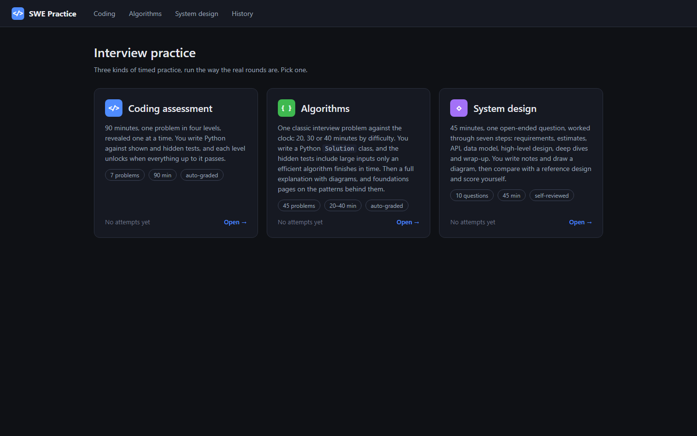

**Coding problems:** start a problem or a random one, or open its question, hints or reference
solution without starting a session.

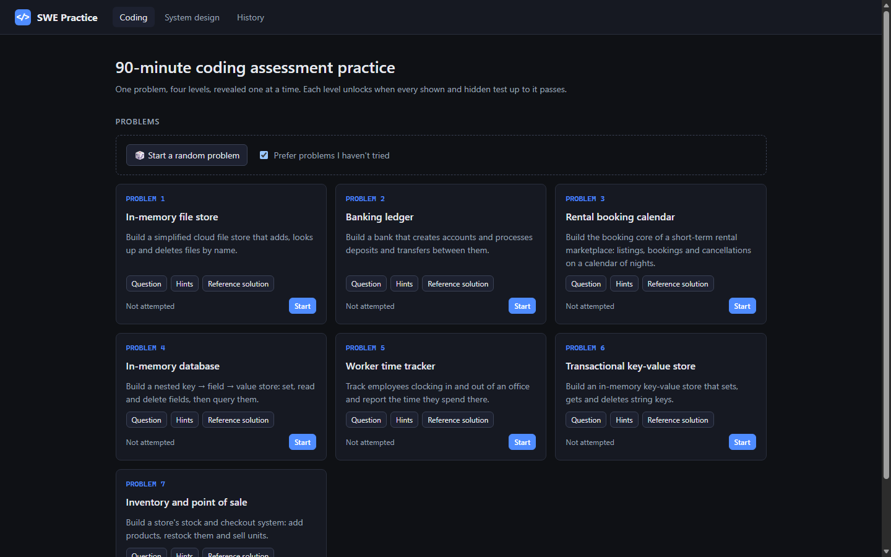

**Run:** shown tests list every call with the expected value, what you returned and your `print()`
output. Here the Level 3 code charges the rate at exit instead of the rate at entry.

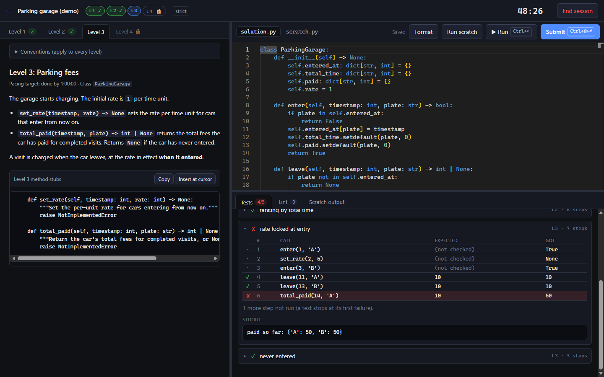

**Submit:** hidden tests run as well but report only counts. When everything passes, the next
level unlocks.

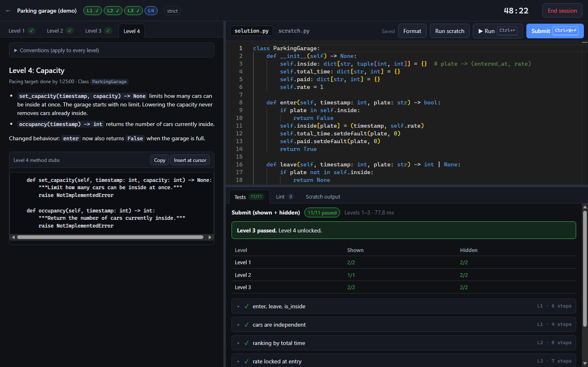

**Review:** the timed result next to the result including overtime, pacing against the targets,
then the analysis, hints, reference solution, your code and a timeline.

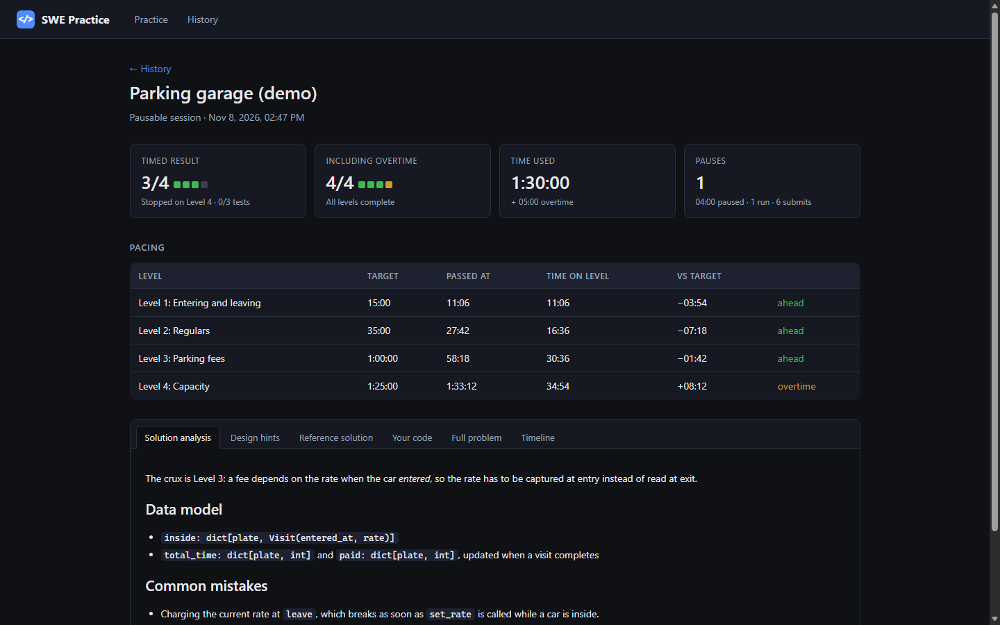

**History:** every attempt, newest first.

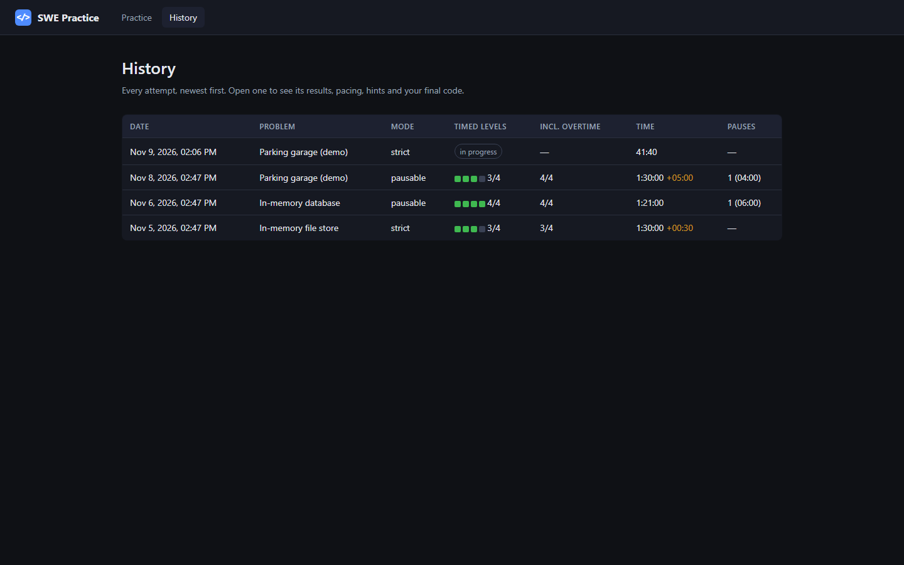

**Algorithms:** the foundations pages, then the problems, filtered by difficulty, pattern or
status. Each card opens the question, hints or solution without starting a session.

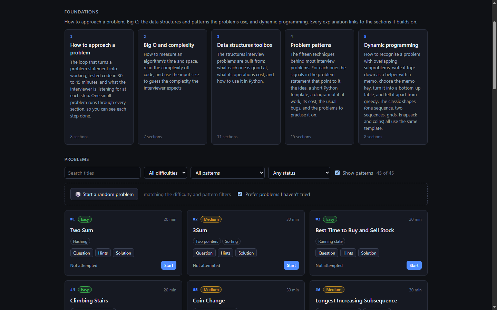

**Algorithms session:** a correct brute force passes the examples, but a large hidden test runs
past its time limit, so the submit stops there.

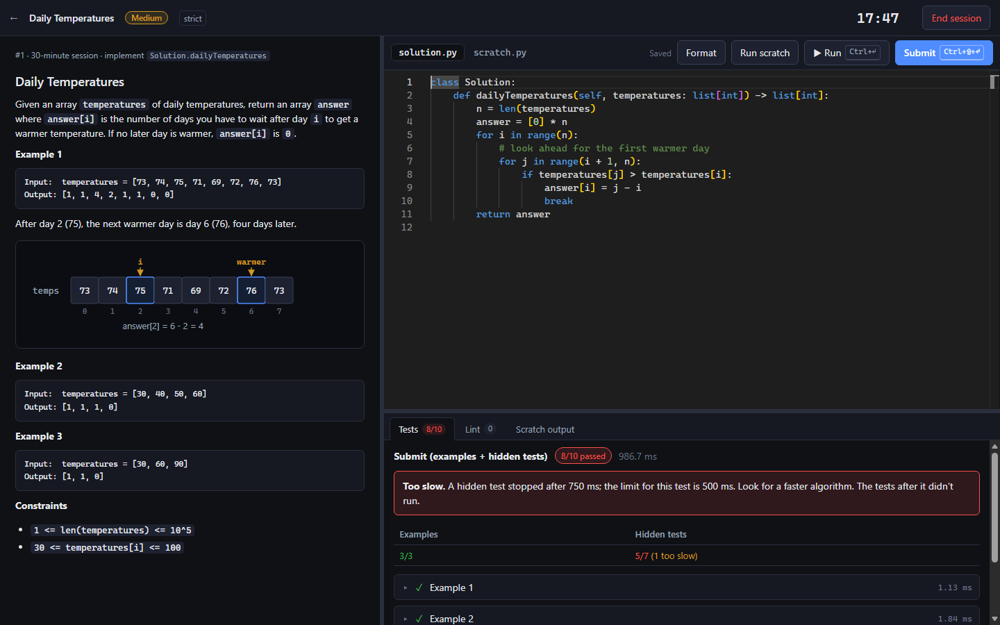

**Algorithms review:** the timed result, links to the foundations sections to study next, then the
explanation with diagrams, hints, reference solution, your code and a timeline.

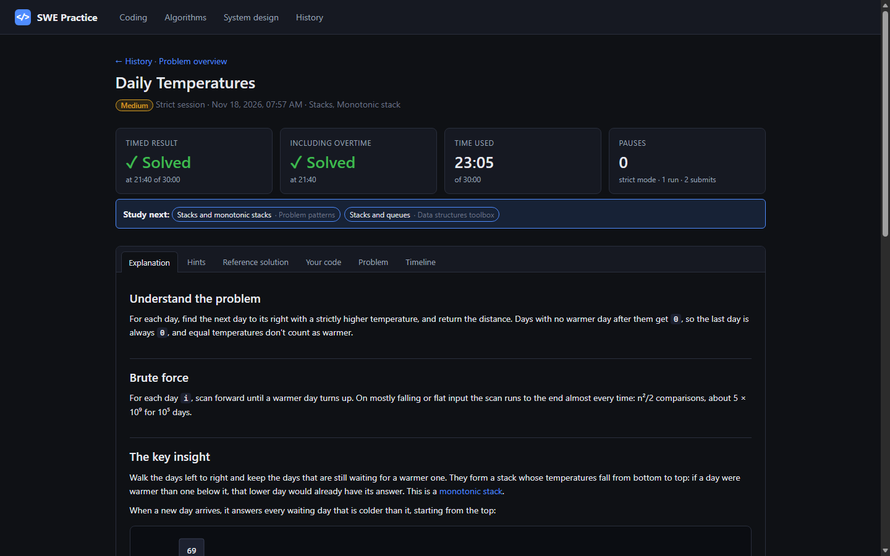

**Foundations page:** sections and subsections on the left; every section can be linked to.
Diagrams like this hash ring are drawn from a few lines of markdown.

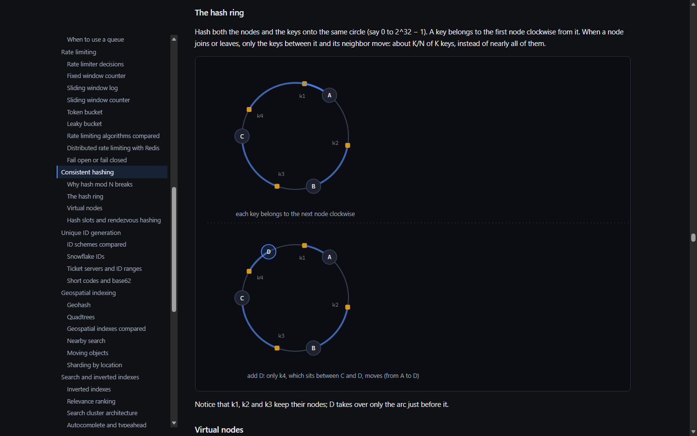

**System design session:** the steps on the left with a clock for each, and your notes and diagram
on the right. Here you're 21 minutes in, drawing the high-level design.

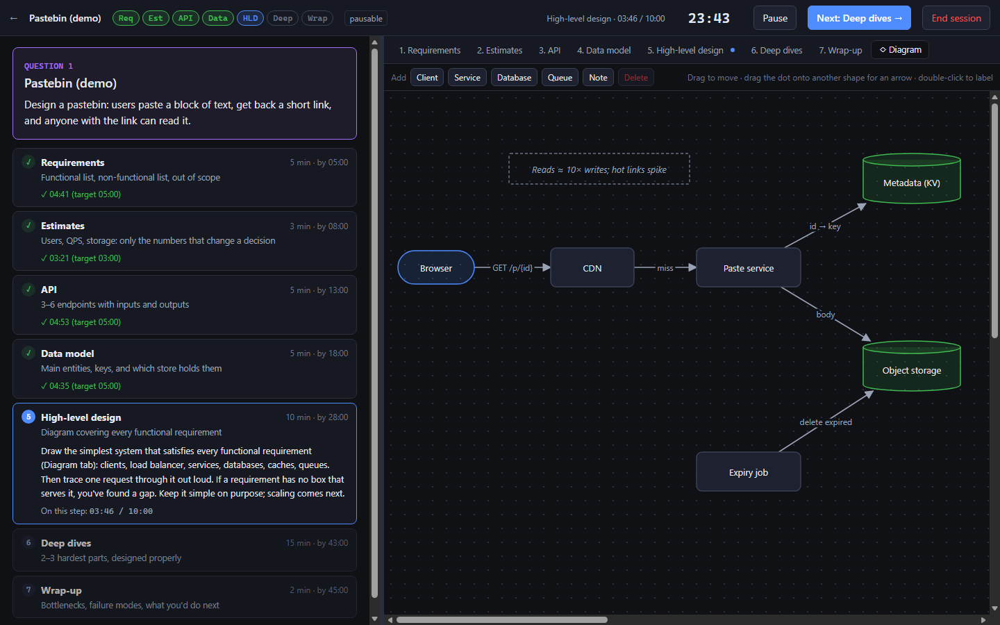

**System design review:** time on each step against its target, then the self-review, your notes
beside the reference design, and your diagram.

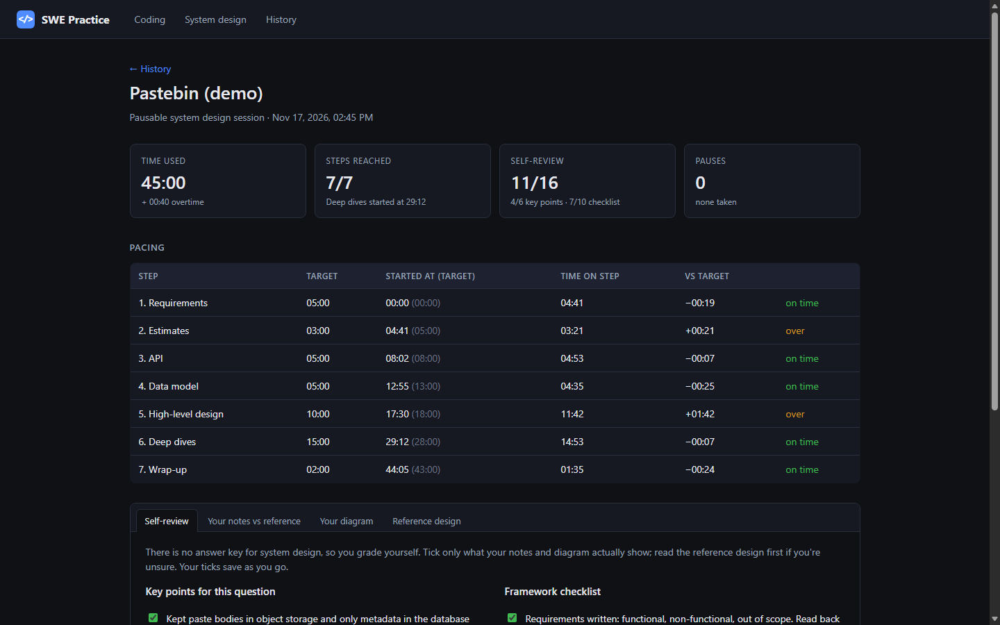

## How a coding session works

- **Pick a problem** or a random one. You can prefer problems you haven't tried yet. Then choose the timer mode:
  - **Strict:** 90 minutes, no pausing. The clock runs on the server, so closing the tab doesn't stop it.
  - **Pausable:** pausing blurs the problem and your code and makes the editor read-only.
    Every pause is recorded in your history.
- **Levels are revealed one at a time.** Level N+1 unlocks when *every* shown and hidden test for
  levels 1..N passes, so a regression in an earlier level blocks the unlock.
- **Run** (`Ctrl+Enter`) runs the shown tests with full detail: each call, the expected value,
  what you returned, your `print()` output and the traceback.
- **Submit** (`Ctrl+Shift+Enter`) also runs the hidden tests. Hidden results are counts only, per level.
- **Lint and format** use [ruff](https://docs.astral.sh/ruff/). Lint runs as you type and on every run,
  with markers in the editor and a Lint tab. It never blocks a level. **Format** (`Shift+Alt+F`)
  reformats your code. The rules are in `swe_prac/user_ruff.toml`.
- **tests.py** is a read-only editor tab with the shown tests of every level you've unlocked, written
  as plain Python (`assert obj.method(...) == expected`). **Run** executes exactly these, and it
  grows when a level unlocks. Hidden tests aren't listed there; **Submit** runs them and reports
  counts only.
- **scratch.py** is another editor tab for quick experiments (`from solution import *`). It starts
  with an example test case, the first shown test of Level 1, plus a small `check(got, expected)`
  helper. Copy it to try your own calls, then press **Run scratch**.
- **At 0:00** your timed score is locked in. You can keep going untimed; anything finished after
  that is marked as overtime.
- **End session** opens the review: timed and overtime results, time to each level against the
  pacing targets (L1 15 min, L2 35, L3 60, L4 85), pauses, a run/submit timeline, design
  hints, solution analysis, the reference solution, your final code and the full problem.

Each problem card on the coding page also has **Question**, **Hints** and **Reference solution**
buttons. They open the full problem, the design hints or the reference solution without starting a
session. On a problem you haven't attempted they ask you to confirm first, and they stay locked
while a session on that problem is running.

Your code runs with the project's Python in a fresh subprocess for every run, with a 10 s limit,
so an infinite loop can't hang the app. It is not a security sandbox: run only your own code.

## How an algorithms session works

- **Pick a problem** or a random one that matches the difficulty and pattern filters. You can
  prefer problems you haven't tried yet. Then choose strict or pausable, as for coding. An
  algorithms session can run alongside a coding or design session; only one of each can be active.
- **The clock** is 20, 30 or 40 minutes by difficulty, and it runs on the server.
- **Run** (`Ctrl+Enter`) runs the examples from the statement with full detail: the input, the
  expected answer, what you returned and your `print()` output.
- **Submit** (`Ctrl+Shift+Enter`) also runs the hidden tests: edge cases first, then large inputs.
  Hidden results are counts only. A large input has a time limit, and the first one your code
  runs past stops the submit and is reported as too slow, so a correct but slow answer doesn't pass.
- **Solved** means one submit passed every test. The first time that happens is recorded; after
  0:00 it counts as overtime. You can keep tidying your code afterwards.
- **scratch.py** starts with a call on the first example. For linked lists, trees and graphs it
  imports helpers that build them from plain lists and print them back. **Run scratch** runs it.
- **Lint and format** work as for coding, except that camelCase method names are allowed, because
  the problems use them. The rules are in `swe_prac/user_ruff_algo.toml`.
- **End session** opens the review: the timed result and the result including overtime, then
  tabs for the explanation, hints, reference solution, your code, the problem and a timeline of
  runs and submits. Links at the top lead to the foundations sections the problem builds on.

Each problem card also has **Question**, **Hints** and **Solution** buttons, and a problem's title
opens its overview page with your past attempts. Explanations and foundations pages link to
problems through that overview, so following a link offers a timed attempt before any spoilers.
As with coding, the study views ask you to confirm first on a problem you haven't attempted, and
they stay locked while a session on that problem is running.

## How a system design session works

- **Pick a question** or a random one, then the timer mode. Strict and pausable work as for coding,
  with a 45-minute clock. A design session can run alongside a coding session; only one of each
  can be active.
- **Seven steps, each with a target:** requirements 5 min, estimates 3, API 5, data model 5,
  high-level design 10, deep dives 15, wrap-up 2. The current step shows its guide and a clock
  against its target. **Next** moves on, and steps only go forward. You can still open any step's
  notes tab, for example to fill a gap you noticed later.
- **Notes:** each step has a tab that starts with a short template (for example functional,
  non-functional and out of scope for requirements). Notes save every few seconds.
- **Diagram:** add clients, services, databases, queues and notes. Drag a shape to move it, drag
  its dot onto another shape to draw an arrow, double-click to label, and press Delete to remove.
- **No spoilers while you work.** The hints, key points and reference design aren't sent to the
  page until the session ends.
- **At 0:00** you can keep going; steps you start after that are marked as overtime.
- **End session** opens the review: time on each step against its target, then tabs for the
  self-review, your notes next to the reference design, your diagram and the reference design.
  The self-review has the question's key points and the framework checklist (ten items). Your
  ticks save as you go and become the score shown in history. The reference design tab starts
  with the hints and the foundations sections to review, grouped by page.

Each question card also has **Hints** and **Reference design** buttons. As with coding, they ask
you to confirm first on a question you haven't attempted, and they stay locked while a session on
that question is running.

History lives in `data/prac.db` (SQLite) with per-session files in `data/sessions/`. Both are
gitignored. Delete `data/` to reset.

## Architecture

**While you practise.** The browser talks JSON to a local FastAPI server. The server owns the
clock, the level gating and your history. It never runs your code itself: each action starts a
fresh Python subprocess.

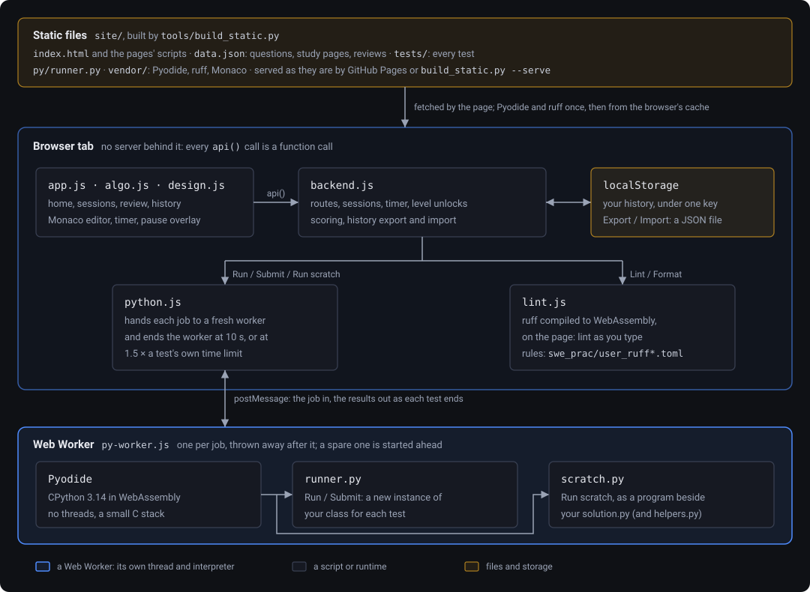

- **Hidden tests stay on the server.** `app.py` keeps full detail only for shown tests. For hidden
  tests it sends back pass counts per level.
- **tests.py and the scratch example are generated, not stored.** `testsource.py` renders them from
  the shown entries in `tests.json`, so every problem gets them and they can never drift from what
  Run executes. Only unlocked levels are rendered, so nothing leaks from later levels.
- **The timer is server-side.** Elapsed time is wall clock minus recorded pauses, so refreshing or
  closing the tab changes nothing.
- **A runaway solution can't hang the app.** `runner.py` writes each result as it finishes, so
  when a run hits the 10 s limit, finished tests keep their results and the test that was running
  is marked as timed out.
- **System design reuses the same clock.** `design_api.py` serves `/api/design/...`, and
  `design_sessions.py` runs the timer, pause and finish code from `sessions.py` against its own
  tables. Questions and the framework are plain files in `designs/`, read by `designs.py`.
- **So do algorithms.** `algo_api.py` serves `/api/algo/...` and `algo_sessions.py` keeps its
  own tables; `algorithms.py` reads `algorithms/<id>/`. Tests are stored as plain lists, and the
  runner gets each problem's options: adapters that build linked lists, trees and graphs before
  the call, an answer comparison that ignores order or calls the problem's own validator, and a
  per-test time limit that stops a submit at the first test that's too slow.
- **Study pages are markdown.** Python-Markdown renders the foundations pages (`pages.py`, which
  also builds their tables of contents and section links), the statements, explanations and
  reference designs. `diagrams.py` draws the data-structure blocks (arrays, trees, linked lists,
  grids, intervals, hash rings) as SVG on the server. Mermaid, bundled in `static/vendor/`, draws
  the flowcharts and sequence and state diagrams in the browser, and is only loaded on pages
  that have one.

**Building problems.** `tools/build_problem.py` turns the spoiler sources in `reference/` into
what the app serves from `problems/`, and checks the hidden tests along the way.
`tools/build_algo.py` does the same for an algorithm problem: it computes the expected answers
with the reference solution, checks them against a brute-force solution on every test and on
random inputs, and runs both the reference and the empty starter code through the real runner.

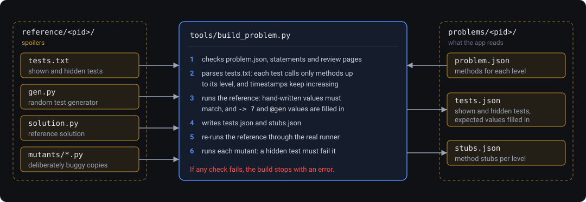

## Layout

```
swe_prac/            the app: FastAPI backend, test runner, static frontend (Monaco and Mermaid
                     are bundled)
problems/<pid>/      what the app reads: statements, review pages, built tests.json and stubs.json
reference/<pid>/     SPOILERS: reference solution, test source, random generator, mutants
algorithms/<id>/     algorithm problems: problem.json, statement.md, test inputs (cases.py) and
                     the built tests.json; SPOILERS: hints.md, explanation.md, solution.py
algorithms/foundations/  the algorithms foundations pages (markdown)
designs/<qid>/       system design questions: design.json (prompt, hints, key points) and
                     reference.md (SPOILER: the reference design)
designs/foundations/ the system design foundations pages (markdown)
designs/framework.*  the seven steps, the self-review checklist and the framework guide
tools/               build_problem.py (compile and verify problems), dsl.py (test format parser),
                     build_algo.py (build and verify algorithm problems), check_content.py
                     (check the study pages' diagrams and links), build_static.py +
                     static_site/ (the GitHub Pages build)
tests/               the app's own test suite (unittest)
docs/                README screenshots, architecture diagrams (SVG, edit them directly) and
                     writing-content.md (how to write study pages and diagrams)
```

The hidden tests are in `problems/<pid>/tests.json` and `algorithms/<id>/tests.json`, the
reference solutions are in `reference/` and `algorithms/<id>/solution.py`, and the reference
designs are in `designs/<qid>/reference.md`. Don't open them before you've practised.

## Developing

```
.venv\Scripts\python -m unittest discover -s tests  # app + every problem end to end
.venv\Scripts\python tools\build_problem.py --all    # rebuild and verify all problems
.venv\Scripts\python tools\build_algo.py --check     # verify every algorithm problem (no writes)
.venv\Scripts\python tools\check_content.py          # diagrams and links in the study pages
.venv\Scripts\python -m ruff check . && .venv\Scripts\python -m ruff format --check swe_prac tools tests algorithms designs
```

`ruff format` also formats the Python code blocks in the study pages' markdown.

`build_problem.py` compiles `reference/<pid>/tests.txt` into `tests.json`. The build fails if any of these checks fail:
- hand-written expectations must match the reference solution
- every test may only call methods from its own level or earlier
- timestamps must increase within each test
- the reference must pass through the real runner
- every deliberately buggy **mutant** in `reference/<pid>/mutants/` must fail at least one hidden test

To add a problem, follow `reference/AUTHORING.md`.

To add an algorithm problem, follow [algorithms/README.md](algorithms/README.md): it covers the
folder layout, linked list, tree and graph arguments, answers in any order, and sizing the large
tests so that a slow solution fails.

To add a system design question, create `designs/<qid>/` with a `design.json` (copy an existing
one: `id` must match the folder name, `number` sets the order and `foundations` lists the
sections to review) and a `reference.md` with the reference design. `tests/test_designs.py`
checks that every question is complete.

To write or edit a foundations page, an explanation or a reference design, see
[docs/writing-content.md](docs/writing-content.md): the markdown, section links, Mermaid and the
data-structure diagram blocks. Then run `tools/check_content.py`.

These environment variables point the app at other directories: `SWE_PRAC_DATA` (history),
`SWE_PRAC_PROBLEMS` (problem set), `SWE_PRAC_REFERENCE` (reference solutions shown on the review
page), `SWE_PRAC_ALGO` (algorithm problems and their foundations pages) and `SWE_PRAC_DESIGNS`
(system design questions, foundations pages and framework). The README screenshots were taken
with them set to throwaway demo sets.
