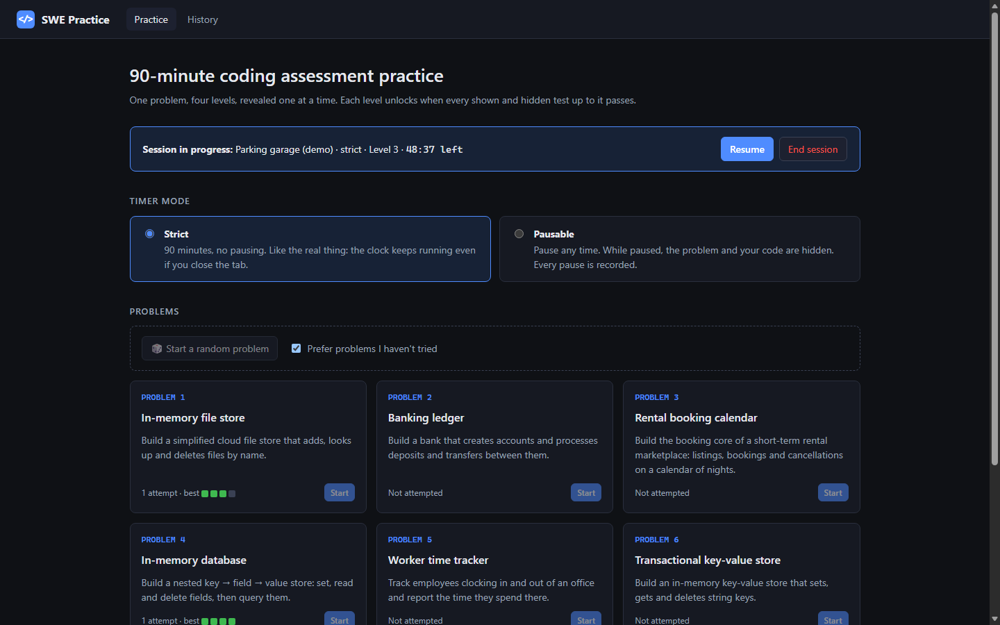
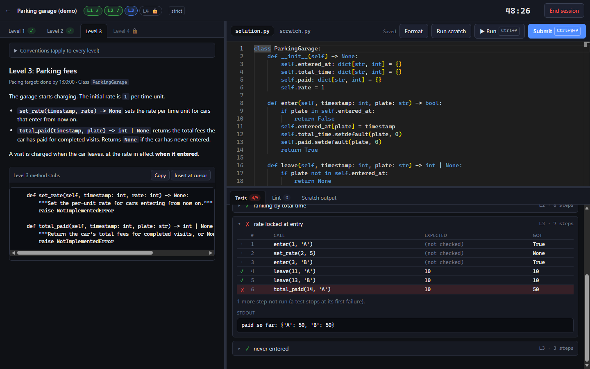
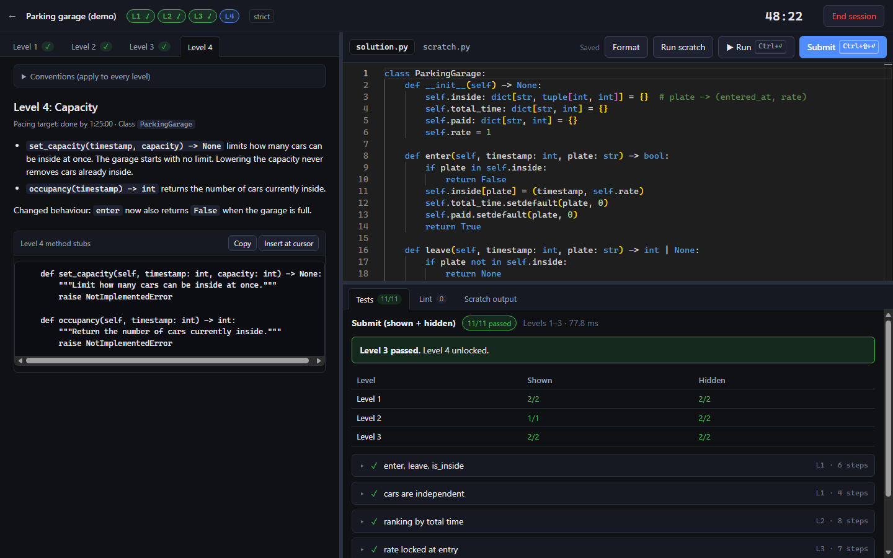
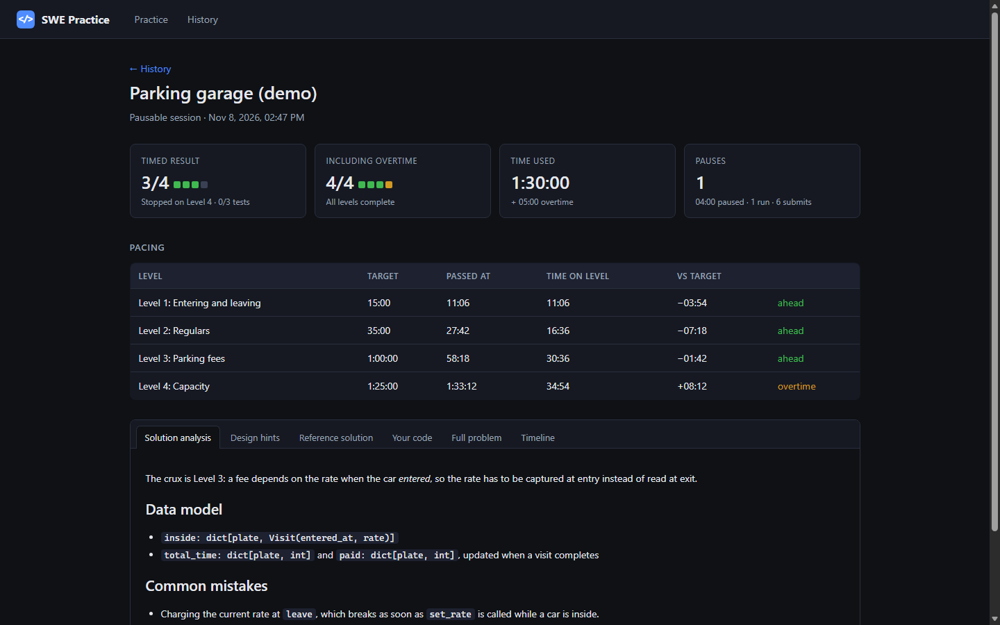
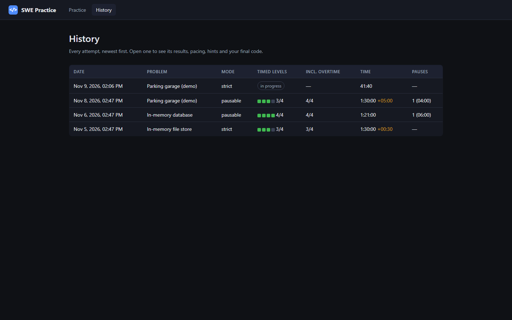
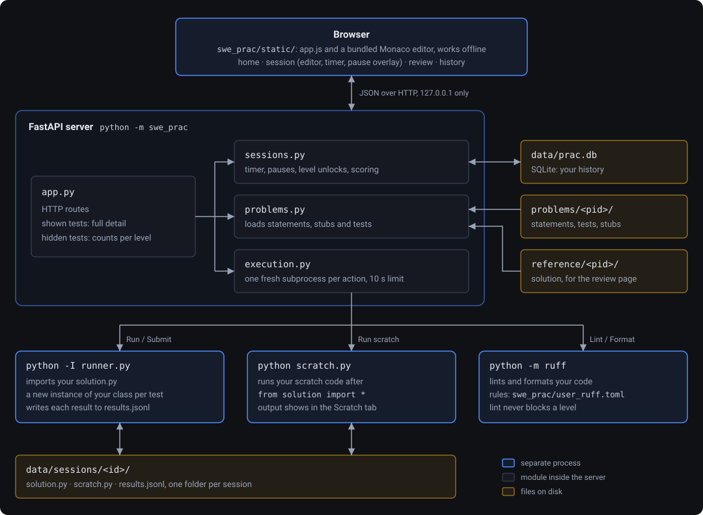
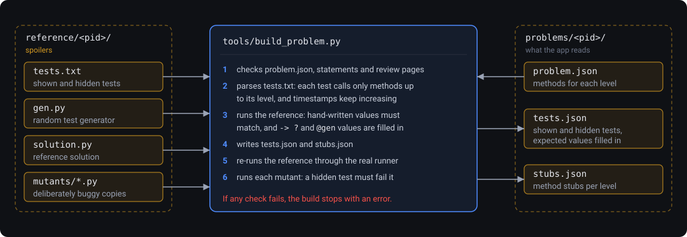

# SWE Practice

Local practice for 90-minute, four-level coding assessments in Python.

## Overview

A common way to screen software engineers is a 90-minute coding assessment. Instead of a set of
separate puzzles, it gives you one realistic task, such as an in-memory database or a bank, split
into four levels. Each level adds requirements to the same class, and you only see a level after
passing the one before it. Pace matters, and so does a design that still holds up when the later
levels arrive.

Practising in a plain editor leaves out most of that pressure: the clock, levels you can't read
ahead, and tests you can't see. This app recreates those conditions on your machine. Afterwards it
shows where your time went against a pacing target for each level.

It comes with seven problems. Each has four levels, shown and hidden tests, hints, a solution
analysis and a reference solution:

- In-memory file store
- Banking ledger
- Rental booking calendar
- In-memory database
- Worker time tracker
- Transactional key-value store
- Inventory and point of sale

To add your own, see [Developing](#developing).

## Start

Double-click `start.bat` in Windows, or run:

```
.venv\Scripts\python -m swe_prac            # opens http://127.0.0.1:8765/
.venv\Scripts\python -m swe_prac --port 9000 --no-browser
```

On first run, `start.bat` creates `.venv` and installs `requirements.txt`. It needs Python 3.12 or newer.
Everything runs on your machine, and the server only listens on 127.0.0.1.

## Screenshots

These screenshots use a small demo problem ("Parking garage") that isn't in the practice set, so
they don't spoil the real problems.

**Home:** pick a problem and a timer mode, or resume the session in progress.



**Run:** shown tests list every call with the expected value, what you returned and your `print()`
output. Here the Level 3 code charges the rate at exit instead of the rate at entry.



**Submit:** hidden tests run as well but report only counts. When everything passes, the next
level unlocks.



**Review:** the timed result next to the result including overtime, pacing against the targets,
then the analysis, hints, reference solution, your code and a timeline.



**History:** every attempt, newest first.



## How a session works

- **Pick a problem** or a random one. You can prefer problems you haven't tried yet. Then choose the timer mode:
  - **Strict:** 90 minutes, no pausing. The clock runs on the server, so closing the tab doesn't stop it.
  - **Pausable:** pausing blurs the problem and your code and makes the editor read-only.
    Every pause is recorded in your history.
- **Levels are revealed one at a time.** Level N+1 unlocks when *every* shown and hidden test for
  levels 1..N passes, so a regression in an earlier level blocks the unlock.
- **Run** (`Ctrl+Enter`) runs the shown tests with full detail: each call, the expected value,
  what you returned, your `print()` output and the traceback.
- **Submit** (`Ctrl+Shift+Enter`) also runs the hidden tests. Hidden results are counts only, per level.
- **Lint and format** use [ruff](https://docs.astral.sh/ruff/). Lint runs as you type and on every run,
  with markers in the editor and a Lint tab. It never blocks a level. **Format** (`Shift+Alt+F`)
  reformats your code. The rules are in `swe_prac/user_ruff.toml`.
- **tests.py** is a read-only editor tab with the shown tests of every level you've unlocked, written
  as plain Python (`assert obj.method(...) == expected`). **Run** executes exactly these, and it
  grows when a level unlocks. Hidden tests aren't listed there; **Submit** runs them and reports
  counts only.
- **scratch.py** is another editor tab for quick experiments (`from solution import *`). It starts
  with an example test case, the first shown test of Level 1, plus a small `check(got, expected)`
  helper. Copy it to try your own calls, then press **Run scratch**.
- **At 0:00** your timed score is locked in. You can keep going untimed; anything finished after
  that is marked as overtime.
- **End session** opens the review: timed and overtime results, time to each level against the
  pacing targets (L1 15 min, L2 35, L3 60, L4 85), pauses, a run/submit timeline, design
  hints, solution analysis, the reference solution, your final code and the full problem.

History lives in `data/prac.db` (SQLite) with per-session files in `data/sessions/`. Both are
gitignored. Delete `data/` to reset.

Your code runs with the project's Python in a fresh subprocess for every run, with a 10 s limit,
so an infinite loop can't hang the app. It is not a security sandbox: run only your own code.

## Architecture

**While you practise.** The browser talks JSON to a local FastAPI server. The server owns the
clock, the level gating and your history. It never runs your code itself: each action starts a
fresh Python subprocess.



- **Hidden tests stay on the server.** `app.py` keeps full detail only for shown tests. For hidden
  tests it sends back pass counts per level.
- **tests.py and the scratch example are generated, not stored.** `testsource.py` renders them from
  the shown entries in `tests.json`, so every problem gets them and they can never drift from what
  Run executes. Only unlocked levels are rendered, so nothing leaks from later levels.
- **The timer is server-side.** Elapsed time is wall clock minus recorded pauses, so refreshing or
  closing the tab changes nothing.
- **A runaway solution can't hang the app.** `runner.py` writes each result as it finishes, so
  when a run hits the 10 s limit, finished tests keep their results and the test that was running
  is marked as timed out.

**Building problems.** `tools/build_problem.py` turns the spoiler sources in `reference/` into
what the app serves from `problems/`, and checks the hidden tests along the way.



## Layout

```
swe_prac/            the app: FastAPI backend, test runner, static frontend (Monaco is bundled)
problems/<pid>/      what the app reads: statements, review pages, built tests.json and stubs.json
reference/<pid>/     SPOILERS: reference solution, test source, random generator, mutants
tools/               build_problem.py (compile and verify problems) and dsl.py (test format parser)
tests/               the app's own test suite (unittest)
docs/                README screenshots and architecture diagrams (SVG, edit them directly)
```

The hidden tests are in `problems/<pid>/tests.json` and the reference solutions are in
`reference/`. Don't open them before you've practised.

## Developing

```
.venv\Scripts\python -m unittest discover -s tests  # app + every problem end to end
.venv\Scripts\python tools\build_problem.py --all    # rebuild and verify all problems
.venv\Scripts\python -m ruff check . && .venv\Scripts\python -m ruff format --check swe_prac tools tests
```

`build_problem.py` compiles `reference/<pid>/tests.txt` into `tests.json`. The build fails if any of these checks fail:
- hand-written expectations must match the reference solution
- every test may only call methods from its own level or earlier
- timestamps must increase within each test
- the reference must pass through the real runner
- every deliberately buggy **mutant** in `reference/<pid>/mutants/` must fail at least one hidden test

To add a problem, follow `reference/AUTHORING.md`.

These environment variables point the app at other directories: `SWE_PRAC_DATA` (history),
`SWE_PRAC_PROBLEMS` (problem set) and `SWE_PRAC_REFERENCE` (reference solutions shown on the review
page). The README screenshots were taken with them set to a throwaway demo set.
