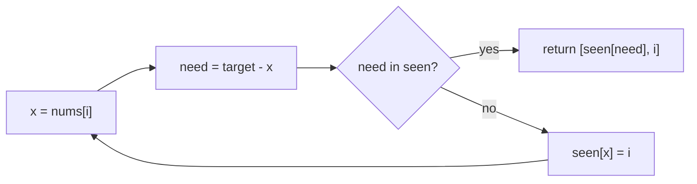

## Understand the problem

We need two different positions `i` and `j` with `nums[i] + nums[j] == target`, and we return
the positions, not the values. A few cases worth saying out loud before coding:

- `[1, 1]`, target `2` → `[0, 1]`: equal values are fine as long as they are different elements.
- `[3, 2, 4]`, target `6` → `[1, 2]`, **not** `[0, 0]`: `3 + 3` would use the same element twice.
- `[-2, 0, 4]`, target `2` → `[0, 2]`: negatives work like any other number.

## Brute force: try every pair

Check each pair once:

```python
for i in range(len(nums)):
    for j in range(i + 1, len(nums)):
        if nums[i] + nums[j] == target:
            return [i, j]
```

That is n(n-1)/2 pairs: **O(n²) time**, O(1) space. With n = 10,000 it's 50 million additions,
seconds in Python. It's still worth stating first: it is obviously correct, and it shows where
the time goes. For every `nums[i]` we scan the rest of the array looking for one specific value.

## A middle step: sort and use two pointers

If the array were sorted, two pointers could walk inwards: when the sum is too small move the left
pointer right, when it's too big move the right pointer left.

```array
label: sorted
values: 2 7 11 15
pointers: lo=0 hi=3
caption: 2 + 15 = 17 > 9, so hi moves left
---
values: 2 7 11 15
pointers: lo=0 hi=2
caption: 2 + 11 = 13 > 9, so hi moves left
---
values: 2 7 11 15
pointers: lo=0 hi=1
highlight: 0 1
caption: 2 + 7 = 9: found
```

That is O(n log n) for the sort plus O(n) for the walk. But sorting moves the elements, and we
must return their *original* indices, so we'd have to sort `(value, index)` pairs. It works, and
it's a good thing to mention, but we can do better. (This is exactly how
[3Sum](#/algo/problem/a02_three_sum) is solved.)

## The key insight: look the partner up

For an element `x`, the only value that completes the pair is `target - x`. So the question for
each element is "have I already seen `target - x`, and where?" A
[hash map](#/algo/learn/data-structures/hash-maps-and-sets) answers that in O(1) on average.

Walk the array once. For each element, first look up its partner among the elements *before* it,
then record the element itself:

```array
label: nums
values: 2 7 11 15
pointers: i=0
caption: need 9 - 2 = 7: not seen yet. Store 2 → 0
---
values: 2 7 11 15
pointers: i=1
highlight: 0 1
caption: need 9 - 7 = 2: seen at index 0. Answer [0, 1]
```



Looking up *before* storing is what stops an element pairing with itself: with `[3, 2, 4]` and
target 6, when we reach the 3 the map is empty, so we never return `[0, 0]`.

Because the map only holds elements to the left of `i`, every pair `(j, i)` with `j < i` is
considered exactly once: when we stand on its right element. So one pass finds the answer.

## The solution

```python
class Solution:
    def twoSum(self, nums: list[int], target: int) -> list[int]:
        seen = {}  # value -> index, for the elements left of i
        for i, x in enumerate(nums):
            need = target - x
            if need in seen:
                return [seen[need], i]
            seen[x] = i
        return []  # not reached: the input always has an answer
```

Duplicates need no special care. With `[3, 3]`, target 6: at index 0 the map is empty, so we
store `3 → 0`; at index 1 we need 3, find it at index 0, and return `[0, 1]`. If a value
appears again later, overwriting its index is harmless: we only ever need *some* earlier
occurrence.

## Complexity

- **Time: O(n).** One pass; each lookup and insert is O(1) on average.
- **Space: O(n).** In the worst case the map holds every element but one.

This is the classic trade: spend O(n) memory to turn an O(n) inner search into an O(1) lookup.
The [hashing pattern](#/algo/learn/patterns/hashing) is the same move in many problems: decide
what you'd search for, and index the data by it.

## Pitfalls and variations

- **Building the whole map first, then searching.** That works only if you also check
  `seen[need] != i`, or `[3, 2, 4]` returns `[0, 0]`. Checking before inserting avoids the bug.
- **Returning values instead of indices**, or sorting `nums` in place and losing the indices.
- **No answer guaranteed?** Say what you'd return (`[]`, or raise) and ask the interviewer.
- **Sorted input** (the "Two Sum II" variant): two pointers give O(1) extra space.
- **Count all pairs, or return all pairs:** keep counts in the map instead of one index.
- **The array doesn't fit in memory:** sort externally and stream with two pointers, or
  partition by hash so each pair lands in the same bucket.
