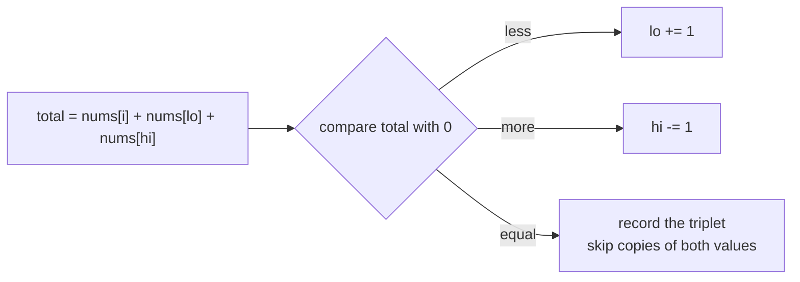

## Understand the problem

We return triplets of **values** (not indices) that add up to 0, each set of three values once.
Two rules pull in different directions, so say both out loud:

- The same *value* may be used twice if it appears twice: `[-1, -1, 2]` is fine when the array
  has two -1s.
- The same *triplet* must not be returned twice: in `[-3, -3, 1, 2]`, `-3 + 1 + 2` can be made
  with either -3, but the answer is just `[[-3, 1, 2]]`.

More cases worth checking:

- Fewer than three numbers → `[]`.
- `[0, 0, 0]` → `[[0, 0, 0]]`, and `[0, 0, 0, 0]` → still one `[0, 0, 0]`.
- All positive (or all negative) → `[]`: three numbers of one sign can't cancel out.

## Brute force: every triple

```python
found = set()
n = len(nums)
for i in range(n):
    for j in range(i + 1, n):
        for k in range(j + 1, n):
            if nums[i] + nums[j] + nums[k] == 0:
                found.add(tuple(sorted((nums[i], nums[j], nums[k]))))
return [list(t) for t in found]
```

Sorting each triplet before adding it is what removes the repeats: `(0, -1, 1)` and `(-1, 0, 1)`
both become the key `(-1, 0, 1)`. That's n(n-1)(n-2)/6 triples: **O(n³) time**. For n = 3000
it's 4.5 billion, hopeless in Python.

## A step up: fix one number, then it's Two Sum

Fix `nums[i]`. We need two later numbers that add up to `-nums[i]`, which is exactly
[Two Sum](#/algo/problem/a01_two_sum): walk the rest of the array with a set of the values seen.

```python
found = set()
for i in range(len(nums)):
    seen = set()
    for j in range(i + 1, len(nums)):
        need = -nums[i] - nums[j]
        if need in seen:
            found.add(tuple(sorted((nums[i], nums[j], need))))
        seen.add(nums[j])
return [list(t) for t in found]
```

That's **O(n²) time**, and a correct answer to give. The repeats are still handled clumsily (the
set of sorted tuples), and every `i` builds its own O(n) set. Sorting the array gives a cleaner
way to do both.

## The key insight: sort, then walk two pointers inwards

Once the array is sorted, the pair search needs no set. For a fixed `i`, put `lo` just after `i`
and `hi` at the end, and look at `total = nums[i] + nums[lo] + nums[hi]`:



Why moving a pointer never loses an answer: if the total is too small, then `nums[lo]` is too
small even with the largest value still in range, `nums[hi]`. Every other partner is smaller, so
no answer uses `nums[lo]` with this `i`, and `lo` can go. If the total is too big, the same
argument rules out `nums[hi]`. Each step discards one value, so one `i` costs O(n) steps. This is
the [two pointers](#/algo/learn/patterns/two-pointers) pattern.

Example 1 sorted is `[-4, -1, -1, 0, 1, 2]`:

```array
label: sorted
values: -4 -1 -1 0 1 2
pointers: i=0 lo=1 hi=5
caption: -4 - 1 + 2 = -3 < 0: too small, so lo moves right
---
label: sorted
values: -4 -1 -1 0 1 2
pointers: i=0 lo=4 hi=5
caption: -4 + 1 + 2 = -1 < 0: lo meets hi, no triplet starts with -4
---
label: sorted
values: -4 -1 -1 0 1 2
pointers: i=1 lo=2 hi=5
highlight: 1 2 5
caption: -1 - 1 + 2 = 0: record [-1, -1, 2], then move both
---
label: sorted
values: -4 -1 -1 0 1 2
pointers: i=1 lo=3 hi=4
highlight: 1 3 4
caption: -1 + 0 + 1 = 0: record [-1, 0, 1]
---
label: sorted
values: -4 -1 -1 0 1 2
pointers: i=2
dim: 2
caption: nums[2] == nums[1]: anything it finds was already found, skip
```

At `i = 3` the smallest total is `0 + 1 + 2 = 3 > 0`, and the loop ends. Answer:
`[[-1, -1, 2], [-1, 0, 1]]`.

## Skipping repeats

Sorting puts equal values side by side, so a repeat is always a copy of the value next to it.
They can come from two places.

**The first number.** If `nums[i] == nums[i - 1]`, every pair available to `i` was also available
to `i - 1`, so skip `i`. Skip the *later* copies and keep the *first*, and let the pair search
include the copies after it:

```array
label: sorted
values: -3 -3 6
pointers: i=0 lo=1 hi=2
highlight: 0..2
caption: the first -3 is nums[i], and the second can still be nums[lo]
```

Skipping to the last copy instead, or leaving the copies out of the pair search, loses
`[-3, -3, 6]`.

**The pair.** After recording a triplet, move `lo` past every copy of its value and `hi` past
every copy of its value. Otherwise the next step finds the same triplet again:

```array
label: sorted
values: -2 0 0 2 2
pointers: i=0 lo=1 hi=4
highlight: 0 1 4
caption: -2 + 0 + 2 = 0: record [-2, 0, 2]
---
label: sorted
values: -2 0 0 2 2
pointers: i=0 lo=3 hi=3
dim: 1 2 4
caption: lo skips both 0s and hi both 2s: no second [-2, 0, 2]
```

## The solution

```python
class Solution:
    def threeSum(self, nums: list[int]) -> list[list[int]]:
        nums = sorted(nums)  # a sorted copy; the caller's list is untouched
        n = len(nums)
        triplets = []
        for i in range(n - 2):
            if nums[i] > 0:
                break  # the smallest of the three is positive: no total can be 0
            if i > 0 and nums[i] == nums[i - 1]:
                continue  # same first value as before: same triplets
            lo, hi = i + 1, n - 1
            while lo < hi:
                total = nums[i] + nums[lo] + nums[hi]
                if total < 0:
                    lo += 1
                elif total > 0:
                    hi -= 1
                else:
                    triplets.append([nums[i], nums[lo], nums[hi]])
                    low_value, high_value = nums[lo], nums[hi]
                    while lo < hi and nums[lo] == low_value:
                        lo += 1
                    while lo < hi and nums[hi] == high_value:
                        hi -= 1
        return triplets
```

`range(n - 2)` leaves room for `lo` and `hi`, and is empty when there are fewer than three
numbers, so `[]` and `[1, -1]` return `[]` without a special case. The early `break` is an
optimization, not a requirement: once `nums[i] > 0`, `nums[lo]` and `nums[hi]` are positive too.

## Complexity

- **Time: O(n²).** Sorting is O(n log n). For each `i`, `lo` only moves right and `hi` only moves
  left, the skip loops included, so the walk is O(n). n walks make O(n²), which dominates the sort.
- **Space: O(n)** for the sorted copy (sorting in place would avoid it but change the caller's
  list), plus the output. The pointers themselves are O(1).

No one knows an algorithm that is fundamentally faster than O(n²) for this problem; it's a famous
open question in complexity theory. And the output alone can hold on the order of n² triplets.

## Pitfalls and variations

- **Not moving a pointer after a match.** If neither `lo` nor `hi` changes, the loop never ends.
- **Repeated triplets**: forgetting to skip a repeated first value, or the copies after a match.
- **Skipping too much**: skipping copies *before* using the value, or the last copy instead of
  the first, loses triplets like `[-1, -1, 2]` and `[-3, -3, 6]`.
- **Returning indices**: sorting moved the elements; the problem wants values.
- **Any target, not just 0**: compare `total` with `target`, and the early exit becomes
  `3 * nums[i] > target` (the smallest possible total).
- **3Sum Closest**: the same walk, tracking the total nearest the target.
- **Count the triples with a total below a target**: when `total < target` at `(lo, hi)`, every
  `hi'` in `lo + 1..hi` also works, so add `hi - lo` and move `lo`.
- **4Sum and k-Sum**: fix one more number per level and recurse down to this two-pointer search:
  O(n^(k-1)).
- **Sorted input, two numbers** (the "Two Sum II" variant): the pointer walk alone, O(n) time
  and O(1) space.
