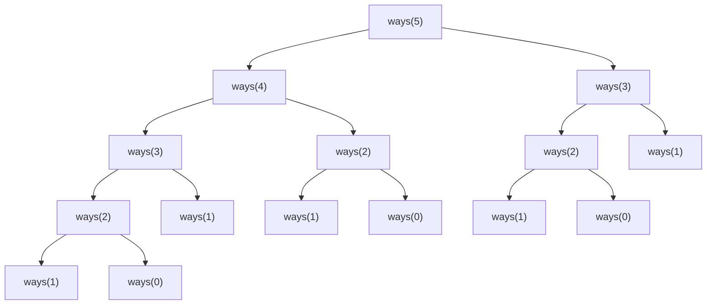
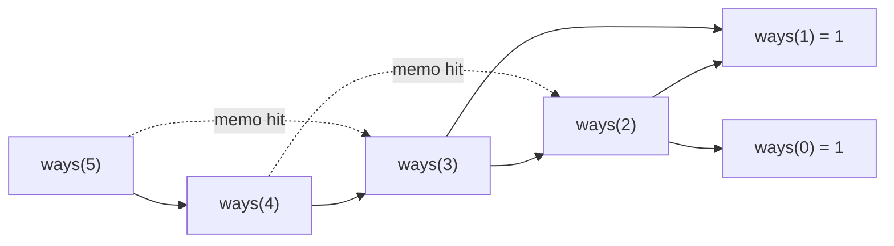

## Understand the problem

A way to climb is a sequence of moves, each 1 or 2, that adds up to exactly `n`. Order matters:
`1 + 2` and `2 + 1` are two different ways. Listing the small cases is the fastest way to see
the shape of the problem:

| `n` | Ways | The sequences |
|---|---|---|
| 1 | 1 | `1` |
| 2 | 2 | `1+1`, `2` |
| 3 | 3 | `1+1+1`, `1+2`, `2+1` |
| 4 | 5 | `1+1+1+1`, `1+1+2`, `1+2+1`, `2+1+1`, `2+2` |
| 5 | 8 | the 5 ways to reach 4, each plus a final `1`, and the 3 ways to reach 3, each plus a final `2` |

The counts 1, 2, 3, 5, 8 are the Fibonacci numbers. The last row already hints at why. It's
better to derive that than to recognise it, because the derivation is what carries over to
harder problems.

## Brute force: try both moves, recursively

Think about the **last move**. To stand on step `n`, you were either on step `n - 1` and took a
1-step, or on step `n - 2` and took a 2-step. Every way falls in exactly one of the two groups
(their last moves differ), and each group is the ways to reach a lower step, with that last move
added. So:

```
ways(n) = ways(n - 1) + ways(n - 2)
```

This is a "count the ways" recursion, so the choices are **added**, and a finished way counts 1
(see [the helper plus memo template](#/algo/learn/dynamic-programming/top-down-helper-plus-memo)).
The base cases:

- `ways(1) = 1`: a single 1-step.
- `ways(0) = 1`: you're already at the top, and taking no more moves is one complete way.

> **Pitfall.** It's tempting to say "zero stairs, zero ways". But then
> `ways(2) = ways(1) + ways(0)` comes out as 1 instead of 2, and you need an extra base case for
> `n = 2` to patch it. When counting ways, reaching the goal returns 1 and a dead end returns 0.

```python
def ways(n: int) -> int:
    if n <= 1:
        return 1  # ways(0): already at the top. ways(1): one 1-step.
    return ways(n - 1) + ways(n - 2)
```

It's correct, but look at the calls it makes for `n = 5`. The highlighted calls repeat work that
was already done elsewhere in the tree: the whole `ways(3)` subtree is computed twice.



Each call makes two more, so the tree almost doubles with every level: **O(2^n) time** (more
precisely about 1.6^n, the growth rate of the Fibonacci numbers; see
[recursion complexity](#/algo/learn/complexity/recursion)). For `n = 45` that's about 3.7 billion
calls, far too slow.

## The key insight: there are only n + 1 different questions

However big the tree gets, every call is `ways(k)` for some `k` between 0 and `n`. So there are
only `n + 1` different subproblems, and the tree asks most of them over and over. Store each
answer the first time it's computed (memoization) and the tree collapses into a chain: each
`ways(k)` is computed once, and every repeat becomes a lookup.



The memo key is just `n`: knowing which stair you're counting from is all you need to know
([choosing the memo key](#/algo/learn/dynamic-programming/choosing-the-memo-key)). In the usual
helper plus memo shape:

```python
class Solution:
    def climbStairs(self, n: int) -> int:
        return self.ways(n, {})

    def ways(self, n: int, memo: dict[int, int]) -> int:
        if n <= 1:
            return 1
        if n in memo:
            return memo[n]  # computed before: reuse it
        memo[n] = self.ways(n - 1, memo) + self.ways(n - 2, memo)
        return memo[n]
```

The runtime is roughly (number of keys) × (work per call) = (n + 1) × O(1) = **O(n)**.

## Bottom-up: fill the table from the ground

The memo is filled from small `n` to large anyway, so we can fill it in that order directly, in
an array, with no recursion ([bottom-up tables](#/algo/learn/dynamic-programming/bottom-up-tables)).
`dp[i]` is the number of ways to reach stair `i`:

```array
label: dp
values: 1 1 _ _ _ _
highlight: 0 1
caption: base cases: dp[0] = 1 and dp[1] = 1
---
label: dp
values: 1 1 2 _ _ _
pointers: i=2
highlight: 0 1
caption: dp[2] = dp[1] + dp[0] = 2
---
label: dp
values: 1 1 2 3 _ _
pointers: i=3
highlight: 1 2
caption: dp[3] = dp[2] + dp[1] = 3
---
label: dp
values: 1 1 2 3 5 _
pointers: i=4
highlight: 2 3
caption: dp[4] = dp[3] + dp[2] = 5
---
label: dp
values: 1 1 2 3 5 8
pointers: i=5
highlight: 3 4
caption: dp[5] = dp[4] + dp[3] = 8, the answer for n = 5
```

```python
dp = [1] * (n + 1)  # dp[0] = dp[1] = 1; the rest are overwritten
for i in range(2, n + 1):
    dp[i] = dp[i - 1] + dp[i - 2]
return dp[n]
```

## The solution: keep only two numbers

Look at the table again: computing `dp[i]` reads only the two cells just before it. Everything
further back is never read again.

```array
label: dp
values: 1 1 2 3 5 8
pointers: before=3 current=4
dim: 0 1 2
caption: dp[5] needs only dp[3] and dp[4]; the dimmed cells aren't read again
```

So two variables that slide up the staircase are enough:

```python
class Solution:
    def climbStairs(self, n: int) -> int:
        before, current = 1, 1  # ways(0), ways(1)
        for _ in range(2, n + 1):
            # The new current is ways(i) = ways(i - 1) + ways(i - 2).
            before, current = current, before + current
        return current
```

For `n = 1` the loop doesn't run and the answer is `current = 1`. The tuple assignment matters:
both right-hand values are read before either variable changes, so no temporary is needed.

## Complexity

| Approach | Time | Space |
|---|---|---|
| Plain recursion | O(2^n) (about 1.6^n) | O(n) call stack |
| Top-down with a memo | O(n) | O(n) memo + O(n) call stack |
| Bottom-up table | O(n) | O(n) |
| Two variables | O(n) | O(1) |

All the fast versions do O(1) work per stair. The answer itself grows like 1.6^n: `ways(45)` is
1,836,311,903, which is why `n` stops at 45 (it still fits in a signed 32-bit integer; Python's
integers never overflow).

## Pitfalls and variations

- **`ways(0) = 0`.** See the pitfall above: it breaks the recurrence and forces a special case
  for `n = 2`.
- **Recursion without a memo.** It passes small tests and then takes seconds at `n = 35` and
  many minutes at `n = 45`. Say the O(2^n) out loud before you code it, then add the memo.
- **Python's recursion limit** is about 1,000 calls deep. That's fine here, but a top-down
  version of a similar problem with `n = 10^4` would crash; the bottom-up loop never does.
- **Steps of 1, 2 or 3** (or 1 to `k`): add the previous three (or `k`) values. With an arbitrary
  list of step sizes this is exactly [Permutation Sum](#/algo/problem/a20_permutation_sum).
- **Minimum cost to climb** (each stair has a cost): the same table with `min` instead of `+`.
  Counting adds the choices; optimizing keeps the best one.
- **Some stairs are broken**: set `dp[i] = 0` for a broken stair, and the recurrence routes
  around it. The same structure counts the ways to decode a digit string in
  [Decode Ways](#/algo/problem/a34_decode_ways), where some "moves" are invalid.
- **Huge `n`, answer modulo 10^9 + 7**: the two-variable loop still works in O(n). For O(log n),
  raise the matrix `[[1, 1], [1, 0]]` to the n-th power by repeated squaring.
