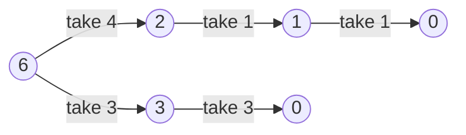
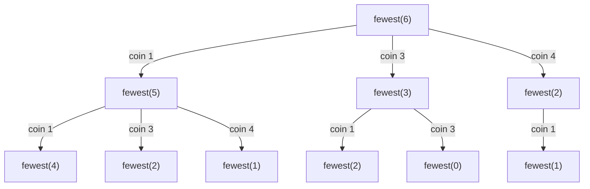

## Understand the problem

We need the size of the smallest pile of coins that adds up to exactly `amount`, using each coin
value as many times as we like. Only the count is returned, not the coins. Some cases to work
through before coding:

| `coins` | `amount` | Answer | Why |
|---|---|---|---|
| `[1, 2, 5]` | 11 | 3 | `5 + 5 + 1` |
| `[2]` | 3 | -1 | only even amounts can be made |
| `[1]` | 0 | 0 | nothing to pay, no coins |
| `[1, 3, 4]` | 6 | 2 | `3 + 3`, not `4 + 1 + 1` |
| `[2, 5]` | 6 | 3 | `2 + 2 + 2`; a 5 leaves 1, which can't be paid |

## Why the biggest coin first doesn't work

The first idea is what a cashier does: take the biggest coin that fits, subtract it, repeat. It is
fast and feels right, and it *is* right for everyday coins like 1, 5, 10 and 25. But try it on
the last two rows of the table:



With `[1, 3, 4]`, greedy goes along the top: 4, 1, 1, three coins, while 3 + 3 needs two. With
`[2, 5]` it's worse: greedy takes the 5, is left with 1, and wrongly reports -1, although
2 + 2 + 2 works. One small counterexample is enough to rule greedy out
([greedy or DP](#/algo/learn/dynamic-programming/greedy-or-dp)): a coin can leave a remainder
that is expensive or impossible, so we have to try every coin.

## Brute force: try every coin at every step

If the first coin is `c`, what's left is the same problem for `amount - c`. Try each coin, and
keep the best:

```
fewest(0) = 0
fewest(a) = 1 + min(fewest(a - c) for each coin c <= a)
```

This is an "optimize" recursion: the base case returns 0 when nothing is left to solve, and a
dead end needs a value that can never win the `min`. Infinity does that.

```python
import math


def fewest(a: int) -> float:
    if a == 0:
        return 0  # nothing left to pay
    best = math.inf  # "impossible" until some coin works
    for c in coins:
        if c <= a:
            best = min(best, 1 + fewest(a - c))
    return best


answer = fewest(amount)  # -1 if it is still infinity
```

Here are the first three levels of calls for `coins = [1, 3, 4]`, `amount = 6`. The highlighted
calls are amounts that come up more than once: `fewest(2)` three times and `fewest(1)` twice
already, and each repeat re-explores its whole subtree.



Every call branches into up to `k = len(coins)` calls, and the paths are as long as
`amount / smallest coin`, so the tree has up to about `k^(amount / smallest coin)` nodes:
exponential. With an amount of 10,000 it never finishes.

## The key insight: only the amount left matters

Ask the memo question: partway through, what do I need to know about the past to finish? Only how
much is left to pay. Which coins got us here doesn't matter, and every coin is still available.
So the memo key is the remaining amount
([choosing the memo key](#/algo/learn/dynamic-programming/choosing-the-memo-key)), and there are
only `amount + 1` different questions: `fewest(0)` to `fewest(amount)`.

In the [helper plus memo](#/algo/learn/dynamic-programming/top-down-helper-plus-memo) shape:

```python
import math


class Solution:
    def coinChange(self, coins: list[int], amount: int) -> int:
        best = self.fewest(coins, amount, {})
        return -1 if best == math.inf else best

    def fewest(self, coins: list[int], left: int, memo: dict[int, float]) -> float:
        if left == 0:
            return 0
        if left in memo:
            return memo[left]
        best = math.inf
        for c in coins:
            if c <= left:
                best = min(best, 1 + self.fewest(coins, left - c, memo))
        memo[left] = best  # store impossible amounts (infinity) too
        return best
```

Each of the `amount + 1` keys is computed once, and each tries `k` coins:
**O(k × amount)** time.

> **Pitfall.** Cache the failures too. If only successful amounts are stored, an impossible
> amount such as 9,999 with coins `[7, 14, 21]` is re-explored from scratch every time it comes
> up, and the solution is exponential again.

> **Key idea.** Keep "impossible" as infinity inside the recursion and convert it to -1 only at
> the very end. If -1 is stored, `min` happily picks it as the best answer, and every comparison
> needs a special case.

The recursion can also go `amount / smallest coin` calls deep: 10,000 with a 1-coin. That's past
Python's default recursion limit of 1,000, so a top-down solution must raise the limit
(`sys.setrecursionlimit`). The bottom-up version below has no recursion at all.

## Bottom-up: fill the table from 0 upwards

Every `fewest(a)` needs only smaller amounts, so compute them in increasing order in an array
([bottom-up tables](#/algo/learn/dynamic-programming/bottom-up-tables)). `dp[a]` is the fewest
coins that make `a`, with infinity for "not possible (yet)". For `coins = [1, 2, 5]`:

```array
label: dp
values: 0 ∞ ∞ ∞ ∞ ∞ ∞ ∞ ∞ ∞ ∞ ∞
highlight: 0
caption: dp[0] = 0; every other amount starts as ∞
---
label: dp
values: 0 1 1 2 2 ∞ ∞ ∞ ∞ ∞ ∞ ∞
pointers: a=5
highlight: 4 3 0
caption: dp[5] = 1 + min(dp[4], dp[3], dp[0]) = 1 + min(2, 2, 0) = 1
---
label: dp
values: 0 1 1 2 2 1 2 2 3 3 2 ∞
pointers: a=11
highlight: 10 9 6
caption: dp[11] = 1 + min(dp[10], dp[9], dp[6]) = 1 + min(2, 3, 2) = 3
---
label: dp
values: 0 1 1 2 2 1 2 2 3 3 2 3
highlight: 11 6 1 0
caption: to list the coins, walk back: 11 → 6 (a 5) → 1 (a 5) → 0 (a 1)
```

The candidates for `dp[a]` are the cells one coin back: `a - 1`, `a - 2` and `a - 5`. When none
of them is reachable, `dp[a]` stays infinity, which is how `coins = [2]`, `amount = 3` ends up
as -1:

```array
label: dp
values: 0 ∞ 1 ∞
highlight: 3
caption: dp[3] needs dp[1], which is ∞: amount 3 is impossible, return -1
```

The two loops can also be swapped: allow one coin value at a time, and improve every amount with
it. After the last coin, the row matches the table above, because for a minimum the order of the
loops doesn't matter:

```grid
collabels: 0 1 2 3 4 5 6 7 8 9 10 11
rowlabels: {1} {1,2} {1,2,5}
0 1 2 3 4 5 6 7 8 9 10 11
0 1 1 2 2 3 3 4 4 5 5 6
0 1 1 2 2 1 2 2 3 3 2 3
highlight: 2,11
caption: each row allows one more coin; the bottom-right cell is the answer
```

That row-by-row view is the [knapsack](#/algo/learn/dynamic-programming/knapsack-and-coin-problems)
way of looking at coin problems. For *counting* ways, the loop order does matter; see the
variations below.

## The solution

```solution
```

Why it's correct: any way to pay `a` ends with some coin `c`, and the coins before it pay
`a - c`. The loop tries every possible last coin, and `fewest[a - c]` is already final because
`a - c < a`. So by induction every cell holds the true minimum, and infinity exactly when no
combination exists.

## Complexity

- **Time: O(k × amount)**, where `k = len(coins)`: each amount tries every coin once. At the
  limits that's 12 × 10,000 = 120,000 steps.
- **Space: O(amount)** for the table. The top-down version also uses O(amount) for the memo,
  plus up to O(amount) call-stack depth.

## Pitfalls and variations

- **Greedy.** Biggest-coin-first is wrong for coins like `[1, 3, 4]` and gets stuck on `[2, 5]`.
  If you propose it, test it on a small case first.
- **Negative indexes.** In Python, `dp[a - c]` with `c > a` doesn't fail: it silently reads a
  cell from the *end* of the list. Always check `c <= a`.
- **amount = 0** is 0 coins, not -1.
- **Huge coins** (up to 2^31 - 1) are fine in Python. In languages with fixed-size integers,
  `INT_MAX + 1` overflows; use `amount + 1` as "infinity" instead, since no answer can need more
  than `amount` coins.
- **Count the combinations** (how many ways to make the amount, ignoring order): add instead of
  taking the min, start from `dp[0] = 1`, and loop over the coins on the *outside* so each
  combination is counted once. With the amount loop outside you count ordered sequences instead,
  which is [Permutation Sum](#/algo/problem/a20_permutation_sum).
- **Return the coins**: remember which coin set each `dp[a]`, then walk back from `amount` as in
  the last diagram.
- **Breadth-first search** works too: amounts are nodes, each coin is an edge `a → a - c`, and the
  fewest coins is the shortest path from `amount` to 0. Same worst case, but it can stop as soon
  as it reaches 0.
- **Each coin at most once** (a 0/1 knapsack): the remaining amount is no longer enough to
  describe the state, because you must also know which coins are used up. The state becomes
  (coin index, amount left).
