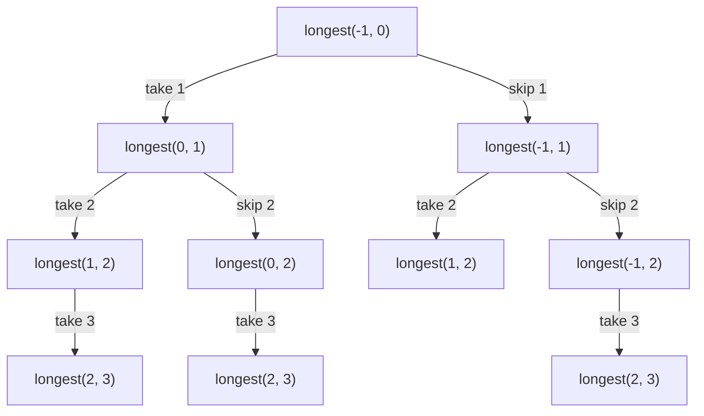

## Understand the problem

A subsequence keeps elements in their original order but may skip any of them; it doesn't have to
be contiguous. We want the longest one in which every element is strictly larger than the one
before.

| `nums` | Answer | One longest |
|---|---|---|
| `[10, 9, 2, 5, 3, 7, 101, 18]` | 4 | `2, 3, 7, 101` |
| `[0, 1, 0, 3, 2, 3]` | 4 | `0, 1, 2, 3` |
| `[1, 2, 3, 0, 5]` | 4 | `1, 2, 3, 5`: skip the 0 |
| `[5, 4, 3, 2, 1]` | 1 | any single element |
| `[7, 7, 7, 7]` | 1 | `7`: equal values aren't increasing |

Note the last two rows. A decreasing array still has increasing subsequences: every single
element is one, so for a non-empty array the answer is always at least 1.

## Brute force: take or skip each element

Each element is either in the subsequence or not, so there are 2^n subsequences. Checking them
all is O(n · 2^n). As a recursion, walk the array and decide for each element. Whether
`nums[i]` may be taken depends on the last element taken, so the recursion has to carry it
along as `prev`:

```python
def longest(prev: int, i: int) -> int:
    # The longest increasing subsequence of nums[i:] whose elements are all larger than
    # nums[prev] (prev = -1 means nothing has been taken yet).
    if i == len(nums):
        return 0
    skip = longest(prev, i + 1)
    take = 0
    if prev == -1 or nums[prev] < nums[i]:
        take = 1 + longest(i, i + 1)
    return max(skip, take)


answer = longest(-1, 0)
```

Here are the calls for `nums = [1, 2, 3]` (leaving out the ones that skip the 3). "Take 1, take
2" and "skip 1, take 2" both arrive at `longest(1, 2)`: the last element taken is the 2 at index
1, and index 2 is next. From there the two paths have exactly the same future, so the work is
done twice. The highlighted states each appear more than once.



Memoizing on the pair `(prev, i)` fixes the repetition: about n²/2 states, O(1) work each, so
O(n²) time. But it also stores O(n²) entries: about 3 million for 2,500 numbers. Asking a
slightly different question needs only one index as the key
([choosing the memo key](#/algo/learn/dynamic-programming/choosing-the-memo-key)).

## A better key: the subsequence that ends at i

Ask, for every index `i`: **what is the longest increasing subsequence that ends exactly at
`nums[i]`?** Call it `ending[i]`. If that subsequence has more than one element, the element
before `nums[i]` is some `nums[j]` with `j < i` and `nums[j] < nums[i]`, and the part ending at
`j` should be as long as possible, which is `ending[j]`. So:

```
ending[i] = 1 + max(ending[j] for j < i if nums[j] < nums[i])    (1 if there is no such j)
answer    = max(ending)
```

Filling it left to right for Example 1:

```grid
collabels: 0 1 2 3 4 5 6 7
rowlabels: nums ending
10 9 2 5 3 7 101 18
1 1 1 2 2 _ _ _
highlight: 0,2 0,3 0,4 1,2 1,3 1,4 1,5
caption: 7 can follow 2, 5 or 3 (runs of 1, 2, 2), so ending[5] = 2 + 1 = 3
---
collabels: 0 1 2 3 4 5 6 7
rowlabels: nums ending
10 9 2 5 3 7 101 18
1 1 1 2 2 3 4 4
highlight: 1,6 1,7
caption: the answer is the largest cell anywhere (4), not necessarily the last
```

Every index is one state, and each looks back at up to `n` earlier ones: **O(n²) time, O(n)
space**. Bottom-up, it's two loops:

```python
class Solution:
    def lengthOfLIS(self, nums: list[int]) -> int:
        ending = [1] * len(nums)  # ending[i]: longest increasing run that ends at nums[i]
        for i in range(len(nums)):
            for j in range(i):
                if nums[j] < nums[i]:
                    ending[i] = max(ending[i], ending[j] + 1)
        return max(ending)
```

The same key top-down, in the
[helper plus memo](#/algo/learn/dynamic-programming/top-down-helper-plus-memo) shape:

```python
class Solution:
    def lengthOfLIS(self, nums: list[int]) -> int:
        memo: dict[int, int] = {}
        return max(self.ending(nums, i, memo) for i in range(len(nums)))

    def ending(self, nums: list[int], i: int, memo: dict[int, int]) -> int:
        if i in memo:
            return memo[i]
        best = 1  # nums[i] on its own
        for j in range(i):
            if nums[j] < nums[i]:
                best = max(best, self.ending(nums, j, memo) + 1)
        memo[i] = best
        return best
```

With n up to 2,500, n² is about 6 million steps: fine. That's the answer most interviewers
expect, and the follow-up asks for better.

## Faster: keep the smallest tail of each length

Scan left to right and, for every length `L`, remember only **the smallest value that can end an
increasing subsequence of length `L`**. Call it `tails[L - 1]`. Why only the smallest? Any later
number that could extend a subsequence ending in a big value could also extend one ending in a
smaller value, so the smaller tail is never worse. (That's an exchange argument; see
[greedy or DP](#/algo/learn/dynamic-programming/greedy-or-dp).)

`tails` is always strictly increasing, so for each new number `x` a
[binary search](#/algo/learn/patterns/binary-search) finds the first tail `>= x`:

- if there is none, `x` is bigger than every tail and extends the longest subsequence: append it;
- otherwise `x` replaces that tail: it ends a subsequence of the same length with a smaller (or
  equal) value.

```array
label: tails
values: 10
highlight: 0
caption: x = 10: tails is empty, so append
---
label: tails
values: 2
highlight: 0
caption: x = 9, then x = 2: each replaces the first tail >= x
---
label: tails
values: 2 5
highlight: 1
caption: x = 5: bigger than every tail, so append
---
label: tails
values: 2 3
highlight: 1
caption: x = 3: the first tail >= 3 is 5, so 3 replaces it
---
label: tails
values: 2 3 7 101
highlight: 2 3
caption: x = 7, then x = 101: append both
---
label: tails
values: 2 3 7 18
highlight: 3
caption: x = 18 replaces 101; the answer is len(tails) = 4
```

> **Pitfall.** `tails` holds the right *length*, but it isn't necessarily a real subsequence.
> For `[3, 4, 1]` it ends as `[1, 4]`, and 1 comes after 4 in the array. Only its length is
> meaningful.

## The solution

```solution
```

Why it's correct: after each step, `tails[k]` is the smallest possible last element of an
increasing subsequence of length `k + 1` among the numbers seen so far. Appending is the only way
to make a longer run, and it happens exactly when `x` beats the current longest run's tail. So the
length of `tails` is always the length of the longest increasing subsequence so far.

## Complexity

| Approach | Time | Space |
|---|---|---|
| Every subsequence | O(n · 2^n) | O(n) |
| Memo on `(prev, i)` | O(n²) | O(n²) |
| `ending[i]` table | O(n²) | O(n) |
| Smallest tails and binary search | O(n log n) | O(n) |

For 2,500 numbers, n² is about 6 million steps and n log n about 30,000.

## Pitfalls and variations

- **Returning `ending[-1]`.** The longest run can end anywhere: for `[1, 2, 0]`,
  `ending = [1, 2, 1]` and the answer is 2.
- **`bisect_left` vs `bisect_right`.** With `bisect_right`, a repeated value is appended instead
  of replacing its equal, so `[2, 2, 3]` would report 3. For the longest *non-decreasing*
  subsequence, `bisect_right` is exactly what you want.
- **Greedy doesn't work.** "Take every number larger than the last one taken" on `[1, 5, 2, 3]`
  takes 1 and 5, and then neither 2 nor 3 fits; `1, 2, 3` is longer.
- **Subsequence vs subarray.** The longest increasing *contiguous* run is a single pass with a
  counter.
- **Return the subsequence itself.** In the O(n²) table, record for each `i` the `j` that gave
  its best value and walk back from the largest `ending[i]`. With tails, store indexes and a
  predecessor for each element.
- **Count the longest subsequences**: keep `count[i]` next to `ending[i]`, adding up the counts of
  every `j` that ties for the best.
- **Nested boxes or envelopes** (fit one inside another in both dimensions): sort by width
  ascending, and by height descending for equal widths, then run this on the heights.
