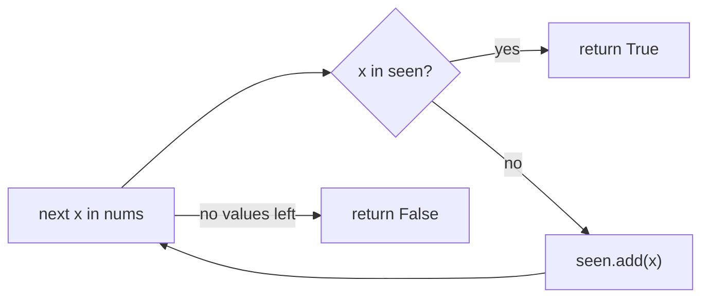

## Understand the problem

We need a yes or no: does any value occur twice or more? Positions don't matter, and we can stop
at the first repeat we find. Edge cases worth saying out loud:

- `[]` and `[7]` → `False`: with fewer than two elements nothing can repeat.
- `[5, 5]` → `True`, and `[2, 2, 2]` → `True`: three copies are still "at least twice".
- `[3, 1, 4, 1, 5]` → `True`: the copies need not be next to each other.
- `[-1, 1]` → `False`: -1 and 1 are different values.

## Brute force: compare every pair

```python
for i in range(len(nums)):
    for j in range(i + 1, len(nums)):
        if nums[i] == nums[j]:
            return True
return False
```

Think of the pairs as the cells above the diagonal of a table, row `i` against column `j`:

```grid
collabels: 3 1 4 1 5
rowlabels: 3 1 4 1 5
_ ≠ ≠ ≠ ≠
_ _ ≠ = _
_ _ _ _ _
_ _ _ _ _
_ _ _ _ _
highlight: 1,3
caption: [3, 1, 4, 1, 5]: row 1 meets column 3 after 6 comparisons
---
collabels: 3 1 4 2 5
rowlabels: 3 1 4 2 5
_ ≠ ≠ ≠ ≠
_ _ ≠ ≠ ≠
_ _ _ ≠ ≠
_ _ _ _ ≠
_ _ _ _ _
caption: no duplicate: every one of the 10 pairs is checked
```

With a duplicate early on the loops stop quickly, but the worst case (no duplicate at all, or
the only pair at the very end) checks all n(n-1)/2 pairs: **O(n²) time**, O(1) space. For
n = 10^5 that is 5 billion comparisons, far too slow. It's still worth saying first: it is
obviously correct, and it shows the waste. For every element we search the rest of the array
for one value.

## Better: sort, then compare neighbours

After sorting, equal values sit side by side, so one pass that compares each element with the
one before it finds any duplicate.

```array
label: nums
values: 3 1 4 1 5
highlight: 1 3
caption: before sorting, the two 1s are apart
---
label: sorted
values: 1 1 3 4 5
pointers: i=1
highlight: 0 1
caption: after sorting: nums[1] == nums[0], return True
```

```python
nums = sorted(nums)  # a copy; nums.sort() would change the caller's list
for i in range(1, len(nums)):
    if nums[i] == nums[i - 1]:
        return True
return False
```

That is **O(n log n) time** for the [sort](#/algo/learn/data-structures/sorting-and-searching)
plus O(n) for the scan. `sorted` copies the array (O(n) space). Sorting in place avoids the copy
(Python's sort may still borrow up to n/2 temporary slots; heapsort needs none) but rearranges an
input the caller may still need, so ask before doing it. This is the answer to reach for when
memory is tight.

## The key insight: remember what you've seen

The brute force asks each element "does this value appear anywhere later?", and answering costs
a scan. Turn the question around: "have I already seen this value?" A
[hash set](#/algo/learn/data-structures/hash-maps-and-sets) answers that in O(1) on average, so
a single pass is enough.

```array
label: nums
values: 3 1 4 1 5
pointers: i=0
caption: 3 is not in seen = {}: add it
---
values: 3 1 4 1 5
pointers: i=1
caption: 1 is not in seen = {3}: add it
---
values: 3 1 4 1 5
pointers: i=2
caption: 4 is not in seen = {3, 1}: add it
---
values: 3 1 4 1 5
pointers: i=3
highlight: 1 3
caption: 1 is in seen = {3, 1, 4}: return True
```

The loop never looks at the 5: it stops at the first repeat.



## The solution

```solution
```

Why it's correct: when the loop reaches the second copy of any value, the first copy is already
in `seen`, so it returns `True` there at the latest. If the loop finishes, every lookup missed:
each value was new when we met it, so all are distinct.

The one-liner `return len(set(nums)) < len(nums)` is also O(n) and fine to mention. It always
builds the whole set, while the loop stops at the first repeat (Example 1 returns at index 2).

## Complexity

| Approach | Time | Extra space | Notes |
|---|---|---|---|
| Compare every pair | O(n²) | O(1) | too slow beyond a few thousand elements |
| Sort, compare neighbours | O(n log n) | O(n) for a copy, less in place | sorting in place changes the input |
| Hash set | O(n) average | O(n) | stops at the first repeat |

- **Time: O(n).** One lookup and at most one insert per element, each O(1) on average.
- **Space: O(n).** With no duplicates, the set ends up holding every element.

It's the usual trade: spend O(n) memory to replace an O(n) search with an O(1) lookup (see
[space complexity](#/algo/learn/complexity/space-complexity)). Say both options in an interview
and let the constraints pick: if memory is tight, sort in place; otherwise use the set.

## Pitfalls and variations

- **A list instead of a set.** `x in seen` on a list scans it, which brings back O(n²) while
  looking like the fast solution.
- **Returning too early.** A `return False` inside the loop (say, in an `else`) answers after
  looking at one element. It belongs after the loop.
- **Sorting the caller's array.** `nums.sort()` saves memory but has a side effect; say so.
- **Duplicate within distance k** (Contains Duplicate II): keep only the last k values in the set,
  removing `nums[i - k]` as you go. That is a
  [sliding window](#/algo/learn/patterns/sliding-window).
- **Values within t and indices within k** (Contains Duplicate III): bucket the window's values by
  `x // (t + 1)`, so near values land in the same or a neighbouring bucket.
- **Too big for memory:** sort on disk, or split the values into files by hash (equal values
  always land in the same file) and check each file with a set. A Bloom filter answers "probably
  seen" in a fraction of the memory, with occasional false positives.
- The same "have I seen it?" move solves [Two Sum](#/algo/problem/a01_two_sum) (a dict from value
  to index) and [Longest Consecutive Sequence](#/algo/problem/a11_longest_consecutive_sequence)
  (a set of all values). This is the [hashing pattern](#/algo/learn/patterns/hashing).
