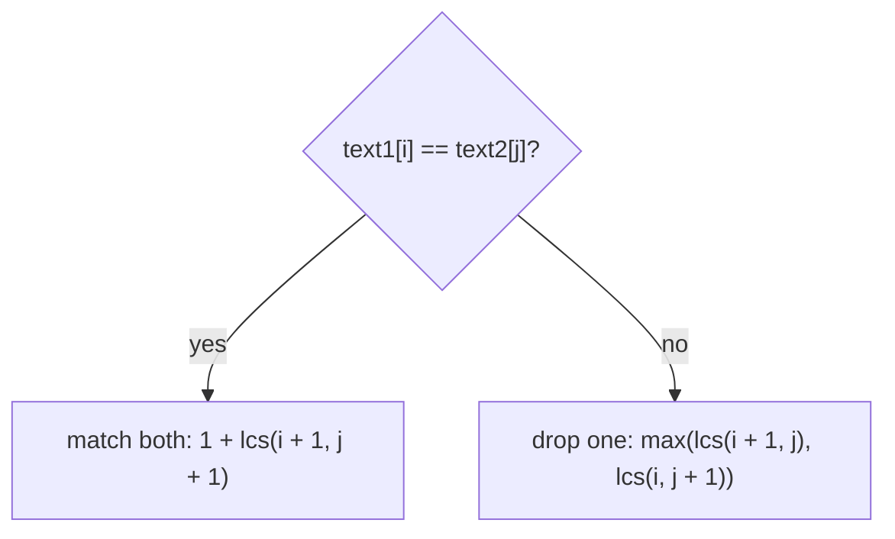
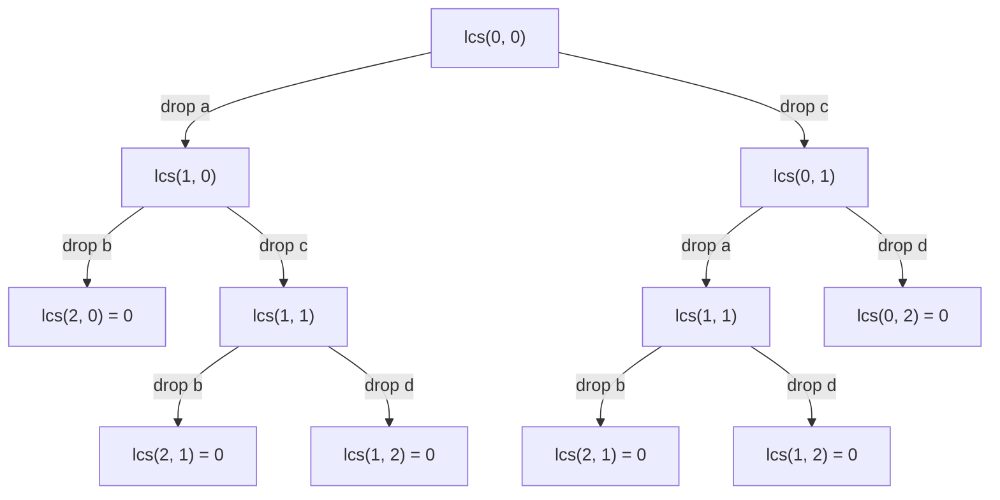

## Understand the problem

A subsequence deletes zero or more characters and keeps the rest in order. We want the longest
string that is a subsequence of both inputs, and only its length.

| `text1` | `text2` | Answer | A longest common subsequence |
|---|---|---|---|
| `"abcde"` | `"ace"` | 3 | `"ace"`: all of `text2` |
| `"abc"` | `"abc"` | 3 | `"abc"`: a string is a subsequence of itself |
| `"abc"` | `"def"` | 0 | nothing in common |
| `"ace"` | `"cbd"` | 1 | `"c"` |
| `"ace"` | `"def"` | 1 | `"e"`: a single shared letter counts |
| `"zabcd"` | `"abcdz"` | 4 | `"abcd"`: matching the `z`s first would give only 1 |

The last row shows why "scan `text1` and grab each letter's first match in `text2`" fails: the
first match can use up the part of `text2` that the rest of the answer needs. This is the same
table that diff tools and DNA alignment are built on.

## Brute force

Write `m = len(text1)` and `n = len(text2)`. The answer is a subsequence of the shorter string,
so we could try every subsequence of it (up to 2^min(m, n) of them) and check each against the
other string in O(m + n): exponential. A recursion that walks both strings is the better
starting point, because it leads straight to the DP.

Look at the first character of each string, `text1[i]` and `text2[j]`:

- **They match.** Pair them up and move both pointers. That's always safe: if a best answer used
  either character with some other copy, re-pairing it with this one loses nothing.
- **They differ.** Then at least one of them is not in the answer. We don't know which, so we
  try dropping each and keep the better.



```python
def lcs(i: int, j: int) -> int:
    if i == len(text1) or j == len(text2):
        return 0  # one string is used up: nothing more in common
    if text1[i] == text2[j]:
        return 1 + lcs(i + 1, j + 1)
    return max(lcs(i + 1, j), lcs(i, j + 1))


answer = lcs(0, 0)
```

The indexes `i` and `j` say where the rest of each string starts. Passing indexes instead of
slices like `text1[1:]` matters: every slice copies the string, which costs O(length) per call.

Here is the call tree for `"ab"` and `"cd"`, which share nothing. The state `lcs(1, 1)` is
reached twice, by dropping `a` then `c` or `c` then `a`, and its whole subtree (highlighted) is
recomputed.



On a mismatch only one pointer moves, so a path can be `m + n` calls long, and every call can
branch in two: **O(2^(m+n))**. Two 20-letter strings with nothing in common already take about
276 billion calls.

## The key insight: a grid of (i, j) states

Each call is identified by the pair `(i, j)`, so there are only `(m + 1) × (n + 1)` different
subproblems: one per cell of a grid. That's the "two pointers" kind of memo key: the future
depends on two independent positions
([choosing the memo key](#/algo/learn/dynamic-programming/choosing-the-memo-key)). Store each
answer the first time:

```python
class Solution:
    def longestCommonSubsequence(self, text1: str, text2: str) -> int:
        return self.lcs(text1, text2, 0, 0, {})

    def lcs(self, text1: str, text2: str, i: int, j: int, memo: dict) -> int:
        if i == len(text1) or j == len(text2):
            return 0
        if (i, j) in memo:
            return memo[(i, j)]
        if text1[i] == text2[j]:
            best = 1 + self.lcs(text1, text2, i + 1, j + 1, memo)
        else:
            best = max(
                self.lcs(text1, text2, i + 1, j, memo), self.lcs(text1, text2, i, j + 1, memo)
            )
        memo[(i, j)] = best
        return best
```

Each of the `(m + 1)(n + 1)` states does O(1) work: **O(m × n) time** and O(m × n) memo space,
plus a call stack up to `m + n` deep.

## Bottom-up: fill the grid from the corner

Lay the memo out as a table ([two sequences and grids](#/algo/learn/dynamic-programming/two-sequences-and-grids)):
`dp[i][j]` is the answer for the suffixes `text1[i:]` and `text2[j:]`, exactly what
`lcs(i, j)` returns. Rows follow `text1`, columns follow `text2`, and the extra last row and
column (`∅`) stand for an empty suffix, where the answer is 0. Every cell reads only the cells
below it and to its right, so fill from the bottom-right corner. For Example 1:

```grid
collabels: a c e ∅
rowlabels: a b c d e ∅
_ _ _ 0
_ _ _ 0
_ _ _ 0
_ _ _ 0
_ _ _ 0
0 0 0 0
caption: an empty suffix shares nothing: the last row and column are 0
---
collabels: a c e ∅
rowlabels: a b c d e ∅
_ _ _ 0
_ _ _ 0
_ 2 1 0
1 1 1 0
1 1 1 0
0 0 0 0
highlight: 2,1 3,2
caption: "c" matches "c": dp[2][1] = 1 + dp[3][2] = 2, from the diagonal
---
collabels: a c e ∅
rowlabels: a b c d e ∅
_ _ _ 0
_ 2 1 0
2 2 1 0
1 1 1 0
1 1 1 0
0 0 0 0
highlight: 1,1 2,1 1,2
caption: "b" and "c" differ: dp[1][1] = max(below, right) = max(2, 1) = 2
---
collabels: a c e ∅
rowlabels: a b c d e ∅
3 2 1 0
2 2 1 0
2 2 1 0
1 1 1 0
1 1 1 0
0 0 0 0
highlight: 0,0 2,1 4,2
path: 0,0 1,1 2,1 3,2 4,2 5,3
caption: dp[0][0] = 3; retracing the choices from the top left gives a, c, e
```

```python
m, n = len(text1), len(text2)
dp = [[0] * (n + 1) for _ in range(m + 1)]  # last row and column stay 0
for i in range(m - 1, -1, -1):
    for j in range(n - 1, -1, -1):
        if text1[i] == text2[j]:
            dp[i][j] = 1 + dp[i + 1][j + 1]
        else:
            dp[i][j] = max(dp[i + 1][j], dp[i][j + 1])
return dp[0][0]
```

## The solution: two rows are enough

Row `i` reads only row `i + 1` (below) and itself (to the right). So keep just two rows: the one
being filled and the one below it. Putting the shorter string along the columns makes each row
as short as possible.

```solution
```

## Complexity

- **Time: O(m × n).** Every cell is filled once with O(1) work: up to 1,000,000 cells for two
  1,000-character strings.
- **Space: O(min(m, n))** with two rows. The full table or the memo take O(m × n), and top-down
  recursion adds O(m + n) of call stack.

Bottom-up and top-down have the same complexity, but bottom-up avoids the function-call overhead
and the recursion depth, so it's usually a few times faster in Python.

## Pitfalls and variations

- **Slicing strings in the recursion** (`text1[1:]`): every call copies, adding a factor of
  O(m + n), and makes a memo keyed on strings slow to hash. Use indexes.
- **Off-by-one with the extra row and column.** The table is `(m + 1) × (n + 1)`: the extra row
  and column are the base case, not data.
- **Greedy first matches**: `"zabcd"` and `"abcdz"` show why matching the earliest equal letter
  isn't safe when the strings disagree on order.
- **Recover the subsequence itself**: keep the full table and walk from `(0, 0)`. On a match,
  take the letter and move diagonally; otherwise move toward the larger neighbour (below or
  right), as the path in the last diagram does. Building strings inside the recursion also works,
  but it copies strings at every step, which is much slower.
- **Longest common substring** (contiguous): on a match `dp[i][j] = 1 + dp[i + 1][j + 1]`, on a
  mismatch 0, and the answer is the largest cell anywhere.
- **Related tables**: the fewest deletions to make two strings equal is `m + n - 2 × LCS`; the
  shortest string containing both as subsequences has length `m + n - LCS`; edit distance (insert,
  delete or replace) uses the same grid with three choices per cell.
