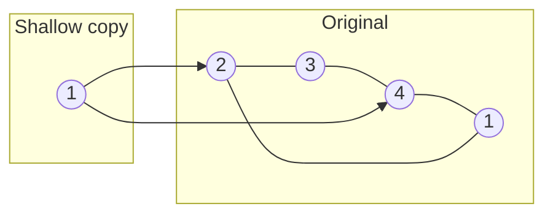
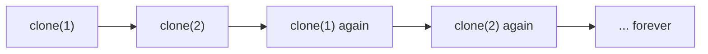
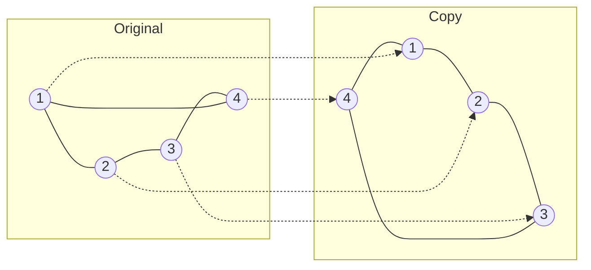

## Understand the problem

A **deep copy** has a new node for every original node, and the new nodes point only at each
other. Copying just the node we are given, and reusing its `neighbors` list, gives a *shallow*
copy whose neighbours are still the original nodes:



So every node must be copied, and **each exactly once**. In Example 1, node 3 is a neighbour of
both 2 and 4: the copy must have one node 3, shared by the copies of 2 and 4, not two separate
ones.

Things to settle before coding:

- **Empty graph**: `node` is `None`; return `None`.
- **One node** with no neighbours: return a new node with an empty list.
- **Cycles everywhere.** The graph is undirected, so each edge appears in both nodes' lists: 1
  lists 2 and 2 lists 1. A walk that doesn't remember where it has been bounces between them.
- **Connected**: every node can be reached from the one we are given, so one walk finds them all.

## Brute force: copy recursively, without memory

The direct translation of "copy a node and its neighbours":

```python
def clone(node):
    copy = Node(node.val)
    for neighbor in node.neighbors:
        copy.neighbors.append(clone(neighbor))
    return copy
```

It never returns a copy, even on two nodes: `clone(1)` calls `clone(2)`, whose neighbour list
contains 1, so it calls `clone(1)` again, and so on until Python stops it with a `RecursionError`.
And even if the walk didn't loop, a node reachable by two routes (like 3 in Example 1, through 2
or through 4) would be copied twice.



## The key insight: map each original node to its copy

Keep a dict `copies` from each original node to its copy. It does two jobs at once:

- **Visited set**: if a node is already in `copies`, it has been (or is being) copied; don't
  start again.
- **Lookup**: when a node lists a neighbour that was already copied, `copies[neighbor]` is the
  node to link to.

The one subtle point: put a node's copy into `copies` **before** copying its neighbours. Then,
when the walk comes back round a cycle to that node, it finds the copy, even though the copy's
own neighbour list is still being filled in.

Here is the depth-first walk on Example 1, writing `1'` for the copy of node 1:

```
clone(1): make 1', copies = {1}. 1's neighbours are 2 and 4:
  clone(2): make 2', copies = {1, 2}. 2's neighbours are 1 and 3:
    1 is in copies                          2'.neighbors = [1']
    clone(3): make 3', copies = {1, 2, 3}. 3's neighbours are 2 and 4:
      2 is in copies                        3'.neighbors = [2']
      clone(4): make 4', copies = {1, 2, 3, 4}. 4's neighbours are 1 and 3:
        1 is in copies                      4'.neighbors = [1']
        3 is in copies                      4'.neighbors = [1', 3']
      clone(4) returns 4'                   3'.neighbors = [2', 4']
    clone(3) returns 3'                     2'.neighbors = [1', 3']
  clone(2) returns 2'                       1'.neighbors = [2']
  4 is in copies                            1'.neighbors = [2', 4']
clone(1) returns 1'
```

Each copy's neighbour list was built in the original's order, so the copy matches exactly. The
dotted arrows are the entries of `copies`:



## The solution

```solution
```

**Why it is correct.** `clone` creates a new node only when the original is not yet in `copies`,
and records it immediately, so each original node gets exactly one copy. Every node is reached,
because the walk follows every neighbour of every node it copies and the graph is connected. And
each copy's list is the original's list with every node replaced by its unique copy, in the same
order, so the copy has exactly the same structure.

The dict is keyed by the node objects themselves, which Python hashes by identity. Keying by
`val` also works here, because the values are unique, but keying by node works for any graph.

### Without recursion: breadth-first

The same idea with a queue. Copy a node when it is first discovered (and record it at once), then
fill in the copies' neighbour lists as each node is taken from the queue:

```python
from collections import deque


class Solution:
    def cloneGraph(self, node: Node | None) -> Node | None:
        if node is None:
            return None
        copies = {node: Node(node.val)}
        queue = deque([node])
        while queue:
            original = queue.popleft()
            for neighbor in original.neighbors:
                if neighbor not in copies:
                    copies[neighbor] = Node(neighbor.val)
                    queue.append(neighbor)
                copies[original].neighbors.append(copies[neighbor])
        return copies[node]
```

On Example 1 the queue evolves like this:

```array
label: queue
values: 1
caption: start: 1 is copied and queued
---
values: 2 4
caption: take 1: 2 and 4 are new, so copy and queue them. 1' links to 2', 4'
---
values: 4 3
caption: take 2: 1 is already copied, 3 is new. 2' links to 1', 3'
---
values: 3
caption: take 4: 1 and 3 are both copied. 4' links to 1', 3'
---
values: _
caption: take 3: 2 and 4 are copied. 3' links to 2', 4'. The queue is empty
```

It never recurses, so a long chain of nodes can't hit Python's recursion limit.

## Complexity

With V nodes and E edges:

- **Time: O(V + E).** Each node is copied once, and each entry of each neighbour list is read
  once. In an undirected graph the lists hold 2E entries in total, because every edge is listed
  by both of its nodes. Saying O(V) because "there is one call per node" undercounts: each call
  loops over its node's neighbours, and in a dense graph E can be close to V²/2.
- **Space: O(V)** for `copies`, plus the recursion stack (up to V calls deep along a long path)
  or the queue (up to V nodes). The copy itself, O(V + E), is the output.

## Pitfalls and variations

- **Recording the copy after the loop** (or never) means a cycle sends the recursion round
  forever. Record first, then recurse.
- **`copy.neighbors = original.neighbors`** shares the list, and the original nodes in it: a
  shallow copy. Build a new list of copies.
- **Forgetting `None`**: `node.val` on an empty graph raises `AttributeError`.
- **Deep graphs.** On a path of 1,000 nodes that starts at node 1 (one of the tests), the
  recursive version goes 1,000 calls deep, which is already past CPython's default limit of about
  1,000. Use the breadth-first version, or raise the limit (this app's runner raises it, so the
  recursive version passes here).
- **Copy List with Random Pointer** is the same trick on a linked list: map each original node to
  its copy, then wire up `next` and `random` through the map.
- **A directed graph** clones with exactly the same code. **A disconnected graph** needs a walk
  from every node not yet in `copies`, the same "start from every node" loop as in
  [Course Schedule](#/algo/problem/a12_course_schedule).
- **A graph given as an edge list** has to be built first: create the nodes, then append each
  edge to both ends' lists. See [graph traversal](#/algo/learn/patterns/graph-traversal) and
  [hash maps](#/algo/learn/data-structures/hash-maps-and-sets).
