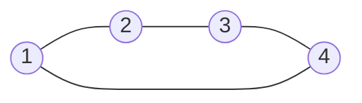

Given a node of a connected, undirected graph, return a **deep copy** (a clone) of the whole
graph: one new node for every node of the original, joined to each other in the same way, and
sharing no node with the original.

Each node has an integer `val` and a list `neighbors` of the nodes it is joined to (the `Node`
class is in the starter code). The tests write a graph as an adjacency list: the list at index
`i` holds the neighbours of the node whose `val` is `i + 1`. You are always given the node with
`val = 1`. An empty list is an empty graph, and then `node` is `None`.

Keep each copied node's `neighbors` in the same order as in the original.

**Example 1**

```
Input:  node = [[2, 4], [1, 3], [2, 4], [1, 3]]
Output: [[2, 4], [1, 3], [2, 4], [1, 3]]
```

Four nodes in a square: node 1 is joined to 2 and 4, node 2 to 1 and 3, node 3 to 2 and 4, and
node 4 to 1 and 3. The copy has the same shape, built from four new nodes.



**Example 2**

```
Input:  node = [[]]
Output: [[]]
```

A single node with no neighbours.

**Example 3**

```
Input:  node = []
Output: []
```

An empty graph: `node` is `None`, so return `None`.

**Constraints**

- The graph has between 0 and 1,000 nodes, numbered `1` to `n` by their `val`.
- Every node can be reached from node 1.
- No node is its own neighbour, and no edge is listed twice. Edges go both ways: if `b` is in
  `a`'s neighbours, then `a` is in `b`'s.
