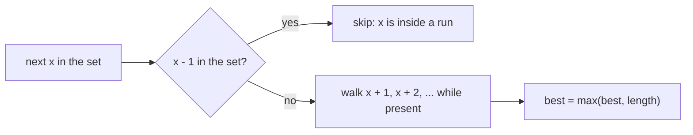

## Understand the problem

We're after consecutive **values**, not neighbouring positions. Picture the numbers dropped onto
a number line: the answer is the longest stretch with no gap.

- `[100, 4, 200, 1, 3, 2]` → 4: the run 1, 2, 3, 4.
- `[1, 2, 2, 3]` → 3: a repeated value neither extends a run nor breaks it.
- `[-1, 1, 0]` → 3: runs can cross zero.
- `[1, 3, 5, 7]` → 1: every number alone is a run of length 1.
- `[]` → 0: no numbers, no run.

## First idea: sort, then scan

Sorting puts each run side by side. Walk the sorted values counting the current run: a value one
more than the previous extends it, an equal value changes nothing, and anything else starts a new
run.

```array
label: sorted
values: 0 0 1 2 3 4 5 6 7 8
pointers: i=1
highlight: 0 1
caption: 0 again: a duplicate, the run stays at 1
---
label: sorted
values: 0 0 1 2 3 4 5 6 7 8
pointers: i=9
highlight: 1..9
caption: every step after that is +1: a run of 9
```

```python
values = sorted(set(nums))  # the set drops duplicates first
best = run = 0
for i, x in enumerate(values):
    run = run + 1 if i > 0 and x == values[i - 1] + 1 else 1
    best = max(best, run)
return best
```

**O(n log n) time** for the [sort](#/algo/learn/data-structures/sorting-and-searching), O(n)
space. That's fast in practice and a fine first answer, but the follow-up asks for O(n), and no
comparison sort is that fast.

## A set answers "is the next value here?"

Without sorting, we need another way to follow a run. Put every value in a
[hash set](#/algo/learn/data-structures/hash-maps-and-sets): "is `x + 1` present?" is then O(1)
on average, and from any `x` we can count upwards until a value is missing.

Counting upwards from **every** value is correct, but it walks the same run again and again.
With one long run, every value starts a walk to the top:

```array
label: set
values: 1 2 3 4 5
pointers: x=0
highlight: 0..4
caption: from 1: walk 1, 2, 3, 4, 5
---
label: set
values: 1 2 3 4 5
pointers: x=1
highlight: 1..4
caption: from 2: walk 2, 3, 4, 5, all over again
---
label: set
values: 1 2 3 4 5
pointers: x=2
highlight: 2..4
caption: from 3: 3, 4, 5 again. In all, 5 + 4 + 3 + 2 + 1 = 15 steps
```

For n values that's n + (n - 1) + ... + 1 ≈ n²/2 steps: **O(n²)**, worse than sorting.

## The key insight: only walk from the start of a run

Every run has exactly one start: its smallest value, the one whose predecessor is missing. So
`x` starts a run exactly when `x - 1` is **not** in the set. Walk upwards only from starts, and
skip everything else, since it will be counted from its own run's start.



Example 1, visiting the set's values in the order they appear in `nums` (a set has no fixed
order, and the order doesn't change the answer):

```array
label: set
values: 100 4 200 1 3 2
pointers: x=0
highlight: 0
caption: 99 is missing: 100 starts a run. 101 is missing: length 1
---
label: set
values: 100 4 200 1 3 2
pointers: x=1
dim: 1
caption: 3 is present: 4 is inside a run. Skip it
---
label: set
values: 100 4 200 1 3 2
pointers: x=3
highlight: 1 3 4 5
caption: 0 is missing: 1 starts a run. Walk 2, 3, 4: length 4
---
label: set
values: 100 4 200 1 3 2
highlight: 1 3 4 5
caption: 200 is a run of 1, and 3 and 2 are skipped: the answer is 4
```

Each value of the long run is looked up at most twice: once in a start check, and once inside the
walk from 1. Nothing is walked twice.

## The solution

```python
class Solution:
    def longestConsecutive(self, nums: list[int]) -> int:
        values = set(nums)
        best = 0
        for x in values:
            if x - 1 in values:
                continue  # x is inside a run; its start will count it
            end = x
            while end + 1 in values:
                end += 1
            best = max(best, end - x + 1)
        return best
```

The run from `x` to `end` holds `end - x + 1` numbers: from 1 to 4 is 4 numbers, not 4 - 1 = 3.
Starting `best` at 0 makes the empty array return 0.

Why it's correct: every run has exactly one start, the start passes the check, and the walk from
it stops exactly at the run's last value. So every run is measured once and in full, and `best`
is the longest.

### Loop over the set, not over nums

It's tempting to write `for x in nums:`. That's still right, but a start value that appears many
times is walked from every time:

```array
label: nums
values: 0 0 0 0 1 2 3
highlight: 0..3
caption: four copies of the start 0: looping over nums walks 0 to 3 four times
```

With k copies of the start of a run of length k that's k² steps, so an input like k zeros
followed by 1 to k - 1 is O(n²) again. The set holds each value once, so each run is walked once.

## Complexity

- **Time: O(n)** on average. Building the set is O(n). The loop does one start check per distinct
  value. The `while` loop looks like it could make this O(n²), but it only runs from starts, and a
  value is only ever walked over from the start of its own run: across the whole loop the walks
  take at most n steps in total. That's an [amortized](#/algo/learn/complexity/amortized-analysis)
  argument: count the total work, not the worst single iteration.
- **Space: O(n)** for the set.

## Pitfalls and variations

- **Walking from every value**: correct but O(n²) on one long run.
- **Looping over `nums` instead of the set**: O(n²) when a run's start is repeated many times.
- **Off by one**: the length is `end - x + 1`.
- **Sorting without handling duplicates**: in `[1, 2, 2, 3]`, the second 2 must leave the run
  alone, not restart it at 1.
- **Return the run itself**: also remember the start of the best run; the answer is
  `list(range(start, start + best))`.
- **Union-find**: union each `x` with `x + 1` when both are present; the largest component is the
  answer. Also near O(n), and it generalises to "connected" defined other ways. See
  [union-find](#/algo/learn/data-structures/union-find).
- **Numbers arriving one at a time**: keep a dict from the two ends of every run to its length.
  A new `x` joins the run ending at `x - 1` and the one starting at `x + 1` in O(1), updating only
  the new ends.
- **Already sorted input**: one scan with O(1) extra space.
- The set lookups here are the same move as in [Contains Duplicate](#/algo/problem/a07_contains_duplicate)
  and [Two Sum](#/algo/problem/a01_two_sum): put the data in a set or map so the question you keep
  asking becomes O(1). That's the [hashing pattern](#/algo/learn/patterns/hashing).
