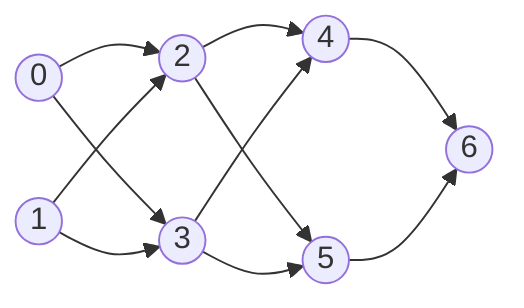
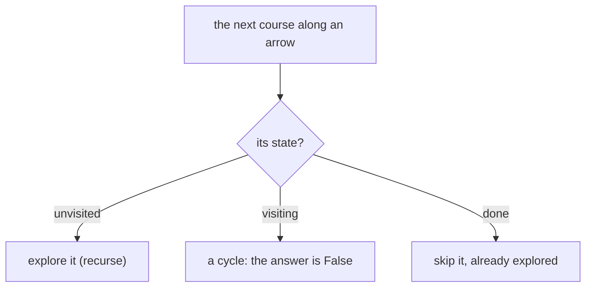
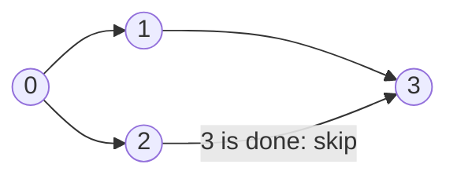
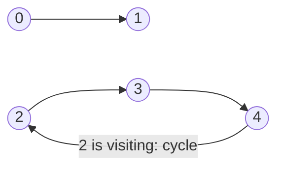

## Understand the problem

Turn the input into a [directed graph](#/algo/learn/data-structures/graphs): one node per course
and an arrow `b → a` for every pair `[a, b]`, read "take `b` before `a`". Finishing every course
means finding an order of all the courses in which every arrow points forwards (a *topological
order*).

Such an order exists exactly when the graph has **no cycle**:

- If there is a cycle, every course on it waits for another course on it, so none of them can be
  taken first.
- If there is no cycle, some course has no prerequisites: start anywhere and keep stepping back to
  a prerequisite; with no cycle you can never revisit a course, so the walk must stop, at a course
  with none. Take it, remove it, and repeat on the rest.

So the question is "does this directed graph contain a cycle?" Things to say before coding:

- **No prerequisites** at all: `True`.
- **A course that lists itself**, `[a, a]`, is a cycle of length one: `False`.
- **The graph can be in pieces.** In Example 4, courses 0 and 1 are fine and the cycle is among 2,
  3 and 4, so a search that starts only from course 0 never sees it.

## Brute force

**Simulate the terms.** Each term, take every course whose prerequisites have all been taken.
Stop when a term takes nothing: the answer is whether everything was taken. Each term scans all
the courses and pairs, O(V + E) for V courses and E pairs, and a chain of prerequisites can force
V terms: **O(V · (V + E))**, around 14 million steps at the largest size.

**A depth-first search without memory** is the other tempting first version: from every course,
follow the arrows, and report a cycle if the walk comes back to a course on its current path. It
is correct, but it walks every *route*, and routes multiply. Stack diamonds, where each course
unlocks both courses of the next layer:



From course 0 there are 2 routes to 4 and 4 routes to 6: every layer doubles the count, and the
search walks each route separately. A thousand layers is far beyond any time limit.

## The key insight: three states, not one "seen" set

The fix for the memory-less search seems to be a `seen` set. But in a directed graph, reaching a
course twice is not a cycle. In Example 3 the search from 0 reaches 3 through 1 and again through
2, yet there is no cycle. A cycle means reaching a course **that is still on the current path**,
one whose search hasn't finished yet.

So each course gets one of three states:

| State | Meaning | Reaching it again means |
|---|---|---|
| unvisited | not reached yet | explore it |
| visiting | on the current path: its search has started but not finished | a cycle |
| done | its search finished and found no cycle | nothing: skip it |



The *done* state does double duty. It stops false alarms (Example 3), and it is a memo: a done
course is never explored again, which removes the exponential blow-up.

On Example 3, the search goes 0, 1, 3 (3 has no arrows out, so it is done), back to 1 (done),
back to 0, then to 2. From 2 it meets 3 again, but 3 is **done**, not visiting. Amber marks the
visiting courses, green the done ones:



On Example 4, the search from 0 finishes 1 and 0 with no cycle. The loop moves on to course 2,
still unvisited, and searches 2, 3, 4. From 4 the arrow leads back to 2, which is **visiting**:



The visiting courses are exactly the recursion's call stack at that moment, the current path:

```array
label: path
values: 2 3 4
direction: vertical
highlight: 0
caption: inside 4: its arrow points back to 2, which is still on the path
```

## The solution

```python
UNVISITED, VISITING, DONE = 0, 1, 2


class Solution:
    def canFinish(self, numCourses: int, prerequisites: list[list[int]]) -> bool:
        unlocks = [[] for _ in range(numCourses)]
        for course, prereq in prerequisites:
            unlocks[prereq].append(course)
        state = [UNVISITED] * numCourses

        def has_cycle(course: int) -> bool:
            state[course] = VISITING
            for nxt in unlocks[course]:
                if state[nxt] == VISITING:
                    return True
                if state[nxt] == UNVISITED and has_cycle(nxt):
                    return True
            state[course] = DONE
            return False

        for course in range(numCourses):
            if state[course] == UNVISITED and has_cycle(course):
                return False
        return True
```

Step by step:

1. Build an adjacency list: `unlocks[b]` lists the courses that need `b`. A list with one entry
   per course (not a dict of the courses that appear) means courses with no pairs are covered.
2. Start a search from every course that is still unvisited, so every piece of the graph is
   checked.
3. In the search, mark the course visiting, follow each arrow, and mark it done on the way out.

**Why it is correct.** A reported cycle is real: the visiting courses form the path from where the
search started to the current course, so an arrow back to one of them closes a loop. And every
cycle is reported: take the first course `x` of a cycle that the search reaches. At that moment
the rest of the cycle is unvisited, so the search from `x` reaches all of it before `x` is
finished, including the course whose arrow leads back to `x`, and `x` is still visiting then.

The direction of the arrows doesn't matter for finding a cycle. Building them the other way,
`needs[a].append(b)`, finds the same cycles.

## Another way: Kahn's algorithm

Instead of hunting for a cycle, try to build the order directly, the way you'd plan a degree:
take whatever has no missing prerequisites, then see what that unlocks.

1. Count each course's missing prerequisites.
2. Put every course with a count of 0 in a queue.
3. Take a course from the queue, and lower the count of every course it unlocks; any that reach 0
   join the queue.
4. Courses on a cycle never reach 0. The answer is whether all `numCourses` courses were taken.

On Example 3 (a dash marks a course already taken):

```array
label: missing
values: 0 1 1 2
highlight: 0
caption: missing prerequisites per course. Only course 0 has none: queue = [0]
---
values: - 0 0 2
highlight: 1 2
caption: take 0: courses 1 and 2 drop to 0 and join the queue: queue = [1, 2]
---
values: - - 0 1
caption: take 1: course 3 drops to 1. queue = [2]
---
values: - - - 0
highlight: 3
caption: take 2: course 3 drops to 0. queue = [3]
---
values: - - - -
caption: take 3. All 4 courses taken, in the order 0, 1, 2, 3: True
```

```python
from collections import deque


class Solution:
    def canFinish(self, numCourses: int, prerequisites: list[list[int]]) -> bool:
        unlocks = [[] for _ in range(numCourses)]
        missing = [0] * numCourses
        for course, prereq in prerequisites:
            unlocks[prereq].append(course)
            missing[course] += 1
        queue = deque(c for c in range(numCourses) if missing[c] == 0)
        taken = 0
        while queue:
            course = queue.popleft()
            taken += 1
            for nxt in unlocks[course]:
                missing[nxt] -= 1
                if missing[nxt] == 0:
                    queue.append(nxt)
        return taken == numCourses
```

It has no recursion, so no recursion limit to worry about, and the order in which courses leave
the queue is a valid schedule. Both versions are worth knowing; see
[topological sort and cycles](#/algo/learn/patterns/topological-sort-and-cycles).

## Complexity

With V courses and E prerequisite pairs:

- **Time: O(V + E)** for both versions. Building the lists reads each pair once. In the DFS each
  course is explored at most once (only from the unvisited state) and each arrow is followed once,
  when its course is explored. In Kahn's algorithm each course is queued once and each arrow
  lowers one count once.
- **Space: O(V + E)** for the adjacency lists, plus O(V) for the states or counts. The DFS
  recursion can be V calls deep (a chain of prerequisites); Kahn's queue holds at most V courses.

## Pitfalls and variations

- **One `seen` set** reports a false cycle whenever two routes meet (Example 3).
- **A per-search `on_path` set with no `done` state** is correct but exponential on stacked
  diamonds: it has no memory between routes.
- **Only searching from course 0** misses cycles in other pieces of the graph (Example 4).
- **Recursion depth.** A chain of 2,000 courses means 2,000 nested calls, over CPython's default
  limit of about 1,000, which raises `RecursionError` in a normal Python. Kahn's algorithm, or an
  explicit stack, avoids it. (This app's runner raises the limit, so the recursive version passes
  here.)
- **Return an order** (Course Schedule II): Kahn's algorithm already produces one, the order in
  which courses leave the queue. In the DFS, append each course to a list when it becomes done:
  with arrows `b → a`, a course is done only after every course that depends on it, so this
  list is backwards; reverse it at the end. (With arrows pointing from a course to its
  prerequisites, the done-order is already a valid schedule.) Return `[]` if there is a cycle.
- **Is `x` a prerequisite of `y`, directly or not?** A topological order can't tell you. If `x`
  is a prerequisite of `y`, then `x` comes earlier, but the converse fails: with
  `[[2, 0], [2, 1]]` the order 0, 1, 2 puts 0 before 1, yet 0 is not a prerequisite of 1.
  Instead, search from `x` along the arrows and check whether `y` is reached: O(V + E) per
  question. For many questions, search once from every course to precompute who reaches whom,
  O(V · (V + E)) (Course Schedule IV).
- **Courses with durations and deadlines** are a different problem, solved greedily with a heap:
  see [Course Schedule III](#/algo/problem/a13_course_schedule_iii).
- **Undirected graphs** are simpler: a cycle is any edge to an already visited node other than
  the one you just came from. In a directed graph you need the visiting/done distinction.
