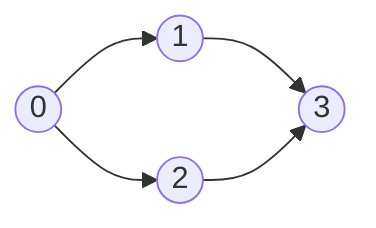
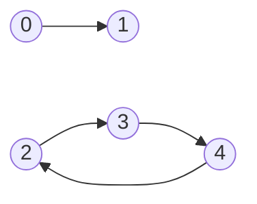

You need to take `numCourses` courses, labelled `0` to `numCourses - 1`. Some have prerequisites:
`prerequisites[i] = [a, b]` means you must finish course `b` before you can take course `a`.

Return `True` if it is possible to finish every course, and `False` otherwise.

**Example 1**

```
Input:  numCourses = 2, prerequisites = [[1, 0]]
Output: True
```

Take course 0, then course 1.

**Example 2**

```
Input:  numCourses = 2, prerequisites = [[1, 0], [0, 1]]
Output: False
```

Each course must come before the other, so neither can ever be taken.

**Example 3**

```
Input:  numCourses = 4, prerequisites = [[1, 0], [2, 0], [3, 1], [3, 2]]
Output: True
```

Course 0 comes before 1 and 2, and course 3 needs both of them: take 0, 1, 2, 3. An arrow below
means "take this course before that one".



**Example 4**

```
Input:  numCourses = 5, prerequisites = [[1, 0], [3, 2], [4, 3], [2, 4]]
Output: False
```

Courses 0 and 1 are fine, but 2 must come before 3, 3 before 4, and 4 before 2: those three wait
for each other in a circle.



**Constraints**

- `1 <= numCourses <= 2000`
- `0 <= len(prerequisites) <= 5000`
- `prerequisites[i] = [a, b]` with `0 <= a, b < numCourses`. No pair appears twice.
- A course may list itself (`[a, a]`); then it can never be taken.
