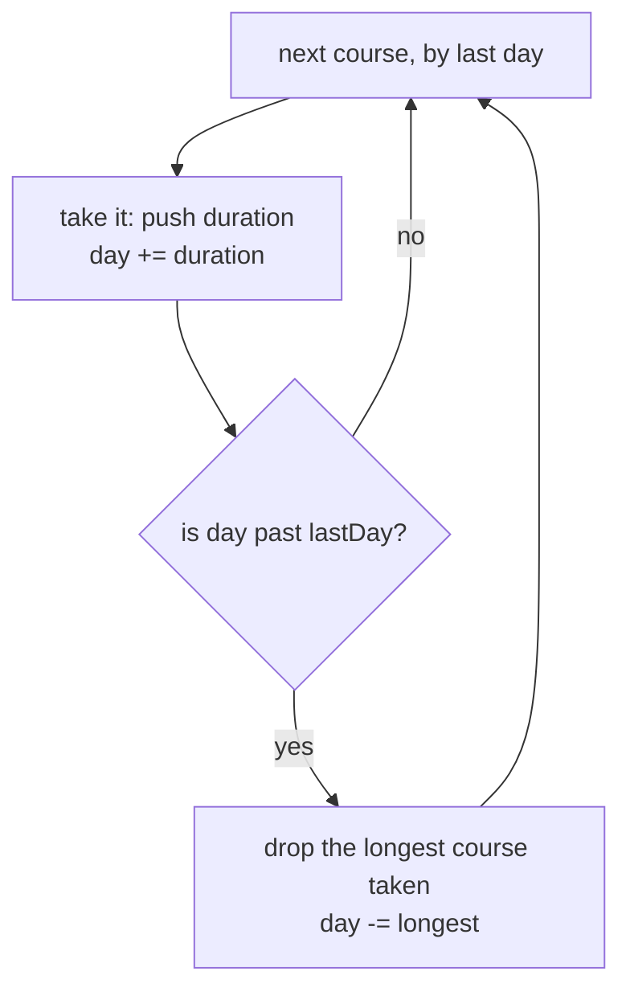

## Understand the problem

We choose a set of courses and an order to take them in. Days add up: if the courses taken so far
use `day` days in total, the next course (`duration`, `lastDay`) finishes on day
`day + duration`, and it is on time if that is at most `lastDay`. We want the largest set that
can be taken with every course on time.

| `courses` | Answer | Why |
|---|---|---|
| `[[3, 2]]` | 0 | 3 days can't fit before day 2 |
| `[[1, 2]]` | 1 | finishes on day 1 |
| `[[1, 10], [5, 10]]` | 2 | 6 days in all, both due on day 10: any order works |
| `[[1, 2], [5, 6]]` | 2 | the short one first: it finishes on day 1, the long one on day 6. Finishing *on* the last day counts |
| `[[10, 12], [10, 30], [1, 2]]` | 3 | only in the right order: day 1, then 11, then 21 |
| `[[1, 20], [10, 11], [5, 15]]` | 3 | by last day: days 10, 15 and 16 |

Two things make it tricky: the order matters, and taking a course changes when every later course
can finish.

## Brute force

Try every subset of courses and check whether it can be taken: O(2^n) subsets, hopeless beyond
about 20 courses.

A better middle step is dynamic programming. Once the courses are in the right order (Step 1
below), choosing which to take is a knapsack over days: let `dp[t]` be the most courses that can
finish exactly on day `t`, and for each course try appending it to every `t`. That is
**O(n · D)** for a largest last day `D`: 10,000 × 10,000 = 100 million steps, far too slow in
Python. The greedy below avoids the days dimension entirely.

## Step 1: take the chosen courses in order of last day

Suppose a schedule takes course `a` right before course `b`, but `b` has the earlier last day.
Swap them:

- `b` now finishes earlier than before, so it is still on time.
- `a` now finishes on the day `b` used to finish, which was no later than `b`'s last day, which
  is earlier than `a`'s last day. So `a` is on time too.
- Every other course finishes on the same day as before.

```intervals
b (4 days, due 5): [3,7]
a (3 days, due 10): [0,3]
caption: a first: b finishes on day 7, two days late
---
b (4 days, due 5): [0,4]
a (3 days, due 10): [4,7]
caption: swapped: b finishes on day 4 and a on day 7, both on time
```

Repeating that swap sorts any on-time schedule by last day without making anything late. So a set
of courses can be taken **if and only if** it works in `lastDay` order, the rule called
*earliest deadline first*. Sort by `lastDay`, and the only question left is which courses to
keep.

## Step 2: "take it if it fits" isn't enough

The obvious greedy goes through the courses by last day and takes each one that still finishes on
time. It fails when an early long course blocks several short ones:

```intervals
2 days, due 11 (late): [10,12]
10 days, due 10: [0,10]
caption: take-if-it-fits keeps the 10-day course; a 2-day course after it would finish on day 12
---
2 days, due 11: [0,2]
2 days, due 11: [2,4]
caption: skipping the 10-day course fits both 2-day courses: 2 courses, not 1
```

The fix is to allow regret: take the new course anyway, and if that makes you late, undo the
choice that hurts the most.

## Step 3: when you're late, drop the longest course

Go through the courses by last day. Add each one: push its duration onto a max-heap and add it to
`day`. If now `day > lastDay`, pop the **longest** duration in the heap (it may be the course just
added) and subtract it.



### Why dropping the longest course is safe

This is an exchange argument. Let `day` be the total before the new course, `d` the new course's
length and `L` the longest length in the heap after adding it, so `L >= d`. Dropping the longest:

- **Keeps the count.** One course came in and one went out (or the new course went straight back
  out).
- **Makes nothing late.** Removing a course only moves the courses after it earlier, and leaves
  the ones before it alone. The new course now finishes on day `day + d - L`, which is at most
  `day`: no later than the previous last finishing day, which met an earlier last day.
- **Leaves the most room.** Of all the ways to keep this many courses, dropping the longest gives
  the smallest total, so every course still to come has the most days available.

That is also why one drop is always enough, never a loop.

The full proof keeps one invariant: after each course, the heap holds as many courses as can
possibly be taken from those seen so far, and among all sets of that size it has the smallest
total length. Adding a course and dropping the longest preserves both properties, so at the end
the heap's size is the answer. (Scheduling theory calls this the Moore-Hodgson algorithm.)

Here is the heap on `[[5, 5], [4, 6], [2, 6]]`, already in last-day order:

```array
label: heap
values: 5
caption: course (5, due 5): day = 5, on time
---
label: heap
values: 5 4
highlight: 0
caption: course (4, due 6): day = 9, which is past 6. Drop the longest, 5: day = 4
---
label: heap
values: 4
caption: the 4-day course now finishes on day 4 instead of 9
---
label: heap
values: 4 2
caption: course (2, due 6): day = 6, on time. Two courses
```

And on Example 1, sorted by last day: `[100, 200], [1000, 1250], [200, 1300], [2000, 3200]`.
This time the course dropped is the new one:

```array
label: heap
values: 1000 100 200
caption: day = 100, then 1100, then 1300: all on time
---
label: heap
values: 2000 1000 200 100
highlight: 0
caption: course (2000, due 3200): day = 3300, late. The longest is the new course itself
---
label: heap
values: 1000 100 200
caption: drop it: day = 1300 again. Three courses
```

## The solution

```python
import heapq


class Solution:
    def scheduleCourse(self, courses: list[list[int]]) -> int:
        taken: list[int] = []  # max-heap of durations, stored negated
        day = 0
        for duration, last_day in sorted(courses, key=lambda c: c[1]):
            heapq.heappush(taken, -duration)
            day += duration
            if day > last_day:
                longest = -heapq.heappop(taken)
                day -= longest
        return len(taken)
```

Python's `heapq` is a min-heap, so durations go in negated and the smallest stored value is the
longest course. A course longer than its own last day needs no special case: it is the longest in
the heap when it makes you late (every other course fits before an earlier last day), so it is
dropped at once.

## Complexity

- **Time: O(n log n):** the sort, then one push and at most one pop per course.
- **Space: O(n)** for the heap and the sorted copy.

Finding the longest course with a linear scan instead of a heap gives O(n²) in the worst case.
It is fine for small inputs, but the heap is the version to give.

## Pitfalls and variations

- **Sorting by duration instead of last day.** It looks natural (short courses first) but breaks
  Step 1. On `[[2, 2], [1, 10]]` it takes `[1, 10]` first, after which `[2, 2]` would finish on
  day 3: one course. In last-day order both fit: day 2, then day 3.
- **`>=` instead of `>`.** Finishing on the last day is allowed, so late means `day > lastDay`.
  With `>=`, Example 4 returns 1.
- **Dropping the course that made you late** instead of the longest. That's the "take it if it
  fits" greedy, which fails Step 2's example.
- **Forgetting that `heapq` is a min-heap,** and dropping the *shortest* course.
- **Equal last days** need no tie-break: any order among them works.
- **Same name, different problem:** [Course Schedule](#/algo/problem/a12_course_schedule) is about
  prerequisites (a topological sort), not deadlines.
- **Courses worth different amounts** (maximise total value, not the count): the exchange
  argument fails, and it becomes the knapsack DP over days.
- **The same "take it, then regret" heap** solves Minimum Number of Refueling Stops and Furthest
  Building You Can Reach: go greedily, and when a budget breaks, undo the worst choice so far,
  found with a heap.

See the [greedy pattern](#/algo/learn/patterns/greedy), the
[heaps pattern](#/algo/learn/patterns/heaps-and-top-k), and
[greedy or DP](#/algo/learn/dynamic-programming/greedy-or-dp) for telling them apart.
