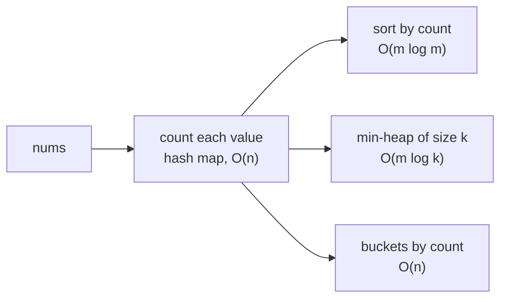

## Understand the problem

Two separate jobs: **count** how often each value appears, then **select** the `k` values with the
largest counts. Write n for the length of `nums` and m for the number of distinct values
(m ≤ n).

For `[4, 1, -1, 2, -1, 2, 3]` and `k = 2` the counts are:

```grid
rowlabels: value count
4 1 -1 2 3
1 1 2 2 1
highlight: 0,2 1,2 0,3 1,3
caption: -1 and 2 appear twice, the rest once: the answer is [-1, 2]
```

Questions to ask: in what order should the answer come (any), what if counts tie at the cut-off
(here it can't: the answer is unique), and can `k` exceed the number of distinct values (no).



## Step 1: count with a hash map

```python
counts = {}
for x in nums:
    counts[x] = counts.get(x, 0) + 1
```

One pass, O(n). `collections.Counter(nums)` does the same in one line.

## Step 2, simplest: sort by count

```python
return sorted(counts, key=counts.get, reverse=True)[:k]
```

Sorting the m distinct values is O(m log m), so **O(n log n)** in the worst case (every value
distinct). That's a fine first answer, and the follow-up asks to beat it.

One look-alike to avoid: `sorted(set(nums), key=nums.count, reverse=True)[:k]`. It reads like the
line above, but `nums.count(x)` scans the whole array for every value: O(n × m), which is O(n²)
when most values are distinct.

## Better: a min-heap of size k

We never need the full order, only the best `k`. Keep the best `k` seen so far in a
[heap](#/algo/learn/data-structures/heaps) ordered by count. It must be a **min**-heap: its root
is the weakest of the current top `k`, the one to evict when a stronger value arrives.

For each `(count, value)`: push it, and if the heap now holds `k + 1` entries, pop the smallest.
With `[4, 1, -1, 2, -1, 2, 3]` and `k = 2` (entries are `(count, value)`, so ties on count fall
back to the value):

```array
label: heap
values: (1,4)
caption: push (1, 4): value 4 appears once
---
label: heap
values: (1,1) (1,4)
caption: push (1, 1): the root is the weakest entry
---
label: heap
values: (1,4) (2,-1)
caption: push (2, -1): 3 entries > k, so pop the root (1, 1)
---
label: heap
values: (2,-1) (2,2)
caption: push (2, 2) and pop (1, 4)
---
label: heap
values: (2,-1) (2,2)
caption: push (1, 3), which is popped straight back out: the top 2 remain
```

```python
import heapq

heap = []
for value, count in counts.items():
    heapq.heappush(heap, (count, value))
    if len(heap) > k:
        heapq.heappop(heap)  # drop the weakest of the k + 1
return [value for count, value in heap]
```

Each push and pop costs O(log k), because the heap never holds more than `k + 1` entries:
**O(n + m log k)** time and O(m + k) space. When `k` is much smaller than m, that's far less than
sorting everything. `heapq.heappushpop` does a push and a pop in one step, and
`heapq.nlargest(k, counts, key=counts.get)` (used by `Counter.most_common(k)`) packages the whole
idea. See [heaps and top-k](#/algo/learn/patterns/heaps-and-top-k).

## Best: buckets indexed by count

A count is a whole number between 1 and n, so we can sort by count without comparing anything.
Make a list of n + 1 buckets, put each value in the bucket for its count, and walk the buckets
from the highest count down, collecting values until we have `k`. That's bucket sort.

Example 1, `[1, 1, 1, 2, 2, 3]` with `k = 2`:

```array
label: bucket
values: _ [3] [2] [1] _ _ _
caption: bucket c holds the values that appear exactly c times
---
label: bucket
values: _ [3] [2] [1] _ _ _
pointers: c=3
highlight: 3
caption: walking down from c = 6: buckets 6, 5 and 4 are empty; take 1
---
label: bucket
values: _ [3] [2] [1] _ _ _
pointers: c=2
highlight: 2 3
caption: take 2: that's k = 2 values, so stop
```

## The solution

```python
from collections import Counter


class Solution:
    def topKFrequent(self, nums: list[int], k: int) -> list[int]:
        counts = Counter(nums)
        buckets = [[] for _ in range(len(nums) + 1)]
        for value, count in counts.items():
            buckets[count].append(value)

        top = []
        for count in range(len(nums), 0, -1):
            for value in buckets[count]:
                top.append(value)
                if len(top) == k:
                    return top
        return top
```

Why it's correct: the walk visits values in order of decreasing count, so the first `k` it collects
are the `k` most frequent. Could it stop partway through a bucket, leaving out a value with the
same count as one it took? Only if two values tied for the last place, and the problem promises
they don't.

## Complexity

| Approach | Time | Extra space | Best when |
|---|---|---|---|
| Sort by count | O(n + m log m) | O(m) | simplest to write |
| Min-heap of size k | O(n + m log k) | O(m + k) | k is small, or counts arrive as a stream |
| Buckets by count | O(n) | O(n) | counts are bounded by n, as here |

For the bucket solution: counting is O(n), filling the buckets O(m), and the walk visits at most
n + 1 buckets and k values: **O(n) time** and **O(n) space**.

## Pitfalls and variations

- **A max-heap of size k** keeps the wrong end: it evicts the most frequent value. To keep the
  largest `k`, use a min-heap and evict from the bottom. (Or heapify all m entries as a max-heap,
  by negating the counts, and pop `k` times: O(m + k log m), also fine.)
- **`nums.count` inside the sort key**: O(n²) hiding inside one line.
- **`queue.PriorityQueue`** is a thread-safe queue for passing work between threads. It locks on
  every call. In a single-threaded solution use `heapq`.
- **Ties at the cut-off**, when the answer isn't promised to be unique: ask which one to return.
  "Top K Frequent Words" breaks ties alphabetically; push `(-count, word)` into a heap and pop
  `k` times, or sort by that key.
- **Quickselect** on the distinct values by count finds the top `k` in O(m) on average (O(m²)
  in the worst case), with no buckets.
- **Too much data for one machine, or an endless stream:** count in shards and merge each shard's
  top lists, or keep approximate counts in a count-min sketch with a size-k heap of the current
  heavy hitters.
- **The k-th largest element** of an array is the same heap idea without the counting.
- Counting with a hash map is also the first step of [Valid Anagram](#/algo/problem/a28_valid_anagram)
  and [Group Anagrams](#/algo/problem/a29_group_anagrams).
