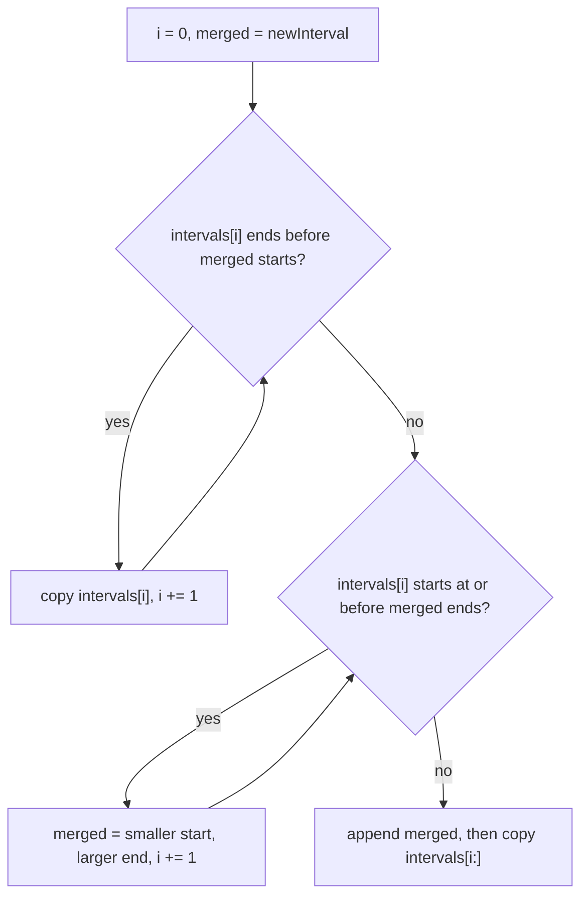

## Understand the problem

The list is already in the shape we want, sorted and overlap-free, except for one new interval.
Inserting it may swallow some existing intervals, and the merged interval can grow past both ends
of `newInterval` when it overlaps an interval only partly.

Two intervals overlap when each starts no later than the other ends, so touching counts:
`[1, 3]` and `[3, 5]` share the point 3. Where the new interval can land:

```intervals
intervals: [3,5] [8,9]
new: [0,1]
result: [0,1] [3,5] [8,9]
caption: before everything: it goes first
---
intervals: [3,5] [8,9]
new: [11,12]
result: [3,5] [8,9] [11,12]
caption: after everything: it goes last
---
intervals: [1,2] [8,9]
new: [4,5]
result: [1,2] [4,5] [8,9]
caption: in a gap: inserted in the middle, nothing merges
---
intervals: [2,3] [5,6] [8,9]
new: [1,10]
result: [1,10]
caption: covering everything: one interval is left
```

Other cases worth saying out loud:

| `intervals` | `newInterval` | Result | Why |
|---|---|---|---|
| `[]` | `[5, 7]` | `[[5, 7]]` | nothing to merge with |
| `[[1, 10]]` | `[3, 4]` | `[[1, 10]]` | inside an existing interval |
| `[[1, 3], [6, 8]]` | `[3, 4]` | `[[1, 4], [6, 8]]` | touching on the left merges |
| `[[0, 5], [6, 10]]` | `[5, 6]` | `[[0, 10]]` | touching both sides bridges the gap |

## Brute force

Append `newInterval` and solve [Merge Intervals](#/algo/problem/a16_merge_intervals): sort by
start, then merge in one pass. That's **O(n log n)** and perfectly correct, and worth saying
first. It throws away the fact that the input is already sorted, though, and the interviewer will
ask for O(n). (Merging by comparing every pair would be worse still: O(n²).)

## The key insight: three runs

Compare each existing interval with `newInterval = [start, end]`:

- **before:** it ends before `start` (`end_i < start`). It can't touch the new interval.
- **after:** it starts after `end` (`start_i > end`). It can't touch it either.
- **overlapping:** everything else. These all merge with the new interval.

Because the list is sorted and overlap-free, the three groups come in that order, each as one
unbroken run. So one index walking left to right can handle them with three loops.

```array
label: intervals
values: [1,2] [3,5] [6,7] [8,10] [12,16]
highlight: 1..3
pointers: before=0 overlapping=1 after=4
caption: newInterval = [4,8]: one run before, one run overlapping it, one run after
```

Here is the walk over Example 2. The green row is the output built so far.

```intervals
still to read: [1,2] [3,5] [6,7] [8,10] [12,16]
merging: [4,8]
output: [0,0]
caption: start: the merged interval is just newInterval = [4,8]; the output is empty
---
still to read: [3,5] [6,7] [8,10] [12,16]
merging: [4,8]
output: [1,2]
caption: before: [1,2] ends at 2, before 4 starts: copy it
---
still to read: [6,7] [8,10] [12,16]
merging: [3,8]
output: [1,2]
caption: overlapping: [3,5] starts at 3, at most 8: merge, giving [min(4,3), max(8,5)] = [3,8]
---
still to read: [12,16]
merging: [3,10]
output: [1,2]
caption: [6,7] fits inside [3,8]; [8,10] touches it at 8: merge, giving [3,10]
---
merging: [3,10]
output: [1,2] [3,10] [12,16]
caption: after: [12,16] starts after 10. Append [3,10], then copy the rest
```

(The `[0,0]` in the first frame is only there to give the empty output a row.)



## The solution

```solution
```

The three cases from the diagrams need no special code. If nothing overlaps, the middle loop
doesn't run and `[start, end]` is `newInterval` itself, appended between the two runs. If the new
interval goes first, the first loop doesn't run; if it goes last, the third copies nothing.

**Why it's correct.**

- The "before" intervals end before `start`, so they don't overlap the new interval, and they
  were already sorted and overlap-free among themselves.
- The middle loop absorbs exactly the intervals that share a point with the growing merged
  interval, so `[start, end]` ends up as the union of the new interval and everything it
  overlaps.
- When the middle loop stops, `intervals[i]` starts after `end`. The intervals after it start
  later still, so none of them overlaps the merged interval.

Could the merged interval grow so much that the "after" run needs merging too? No. The end only
grows past `newInterval`'s end by absorbing some `intervals[j]`, and the next interval starts
after `intervals[j]` ends, because the input intervals don't touch. That's why the middle loop
compares against the merged end (`end`), which is always safe.

```intervals
intervals: [3,5] [6,7] [8,10] [12,16]
new: [4,8]
merged: [3,10]
caption: absorbing [8,10] pushes the end to 10, and the next interval starts at 12, after 10
```

## Complexity

- **Time: O(n).** The index `i` only moves forward: each interval is looked at once, by one of
  the three loops.
- **Space: O(n)** for the output list. Apart from it, O(1).

To *find* the overlapping run, two binary searches would take O(log n) (the first interval with
`end_i >= start`, and the first with `start_i > end`). Building the output is still O(n), but
`intervals[lo:hi] = [[start, end]]` does the copying in one fast slice operation when changing
the list in place is allowed.

## Pitfalls and variations

- **`<=` and `<` mixed up.** "Before" must be `end_i < start` and "after" must be
  `start_i > end`. With `end_i <= start`, an interval that touches the new one is copied
  unmerged, and the output has two touching intervals. Ask whether touching counts as
  overlapping: here it does.
- **Not appending the merged interval** when nothing overlaps, or when the new interval belongs
  at the very end. Appending it once, right after the middle loop, covers every case.
- **Modifying `newInterval` in place** (`newInterval[0] = ...`) changes the caller's list. Use
  local variables.
- **Merging only with `newInterval`'s own bounds.** Write the middle loop against the merged
  interval's end. The original end also happens to work, because the input doesn't overlap, but
  only for that reason.
- **Many insertions:** with a stream of new intervals, keep the merged intervals in a sorted
  structure and binary-search for the neighbours, rather than rebuilding the list every time.
- Related: [Merge Intervals](#/algo/problem/a16_merge_intervals) (unsorted input, sort first)
  and [Non-overlapping Intervals](#/algo/problem/a17_non_overlapping_intervals). The
  [intervals pattern](#/algo/learn/patterns/intervals) covers the family.
