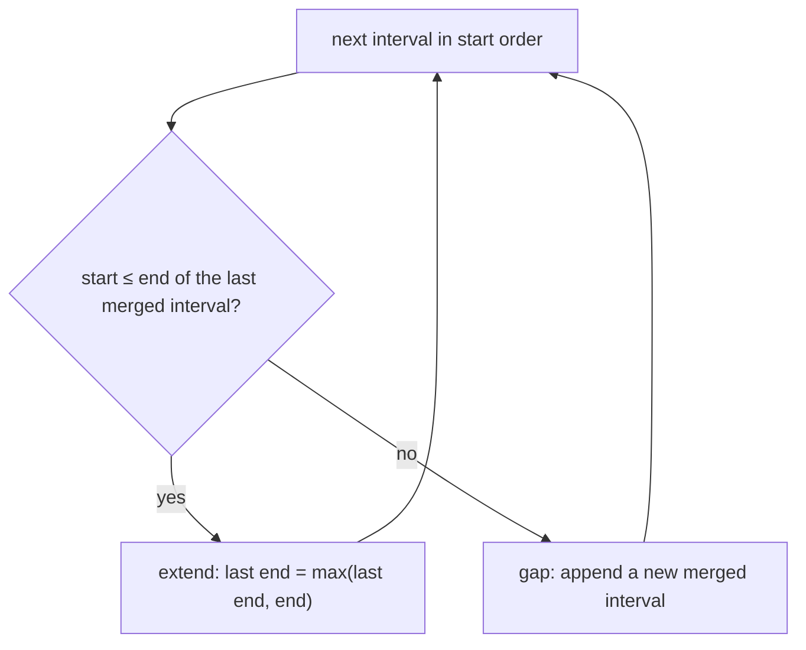

## Understand the problem

Every group of intervals that overlap, directly or through a chain, becomes one interval running
from the group's smallest start to its largest end. Everything else is copied as it is.

First pin down what "overlap" means. Two intervals `a` and `b` share a point exactly when each one
starts no later than the other ends:

```
a[0] <= b[1] and b[0] <= a[1]
```

It is easy to get this backwards: "one starts after the other ends" is the test for *not*
overlapping. The four ways two intervals can sit relative to each other:

```intervals
a: [1,4]
b: [3,7]
merged: [1,7]
caption: partial overlap: merge to [min start, max end]
---
a: [1,8]
b: [3,5]
merged: [1,8]
caption: nested: the outer interval swallows the inner one
---
a: [1,4]
b: [4,7]
merged: [1,7]
caption: touching: they share the point 4, so they merge too
---
a: [1,3]
b: [5,7]
merged: [1,3] [5,7]
caption: separate: a gap between them, nothing to do
```

Cases to say out loud before coding:

| Input | Output | Why |
|---|---|---|
| `[]` | `[]` | nothing to merge |
| `[[5, 7]]` | `[[5, 7]]` | one interval |
| `[[1, 4], [4, 5]]` | `[[1, 5]]` | touching counts (ask the interviewer: some problems say it doesn't) |
| `[[1, 10], [2, 3]]` | `[[1, 10]]` | nested |
| `[[1, 4], [2, 7], [5, 10]]` | `[[1, 10]]` | a chain: the first and last don't overlap each other, but both overlap the middle one |
| `[[1, 2], [3, 4]]` | `[[1, 2], [3, 4]]` | 2 and 3 are neighbours, but no point is shared |

## Brute force

Merge any two overlapping intervals into one, and repeat until no pair overlaps. Each pass compares
up to n²/2 pairs, and a pass may find only one merge, so this is O(n²) at best and O(n³) in the
worst case.

A tidier version treats the intervals as a graph: an edge joins two intervals that overlap, and
each connected component becomes one merged interval. Building the edges still checks every pair:
**O(n²)**. With n = 10,000 that is 50 million comparisons, many seconds in Python. The chain case
is what makes the problem harder than it looks: `[1, 4]` and `[5, 10]` end up in the same output
interval without overlapping each other, so looking at pairs once isn't enough.

## The key insight: sort by start

If the intervals are sorted by start, the members of each merged group sit next to each other,
and one left-to-right pass can merge them.

```array
label: input
values: [5,10] [1,4] [2,7]
caption: in input order, the chain [1,4] - [2,7] - [5,10] is scrambled
---
label: sorted
values: [1,4] [2,7] [5,10]
highlight: 0 1 2
caption: sorted by start, each interval only needs comparing with the group just before it
```

Walk the sorted intervals keeping `last`, the merged interval being built. For each interval
`[start, end]`:

- **`start <= last[1]`**: it overlaps or touches `last`. Extend: `last[1] = max(last[1], end)`.
  The start never needs updating, because sorting guarantees `start >= last[0]`.
- **`start > last[1]`**: there is a gap. Every later interval starts at `start` or after, so none
  of them can reach back into `last`: it is finished. Begin a new merged interval.



Here is the pass over Example 1. The green row is the output built so far.

```intervals
sorted: [1,3] [2,6] [8,10] [15,18]
merged: [1,3]
caption: first interval: it starts the output
---
sorted: [1,3] [2,6] [8,10] [15,18]
merged: [1,6]
caption: [2,6] starts at 2, which is at most 3: extend the end to max(3, 6) = 6
---
sorted: [1,3] [2,6] [8,10] [15,18]
merged: [1,6] [8,10]
caption: [8,10] starts after 6: a gap, so [1,6] is final and [8,10] starts a new interval
---
sorted: [1,3] [2,6] [8,10] [15,18]
merged: [1,6] [8,10] [15,18]
caption: [15,18] starts after 10: another gap
```

## The solution

```solution
```

`if merged and ...` handles the first interval (and an empty input) without a special case:
there is nothing to extend yet, so it is appended.

**Why it's correct.** Two facts hold after each step: the intervals in `merged` don't overlap each
other, and each covers exactly the union of some consecutive run of the sorted input.

- When `start <= merged[-1][1]`, the new interval shares a point with the last merged interval, so
  their union is one interval: `[merged[-1][0], max(...)]`. Its start can't be smaller, since
  the input is sorted by start.
- When `start > merged[-1][1]`, the last merged interval ends before this interval starts, and
  every later interval starts even later. So nothing can ever join it again, and appending a new
  interval keeps the output overlap-free.

## Complexity

- **Time: O(n log n).** Sorting dominates; the pass after it is O(n).
- **Space: O(n)** for the output. `sorted()` also makes a sorted copy (O(n)); `intervals.sort()`
  avoids the copy but reorders the caller's list.

O(n log n) is the best possible for a comparison-based method: given n single points, merging
them returns them in sorted order, so merging is at least as hard as sorting.

## Pitfalls and variations

The most common bug is extending with `end` instead of `max(last end, end)`. Then a nested
interval cuts the outer one short:

```intervals
sorted: [1,10] [2,3] [4,5]
wrong: [1,3] [4,5]
right: [1,10]
caption: last[1] = end turns [1,10] into [1,3]; max keeps the 10
```

- **Sorting by end.** It breaks the guarantee that the start never moves. With
  `[[2, 3], [4, 5], [1, 10]]` sorted by end, the pass outputs `[2, 3]`, then sees `[1, 10]`
  overlap `[4, 5]` and returns `[[2, 3], [4, 10]]` instead of `[[1, 10]]`.
- **`<` instead of `<=`.** Then touching intervals stay apart. Which one is right depends on the
  problem, so ask. In [Non-overlapping Intervals](#/algo/problem/a17_non_overlapping_intervals)
  touching intervals do *not* overlap.
- **Changing the caller's data.** Appending the input's own list and then doing
  `merged[-1][1] = ...` silently edits `intervals`. Append a copy.
- **Empty input.** Code that starts with `merged = [intervals[0]]` crashes on `[]`.
- **Already sorted input:** skip the sort for O(n). That is
  [Insert Interval](#/algo/problem/a15_insert_interval), where only one interval is out of place.
- **Count the overlap instead of merging** ("how many rooms?", "how many planes in the air?"):
  sweep over start and end events instead. See
  [Number of Airplanes in the Sky](#/algo/problem/a18_number_of_airplanes_in_the_sky).
- **More data than fits in memory:** sort externally by start, then stream through it. The pass
  only ever holds one merged interval.
- **Intervals arrive one at a time** and you must keep the merged set up to date: keep the merged
  intervals in a structure sorted by start (a balanced tree, or a sorted list with binary search),
  find the neighbours of the new interval and merge it with them.

The [intervals pattern](#/algo/learn/patterns/intervals) collects these problems; sort by start
first is the opening move for most of them.
