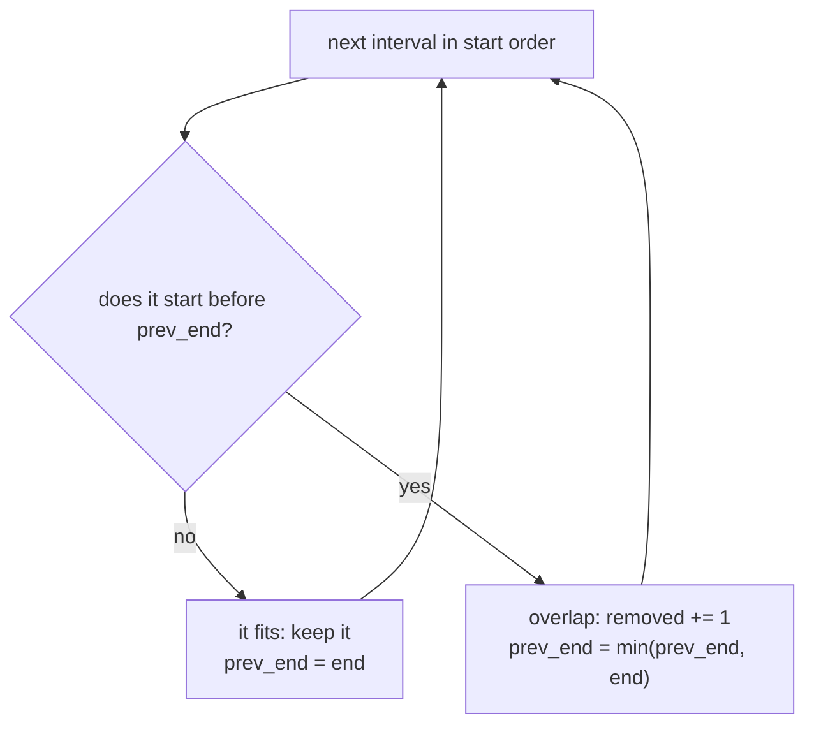

## Understand the problem

Two intervals overlap when each starts *before* the other ends:

```
a[0] < b[1] and b[0] < a[1]
```

The comparisons are strict, so touching intervals like `[1, 2]` and `[2, 3]` can both stay. That
is the opposite of [Merge Intervals](#/algo/problem/a16_merge_intervals), where touching
intervals merge. Always check which rule the problem uses.

The question asks for the fewest removals, but it is easier to think about the intervals we
*keep*: removing as few as possible is the same as keeping as many as possible that don't
overlap. So the answer is `len(intervals) - kept`, and the job is the classic **interval
scheduling** problem: fit the most meetings into one room.

| `intervals` | Answer | Why |
|---|---|---|
| `[]` | 0 | nothing to remove |
| `[[1, 2], [2, 3]]` | 0 | touching is allowed |
| `[[1, 2], [1, 2], [1, 2]]` | 2 | only one copy can stay |
| `[[1, 3], [2, 5], [4, 6]]` | 1 | `[2, 5]` overlaps both others; removing it fixes everything |
| `[[1, 10], [2, 3], [4, 5], [6, 7]]` | 1 | remove the long one, not the three short ones |

## Brute force

Try every subset of intervals, keep the largest one with no overlaps: O(2^n · n log n), hopeless
past about 20 intervals.

A better middle step is dynamic programming, like longest increasing subsequence. Sort by start,
and let `best[i]` be the most intervals you can keep if interval `i` is the last one kept:

```
best[i] = 1 + max(best[j] for j < i if intervals[j][1] <= intervals[i][0])
```

That is **O(n²)**: 50 million steps for 10,000 intervals, several seconds in Python. The DP tries
every possible previous interval. The question is whether we can know the right choice without
trying them all.

## The key insight: keep the interval that ends first

Sort by start and look at the intervals in order. Whenever an interval overlaps the one we are
keeping, at least one of the two has to go. Keep the one that **ends first**.

Why the end? Every interval still to come starts at or after both of them (we're going in start
order), so the only thing that affects the future is where the kept interval ends. An earlier end
leaves room for at least as many later intervals:

```intervals
A: [1,10]
B: [1,3]
later: [4,5] [6,7]
keep A: [1,10]
keep B: [1,3] [4,5] [6,7]
caption: A and B overlap. Keeping B, which ends first, leaves room for the rest
```

Other rules sound just as reasonable but fail. Keeping the interval that *starts* first keeps
`[1, 10]` above. Keeping the *shortest* one fails too:

```intervals
input: [1,5] [4,6] [5,10]
shortest first: [4,6]
ends first: [1,5] [5,10]
caption: the shortest interval overlaps both others; picking by earliest end keeps two
```

### Why keeping the earlier end is safe (an exchange argument)

Suppose some best answer keeps the interval that ends later, `X`, where we keep the one that ends
earlier, `Y`. Swap `X` for `Y` in that answer:

- **Still valid on the right.** `Y` ends no later than `X`, so anything that started after `X`
  ended also starts after `Y` ends.
- **Still valid on the left.** We only ever replace the kept interval with a *later* one in
  start order, so `Y` starts no earlier than the interval it replaces. That interval started
  after the previous kept interval ended, so `Y` does too.
- **No worse.** One interval out, one in: the count is the same.

So there is always a best answer that agrees with each greedy choice. Put as an invariant: after
each interval, the kept set is as large as possible for the intervals seen so far, and among sets
of that size it ends as early as possible. Each step preserves both properties, so at the end the
kept set is a largest one.

## The solution

Walk the intervals in start order, keeping `prev_end`, the end of the last interval kept:

- `start >= prev_end`: no overlap (touching is fine). Keep it: `prev_end = end`.
- `start < prev_end`: overlap. Count one removal, and keep whichever of the two ends first:
  `prev_end = min(prev_end, end)`.



On `[[1, 2], [2, 3], [3, 4], [1, 3]]`, sorted to `[1,2] [1,3] [2,3] [3,4]` (the green row is
what we keep):

```intervals
sorted: [1,2] [1,3] [2,3] [3,4]
kept: [1,2]
caption: keep [1,2]: prev_end = 2
---
sorted: [1,2] [1,3] [2,3] [3,4]
kept: [1,2]
caption: [1,3] starts at 1 < 2: overlap, one removal. [1,2] ends first, so it stays
---
sorted: [1,2] [1,3] [2,3] [3,4]
kept: [1,2] [2,3]
caption: [2,3] starts at 2, not before 2: it only touches, so keep it. prev_end = 3
---
sorted: [1,2] [1,3] [2,3] [3,4]
kept: [1,2] [2,3] [3,4]
caption: [3,4] touches too: keep it. One removal in total
```

When the newcomer ends first, it *replaces* the kept interval:

```intervals
sorted: [1,10] [2,3] [4,5] [6,7]
kept: [1,10]
caption: keep [1,10]: prev_end = 10
---
sorted: [1,10] [2,3] [4,5] [6,7]
kept: [2,3]
caption: [2,3] overlaps and ends first: [1,10] is the one removed. prev_end = 3
---
sorted: [1,10] [2,3] [4,5] [6,7]
kept: [2,3] [4,5] [6,7]
caption: [4,5] and [6,7] now fit. One removal
```

```python
class Solution:
    def eraseOverlapIntervals(self, intervals: list[list[int]]) -> int:
        removed = 0
        prev_end = float("-inf")  # end of the last kept interval; nothing kept yet
        for start, end in sorted(intervals, key=lambda iv: iv[0]):
            if start < prev_end:  # overlap (touching, start == prev_end, is fine)
                removed += 1
                prev_end = min(prev_end, end)  # keep whichever of the two ends first
            else:
                prev_end = end  # no overlap: keep it
        return removed
```

Starting `prev_end` at minus infinity means the first interval is always kept, and an empty
input returns 0 without a special case.

### The same idea, sorted by end

Sorting by end makes the greedy even plainer: take intervals in order of end, and keep each one
that starts at or after the last kept end. An interval that overlaps is simply skipped, because it
ends later than the one already kept. This is the textbook **activity selection** algorithm, and
both versions give the same count.

```python
kept, prev_end = 0, float("-inf")
for start, end in sorted(intervals, key=lambda iv: iv[1]):
    if start >= prev_end:
        kept += 1
        prev_end = end
return len(intervals) - kept
```

## Complexity

- **Time: O(n log n)** for the sort; the pass is O(n).
- **Space: O(n)** for the sorted copy (`intervals.sort()` avoids it but reorders the caller's
  list), and O(1) besides.

## Pitfalls and variations

- **`<=` instead of `<`.** Then touching intervals count as overlapping and Example 3 returns 1
  instead of 0.
- **Always removing the newcomer.** Without the `min`, the first interval sticks: on
  `[[1, 10], [2, 3], [4, 5], [6, 7]]` you remove three intervals instead of one.
- **Empty input.** Code that starts with `prev_end = intervals[0][1]` crashes on `[]`.
- **Counting what to keep vs what to remove:** `len(intervals) - kept`. Saying the flip out
  loud makes the greedy easier to explain.
- **Minimum Number of Arrows to Burst Balloons** is the same greedy, but balloons that touch can
  share an arrow, so there the test is `start <= prev_end`.
- **Weighted intervals** (each interval has a value; maximise the total value kept): the
  greedy breaks, because one valuable long interval can beat several short ones. Sort by end
  and use DP with binary search, O(n log n). This is the
  [greedy or DP](#/algo/learn/dynamic-programming/greedy-or-dp) question in miniature: a greedy
  needs an exchange argument, and weights destroy it.
- **How many rooms do all the meetings need?** That counts the most intervals overlapping at
  once instead: see
  [Number of Airplanes in the Sky](#/algo/problem/a18_number_of_airplanes_in_the_sky).

See the [greedy pattern](#/algo/learn/patterns/greedy) and the
[intervals pattern](#/algo/learn/patterns/intervals).
