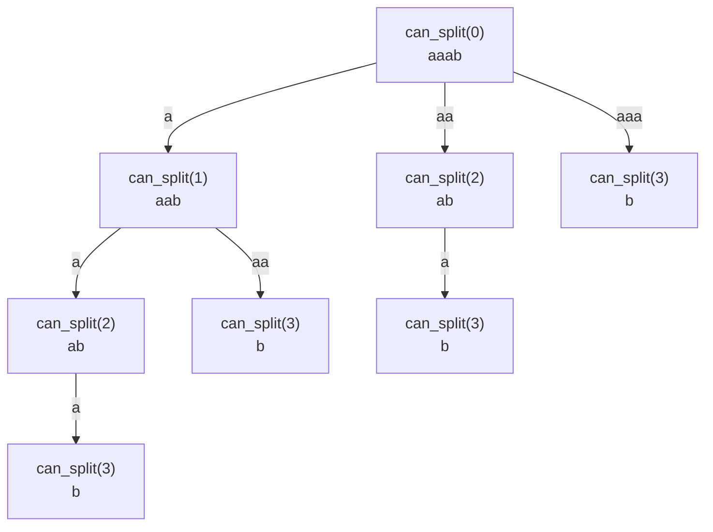
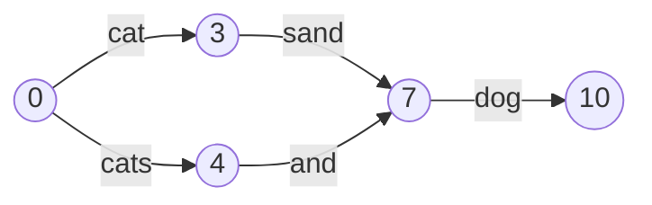

## Understand the problem

The words must cover `s` exactly, end to end, and each word can be used as often as we like.
Some cases to try by hand:

| `s` | `wordDict` | Answer | Why |
|---|---|---|---|
| `"yellowsun"` | yell, yellow, sun | `True` | `yellow + sun` |
| `"applepenapple"` | apple, pen | `True` | `apple + pen + apple` |
| `"catsandog"` | cats, dog, sand, and, cat | `False` | both routes get stuck on `"og"` |
| `"goalspecial"` | go, goal, goals, special | `True` | `goal + special` |
| `"aaaaaaa"` | aaaa, aaa | `True` | `aaa + aaaa` |

The `"goalspecial"` row rules out the greedy shortcuts. Taking the longest word first gives
`"goals"` and leaves `"pecial"`; taking the shortest gives `"go"` and leaves `"alspecial"`. Only
`"goal"` works, so we have to be ready to try every word that fits.

## Brute force: try every first word

The first word is some prefix `s[i:j]`. If it's in the dictionary, the question becomes the same
one for the rest, `s[j:]`. We describe "the rest" by its start index `i` rather than by slicing
out a new string:

```python
def can_split(i: int) -> bool:
    # Can s[i:] be split into words?
    if i == len(s):
        return True  # nothing left: the split is complete
    for j in range(i + 1, len(s) + 1):
        if s[i:j] in words and can_split(j):
            return True  # one working split is enough
    return False  # every first word led to a dead end
```

This is a feasibility recursion: the options are OR-ed together, the goal returns `True`, a dead
end returns `False`, and the loop can stop at the first success.

Without a memo it repeats itself badly. Here is `"aaab"` with the words `a`, `aa` and `aaa`: the
rest `"ab"` (index 2) is examined twice and `"b"` (index 3) four times, and the highlighted calls
redo work that was already done.



A string of `n` letters can be cut into pieces in 2^(n-1) ways (each gap between letters is cut
or not). On `"aaa...ab"` with the words `a`, `aa`, `aaa` and so on, most cuts of the `a`s are
made of words, and each one fails only when it reaches the `b`, so the recursion tries them all
before giving up. For 300 letters that never finishes.

## The key insight: the state is a position in the string

Whatever words came before, the question left is always "can `s[i:]` be split?", and it depends
only on `i`. Picture the positions as stops and each dictionary word as a hop from one stop to
another; the question is whether some route gets from 0 to the end. For `"catsanddog"`:



Two routes reach position 7, and "can `s[7:]` be split?" has the same answer for both. That's the
overlapping subproblem: there are only `n + 1` positions, so memoize on the index
([choosing the memo key](#/algo/learn/dynamic-programming/choosing-the-memo-key)). No word is
longer than the longest one in the dictionary, so only those lengths need trying:

```python
class Solution:
    def wordBreak(self, s: str, wordDict: list[str]) -> bool:
        words = set(wordDict)  # O(1) average lookups instead of scanning a list
        longest = max(len(w) for w in words)
        return self.can_split(s, 0, words, longest, {})

    def can_split(
        self, s: str, i: int, words: set[str], longest: int, memo: dict[int, bool]
    ) -> bool:
        if i == len(s):
            return True
        if i in memo:
            return memo[i]
        ok = False
        for j in range(i + 1, min(len(s), i + longest) + 1):
            if s[i:j] in words and self.can_split(s, j, words, longest, memo):
                ok = True
                break
        memo[i] = ok  # store False too, or every dead end is explored again
        return ok
```

> **Pitfall.** Key the memo on the index, not on the remaining string. A string key works, but
> every lookup slices and hashes up to `n` characters, which turns each O(1) step into O(n).

## Bottom-up: fill from the end of the string

`ok[i]` answers "can `s[i:]` be split?". The empty rest, `ok[n]`, is `True`, and each `ok[i]`
needs only later positions, so fill from right to left
([one-dimensional DP](#/algo/learn/dynamic-programming/one-dimensional-dp)). For the false
example `"catsandog"`:

```grid
collabels: 0 1 2 3 4 5 6 7 8 9
rowlabels: s ok
c a t s a n d o g _
_ _ _ _ _ _ T F F T
highlight: 0,6 0,7 0,8 1,6 1,9
caption: ok[9] = T: nothing left. ok[6] = T: "dog" is a word and ok[9] is T
---
collabels: 0 1 2 3 4 5 6 7 8 9
rowlabels: s ok
c a t s a n d o g _
F F F F F F T F F T
highlight: 1,0 1,3 1,4 1,7
caption: "cat" + "sand" or "cats" + "and": both routes end at 7, which is F
```

Both routes from the start end up at position 7, and nothing splits `"og"`, so `ok[0]` is
`False`. The `"dog"` at position 6 is a word, but no route reaches it.

## The solution

```python
class Solution:
    def wordBreak(self, s: str, wordDict: list[str]) -> bool:
        words = set(wordDict)
        lengths = sorted({len(w) for w in words})  # only these lengths can be words
        n = len(s)
        ok = [False] * (n + 1)
        ok[n] = True  # the empty rest is already split
        for i in range(n - 1, -1, -1):
            for length in lengths:
                j = i + length
                if j > n:
                    break  # this length and every longer one run past the end
                if ok[j] and s[i:j] in words:
                    ok[i] = True  # word s[i:j], then a splittable rest
                    break
        return ok[0]
```

Checking `ok[j]` before `s[i:j] in words` skips building the slice whenever the rest can't be
split anyway.

## Complexity

With `n = len(s)`, `L` = the longest word's length and `W` = the total letters in `wordDict`:

- **Time: O(W + n × L²).** Building the set reads every word once. Each of the `n` positions
  tries at most `L` lengths, and slicing and hashing a candidate costs O(L). For the limits here
  that's about 300 × 20 × 20 = 120,000 character steps. Trying every end position `j` instead
  costs O(n³) (n² slices of up to `n` letters): still fine for 300 letters, but bounding the
  length by `L` is the better answer.
- **Space: O(n + W)** for the table and the set. The top-down version also uses O(n) of call
  stack.

## Pitfalls and variations

- **Not storing `False`.** If the memo only records successes, `"aaa...ab"` is exponential again.
- **A list instead of a set** for the dictionary: every `in` scans up to 1,000 words.
- **Returning the first matching word's result** (`return can_split(j)`) instead of trying the
  other words when it fails: that's the greedy bug in disguise.
- **The base case is `True`.** Reaching the end of the string means every letter was covered.
- **Return every possible sentence** (a common follow-up): memoize the list of sentences for each
  position. The output itself can be exponential (`"aaaa..."` with `a`, `aa`), so no algorithm is
  fast in the worst case; say so.
- **A trie** of the words lets you walk forward from `i` one letter at a time and find every word
  that starts there in O(L), without slicing: O(n × L) overall.
- **Breadth-first search** over positions (the hops in the diagram) is another way to ask "is the
  end reachable from 0?", with the same complexity.
