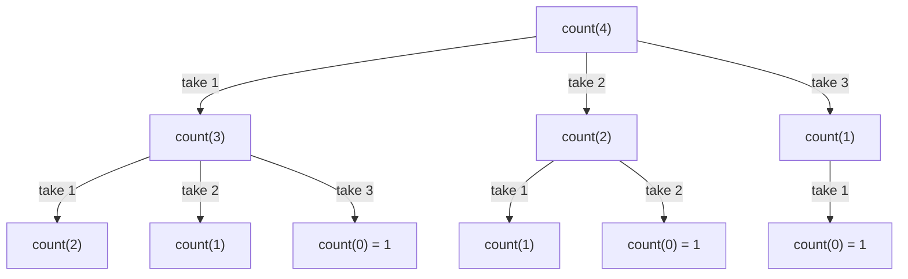

## Understand the problem

We count **ordered** sequences built from `nums`, with repeats allowed, that add up to `target`.
Problem titles often call them "permutations" or "combinations", but what's counted are
sequences: `1 + 3` and `3 + 1` are different. For `nums = [1, 2, 3]`, `target = 4` there are 7:

| Numbers used | Sequences |
|---|---|
| four 1s | `1+1+1+1` |
| two 1s and a 2 | `1+1+2`, `1+2+1`, `2+1+1` |
| a 1 and a 3 | `1+3`, `3+1` |
| two 2s | `2+2` |

If order didn't matter there would be only 4 (one per row). Keep that difference in mind: it
decides the loop order at the end.

## Brute force: build every sequence

[Backtracking](#/algo/learn/patterns/backtracking) could generate every sequence and count them.
But the answer can be about two billion (`nums = [1, 2, 3]`, `target = 36` gives 2,082,876,103),
and generating each sequence takes at least one step, so no enumeration can be fast. We need to
count without listing.

Think about the **first number** of a sequence. If it's `x`, the rest is any sequence that adds
up to `target - x`. The groups for different first numbers don't overlap, so their counts add up:

```python
def count(left: int) -> int:
    if left == 0:
        return 1  # nothing left: the sequence is complete, one way
    total = 0
    for x in nums:
        if x <= left:  # a bigger x would overshoot: no way through there
            total += count(left - x)
    return total


answer = count(target)
```

This is the "count the ways" shape of the
[helper plus memo template](#/algo/learn/dynamic-programming/top-down-helper-plus-memo): add the
choices, return 1 for a finished way and 0 (here, simply skip) for a dead end.

It recomputes the same remainders over and over. Here are the first three levels for
`nums = [1, 2, 3]`, `target = 4`. `count(2)` and `count(1)` keep reappearing; the highlighted
calls repeat work done elsewhere in the tree:



Every sequence it counts ends in a call to `count(0)` of its own, so the number of calls is at
least the answer: over two billion for `target = 36`. Dead ends cost calls too, so even an
answer of 0 can take exponential time.

## The key insight: only the amount left matters

How we got to a remainder doesn't change how many ways there are to finish it, and every number
is still available. So the memo key is the remaining target, the same key as in
[Coin Change](#/algo/problem/a05_coin_change), and there are only `target + 1` different
questions:

```python
class Solution:
    def combinationSum4(self, nums: list[int], target: int) -> int:
        return self.count(nums, target, {})

    def count(self, nums: list[int], left: int, memo: dict[int, int]) -> int:
        if left == 0:
            return 1
        if left in memo:
            return memo[left]
        total = 0
        for x in nums:
            if x <= left:
                total += self.count(nums, left - x, memo)
        memo[left] = total  # zeros included
        return total
```

> **Pitfall.** Test membership with `if left in memo`, not `if memo.get(left):`. A stored 0 is
> falsy, so the second version treats every dead end as "not computed yet" and explores it again.
> With all-even numbers and an odd target, every remainder is a dead end, and the solution is
> exponential again.

## Bottom-up: fill the counts from 0 upwards

`ways[t]` is the number of sequences adding up to `t`, and each one reads only smaller indexes,
so fill them in increasing order
([bottom-up tables](#/algo/learn/dynamic-programming/bottom-up-tables)). For
`nums = [1, 2, 3]`, `target = 4`:

```array
label: ways
values: 1 _ _ _ _
highlight: 0
caption: ways[0] = 1: the empty sequence
---
label: ways
values: 1 1 _ _ _
pointers: t=1
highlight: 0
caption: ways[1] = ways[0] = 1: only the 1 fits
---
label: ways
values: 1 1 2 _ _
pointers: t=2
highlight: 0 1
caption: ways[2] = ways[1] + ways[0] = 2
---
label: ways
values: 1 1 2 4 _
pointers: t=3
highlight: 0 1 2
caption: ways[3] = ways[2] + ways[1] + ways[0] = 4
---
label: ways
values: 1 1 2 4 7
pointers: t=4
highlight: 1 2 3
caption: ways[4] = ways[3] + ways[2] + ways[1] = 7
```

With `nums = [1, 2]`, this is exactly [Climbing Stairs](#/algo/problem/a04_climbing_stairs): the
numbers are the step sizes.

## Order matters: which loop goes outside

The same table with the loops swapped counts something else. With the **target on the outside**,
`ways[t]` adds every possible first number for every `t`, so `1 + 2` and `2 + 1` are both
counted. With the **numbers on the outside**, the table first counts the sums made of the first
number only, then lets the second one in, and so on, so every combination is built in just one
order: its numbers in list order. For `nums = [1, 2]`:

```grid
collabels: 0 1 2 3 4 5 6
rowlabels: sequences combinations
1 1 2 3 5 8 13
1 1 2 2 3 3 4
highlight: 0,3 1,3
caption: target 3: 1+1+1, 1+2, 2+1 are 3 sequences but only 2 combinations
```

```python
# Ordered sequences (this problem): target outside, numbers inside.
for t in range(1, target + 1):
    for x in nums:
        if x <= t:
            ways[t] += ways[t - x]

# Combinations, order ignored ("coin change II"): numbers outside, target inside.
for x in nums:
    for t in range(x, target + 1):
        ways[t] += ways[t - x]
```

When counting, the [knapsack-style](#/algo/learn/dynamic-programming/knapsack-and-coin-problems)
loop order changes what gets counted. For a minimum, as in Coin Change, either order gives the
same answer.

## The solution

```python
class Solution:
    def combinationSum4(self, nums: list[int], target: int) -> int:
        nums = sorted(nums)  # so the inner loop can stop at the first number that's too big
        ways = [1] + [0] * target  # ways[0] = 1: the empty sequence
        for t in range(1, target + 1):
            total = 0
            for x in nums:
                if x > t:
                    break  # this number and every larger one overshoots t
                total += ways[t - x]  # sequences that start with x
            ways[t] = total
        return ways[target]
```

## Complexity

- **Time: O(target × k)**, where `k = len(nums)`, plus O(k log k) for the sort: at most
  1,000 × 200 = 200,000 additions.
- **Space: O(target)** for the table. The top-down version adds up to `target` levels of
  recursion (with a 1 in `nums`).

## Pitfalls and variations

- **The overshoot check.** Recurse on `left - x` only when `x <= left`. Writing the comparison
  the wrong way round (`left - x <= 0`) recurses only on the overshoots.
- **Zeros in the memo**: see the pitfall above.
- **Overflow in other languages.** The final answer fits in 32 bits, but `ways[t]` for some
  smaller `t` may not: with even numbers and an odd target the answer is 0, while the even
  entries grow huge. In Java or C++ use a wider or unsigned type there; Python's integers never
  overflow.
- **Negative numbers allowed?** A common follow-up. Then the count can be infinite: with
  `[1, -1]` you can keep adding `1 + (-1)` forever. You'd have to cap the sequence length, and
  the state becomes (remaining target, length used).
- **List the sequences themselves**: that's backtracking, and its running time is at least the
  size of the output.
- **Related problems**: [Coin Change](#/algo/problem/a05_coin_change) is the same recurrence with
  `min` instead of `+`; counting combinations swaps the loops, as shown above.
