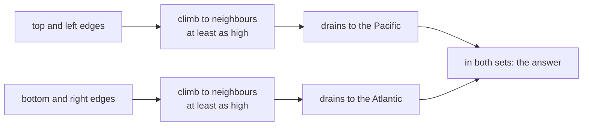

## Understand the problem

Think of the grid as a graph: each cell is a node, joined to its four neighbours, and water can
move along a join from a cell to a neighbour that is **no higher**. A cell counts if its water
can reach the top or left edge (the Pacific) *and* the bottom or right edge (the Atlantic). Water
can run across equal heights, so flat areas pass water both ways.

Facts worth stating before coding:

- Every cell on the top row or left column touches the Pacific, and every cell on the bottom row
  or right column touches the Atlantic. The top-right and bottom-left corners touch both.
- With a single row or a single column, every cell touches both oceans.
- A cell lower than all its neighbours (Example 2's middle 0) keeps its water, and reaches
  neither ocean unless it is on an edge itself.

## Brute force: follow the water from every cell

For each cell, run a search ([DFS or BFS](#/algo/learn/patterns/graph-traversal)) over the cells
its water can reach, stepping only to neighbours that are no higher, and note whether it touches
each ocean. Here is the 6 in Example 1 (row 1, column 1) reaching both, drawn on the island with
its ring of ocean:

```grid
_ P P P P _
P 1 2 3 4 A
P 2 6 7 3 A
P 3 5 4 2 A
P 4 3 2 1 A
_ A A A A _
dim: 0,0 0,1 0,2 0,3 0,4 0,5 1,0 2,0 3,0 4,0 1,5 2,5 3,5 4,5 5,0 5,1 5,2 5,3 5,4 5,5
highlight: 2,2
path: 2,2 1,2 0,2
caption: 6 → 2 → the Pacific
---
_ P P P P _
P 1 2 3 4 A
P 2 6 7 3 A
P 3 5 4 2 A
P 4 3 2 1 A
_ A A A A _
dim: 0,0 0,1 0,2 0,3 0,4 0,5 1,0 2,0 3,0 4,0 1,5 2,5 3,5 4,5 5,0 5,1 5,2 5,3 5,4 5,5
highlight: 2,2
path: 2,2 3,2 4,2 5,2
caption: 6 → 5 → 3 → the Atlantic
```

It is correct, but one search can cover the whole grid, and we run one per cell: **O((m · n)²)**.
The worst case is a basin. Every cell in it searches the entire basin, finds that the rim is
higher, and reaches neither ocean:

```grid
9 9 9 9 9 9
9 1 1 1 1 9
9 1 1 1 1 9
9 1 1 1 1 9
9 1 1 1 1 9
9 9 9 9 9 9
highlight: 1,1 1,2 1,3 1,4 2,1 2,2 2,3 2,4 3,1 3,2 3,3 3,4 4,1 4,2 4,3 4,4
caption: each of the 16 inner cells searches all 16 and gets nowhere
```

On a 200 x 200 grid with a big basin that is about 40,000 searches of up to 40,000 cells each,
over a billion steps. The [input size](#/algo/learn/complexity/input-size-tells-you-the-target)
says we need something close to O(m · n).

## The key insight: start from the oceans and walk uphill

The searches from different cells repeat each other's work, and most of them are looking for the
same two things: an edge of the Pacific and an edge of the Atlantic. So
[turn the search around](#/algo/learn/approach/brute-force-first). Instead of asking where each
cell's water goes, ask **which cells' water can arrive at the Pacific**.

Run the flow backwards. Water moves from a cell to a neighbour that is no higher, so going
against it, from a cell we may step to a neighbour that is **at least as high**. Start one search
at all the Pacific edge cells together and climb: every cell it reaches drains to the Pacific,
and every cell it can't reach doesn't. Do the same from the Atlantic edge cells. The answer is the
cells found by both searches.



On Example 1:

```grid
1 2 3 4
2 6 7 3
3 5 4 2
4 3 2 1
highlight: 0,0 0,1 0,2 0,3 1,0 2,0 3,0
caption: Pacific: start from the top row and the left column
---
1 2 3 4
2 6 7 3
3 5 4 2
4 3 2 1
highlight: 0,0 0,1 0,2 0,3 1,0 2,0 3,0 1,1 1,2 2,1
caption: climb: 6 (above 2), 7 (above 3), 5 (above 3) join. Nothing else can
---
1 2 3 4
2 6 7 3
3 5 4 2
4 3 2 1
highlight: 3,0 3,1 3,2 3,3 0,3 1,3 2,3
caption: Atlantic: start from the bottom row and the right column
---
1 2 3 4
2 6 7 3
3 5 4 2
4 3 2 1
highlight: 3,0 3,1 3,2 3,3 0,3 1,3 2,3 2,2 2,1 1,1 1,2
caption: climb: 4, then 5, 6 and 7 join
---
1 2 3 4
2 6 7 3
3 5 4 2
4 3 2 1
highlight: 0,3 1,1 1,2 2,1 3,0
caption: in both sets: [0, 3], [1, 1], [1, 2], [2, 1], [3, 0]
```

Each search marks a cell the first time it reaches it and never processes it again, so it is one
pass over the grid per ocean, however the cells are connected.

## The solution

```python
class Solution:
    def pacificAtlantic(self, heights: list[list[int]]) -> list[list[int]]:
        if not heights or not heights[0]:
            return []
        rows, cols = len(heights), len(heights[0])

        def climb(starts):
            reached = set(starts)
            stack = list(reached)
            while stack:
                r, c = stack.pop()
                for nr, nc in ((r + 1, c), (r - 1, c), (r, c + 1), (r, c - 1)):
                    if (
                        0 <= nr < rows
                        and 0 <= nc < cols
                        and (nr, nc) not in reached
                        and heights[nr][nc] >= heights[r][c]
                    ):
                        reached.add((nr, nc))
                        stack.append((nr, nc))
            return reached

        pacific = climb([(0, c) for c in range(cols)] + [(r, 0) for r in range(rows)])
        atlantic = climb(
            [(rows - 1, c) for c in range(cols)] + [(r, cols - 1) for r in range(rows)]
        )
        return [[r, c] for r, c in sorted(pacific & atlantic)]
```

Details that matter:

- **One search per ocean, many starting points.** All the edge cells of an ocean go on the stack
  at once (a *multi-source* search), rather than one search per edge cell. Searches started from
  different edge cells would only re-find the same cells.
- **A separate `reached` set per ocean.** The Atlantic search must be free to revisit cells the
  Pacific search found.
- **An explicit stack** instead of recursion. A recursive DFS works too, but a winding path of
  equal heights can make it m · n = 40,000 calls deep, far past Python's default limit of about
  1,000. A queue (BFS) works equally well; only the order of visits changes.
- `sorted` is only for tidy output: any order is accepted.

**Why it is correct.** If the climb from the Pacific reaches a cell, the steps it took, read
backwards, are a path on which water only flows downhill or level, ending at a Pacific edge cell,
so the cell's water reaches the Pacific. Conversely, if a cell's water can reach the Pacific, the
path it takes, read backwards from the edge, only ever steps up or level, so the climb finds it.
The same holds for the Atlantic.

## Complexity

- **Time: O(m · n).** Each search adds a cell to its stack at most once and checks its four
  neighbours once, so two searches touch each cell at most twice. The intersection is O(m · n)
  as well.
- **Space: O(m · n)** for the two sets and the stack.

Compared with the brute force: on a 200 x 200 grid, about 160,000 cell checks per search instead
of over a billion steps.

## Pitfalls and variations

- **Climbing the wrong way.** Walking back from the ocean, the next cell must be `>=` the current
  one. Using `<=` follows the water forwards instead, and `>` misses flat areas, where water does
  flow.
- **Sharing one visited set** between the two oceans makes the second search skip cells.
- **Seeding only one edge** per ocean, such as the top row but not the left column.
- **Recursion depth** with a recursive DFS on a large grid (see above).
- **Returning tuples or a set.** Build a list of `[r, c]` lists.
- **The same "flood from the border" trick** solves Surrounded Regions and Number of Enclaves:
  start from the edge cells to find everything connected to the outside, rather than searching
  outwards from every inner cell.
- **Multi-source search** in general: start one search from all the sources at once. With a
  queue and distances it becomes a multi-source BFS (the distance from every cell to its nearest
  exit, or how long rot takes to spread). For shortest paths in a grid see
  [Shortest Path in Binary Matrix](#/algo/problem/a35_shortest_path_in_binary_matrix).
