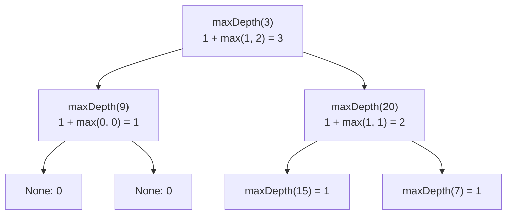

## Understand the problem

The depth is the number of nodes on the longest path that starts at the root and ends at a leaf.
Two things are worth confirming out loud before coding:

- **Nodes or edges?** Here we count nodes: a single node has depth 1 and an empty tree depth 0.
  Some books count edges instead (and call it the height), which gives one less.
- **Where does a path end?** At a leaf, a node with no children. A node with one child is not a
  leaf, so a path through it continues into that child.

```tree
values: 1 null 2 3 4
highlight: 1 2 4
caption: 1 → 2 → 4 is one of the two longest paths: depth 3
```

The edge cases are short to list: the empty tree (0), a single node (1), and a "stick" where
every node has exactly one child, whose depth is the number of nodes.

```tree
values: 1 2 null 3 null 4
caption: a stick of 4 nodes: depth 4, the worst case for recursion depth
```

## Brute force

The literal reading is "list every root-to-leaf path and keep the longest". Copying out each path
costs O(n · h) for a tree of n nodes and height h, which is O(n²) for a stick. But we never need
the paths themselves, only their lengths, and any correct method must look at every node anyway:
the deepest leaf could be anywhere. So O(n) is the target, and the real question is how to
organise the walk. There are two natural ways, and both are worth knowing:

- **Depth-first (recursion)**: the answer for a node comes from the answers for its two subtrees.
- **Breadth-first (levels)**: walk the tree level by level and count the levels.

## The key insight: depth is defined recursively

The longest path from a node goes down through whichever subtree is deeper, plus the node itself:

```
depth(None) = 0
depth(node) = 1 + max(depth(node.left), depth(node.right))
```

A [recursive](#/algo/learn/complexity/recursion) function computes this bottom-up: a node's call
returns only after both children's calls have returned, so the leaves finish first and the root
last (a post-order walk). On Example 1:

```tree
values: 3 9 20 null null 15 7
highlight: 9
dim: 3 20 15 7
caption: 9 has no children: depth(9) = 1 + max(0, 0) = 1
---
values: 3 9 20 null null 15 7
highlight: 15 7
dim: 3 20
caption: 15 and 7 are leaves too: depth 1 each
---
values: 3 9 20 null null 15 7
highlight: 20
dim: 3
caption: depth(20) = 1 + max(1, 1) = 2
---
values: 3 9 20 null null 15 7
highlight: 3
caption: depth(3) = 1 + max(depth(9), depth(20)) = 1 + max(1, 2) = 3
```

The same computation as a tree of calls, each returning its answer to its parent. The `None`
children return 0; only 9's are drawn.



## The solution

```solution
```

Why it is correct, by induction on the size of the tree: an empty tree has depth 0. For a
non-empty tree, every root-to-leaf path is the root followed by a root-to-leaf path of the left
subtree or of the right one, so the longest is one node longer than the longer of the two, which
the recursive calls compute correctly because the subtrees are smaller.

## Another way: count the levels (BFS)

Breadth-first search visits the tree level by level: the root, then all its children, then all
their children. The depth is simply the number of levels. Keep the current level in a list,
build the next level from its children, and count:

```tree
values: 3 9 20 null null 15 7
highlight: 3
caption: level 1 = [3]. depth = 1
---
values: 3 9 20 null null 15 7
highlight: 9 20
dim: 3
caption: level 2 = the children of level 1 = [9, 20]. depth = 2
---
values: 3 9 20 null null 15 7
highlight: 15 7
dim: 3 9 20
caption: level 3 = [15, 7]. No children, so the next level is empty: depth = 3
```

```python
class Solution:
    def maxDepth(self, root: TreeNode | None) -> int:
        depth = 0
        level = [root] if root else []
        while level:
            depth += 1
            next_level = []
            for node in level:
                if node.left:
                    next_level.append(node.left)
                if node.right:
                    next_level.append(node.right)
            level = next_level
        return depth
```

There is a loop inside a loop, but each node is added to a level once and read once, so this is
O(n) too. It is the same idea as
[BFS by levels](#/algo/learn/patterns/bfs-by-levels-and-shortest-paths), and the basis of
[Binary Tree Level Order Traversal](#/algo/problem/a25_binary_tree_level_order_traversal).

A third option is an iterative depth-first search: a stack of `(node, depth)` pairs, pushing each
child with `depth + 1` and keeping the largest depth seen.

## Complexity

- **Time: O(n)** for every version: each node is visited once, with O(1) work per visit.
- **Space** is where they differ. Recursion keeps one call per level of the current path, so its
  stack is O(h). BFS holds one whole level, so its list is O(w), the width of the widest level.

| Tree shape (n nodes) | Recursion: O(h) | BFS: O(w) |
|---|---|---|
| Perfect (every level full) | O(log n) | O(n): the last level holds about n/2 nodes |
| Stick (one child each) | O(n) | O(1): one node per level |

Neither wins everywhere. In an interview, say which shape you expect and which cost you are
paying; see [space complexity](#/algo/learn/complexity/space-complexity).

## Pitfalls and variations

- **Off by one.** Returning 0 for a single node means you are counting edges. Agree on the
  definition first.
- **`if not root.val`** treats a node whose value is 0 as missing. Test `root is None`.
- **Python's recursion limit.** CPython stops at about 1,000 nested calls by default, so the
  recursive version raises `RecursionError` on the 1,000-level trees in these tests. Say so in an
  interview and offer the BFS or explicit-stack version (or `sys.setrecursionlimit`). This app's
  test runner raises the limit, so recursion passes here.
- **Minimum depth** (the nearest leaf) looks like the same problem with `min`, but it is not:
  `1 + min(depth(left), depth(right))` returns 1 for a root with one child, because the missing
  child counts as a path of length 0. Only real leaves end a path. BFS handles it naturally:
  return the level of the first leaf you meet.
- **The same post-order shape** solves Balanced Binary Tree (do the two subtree depths differ by
  at most one at every node?) and Diameter of Binary Tree (the longest path between any two nodes
  is the largest `depth(left) + depth(right)` over all nodes).
- Related tree warm-ups: [Same Tree](#/algo/problem/a23_same_tree) and
  [Invert Binary Tree](#/algo/problem/a24_invert_binary_tree) use the same recursion.
