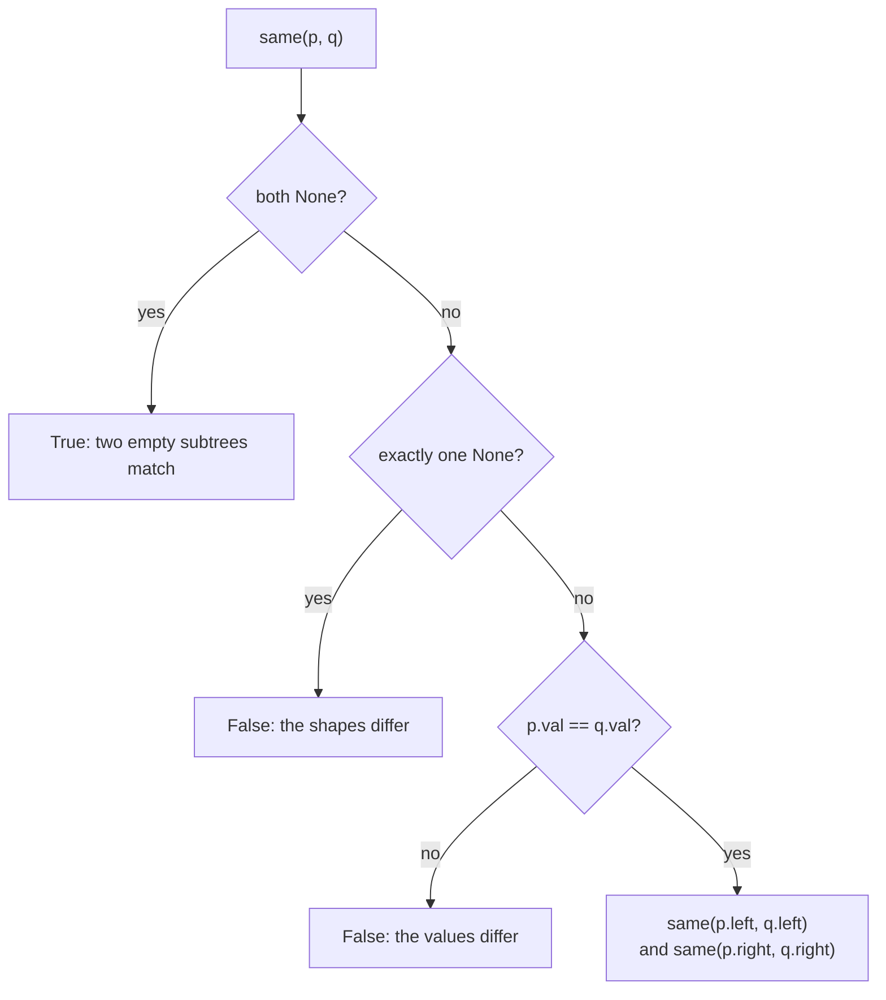

## Understand the problem

Two trees are the same when they have the same shape **and** the same value at every position.
Neither half is enough on its own:

- Example 2, `[1, 2]` and `[1, None, 2]`: the same values, but 2 hangs on different sides.
- Example 3, `[1, 2, 1]` and `[1, 1, 2]`: the same shape, but the left children differ.

```tree
values: 1 2 1
highlight: 2
caption: p = [1, 2, 1]
---
values: 1 1 2
highlight: 2
caption: q = [1, 1, 2]: same shape, different values on each side
```

Edge cases to say out loud: two empty trees are the same (`True`); an empty tree and a non-empty
one are not.

## Brute force: serialize both and compare

Turn each tree into a list and compare the lists. This works only if the list pins down the
shape, and the common traversals don't when they skip the missing children. `p = [2, 1]` and
`q = [1, None, 2]` both give the in-order list `1, 2`:

```tree
values: 2 1
caption: p = [2, 1]: in-order 1, 2
---
values: 1 null 2
caption: q = [1, None, 2]: in-order 1, 2 as well, but a different tree
```

Pre-order without markers fails too: `[1, 2, 3]` and `[1, 2, None, 3]` both give `1, 2, 3`. A
serialization that writes a marker for every missing child (like the level-order notation the
tests use, or pre-order with `None` markers) does identify a tree, so comparing those works. It
costs O(n + m) time and O(n + m) extra memory for the two lists, and it builds both lists in full
even when the roots already differ. We can do better on memory and stop early.

## The key insight: compare in lockstep

Walk both trees at the same time, always looking at the node in the same position in each. At
every position there are only four cases:



The last case is the recursion: the trees are the same exactly when the roots match and both
pairs of subtrees are the same. Take `p = [1, 2, 3, 4]` and `q = [1, 2, 3, None, 4]`, where 4 is a
left child in `p` and a right child in `q`:

| Call | Case | Result |
|---|---|---|
| `same(1, 1)` | values match | compare the left subtrees first |
| `same(2, 2)` | values match | compare the left subtrees first |
| `same(4, None)` | exactly one is `None` | `False` |

`False` travels back up. Because `and` short-circuits, `same(2, 2)` returns `False` without
comparing its right subtrees, and so does `same(1, 1)`: node 3 is never looked at.

```tree
values: 1 2 3 4
highlight: 1 2 4
dim: 3
caption: p: the walk visits 1, 2, 4 and stops
---
values: 1 2 3 null 4
highlight: 1 2
dim: 3 4
caption: q: 2 has no left child where p has 4, so the trees differ
```

## The solution

```solution
```

The order of the checks matters: `p.val` may only be read once we know `p` is not `None`, so both
`None` checks come first.

Why it is correct, by induction: two empty trees are the same; an empty and a non-empty tree are
not. Two non-empty trees are the same exactly when their roots hold equal values and their left
subtrees and right subtrees are pairwise the same, which the smaller recursive calls decide.

### Without recursion

The same lockstep walk works with an explicit stack of pairs, which avoids Python's recursion
limit on very deep trees:

```python
class Solution:
    def isSameTree(self, p: TreeNode | None, q: TreeNode | None) -> bool:
        stack = [(p, q)]
        while stack:
            a, b = stack.pop()
            if a is None and b is None:
                continue
            if a is None or b is None or a.val != b.val:
                return False
            stack.append((a.right, b.right))
            stack.append((a.left, b.left))
        return True
```

## Complexity

- **Time: O(min(n, m))** for trees of n and m nodes. Every call that gets past the `None` checks
  pairs a node of `p` with the node in the same position of `q`, so there are at most
  min(n, m) such calls, and each makes at most two more. Saying O(n + m) or O(max(n, m)) is a
  correct upper bound but a loose one: the walk can never go further than the smaller tree.
  When the trees are identical every node is visited, O(n).
- **Space: O(h)** for the recursion (or the stack), where h is the height of the shorter tree:
  O(log n) when balanced, O(n) for a stick.

## Pitfalls and variations

- **`p == q`** compares the node objects, not the trees. It is `True` only if they are the very
  same node.
- **Reading `p.val` before the `None` checks** raises `AttributeError` when one tree is shorter.
- **`if not p.val`** treats a node holding 0 as missing. Test `is None`.
- **Comparing traversals without markers** (see above): `[2, 1]` and `[1, None, 2]` look equal.
- **Symmetric Tree**: is a tree the mirror image of itself? Compare its two halves crosswise:
  `mirror(a, b) = a.val == b.val and mirror(a.left, b.right) and mirror(a.right, b.left)`. A tree
  is symmetric exactly when it is the same as its
  [inversion](#/algo/problem/a24_invert_binary_tree).
- **Subtree of Another Tree**: is `q` a subtree of `p`? Run this comparison at every node of `p`,
  O(n · m) in the worst case. For O(n + m), serialize both with `None` markers and a separator
  before every value (so `2` doesn't match inside `12`), then search for one string inside the
  other with a linear-time string search.
- **Many comparisons** (Find Duplicate Subtrees): number the distinct subtrees bottom-up. A hash
  map from `(val, left_id, right_id)` to an id gives equal subtrees equal ids, so comparing two
  subtrees is a single integer comparison.
- The same recursive shape computes the
  [maximum depth](#/algo/problem/a22_maximum_depth_of_binary_tree); see
  [tree traversals](#/algo/learn/data-structures/tree-traversals) for the visiting orders.
