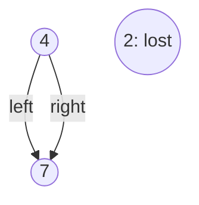

## Understand the problem

Inverting a tree produces its mirror image. At every node the left and right children trade
places, and each carries its entire subtree along, which is then mirrored as well.

It is tempting to read this as "reverse the values on each level". For a perfect tree the picture
happens to agree, but in general the *shape* changes too. A tree that leans left becomes one that
leans right:

```tree
values: 1 2 null 3
caption: [1, 2, None, 3]: 2 is a left child, 3 is 2's left child
---
values: 1 null 2 null 3
caption: inverted: [1, None, 2, None, 3]. Same values per level, different shape
```

Edge cases: an empty tree inverts to an empty tree, and a single node stays as it is.

## Brute force: build a mirrored copy

A first idea is to build a brand-new tree: the copy of a node gets, as its left child, the copy of
the original's right child, and vice versa.

```python
def mirror(node):
    if node is None:
        return None
    return TreeNode(node.val, mirror(node.right), mirror(node.left))
```

That is already O(n) time, so there is nothing slow to fix. It does use O(n) extra memory for the
second tree, and the problem lets us change the tree in place, which needs none.

## The key insight: swap at every node, in any order

Inverting means doing one swap at every node. The swaps don't interfere: swapping the children
of node 2 moves the subtrees rooted at 1 and 3 as whole units, whatever has happened inside them
so far. So **any** traversal that visits every node once and swaps its two children works:
pre-order, post-order or level by level.

Here are the swaps in pre-order (a node, then its left subtree, then its right) on Example 1:

```tree
values: 4 2 7 1 3 6 9
caption: start
---
values: 4 7 2 6 9 1 3
highlight: 4
caption: swap at 4: the subtrees rooted at 2 and 7 trade places, children and all
---
values: 4 7 2 9 6 1 3
highlight: 7
caption: swap at 7 (now the left child): 6 and 9 trade places
---
values: 4 7 2 9 6 3 1
highlight: 2
caption: swap at 2: 1 and 3 trade places. Swaps at the leaves change nothing
```

## The solution

Recursion says it most directly: invert both subtrees, then attach each on the other side.

```python
class Solution:
    def invertTree(self, root: TreeNode | None) -> TreeNode | None:
        if root is None:
            return None
        root.left, root.right = self.invertTree(root.right), self.invertTree(root.left)
        return root
```

Python evaluates the whole right-hand side (both recursive calls) before assigning either
attribute, so each call receives an original child. This version inverts the subtrees first and
swaps on the way back up (post-order); doing the swap first and recursing afterwards is just as
correct.

Why it is correct, by induction: the mirror image of an empty tree is empty. For a non-empty
tree, the mirror image has the same root, the mirrored right subtree on the left and the mirrored
left subtree on the right, which is exactly what the line builds from the smaller recursive calls.

### Without recursion: a queue

Visit the nodes level by level, swap each node's children, and queue the children to be swapped
in turn. This avoids Python's recursion limit on very deep trees.

```python
from collections import deque


class Solution:
    def invertTree(self, root: TreeNode | None) -> TreeNode | None:
        queue = deque([root] if root else [])
        while queue:
            node = queue.popleft()
            node.left, node.right = node.right, node.left
            if node.left:
                queue.append(node.left)
            if node.right:
                queue.append(node.right)
        return root
```

On Example 1 the queue runs like this (highlighted: the children just queued):

```array
label: queue
values: 4
highlight: 0
caption: start with the root
---
values: 7 2
highlight: 0 1
caption: took 4, swapped its children (now 7, 2) and queued them
---
values: 2 9 6
highlight: 1 2
caption: took 7, swapped its children (now 9, 6) and queued them
---
values: 9 6 3 1
highlight: 2 3
caption: took 2, swapped its children (now 3, 1) and queued them
```

The four leaves come out last. Swapping their two `None` children changes nothing and queues
nothing, so the loop ends with the tree `[4, 7, 2, 9, 6, 3, 1]`.

Swapping a stack for the queue (`pop()` instead of `popleft()`) gives an iterative depth-first
version; the order doesn't matter.

## Complexity

- **Time: O(n).** Each node is visited once and its swap is O(1).
- **Space: O(h)** for the recursion, where h is the height: O(log n) for a balanced tree, O(n)
  for a stick. The queue version holds up to one level, O(w) for the widest level, which is about
  n/2 for a perfect tree. Building a mirrored copy instead adds O(n) for the new nodes.

## Pitfalls and variations

### Assigning one child at a time

This looks right but loses a subtree:

```python
root.left = self.invertTree(root.right)
root.right = self.invertTree(root.left)  # root.left is already the new left
```

The second line reads `root.left` after it has been overwritten, so it processes the old right
subtree a second time and hangs it on the right as well. Both pointers now lead to the same
subtree, and the old left subtree is unreachable:



Save both children in variables first, or assign them together as in the solution.

### More to watch for

- **Forgetting `return root`.** The method must return the root (the tests read the tree from
  the return value); a recursive version that returns nothing also loses every subtree.
- **Very deep trees.** CPython's default recursion limit is about 1,000 calls; use the queue
  version (or raise the limit) for trees taller than that.
- **Symmetric Tree**: a tree is symmetric when it equals its own mirror image. Rather than
  inverting a copy and running [Same Tree](#/algo/problem/a23_same_tree), compare the two halves
  crosswise directly.
- **Flip Equivalent Binary Trees**: can one tree be turned into another by swapping the children
  of *some* nodes? At each node, the subtrees must match either straight or swapped.
- **N-ary trees**: inverting means reversing each node's list of children.
- The same "visit every node, do O(1) work" shape as
  [Maximum Depth of Binary Tree](#/algo/problem/a22_maximum_depth_of_binary_tree); see
  [tree traversals](#/algo/learn/data-structures/tree-traversals) for the visiting orders.
