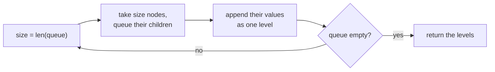

## Understand the problem

A node's level is its distance from the root: the root is alone on the first level, its children
make up the second, their children the third, and so on. We return one list per level, top to
bottom, each read left to right:

```tree
values: 3 9 20 null null 15 7
highlight: 3
caption: level 1: [3]
---
values: 3 9 20 null null 15 7
highlight: 9 20
caption: level 2: [9, 20]
---
values: 3 9 20 null null 15 7
highlight: 15 7
caption: level 3: [15, 7]
```

A level mixes nodes from different parents: in Example 2, 4 is the left child of 2 and 5 the
right child of 3, and they belong together because both are two steps from the root.

Edge cases: an empty tree returns `[]` (no levels, not `[[]]`), and a stick-shaped tree, where
every node has one child, returns one single-value list per node.

## Brute force: one walk per level

Find the height h. Then for each depth `d` from 0 to h - 1, walk the tree from the root, going
left before right and stopping at depth `d`, and collect the nodes found there. It is correct, but
every walk passes through all the shallower nodes again:

```tree
values: 1 2 3 4 5 6 7
highlight: 1
dim: 2 3 4 5 6 7
caption: the walk for depth 0 visits 1
---
values: 1 2 3 4 5 6 7
highlight: 1 2 3
dim: 4 5 6 7
caption: the walk for depth 1 visits 1 again, then 2 and 3
---
values: 1 2 3 4 5 6 7
highlight: 1 2 3 4 5 6 7
caption: the walk for depth 2: 1 a third time, 2 and 3 again, then 4 to 7
```

That is O(n · h) time: O(n log n) for a balanced tree, but **O(n²)** for a stick, where h = n.
A perfect tree of 8,191 nodes with a tail of about 1,000 nodes hanging below it costs about
8.6 million node visits this way, against about 9,000 for the solution below.

## The key insight: a queue hands out nodes level by level

A queue gives items back in the order they went in. Start it with the root, and repeatedly take
the node at the front and add its children at the back. Every node of one level is added before
any node of the next, because the next level's nodes are only added while this level's are being
taken out. So the nodes come out level by level, and within a level left to right, as long as we
add the left child before the right. This is breadth-first search (BFS).

To cut the stream into levels, read the queue's length at the start of each round. At that moment
the queue holds exactly one whole level: take out exactly that many nodes, and leave the children
they add for the next round.

```array
label: queue
values: 3
highlight: 0
caption: round 1 takes the 1 node in the queue: level 1 = [3]
---
values: 9 20
highlight: 0 1
caption: 3 queued 9 and 20. Round 2 takes 2 nodes: level 2 = [9, 20]
---
values: 15 7
highlight: 0 1
caption: 9 queued nothing, 20 queued 15 and 7. Round 3: level 3 = [15, 7]
```

After round 3 the queue is empty (15 and 7 have no children), so we are done.



## The solution

```solution
```

`range(len(queue))` is evaluated once, when the `for` loop starts, so the children appended
during the loop wait for the next round.

An equally good way to keep the levels apart is two plain lists: walk `level`, collect the
children into `next_level`, then set `level = next_level`. It needs no deque, because nothing is
ever removed from the front of a list.

## DFS works too

Depth-first search can produce the same answer, as long as it carries the depth along. A
pre-order walk (a node, then its left subtree, then its right) reaches the nodes of every level
from left to right, so appending each value to `levels[depth]` builds the lists in the right
order. On Example 2:

| Visit | Depth | `levels` afterwards |
|---|---|---|
| 1 | 0 | `[[1]]` |
| 2 | 1 | `[[1], [2]]` |
| 4 | 2 | `[[1], [2], [4]]` |
| 3 | 1 | `[[1], [2, 3], [4]]` |
| 5 | 2 | `[[1], [2, 3], [4, 5]]` |

```python
class Solution:
    def levelOrder(self, root: TreeNode | None) -> list[list[int]]:
        levels = []

        def visit(node, depth):
            if node is None:
                return
            if depth == len(levels):  # the first node seen on a new level
                levels.append([])
            levels[depth].append(node.val)
            visit(node.left, depth + 1)
            visit(node.right, depth + 1)

        visit(root, 0)
        return levels
```

BFS is still the natural fit, and the one to reach for when you might stop early (the first leaf,
the nearest target), but "DFS can't do levels" is not true.

## Complexity

- **Time: O(n).** Each node is added to the queue once and taken out once, with O(1) work in
  between. The loop inside a loop doesn't change that: the inner loops together run n times.
- **Space: O(w)** for the queue, where w is the widest level: up to about n/2 for a perfect
  tree, 1 for a stick. The output itself holds all n values. The DFS version uses O(h) for the
  recursion instead.

## Pitfalls and variations

- **`list.pop(0)`** shifts every remaining element, so it is O(length) and a BFS built on it can
  degrade towards O(n²) on wide trees. Use `collections.deque.popleft()`, which is O(1), or the
  two-list version. See [stacks and queues](#/algo/learn/data-structures/stacks-and-queues).
- **Not snapshotting the level size.** Looping `while queue:` inside a round, or checking the
  length again as you go, runs into the next level and merges them.
- **Queuing `None` children** means a later `node.val` raises `AttributeError`, or `None` values
  appear in the output.
- **`if node.val:`** to skip missing nodes also skips nodes whose value is 0.
- **Variations** that are the same loop with a small change: zigzag order (reverse every other
  level), bottom-up order (reverse the result), the right side view (the last value of each
  level), the average of each level, and the minimum depth (stop at the first leaf).
- [Maximum Depth of Binary Tree](#/algo/problem/a22_maximum_depth_of_binary_tree) is this loop
  counting rounds, and
  [Shortest Path in Binary Matrix](#/algo/problem/a35_shortest_path_in_binary_matrix) runs the
  same BFS by levels on a grid. More in
  [BFS by levels](#/algo/learn/patterns/bfs-by-levels-and-shortest-paths).
