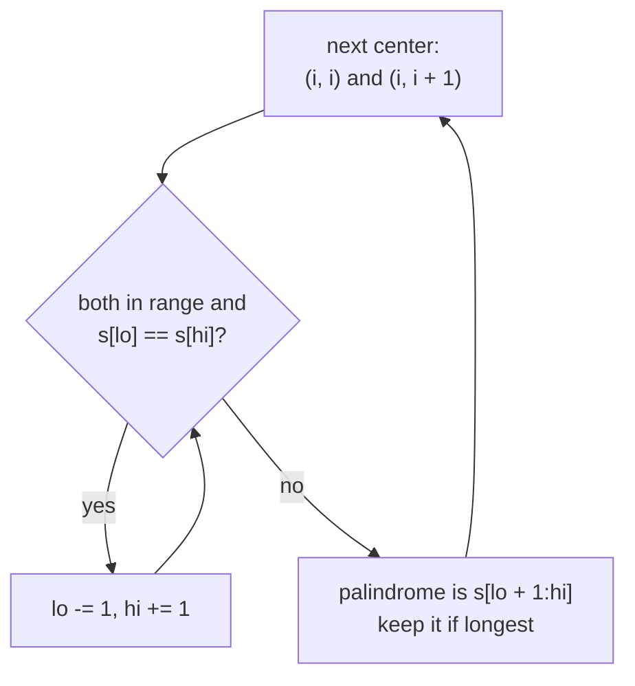

## Understand the problem

A palindrome is symmetric around its middle: the first character matches the last, the second
matches the second-to-last, and so on inwards to the middle one or two characters. Because we
want a *substring*, the characters stay in place: nothing can be skipped or moved.

| `s` | Answer | Why |
|---|---|---|
| `"baba"` | `"bab"` or `"aba"` | two palindromes of length 3; either is accepted |
| `"babab"` | `"babab"` | the whole string |
| `"cbbd"` | `"bb"` | even length: the middle is the gap between the two b's |
| `"abc"` | `"a"`, `"b"` or `"c"` | a single character is always a palindrome |
| `"Abcba"` | `"bcb"` | `A` and `a` are different characters |

Since every single character is a palindrome, the answer is never empty.

## Brute force: check every substring

```python
best = ""
for i in range(len(s)):
    for j in range(i, len(s)):
        sub = s[i : j + 1]
        if sub == sub[::-1] and len(sub) > len(best):
            best = sub
```

There are about n²/2 substrings, and copying, reversing and comparing one takes up to n steps,
so this is **O(n³)** time. For 2,500 characters that's over 3 million substrings averaging 800
characters each: seconds in Python, even though the slicing runs in C.

It also repeats itself. Checking `"xabax"` compares the inner `"aba"` again, although `"aba"` was
already checked as a substring of its own.

## A middle step: build long palindromes from short ones

`s[i..j]` is a palindrome exactly when its end characters match **and** its inside
`s[i+1..j-1]` is a palindrome (an inside of length 0 or 1 always is). Decide the substrings in
order of length and each one costs a single comparison plus a lookup of an answer we already
have. That is [bottom-up dynamic programming](#/algo/learn/dynamic-programming/bottom-up-tables)
on a table `pal[i][j]`:

```grid
collabels: b a b a
rowlabels: b a b a
T F T F
_ T F T
_ _ T F
_ _ _ T
highlight: 0,2 1,3
path: 1,1 0,2
caption: s = "baba". Row = start i, column = end j. pal[0][2] uses pal[1][1]
```

```python
n = len(s)
pal = [[False] * n for _ in range(n)]
start, end = 0, 0
for length in range(1, n + 1):
    for i in range(n - length + 1):
        j = i + length - 1
        if s[i] == s[j] and (length <= 2 or pal[i + 1][j - 1]):
            pal[i][j] = True
            start, end = i, j  # lengths only grow, so the last one found is a longest
return s[start : end + 1]
```

This is **O(n²)** time, one step per cell, and a correct answer in an interview. Storing only the
`True` cells in a dict keyed by `(i, j)` works the same way. But the table costs **O(n²)
space** (over 3 million cells for 2,500 characters), and the loops visit every cell even when
the string has no long palindromes at all. The usual follow-up is: can you drop the table?

## The key insight: expand around each center

Read the rule the other way round: if `s[lo..hi]` is a palindrome and `s[lo-1] == s[hi+1]`, then
`s[lo-1..hi+1]` is a palindrome too. So a palindrome grows outwards from its center, and the
moment one pair fails to match, nothing longer exists around that center. Instead of testing
n²/2 substrings, start at each center and move two
[pointers](#/algo/learn/patterns/two-pointers) apart until the characters differ.

An odd-length palindrome (`"aba"`) is centered on a character, an even-length one (`"abba"`) on
the gap between two characters. A string of n characters has n + (n - 1) = **2n - 1** centers:

```array
values: a _ b _ b _ a
highlight: 1 3 5
indices: false
caption: 4 letters, 7 centers: each letter (odd) and each gap (even)
```

Expanding from the letter at index 1 of `"babad"`:

```array
label: s
values: b a b a d
pointers: lo=1 hi=1
highlight: 1
caption: odd center: start with lo = hi = 1, the palindrome "a"
---
label: s
values: b a b a d
pointers: lo=0 hi=2
highlight: 0..2
caption: s[0] == s[2] (b, b): "bab". lo is at the start, so stop here
```

The next center, index 2, grows `"b"` to `"aba"` and then stops at `b` against `d`. Both give
length 3; we keep the first one found.

Expanding from the gap between the two b's of `"cabbad"`:

```array
label: s
values: c a b b a d
pointers: lo=2 hi=3
caption: even center: start with lo = 2, hi = 3. s[2] == s[3] (b, b)
---
label: s
values: c a b b a d
pointers: lo=1 hi=4
highlight: 2 3
caption: s[1] == s[4] (a, a): keep going
---
label: s
values: c a b b a d
pointers: lo=0 hi=5
highlight: 1..4
caption: s[0] != s[5] (c, d): stop. The palindrome is s[1..4] = "abba"
```

The loop always stops one step *past* the palindrome: on a mismatch, or with a pointer off the
end. So the palindrome it found is `s[lo + 1 .. hi - 1]`, or `s[lo + 1:hi]` as a Python slice.



## The solution

```solution
```

`expand` returns a half-open range `[lo, hi)`, so its length is simply `hi - lo`. An even center
whose two characters differ returns an empty range (length 0), which never wins.

Tracing `"cbbd"`: the odd centers give single letters. The gap between the b's matches
(`b == b`), then `c` against `d` fails, so it returns `s[1:3] = "bb"`, the longest.

**Why it's correct.** Take the longest palindrome `s[a..b]`. When we expand from its center,
every pair inside it matches, so the loop gets at least as far as `a` and `b`: it returns that
palindrome or a longer one around the same center. Every center is tried, so the longest
palindrome is found.

## Complexity

- **Time: O(n²) in the worst case.** There are 2n - 1 centers and an expansion takes up to n/2
  steps. The worst input is one letter repeated: every expansion runs to an end of the string,
  about n²/2 comparisons in total (about 3 million for n = 2,500, a fraction of a second). On
  ordinary text most expansions stop after a step or two, so the work is close to linear.
- **Space: O(1)** besides the returned string: two pointers and the best range. The table
  version needs O(n²).

> **Interview tip.** Mention both O(n²) solutions and say why you prefer expansion: the same
> time, O(1) space, and it stops early on real text. If asked for better than O(n²), name
> Manacher's algorithm: it reuses the mirror image of palindromes already found to skip
> comparisons and runs in O(n). A full implementation is rarely expected.

## Pitfalls and variations

- **Forgetting even lengths.** Expanding only from `(i, i)` misses `"bb"` in `"cbbd"` and every
  palindrome like `"abba"`.
- **Off by one after the loop.** When the loop ends, `lo` and `hi` sit on the mismatch (or past
  the ends). The palindrome is `s[lo + 1:hi]`, not `s[lo:hi + 1]`.
- **Slicing inside the loop.** Building `s[lo:hi + 1]` at every step copies characters, which
  brings back an extra factor of n. Keep indices and slice once at the end.
- **Reversing the string and taking the longest common substring.** It looks right, since a
  palindrome is equal to its reverse, but a common substring needn't sit at mirrored positions:

```array
label: s
values: a b a c d f g d c a b a
highlight: 0..4
caption: "abacd" is in s ...
---
label: reversed
values: a b a c d g f d c a b a
highlight: 0..4
caption: ... and in reversed s, but it is not a palindrome. The answer is "aba"
```

- **Longest palindromic *subsequence*** (characters may be skipped) is a different problem: a DP
  over two indices, equal to the
  [longest common subsequence](#/algo/problem/a09_longest_common_subsequence) of `s` and its
  reverse.
- **Count the palindromic substrings:** the same expansion, adding one for every matching step
  instead of keeping the longest.
