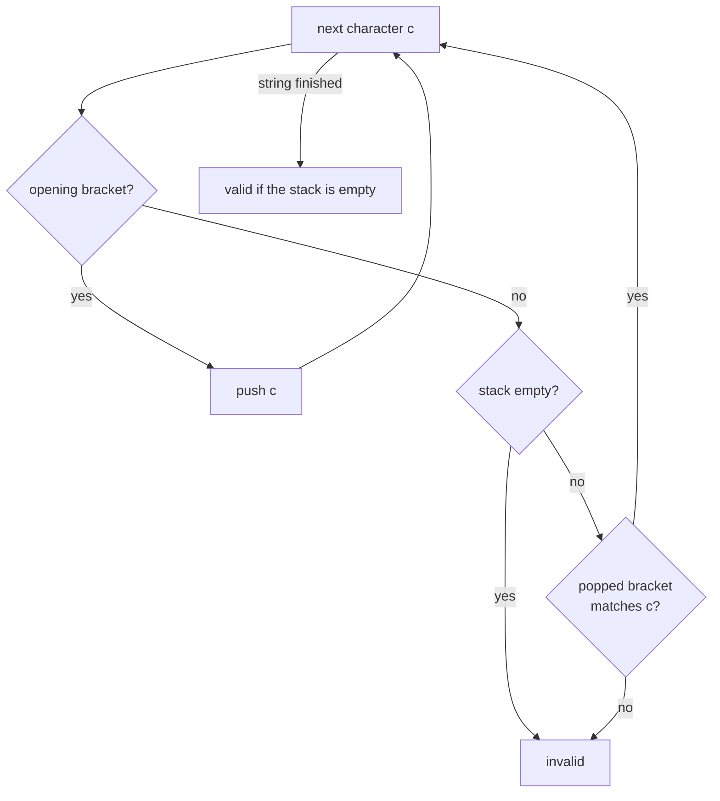

## Understand the problem

Before coding, list the ways a string can go wrong. Each one becomes a test:

| `s` | Valid? | What happens |
|---|---|---|
| `"()[]{}"` | yes | pairs one after another |
| `"{[()]}"` | yes | pairs nested inside each other |
| `"(}"` | no | the closing bracket has the wrong type |
| `"({)}"` | no | `)` closes while `{` is the innermost open bracket |
| `")("` | no | a closing bracket arrives with nothing open |
| `"(("` | no | brackets are still open at the end |
| `""` | yes | nothing to match |

`"({)}"` and `")("` show that counting each type is not enough: their counts balance, but the
*order* is wrong.

## Brute force: delete matched pairs until nothing changes

A valid, non-empty string always contains an adjacent pair `()`, `[]` or `{}` (its innermost
pair), and deleting that pair leaves a valid string. So keep deleting adjacent pairs; the string
was valid exactly when this ends with the empty string.

```array
label: s
values: { [ ( ) ] }
highlight: 2 3
caption: delete the adjacent pair "()"
---
label: s
values: { [ ] }
highlight: 1 2
caption: now "[]" is adjacent: delete it
---
label: s
values: { }
highlight: 0 1
caption: delete "{}": the string becomes empty, so it was valid
```

```python
while True:
    shorter = s.replace("()", "").replace("[]", "").replace("{}", "")
    if shorter == s:  # nothing left to delete
        return s == ""
    s = shorter
```

It's correct, and a good way to *define* validity, but each pass is O(n) and a deeply nested
string loses only one or two pairs per pass. `"(((...)))"` with 40,000 pairs needs 40,000
passes: **O(n²)**, seconds in Python.

## The key insight: the last bracket opened closes first

When a closing bracket arrives, the only bracket it may close is the most recently opened one
that is still open. Anything opened earlier is waiting *outside* it. "Last in, first out" is
exactly what a [stack](#/algo/learn/data-structures/stacks-and-queues) gives: push each opening
bracket, and the top of the stack is always the innermost bracket still open.

Reading `"{[()]}"`:

```array
label: stack
direction: vertical
values: { [ (
pointers: top=2
caption: read "{", "[", "(": push each one
---
label: stack
direction: vertical
values: { [
pointers: top=1
caption: read ")": the top is "(", a match. Pop it
---
label: stack
direction: vertical
values: {
pointers: top=0
caption: read "]": pop "[". Then "}" pops "{" and the stack is empty: valid
```

Reading `"([)]"`, the stack catches the crossed pairs that counting misses:

```array
label: stack
direction: vertical
values: ( [
pointers: top=1
highlight: 1
caption: read ")": the top is "[", not "(". Invalid
```

Each character needs one decision:



## The solution

```python
class Solution:
    def isValid(self, s: str) -> bool:
        opener = {")": "(", "]": "[", "}": "{"}
        stack = []
        for c in s:
            if c in opener:  # a closing bracket
                if not stack or stack.pop() != opener[c]:
                    return False
            else:
                stack.append(c)
        return not stack  # anything left was never closed
```

The dict maps each closing bracket to its opener, so one lookup answers both "is this a closing
bracket?" and "which opener must be on top?". `not stack` is checked before `pop()`, which would
raise an `IndexError` on `")"`.

Trace the edge cases before saying you're done, as you would in an
[interview](#/algo/learn/approach/test-it):

- `")"`: the stack is empty when `)` arrives, so return `False` (without that check, `pop()`
  crashes).
- `"(("`: the loop finishes without a mismatch, but two openers remain, so `not stack` is
  `False`.
- `""`: the loop never runs and the empty stack gives `True`. No special case is needed.

An optional shortcut: a valid string has even length (every opener pairs with one closer), so
`if len(s) % 2: return False` rejects odd lengths at once. It doesn't change the complexity.

## Complexity

- **Time: O(n).** One pass; each character is pushed or popped at most once, in O(1).
- **Space: O(n).** A string of openers, like `"(((("`, puts every character on the stack.

## Pitfalls and variations

- **Popping an empty stack.** `")"` and `"())"` crash with `IndexError` unless you check
  `not stack` first.
- **Returning `True` after the loop.** Leftover openers (`"(("`) make the string invalid.
- **Counting instead of stacking.** Balanced counts don't mean balanced order: `"([)]"`, `")("`.
- **One bracket type only:** a stack of identical characters is just a counter. Add 1 for `(`,
  subtract 1 for `)`, fail if it goes negative, and require 0 at the end: O(1) space. With
  several types you need the stack to remember *which* type is open.
- **Follow-ups on the same idea:** the minimum number of insertions to make a string valid (count
  the unmatched closers and leftover openers); the longest valid substring (a stack of indices);
  matching HTML or XML tags (push tag names instead of characters); evaluating arithmetic
  expressions. [Stack samples to trace events](#/algo/problem/a43_stack_samples_to_trace_events)
  uses the same "innermost first" order for function calls.
