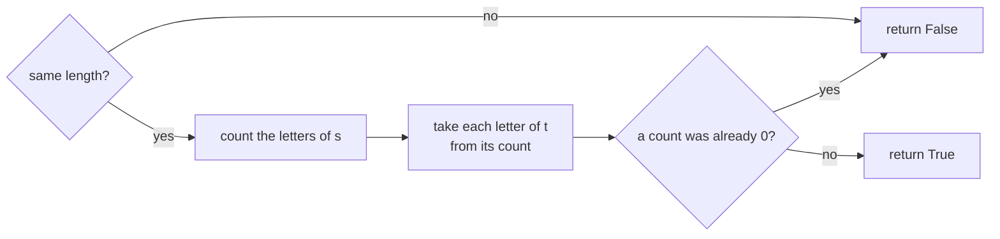

## Understand the problem

Two strings are anagrams when one is a rearrangement of the other: the same letters, each the same
number of times. Order is irrelevant; only the counts matter.

| `s` | `t` | Answer | Why |
|---|---|---|---|
| `"tea"` | `"eat"` | True | same letters, new order |
| `"aab"` | `"abb"` | False | same *set* of letters, different counts |
| `"ab"` | `"aab"` | False | different lengths are never anagrams |
| `""` | `""` | True | nothing to rearrange |
| `"rat"` | `"car"` | False | c is not in `s`, t is not in `t` |

Things to clarify: are upper and lower case the same letter (`"Tea"` and `"eat"`)? Do spaces
count? Can the strings hold any Unicode characters? Here they are lowercase a to z only.

## Brute force

Generating every rearrangement of `s` and checking whether one equals `t` is correct and
hopeless: a 20-letter string has 2.4 × 10^18 orderings.

A sensible brute force crosses letters off: for each letter of `s`, find an unused copy in `t` and
cross it out. If some letter has no copy left, the answer is `False`.

```array
label: t
values: e a t
pointers: find=2
caption: s = "tea": the t is at index 2, cross it off
---
label: t
values: e a t
pointers: find=0
dim: 2
caption: the e is at index 0
---
label: t
values: e a t
pointers: find=1
dim: 0 2
caption: the a is at index 1: every letter matched, an anagram
```

Each search (and each removal from a list) is O(n), so this is **O(n²)**: over a billion steps for
two strings of 5 × 10^4 letters, when the letters are arranged badly.

## Better: sort both strings

Rearranging doesn't change the sorted order, so anagrams sort to the same string:

```array
label: sorted(s)
values: a a a g m n r
---
label: sorted(t)
values: a a a g m n r
caption: "anagram" and "nagaram" both sort to "aaagmnr"
```

`sorted(s) == sorted(t)` is one line and **O(n log n)**: good, and worth saying. But sorting
computes a full order, and we only need the counts.

## The key insight: compare letter counts

Count each string's letters in one pass and compare the tables. Counting is O(n), and a
[hash map](#/algo/learn/data-structures/hash-maps-and-sets) from letter to count is the natural
table:

```python
def letter_counts(word: str) -> dict[str, int]:
    table = {}
    for ch in word:
        table[ch] = table.get(ch, 0) + 1
    return table


def is_anagram(s: str, t: str) -> bool:
    return letter_counts(s) == letter_counts(t)
```

`collections.Counter(s) == Counter(t)` is the same thing in one line. With only lowercase letters,
an array of 26 counts indexed by `ord(ch) - ord("a")` works too.

**What if the tables couldn't be compared with `==`?** (A common follow-up.) Two tables are equal
when they have the same keys and every key has the same count:

```python
def same_counts(a: dict[str, int], b: dict[str, int]) -> bool:
    if a.keys() != b.keys():  # key views compare like sets
        return False
    return all(a[ch] == b[ch] for ch in a)
```

Each table has at most 26 keys, so this check is O(1) here.

## One table is enough

Instead of two tables, count `s` up and `t` down in the same table. Every letter of `t` must find a
count above zero to take from; if one doesn't, `t` has more of that letter than `s`.

```grid
collabels: a c r t
rowlabels: count
1 0 1 1
caption: s = "rat": +1 for each letter
---
collabels: a c r t
rowlabels: count
1 0 1 1
highlight: 0,1
caption: t = "car" starts with c, whose count is 0: return False at once
```

If no letter of `t` comes up short, are we done? Only if the lengths are equal. The counts start
out adding up to `len(s)`, and each letter of `t` removes 1, so they end up adding up to
`len(s) - len(t)`. With equal lengths that's 0, and since no count went below zero, every count is
exactly zero: the strings are anagrams. Without the length check, `s = "ab"` and `t = "a"` would
wrongly pass.



## The solution

```solution
```

The length check also returns early for most non-anagrams, before any counting.

## Complexity

- **Time: O(n).** One pass over each string, with O(1) dict work per letter.
- **Space: O(1).** The table holds at most 26 keys, whatever the length of the strings. For an
  alphabet of k characters it's O(k).

| Approach | Time | Extra space |
|---|---|---|
| Every rearrangement | O(n! × n) | O(n) |
| Cross letters off | O(n²) | O(n) |
| Sort both | O(n log n) | O(n) |
| Count letters | O(n) | O(1) for a fixed alphabet |

## Pitfalls and variations

- **Comparing sets of letters**: `set("aab") == set("abb")` is `True`, but they aren't anagrams.
- **Skipping the length check** in the one-table version: `"ab"` and `"a"` pass.
- **`ord(ch) - ord("a")` on other characters.** For `"A"` it's -32, which raises an `IndexError`
  on a 26-slot array, but for `"Z"` it's -7, which Python quietly reads as slot 19 (the letter t).
  Use a dict unless the input is guaranteed to be a to z.
- **Unicode (the follow-up):** use a dict or `Counter`, since an array can't cover every code
  point. Normalize first (`unicodedata.normalize("NFC", s)`), because "é" can be one code point or
  "e" plus a combining accent. Case-fold (`s.casefold()`) if case shouldn't matter, and drop spaces
  or punctuation if the interviewer says they don't count.
- **Find all anagrams of `p` inside a longer string**: slide a window of length `len(p)` and keep
  its counts up to date as one letter enters and one leaves. That's the
  [sliding window](#/algo/learn/patterns/sliding-window) pattern.
- **Ransom note** (can `t`'s letters be built from `s`'s?): the same one-table check, without
  requiring equal lengths.
- **Group many words by anagram:** [Group Anagrams](#/algo/problem/a29_group_anagrams) turns these
  letter counts into a dictionary key.
