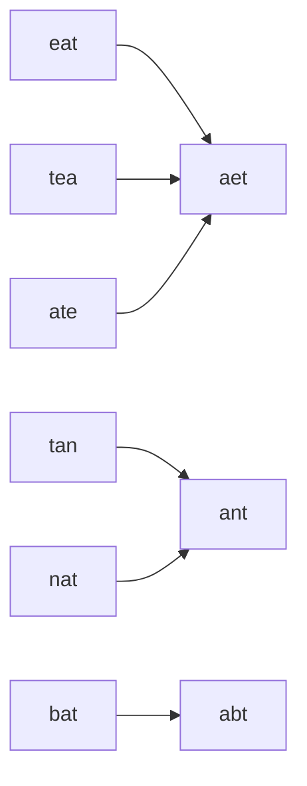

## Understand the problem

Split the words into groups where every word in a group is an anagram of every other. "Is an
anagram of" behaves like "equals": each word belongs to exactly one group, and every word belongs
to some group, even if it's alone.

- `["eat", "tea", "tan", "ate", "nat", "bat"]` → `[["eat", "tea", "ate"], ["tan", "nat"], ["bat"]]`.
- `["ab", "ba", "aba"]` → `[["ab", "ba"], ["aba"]]`: the same letters with different counts are
  different groups.
- `["ab", "ab"]` → `[["ab", "ab"]]`: repeated words are kept, in the same group.
- `[""]` → `[[""]]`, and `[]` → `[]`.

Write n for the number of words and m for the length of the longest word.

## Brute force: compare against every group

Keep a list of groups. For each word, test it against the first word of each group with an
anagram check (see [Valid Anagram](#/algo/problem/a28_valid_anagram)); join the first group that
matches, or start a new one.

```python
groups = []
for word in strs:
    for group in groups:
        if sorted(group[0]) == sorted(word):
            group.append(word)
            break
    else:  # no group matched
        groups.append([word])
return groups
```

When most words have no anagram, each word is checked against almost every group: about n²/2
checks of O(m log m) each. For 10^4 words that's 50 million checks.

## The key insight: give each word a key

Look for something computed from **one word alone** that comes out the same for exactly its
anagrams, a *canonical form*. Then a dictionary from key to list of words does the grouping in one
pass, with no comparisons between words. That's the [hashing pattern](#/algo/learn/patterns/hashing):
decide what you'd look up, and index the data by it.

Sorting the letters gives such a key: rearranging a word doesn't change its sorted letters, and
two words with the same sorted letters are rearrangements of each other.



The dictionary as the words of Example 1 arrive:

```array
label: groups
values: "aet: [eat, tea]"
indices: false
caption: after "eat" and "tea": both sort to aet
---
label: groups
values: "aet: [eat, tea]" "ant: [tan]"
indices: false
highlight: 1
caption: "tan" sorts to ant: a new key and a new group
---
label: groups
values: "aet: [eat, tea, ate]" "ant: [tan, nat]" "abt: [bat]"
indices: false
caption: after every word, the dictionary's values are the answer
```

```python
groups = {}
for word in strs:
    key = "".join(sorted(word))
    groups.setdefault(key, []).append(word)
return list(groups.values())
```

`setdefault(key, [])` returns the key's list, creating an empty one the first time;
`collections.defaultdict(list)` does the same. This is **O(n · m log m)**: one sort per word.

## Choosing the key

Not every idea for a key works:

| Key for "aab" | Works? | Why |
|---|---|---|
| `set(word)`: {a, b} | no | loses the counts: "ab" and "aab" collide. (And a set can't be a key; a frozenset can.) |
| `Counter(word)` | no | a dict can't be a key. `frozenset(Counter(word).items())` can, and works |
| sorted letters: "aab" | yes | O(m log m) per word |
| 26 letter counts: (2, 1, 0, ...) | yes | O(m) per word, as a tuple |
| product of a prime per letter | yes | unique by prime factorization, but the numbers get huge for long words |

The count key drops the sort. Count the letters into 26 slots: anagrams have exactly the same
counts.

```grid
collabels: a e n t
rowlabels: eat tea tan
1 1 0 1
1 1 0 1
1 0 1 1
highlight: 0,0 0,1 0,2 0,3 1,0 1,1 1,2 1,3
caption: eat and tea have the same counts, tan doesn't (other letters are 0)
```

A list can't be a dictionary key (it can change, so its hash could change), but a tuple can:
`tuple(counts)`. If you build a string from the counts instead, put a separator between them:
`"aaaaaaaaaaab"` (11 a's, 1 b) and `"abbbbbbbbbbb"` (1 a, 11 b's) both turn into `"111000..."`
without one.

## The solution

```solution
```

Why it's correct: two words get the same key exactly when they have the same count of every
letter, which is exactly when they're anagrams. So each dictionary entry holds one complete group,
and every word lands in exactly one entry.

## Complexity

- **Time: O(n · m).** Each word costs O(m) to count, plus O(26) to build and hash its key. The
  sorted key costs O(n · m log m).
- **Space: O(n · m)** for the groups (every word is stored once) plus one key per group.

Reading the input is already O(n · m), so the count key is optimal. In Python the sorted key is
often just as fast for short words, because `sorted` runs in C while the counting loop runs in
Python: big-O wins once words get long. Mention both, and the trade-off, in an interview.

## Pitfalls and variations

- **A set of letters as the key** loses the counts: "ab" and "aba" end up together.
- **A list as the key** raises `TypeError: unhashable type: 'list'`. Convert it to a tuple.
- **Joining counts without a separator** makes different counts collide (see above).
- **Lower-casing inside the key** (`word.lower()`) quietly changes the problem: "Tea" and "eat"
  would be grouped. Do it only if the interviewer says case doesn't matter.
- **Characters outside a to z** break `ord(ch) - ord("a")`: some raise an `IndexError`, others land
  in the wrong slot. For general text, use the sorted key or `frozenset(Counter(word).items())`.
- **Output order** can be anything here. If the order matters, say what you'd use: Python dicts
  keep insertion order, so groups come out in order of their first word.
- **Other canonical forms**, same pattern: group strings that are shifts of each other ("abc",
  "bcd", "xyz") by the differences between neighbouring letters mod 26; group equal sets of
  numbers by a sorted tuple.
- **Anagrams of a word inside a longer text**: a sliding window of letter counts, as in
  [Valid Anagram](#/algo/problem/a28_valid_anagram)'s variations. The counting itself is the same
  first step as in [Top K Frequent Elements](#/algo/problem/a14_top_k_frequent_elements).
