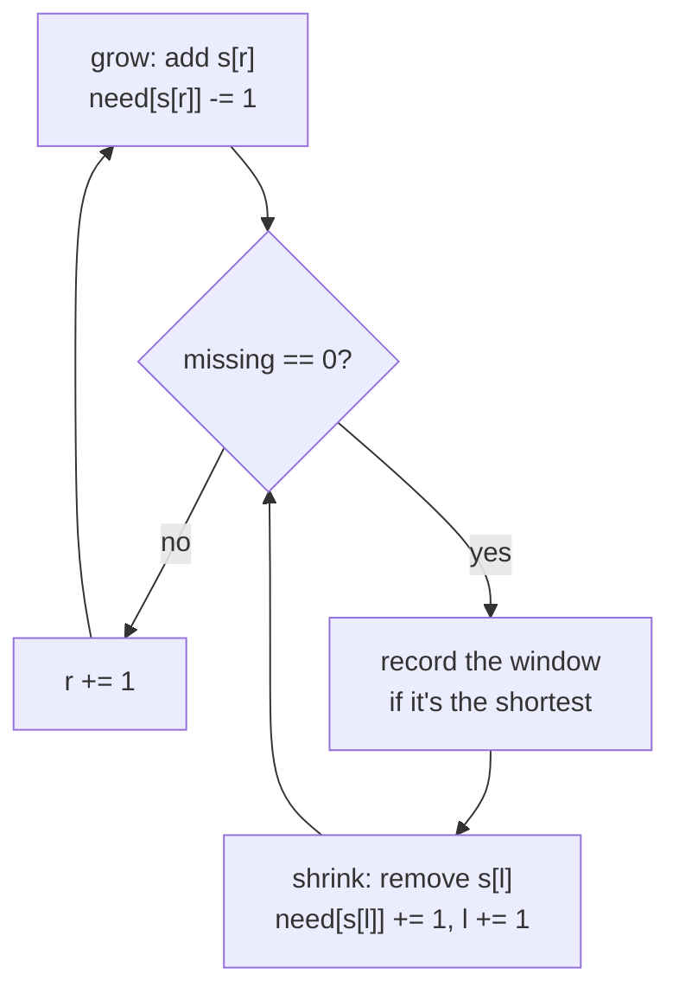

## Understand the problem

We want the shortest contiguous piece of `s` (a *window*) whose character counts cover `t`'s.
Only counts matter, not order, and extra characters are allowed:

| `s` | `t` | Answer | Note |
|---|---|---|---|
| `"aebc"` | `"abc"` | `"aebc"` | the only window is the whole string |
| `"aetbxab"` | `"ab"` | `"ab"` | the first window found, `"aetb"`, isn't the shortest |
| `"acbbaca"` | `"aba"` | `"baca"` | duplicates count: two `a`s are needed |
| `"a"` | `"aa"` | `""` | not enough `a`s anywhere |
| `"ab"` | `"abc"` | `""` | `t` is longer than `s` |
| `"aBcAb"` | `"Ab"` | `"Ab"` | `A` and `a` are different |

## Brute force: from each start, grow until covered

Fix a start, extend the end one character at a time while counting, and stop as soon as the
window covers `t`:

```array
label: s
values: a e t b x a b
pointers: start=1 end=5
highlight: 1..5
caption: from start 1, scan right until the window covers t: "etbxa"
```

```python
need = Counter(t)
best = ""
for i in range(len(s)):
    have = Counter()
    for j in range(i, len(s)):
        have[s[j]] += 1
        if all(have[c] >= k for c, k in need.items()):
            if not best or j - i + 1 < len(best):
                best = s[i : j + 1]
            break
```

Each start can scan to the end of `s`, so this is **O(n²)** time (times the cost of the
coverage check). For `s = "aaa...abc"` with 50,000 characters, every start scans to the end:
over a billion steps.

The source of the waste: when start `i` has found its window `s[i..j]`, start `i + 1` begins
counting from nothing again, although it shares almost the whole window.

## The key insight: both ends only move forwards

Two facts about windows that cover `t`:

1. **Growing never hurts.** If `s[l..r]` covers `t`, so does any window containing it.
2. **The best start never moves back.** Call `L(r)` the latest start for which `s[L(r)..r]`
   covers `t`: that is the shortest covering window ending at `r`. For a later end `r' > r`,
   `s[L(r)..r']` still covers `t` by fact 1, so `L(r') >= L(r)`.

So we never need to look at a start again once we've moved past it. Keep one window
`[left, right]`: move `right` forwards to **grow** until the window covers `t`, then move `left`
forwards to **shrink** while it still covers `t`, recording each window on the way. This is the
[sliding window](#/algo/learn/patterns/sliding-window) pattern, the version that searches for the
*shortest* valid window.

The window on `s = "aetbxab"`, `t = "ab"`:

```array
label: s
values: a e t b x a b
pointers: l=0 r=3
highlight: 0..3
caption: grow until the window covers t: "aetb", length 4 (best so far)
---
label: s
values: a e t b x a b
pointers: l=1 r=5
highlight: 1..5
caption: dropping s[0] lost the only a, so grow to the next a
---
label: s
values: a e t b x a b
pointers: l=3 r=5
highlight: 3..5
caption: drop e and t, which t doesn't need: "bxa", length 3 (best)
---
label: s
values: a e t b x a b
pointers: l=5 r=6
highlight: 5 6
caption: drop b, grow to the next b, drop x: "ab", length 2 (best)
```

Neither pointer ever moves back, so each moves at most n times in total.

### Knowing in O(1) whether the window covers t

Comparing the window's counts with `t`'s at every step costs O(size of the alphabet). Instead
keep two pieces of running state, as in the
[hashing pattern](#/algo/learn/patterns/hashing):

- `need[c]`: how many more `c`s the window needs. It starts as `t`'s counts. Positive means
  still missing, zero means exactly enough, **negative means spare copies**.
- `missing`: the total of the positive `need` values, so the window covers `t` exactly when
  `missing == 0`.

Adding a character `c` always does `need[c] -= 1`, but lowers `missing` only if `c` was still
needed (`need[c] > 0` before the change). Removing `c` does `need[c] += 1` and raises `missing`
only if the window is now short of `c` (`need[c] > 0` after the change).

The same trace, with the counts:

| Step | Window | `need[a]` | `need[b]` | `missing` | Then |
|---|---|---|---|---|---|
| r = 0, 1, 2 | `aet` | 0 | 1 | 1 | grow |
| r = 3 | `aetb` | 0 | 0 | 0 | record 4, shrink |
| l = 1 | `etb` | 1 | 0 | 1 | grow |
| r = 4, 5 | `etbxa` | 0 | 0 | 0 | shrink |
| l = 2, 3 | `bxa` | 0 | 0 | 0 | record 3, shrink |
| l = 4 | `xa` | 0 | 1 | 1 | grow |
| r = 6 | `xab` | 0 | 0 | 0 | shrink |
| l = 5 | `ab` | 0 | 0 | 0 | record 2, shrink |
| l = 6 | `b` | 1 | 0 | 1 | `s` is finished |

Spare copies are what let the window shrink past characters that `t` does need. With
`s = "aaab"` and `t = "ab"`:

```array
label: s
values: a a a b
pointers: l=0 r=3
highlight: 0..3
caption: covers t with need[a] = -2: two spare a's
---
label: s
values: a a a b
pointers: l=2 r=3
highlight: 2 3
caption: drop two a's (need[a] = 0): "ab" still covers, record it
---
label: s
values: a a a b
pointers: l=3 r=3
highlight: 3
caption: dropping the last a makes need[a] = 1 > 0: missing = 1, stop
```

The whole loop, for each new character:



## The solution

```solution
```

Details worth saying out loud:

- Characters that aren't in `t` need no special case: their `need` goes negative when they
  enter and back to 0 when they leave, so they never touch `missing`.
- The best window is kept as a start and a length, and sliced once at the end. Slicing it at
  every improvement would cost O(n) each time.
- The `best_len <= len(s)` test matters: without it, "no window found" would return the whole of
  `s` (the slice `s[0:len(s) + 1]`).
- If `t` is longer than `s`, `missing` never reaches 0 and the answer is `""` with no special
  case.

**Why it's correct.** For every end `r`, the inner loop moves `left` to `L(r)`, the latest start
that still covers `t` (it stops exactly when one more step would lose a needed character), and
records that window. The shortest window overall is the shortest window ending at *some* `r`, so
it gets recorded.

## Complexity

- **Time: O(n + m)** for `n = len(s)` and `m = len(t)`. Counting `t` is O(m). Each index of `s`
  enters the window once (`right`) and leaves at most once (`left`), and each step is O(1), so
  the loops do at most 2n steps in total. This is
  [amortized](#/algo/learn/complexity/amortized-analysis): one shrink loop can run long, but the
  shrinks over the whole run add up to at most n.
- **Space: O(k)** for the `need` table, where k is the number of distinct characters (at most 52
  English letters here).

## Pitfalls and variations

- **Ignoring duplicates.** A set of `t`'s characters accepts `"acb"` for `t = "aba"`. Count them.
- **Lowering `missing` for spare copies.** Only a character that was still needed
  (`need[c] > 0` before decrementing) reduces it. Decrementing first and testing `>= 0` is the
  same check.
- **Recording before the window covers `t`**, or after shrinking past the last needed
  character: record inside the `while missing == 0` loop, before removing `s[left]`.
- **Ties.** With `<`, the first shortest window found wins (the leftmost). With `<=`, the last
  one wins. Here the answer is unique, but say which one you return.
- **Why not dynamic programming?** It's tempting, but nothing needs to be remembered except the
  current window: coverage only improves as a window grows, which is exactly the property that
  lets two forward-only pointers do the job.

The three window problems in this set differ only in what makes a window valid and which window
they want:

| Problem | Valid window | Want | Shrink |
|---|---|---|---|
| This one | covers `t` | shortest | *while valid*, recording each one |
| [Longest substring without repeating characters](#/algo/problem/a31_longest_substring_without_repeating_characters) | no repeats | longest | *until valid* again |
| [Longest repeating character replacement](#/algo/problem/a32_longest_repeating_character_replacement) | at most k changes | longest | *until valid* again |

Follow-ups on the same machinery: find every anagram of `t` in `s`, or check whether `s` contains
a permutation of `t` (a fixed-size window of length `len(t)`); and the case where `t`'s
characters are rare in `s`, where you can slide over just the positions of characters in `t`.
