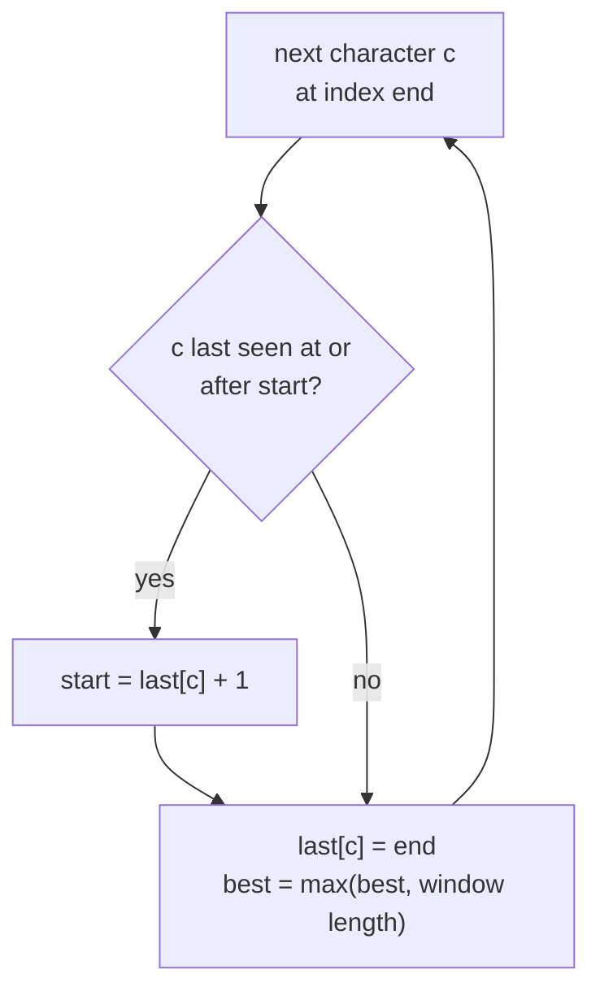

## Understand the problem

We want the longest contiguous run of `s` whose characters are all different, and we return its
length:

| `s` | Answer | Longest run |
|---|---|---|
| `"abcda"` | 4 | `"abcd"` or `"bcda"` |
| `"bbbb"` | 1 | `"b"` |
| `"pwwkew"` | 3 | `"wke"`; `"pwke"` skips a character, so it isn't a substring |
| `"abba"` | 2 | `"ab"` or `"ba"` |
| `""` | 0 | nothing |

Spaces, digits and symbols are characters like any other, and `A` differs from `a`.

## Brute force

Check every substring for repeats:

```python
best = 0
for i in range(len(s)):
    for j in range(i, len(s)):
        if len(set(s[i : j + 1])) == j - i + 1:  # all different
            best = max(best, j - i + 1)
```

That's O(n²) substrings at O(n) each: **O(n³)**. Two easy improvements: stop extending from `i`
at the first repeat (every longer substring from `i` repeats too), and grow one set as `j` moves
instead of rebuilding it. Then each start costs at most σ steps, where σ is the number of
distinct characters (a run without repeats can't be longer than the alphabet). That's
**O(n·σ)**: up to 95 steps per start for printable ASCII, and O(n²) if the alphabet were
unbounded, as with Unicode text.

A recursion that "takes or skips" each character is a tempting dynamic programming idea, but it
builds *subsequences*: skipping a character in the middle leaves a gap, which a substring can't
have.

## The key insight: slide a window that never holds a repeat

Starting over at every `i` throws away what we know. If `s[start..end]` has no repeats, so does
every window inside it. So keep **one** window and move both ends forwards only, a
[sliding window](#/algo/learn/patterns/sliding-window):

- Move `end` forwards, adding `s[end]` to the window.
- If `s[end]` already appears in the window, at index `j`, then every window starting at or
  before `j` contains two copies of it. The window must start at `j + 1`.

Knowing `j` in O(1) is a [hashing](#/algo/learn/patterns/hashing) job: a dict from each
character to the index where it was **last seen**. Walking through `s = "abcbda"`:

```array
label: s
values: a b c b d a
pointers: start=0 end=2
highlight: 0..2
caption: "abc" has no repeats: length 3
---
label: s
values: a b c b d a
pointers: start=0 end=3
highlight: 1 3
caption: the b at 3 repeats the b last seen at 1
---
label: s
values: a b c b d a
pointers: start=2 end=3
highlight: 2 3
caption: so start jumps to 1 + 1 = 2: the window is "cb"
---
label: s
values: a b c b d a
pointers: start=2 end=5
highlight: 2..5
caption: "cbda": the a last seen at 0 is before start. Length 4
```

When the last `a` arrives, the dict still remembers the first one:

```array
label: last
values: "a: 0" "b: 3" "c: 2" "d: 4"
highlight: 0
indices: false
caption: last["a"] = 0 < start = 2: that a is outside the window, ignore it
```

The dict keeps every character ever seen, not only those in the window, so the check is
"seen **at or after** `start`", not just "seen". For each character:



## The solution

```solution
```

The window's length is `end - start + 1`: when `start == end` it holds one character.

**Why it's correct.** For each `end`, `start` is the smallest index for which `s[start..end]`
has no repeats. It can only increase: a window ending at `end + 1` that started earlier would
contain the window ending at `end` that already failed. So `best` sees the longest valid window
ending at every position, and the answer is the longest of those.

An equally good version keeps a **set** of the window's characters and, on a repeat, removes
`s[start]` and advances `start` one step at a time until the repeat is gone:

```python
seen = set()
start = best = 0
for end, c in enumerate(s):
    while c in seen:  # shrink until c is no longer in the window
        seen.remove(s[start])
        start += 1
    seen.add(c)
    best = max(best, end - start + 1)
```

It's O(n) too, since each character is added once and removed at most once. The dict version
jumps straight to the right `start`.

## Complexity

- **Time: O(n).** One pass; each step does O(1) dict work, and `start` only moves forwards.
- **Space: O(min(n, σ))** for the dict: at most one entry per distinct character (at most 95
  for printable ASCII).

Compared with growing a set from every start, O(n·σ), the window does a fixed amount of work per
character whatever the alphabet. For 50,000 characters over a 95-character alphabet that's the
difference between 50,000 steps and up to 4.75 million.

## Pitfalls and variations

- **Moving `start` backwards.** Writing `start = last_seen[c] + 1` without the `>= start` check
  breaks on `"abba"`: the final `a` was last seen at 0, so `start` would go back to 1.

```array
label: s
values: a b b a
pointers: start=2 end=3
highlight: 2 3
caption: correct: the a at 0 is outside the window, which stays "ba"
---
label: s
values: a b b a
pointers: start=1 end=3
highlight: 1 2
caption: wrong: start moved back to 1 and "bba" repeats b. Answer 3, not 2
```

- **Jumping to the repeat instead of past its earlier copy.** In `"dvdf"`, the second `d` must
  move `start` to 1 (just after the first `d`), giving `"vdf"` (3). Restarting at the second `d`
  gives `"df"` (2).
- **Off by one in the length.** It's `end - start + 1`.
- **Returning the substring instead of the length:** also record `start` whenever `best`
  improves.
- **At most k distinct characters** (a common follow-up): the window is valid while it holds at
  most k distinct characters, so keep a count per character and shrink from the left until the
  number of distinct characters is back to k.
- Related windows: [Minimum window substring](#/algo/problem/a30_minimum_window_substring) (the
  shortest window that covers a set of characters) and
  [Longest repeating character replacement](#/algo/problem/a32_longest_repeating_character_replacement)
  (the longest window that needs at most k changes).
