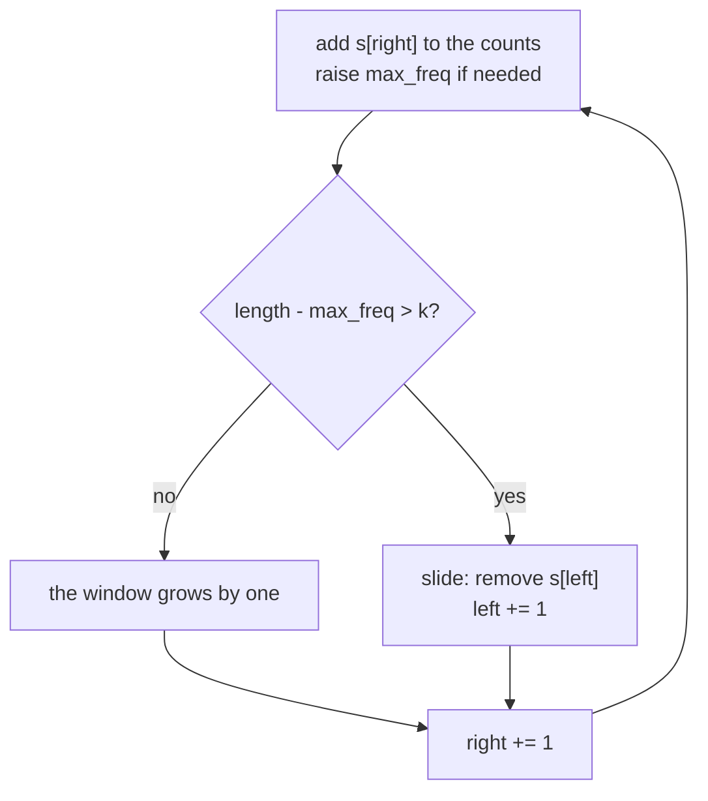

## Understand the problem

Pick a substring and make it a single letter with at most `k` changes. The cheapest way is to keep
its most frequent letter and change everything else, so a substring needs

**changes = length - (count of its most frequent letter)**

and it works when that is at most `k`.

```array
label: s
values: A A B A B
highlight: 2 4
caption: keep the 3 A's and change the 2 B's: 5 - 3 = 2 changes
```

| `s` | `k` | Answer | Why |
|---|---|---|---|
| `"ABAB"` | 2 | 4 | 4 - 2 = 2 changes for the whole string |
| `"EEBAA"` | 1 | 3 | `"EEB"` or `"BAA"`; any 4 letters need 2 changes |
| `"EEBEE"` | 1 | 5 | change the `B` |
| `"AABBBCC"` | 0 | 3 | with no changes, the longest run of one letter |
| `"ABCDE"` | 5 | 5 | enough changes for anything |

## Brute force

For every start, extend the end one letter at a time, keeping counts and the top count:

```python
best = 0
for i in range(len(s)):
    count = Counter()
    top = 0
    for j in range(i, len(s)):
        count[s[j]] += 1
        top = max(top, count[s[j]])
        if j - i + 1 - top > k:
            break  # longer substrings from i need even more changes
        best = max(best, j - i + 1)
```

That's **O(n²)**. With 50,000 letters and `k = 1,000`, each start runs about a thousand letters
before it breaks, some 50 million steps in all; with `k` close to n it's over a billion.

## The key insight: a sliding window

Two facts make a [sliding window](#/algo/learn/patterns/sliding-window) work:

- **Shrinking never breaks a window.** Removing a letter lowers the length by 1 and the top count
  by at most 1, so the number of changes doesn't go up.
- **Growing never fixes one.** If a window needs more than `k` changes, so does every window
  containing it.

So keep a window `s[left..right]` and a count of each letter in it. Move `right` forwards; while
the window needs more than `k` changes, remove `s[left]` and move `left` forwards. Every window
that fits is a candidate. With `s = "AABABBA"`, `k = 1`:

```array
label: s
values: A A B A B B A
pointers: left=0 right=3
highlight: 0..3
caption: "AABA": 4 - 3 = 1 change. Best 4
---
label: s
values: A A B A B B A
pointers: left=0 right=4
highlight: 0..4
caption: "AABAB": 5 - 3 = 2 changes, more than k. Shrink
---
label: s
values: A A B A B B A
pointers: left=2 right=4
highlight: 2..4
caption: dropping two A's leaves "BAB": 3 - 2 = 1 fits
---
label: s
values: A A B A B B A
pointers: left=2 right=5
highlight: 2..5
caption: "BABB": 4 - 3 = 1. Length 4 again (change the A)
```

```python
count = Counter()
left = best = 0
for right, c in enumerate(s):
    count[c] += 1
    while right - left + 1 - max(count.values()) > k:
        count[s[left]] -= 1
        left += 1
    best = max(best, right - left + 1)
```

There are only 26 letters, so `max(count.values())` is O(26) and this is **O(26n) = O(n)**. In an
interview this is a complete answer. The usual follow-up asks you to drop the factor of 26.

## Making it O(n): the top count never has to go down

We only care about windows **longer than the best so far**. Two consequences:

1. **The window never needs to shrink below the best.** When it doesn't fit, move `left` by one
   step only. Together with `right`'s step, the window *slides*, keeping its length. It grows only
   when a longer window fits.
2. **`max_freq` never needs to decrease.** Keep `max_freq`, the highest count any letter has
   reached in the window so far, and don't lower it when letters leave.

Why the second is safe: once the window has started sliding, its length (the best so far) is
exactly `max_freq + k`. A window of length `max_freq + k + 1` fits only if some letter appears at
least `max_freq + 1` times in it, more than any letter has ever appeared. So until some count rises above `max_freq`,
no longer window is possible, and it doesn't matter that `max_freq` may overstate the current
window's top count: the window just slides at the same length. When a count does exceed it,
`max_freq` is updated to that count, which is exact, and the window grows. A stale `max_freq` can
make the *current* window not really fit, but never makes us record a length that doesn't fit.

With `s = "AAAABCDE"`, `k = 1`:

```array
label: s
values: A A A A B C D E
pointers: left=0 right=4
highlight: 0..4
caption: "AAAAB": 5 - 4 = 1. Best 5, max_freq = 4
---
label: s
values: A A A A B C D E
pointers: left=1 right=5
highlight: 1..5
caption: "AAABC" slid one step. It needs 2 changes, but its length is no record
---
label: s
values: A A A A B C D E
pointers: left=3 right=7
highlight: 3..7
caption: to reach length 6, a letter must appear 5 times: none does. Answer 5
```

Each step does one of two things:



## The solution

```python
from collections import Counter


class Solution:
    def characterReplacement(self, s: str, k: int) -> int:
        count = Counter()  # letters in the window s[left..right]
        max_freq = 0  # the highest count any letter has reached; never lowered
        left = best = 0
        for right, c in enumerate(s):
            count[c] += 1
            max_freq = max(max_freq, count[c])
            if right - left + 1 - max_freq > k:  # too many changes: slide
                count[s[left]] -= 1
                left += 1
            best = max(best, right - left + 1)
        return best
```

Only `count[c]` can rise when `c` enters, so `max_freq = max(max_freq, count[c])` is the whole
update: O(1) per step. `best` ends equal to the final window length, `len(s) - left`, since the
window never shrinks.

Tracing `"EEBAA"`, `k = 1`:

| `right` | Window | Counts | `max_freq` | Changes needed | Then |
|---|---|---|---|---|---|
| 0, 1 | `EE` | E 2 | 2 | 0 | grow |
| 2 | `EEB` | E 2, B 1 | 2 | 1 | grow: best 3 |
| 3 | `EEBA`, then `EBA` | E 1, B 1, A 1 | 2 | 2 | slide |
| 4 | `EBAA`, then `BAA` | B 1, A 2 | 2 | 2 | slide |

The answer is 3. After the slide at `right = 3`, `"EBA"` really needs two changes, but its length
3 was already the best.

## Complexity

- **Time: O(n).** Each step does O(1) work; `left` moves at most once per step.
- **Space: O(1).** At most 26 counts.

## Pitfalls and variations

- **Using the current letter's count** instead of the top count: the letter you keep is the
  window's most frequent one, not the newest.
- **"Fixing" `max_freq` when letters leave.** Recomputing it after every removal is correct but
  costs O(26) a step. The point of the trick is that it never needs lowering at all.
- **Returning the final window as the substring.** With the sliding version the final window may
  not fit (`"EBA"` above, or `"ABCDE"`). To return the substring, record `left` whenever `best`
  improves.
- **`k = 0`**: the answer is the longest run of one letter. **`k >= len(s) - 1`**: the whole
  string.
- **Binary version** (flip at most `k` zeros to get the longest run of ones): the window is valid
  while it holds at most `k` zeros, the same shape with a simpler test.
- Related windows: [Longest substring without repeating characters](#/algo/problem/a31_longest_substring_without_repeating_characters)
  and [Minimum window substring](#/algo/problem/a30_minimum_window_substring).
