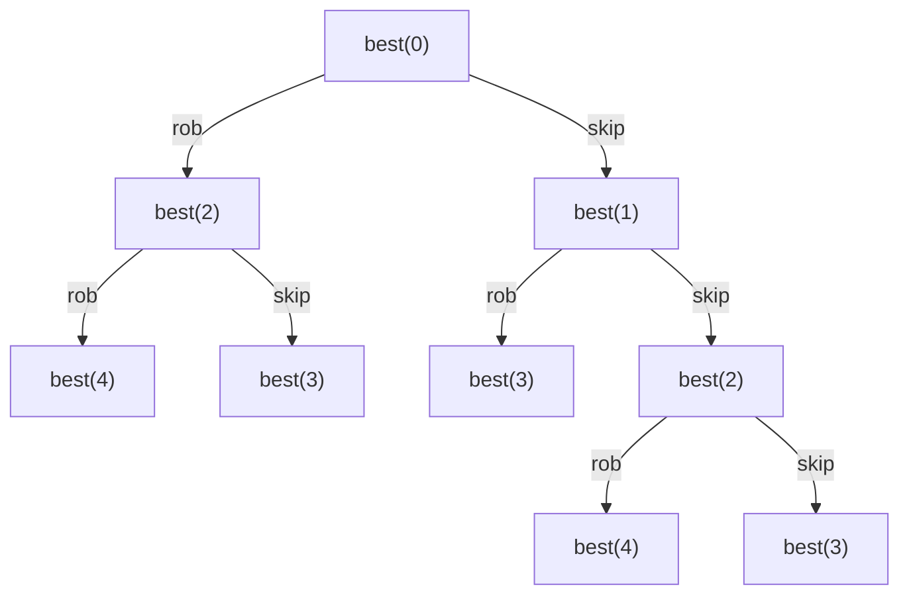

## Understand the problem

Choose a set of houses with no two next to each other, and maximise the money in them. Only the
total is returned.

| `nums` | Answer | Houses robbed |
|---|---|---|
| `[1, 2, 3, 1]` | 4 | 0, 2 |
| `[2, 7, 9, 3, 1]` | 12 | 0, 2, 4 |
| `[2, 1, 1, 2]` | 4 | 0, 3 |
| `[5]` | 5 | 0 |
| `[3, 10]` | 10 | 1: with two houses, take the richer |
| `[2, 3, 2]` | 4 | 0, 2: not the richest house |

## Two tempting shortcuts that fail

**Every other house.** Robbing all the even-indexed houses or all the odd ones never breaks the
rule, but the best plan may skip two houses in a row:

```array
label: evens
values: 2 1 1 2
highlight: 0 2
caption: houses 0 and 2: 3
---
label: odds
values: 2 1 1 2
highlight: 1 3
caption: houses 1 and 3: 3
---
label: best
values: 2 1 1 2
highlight: 0 3
caption: houses 0 and 3: 4, skipping two houses in a row
```

**Richest house first.** Take the most valuable house, rule out its neighbours, repeat. On
`[2, 3, 2]` that takes the 3 and blocks both 2s, for 3 instead of 4.

Both fail for the same reason: the choices interact. Robbing a house removes its neighbours from
play, so a choice that looks good now can cost more later. That's the signal for dynamic
programming rather than a greedy rule
([greedy or DP](#/algo/learn/dynamic-programming/greedy-or-dp)).

## Brute force: rob or skip each house

Walk along the street. At house `i` there are two choices:

- **rob it**: take `nums[i]`, and the next house is off limits, so continue from `i + 2`;
- **skip it**: continue from `i + 1`.

With `best(i)` the most money from houses `i` to the end:

```python
def best(i: int) -> int:
    if i >= len(nums):
        return 0  # past the last house: nothing more to take
    rob = nums[i] + best(i + 2)
    skip = best(i + 1)
    return max(rob, skip)


answer = best(0)
```

This is an "optimize" recursion: keep the better of the two choices, with 0 when nothing is left.
For five houses, the first levels of calls already repeat themselves. Robbing house 0 and
skipping houses 0 and 1 both lead to `best(2)`, and the highlighted calls redo work done
elsewhere:



The number of calls grows like the Fibonacci numbers, about 1.6^n: for 100 houses, more than
10^20 calls.

## The key insight: the only state is the next house

What do we need to know about the past to finish? Only which house is next. The neighbour rule is
already handled: after a robbery we jump straight to `i + 2`. So the memo key is the index `i`
([choosing the memo key](#/algo/learn/dynamic-programming/choosing-the-memo-key)), with only `n`
different questions:

```python
class Solution:
    def rob(self, nums: list[int]) -> int:
        return self.best(nums, 0, {})

    def best(self, nums: list[int], i: int, memo: dict[int, int]) -> int:
        if i >= len(nums):
            return 0
        if i not in memo:
            rob = nums[i] + self.best(nums, i + 2, memo)
            skip = self.best(nums, i + 1, memo)
            memo[i] = max(rob, skip)
        return memo[i]
```

Each index is solved once with O(1) work: **O(n) time**, and O(n) space for the memo and the
call stack.

## Bottom-up: from the last house back

`best[i]` needs `best[i + 1]` and `best[i + 2]`, so fill the table from the end of the street
([one-dimensional DP](#/algo/learn/dynamic-programming/one-dimensional-dp)). Two extra cells past
the end hold 0, so `i + 2` never runs off the table. For `[2, 7, 9, 3, 1]`:

```grid
collabels: 0 1 2 3 4 5 6
rowlabels: nums best
2 7 9 3 1 _ _
_ _ _ _ 1 0 0
highlight: 0,4 1,4 1,5 1,6
caption: best[4] = max(1 + best[6], best[5]) = max(1, 0) = 1
---
collabels: 0 1 2 3 4 5 6
rowlabels: nums best
2 7 9 3 1 _ _
_ _ 10 3 1 0 0
highlight: 0,2 1,2 1,3 1,4
caption: best[2] = max(9 + best[4], best[3]) = max(10, 3) = 10: rob house 2
---
collabels: 0 1 2 3 4 5 6
rowlabels: nums best
2 7 9 3 1 _ _
12 10 10 3 1 0 0
highlight: 0,0 1,0 1,1 1,2
caption: best[0] = max(2 + best[2], best[1]) = max(12, 10) = 12
---
collabels: 0 1 2 3 4 5 6
rowlabels: nums best
2 7 9 3 1 _ _
12 10 10 3 1 0 0
highlight: 0,0 0,2 0,4
caption: to list the houses, walk forward, robbing wherever that wins: 0, 2, 4
```

## The solution: keep two numbers

Each step reads only the next two values, so two variables replace the table:

```solution
```

The mirror image, walking left to right with "the best total of the houses so far", is just as
common and works the same way:

```python
before1 = before2 = 0  # the best total of the houses so far, and of all but the last one
for x in nums:
    before1, before2 = max(before1, before2 + x), before1
return before1
```

## Complexity

- **Time: O(n).** One step per house.
- **Space: O(1)** with two variables; O(n) for the table, or for the memo plus the call stack in
  the top-down version.

## Pitfalls and variations

- **Every other house, or the richest first**: both fail; see the counterexamples above.
- **Indexes past the end.** `best(i + 2)` for the last house must be 0, not an error. Pad the
  table or check `i >= len(nums)`.
- **One or two houses**: make sure the code returns `nums[0]` for one house and the larger value
  for two.
- **Return the houses themselves**: after filling the table, walk forward from house 0. If
  `nums[i] + best[i + 2] >= best[i + 1]`, rob house `i` and jump to `i + 2`; otherwise move to
  `i + 1`.
- **Houses in a circle** (the first and last are neighbours, a common follow-up): one of them
  must be skipped. Solve the street twice, once without the first house and once without the
  last, and take the larger. With a single house, return it directly, since dropping one end
  would leave nothing:

```python
def rob_circle(self, nums: list[int]) -> int:
    if len(nums) == 1:
        return nums[0]
    return max(self.rob(nums[1:]), self.rob(nums[:-1]))
```

- **Houses on a binary tree** (no robbing a node and its child): each node returns two numbers,
  the best total with it robbed and without, combined bottom-up in one depth-first pass.
- **Points for deleting values** ("delete and earn": taking a value removes the values one
  above and below): add up the points per value, and it becomes this problem over the values in
  order.
