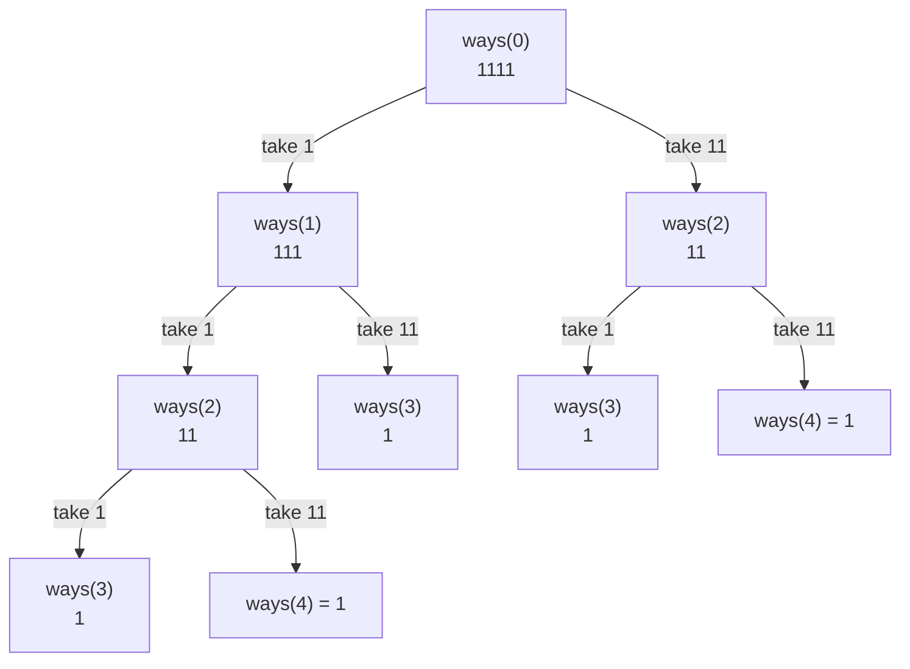
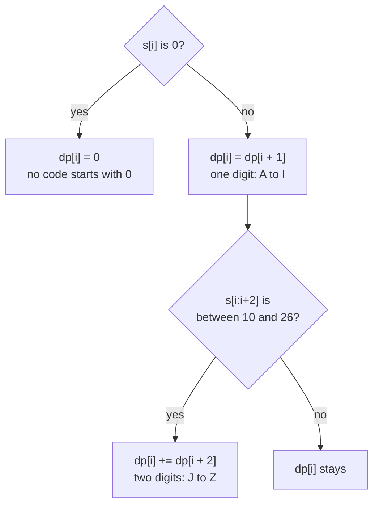

## Understand the problem

Split the digits into groups of one or two, where every group is a letter's code from `"1"` to
`"26"`, and count the splits.

| `s` | Answer | The decodings |
|---|---|---|
| `"12"` | 2 | `1 2` (AB), `12` (L) |
| `"226"` | 3 | `2 2 6` (BBF), `22 6` (VF), `2 26` (BZ) |
| `"123"` | 3 | `1 2 3` (ABC), `12 3` (LC), `1 23` (AW) |
| `"106"` | 1 | `10 6` (JF); `1 06` isn't allowed |
| `"27"` | 1 | `2 7` (BG); 27 is not a letter |
| `"06"` | 0 | no group can start with 0 |
| `"100"` | 0 | `10` uses the first 0; the second has nothing to join |

`"123"` is easy to get wrong: it's tempting to count only `1 2 3` and `12 3` and miss `1 23`.

Zeros are the tricky part. A 0 can't stand alone and can't start a group, so it must be the
second digit of `10` or `20`. Any other 0, as in `"30"`, `"00"` or a leading `"0"`, makes the
whole string undecodable.

## Brute force: try both group sizes

At position `i`, the next group is either one digit or two. Each valid choice leaves a shorter
string, and different first groups give different decodings, so the counts add up:

```python
def ways(i: int) -> int:
    # The number of ways to decode s[i:].
    if i == len(s):
        return 1  # everything is decoded: one complete way
    if s[i] == "0":
        return 0  # no letter's code starts with 0
    total = ways(i + 1)  # one digit, 1 to 9
    if i + 1 < len(s) and "10" <= s[i : i + 2] <= "26":
        total += ways(i + 2)  # two digits, 10 to 26
    return total


answer = ways(0)
```

It follows the [count-the-ways template](#/algo/learn/dynamic-programming/top-down-helper-plus-memo):
add the choices, return 1 when the string is used up and 0 at a dead end. The two-digit test
compares strings: digit strings of the same length compare like the numbers they spell, and
`"06"` correctly fails.

Each call can make two more, and they overlap. For `"1111"`, the highlighted calls repeat work
done elsewhere in the tree:



A string of `n` ones has a Fibonacci number of decodings (it's
[Climbing Stairs](#/algo/problem/a04_climbing_stairs) in disguise: groups of 1 or 2), and the
plain recursion makes about twice that many calls. For 100 ones, about 10^21.

## The key insight: the state is a position

Whatever groups came before, what's left to decode is the suffix `s[i:]`, and its count depends
only on `i`. So there are only `n + 1` different questions; memoize on the index
([choosing the memo key](#/algo/learn/dynamic-programming/choosing-the-memo-key)):

```python
class Solution:
    def numDecodings(self, s: str) -> int:
        return self.ways(s, 0, {})

    def ways(self, s: str, i: int, memo: dict[int, int]) -> int:
        if i == len(s):
            return 1
        if s[i] == "0":
            return 0
        if i not in memo:
            total = self.ways(s, i + 1, memo)
            if i + 1 < len(s) and "10" <= s[i : i + 2] <= "26":
                total += self.ways(s, i + 2, memo)
            memo[i] = total
        return memo[i]
```

Each index is computed once with O(1) work: **O(n) time**, and O(n) for the memo and the call
stack. Passing the index instead of slicing `s[1:]` matters: each slice copies the rest of the
string.

## Bottom-up: from the end of the string

`dp[i]` is the number of ways to decode `s[i:]`; it needs `dp[i + 1]` and `dp[i + 2]`, so fill
from the right ([one-dimensional DP](#/algo/learn/dynamic-programming/one-dimensional-dp)). One
position works like this:



For `"226"`:

```grid
collabels: 0 1 2 3
rowlabels: s dp
2 2 6 _
_ _ 1 1
highlight: 0,2 1,2 1,3
caption: dp[3] = 1: nothing left. dp[2]: "6" alone, then dp[3], so 1
---
collabels: 0 1 2 3
rowlabels: s dp
2 2 6 _
_ 2 1 1
highlight: 0,1 0,2 1,1 1,2 1,3
caption: dp[1]: "2" then dp[2], or "26" then dp[3]: 1 + 1 = 2
---
collabels: 0 1 2 3
rowlabels: s dp
2 2 6 _
3 2 1 1
highlight: 0,0 0,1 1,0 1,1 1,2
caption: dp[0]: "2" then dp[1], or "22" then dp[2]: 2 + 1 = 3
```

And `"11106"`, where a zero cuts off one of the choices:

```grid
collabels: 0 1 2 3 4 5
rowlabels: s dp
1 1 1 0 6 _
2 1 1 0 1 1
highlight: 0,3 1,3 0,2 1,2
caption: dp[3] = 0, so the 1 before the 0 must take "10": dp[2] = dp[4] = 1
```

The answer is `dp[0] = 2`: `1 1 10 6` (AAJF) and `11 10 6` (KJF).

## The solution

Each step reads only the next two values, so keep two variables:

```python
class Solution:
    def numDecodings(self, s: str) -> int:
        n = len(s)
        after1, after2 = 1, 0  # ways(i + 1) and ways(i + 2); ways(n) = 1
        for i in range(n - 1, -1, -1):
            if s[i] == "0":
                here = 0  # no letter's code starts with 0
            else:
                here = after1  # s[i] alone: 1 to 9
                if i + 1 < n and "10" <= s[i : i + 2] <= "26":
                    here += after2  # s[i:i + 2]: 10 to 26
            after1, after2 = here, after1
        return after1  # ways(0)
```

`after2` starts at 0, but it's only read when `i + 1 < n`, and by then it holds `ways(n) = 1`.

## Complexity

- **Time: O(n).** One step per digit, each O(1).
- **Space: O(1)** with two variables; O(n) for a table, or for the memo plus the call stack.

## Pitfalls and variations

- **Converting with `int()`.** `int("06")` is 6, so a check like `1 <= int(pair) <= 26` accepts a
  group with a leading zero. Either check `s[i] != "0"` first or compare strings,
  `"10" <= pair <= "26"`.
- **The last digit.** At `i = n - 1`, `s[i:i + 2]` is a single digit, and as a string `"2"`
  sorts between `"10"` and `"26"`. Check `i + 1 < n` before the two-digit test.
- **Zeros**: `"0"`, `"30"`, `"100"` and `"06"` are all 0. Test them before you say you're done.
- **Missing a decoding**: as in `"123"`, both group sizes must be tried at every position, not
  just at the start.
- **Zeros in the memo**: check `i in memo`, not `memo.get(i)`, or every dead end is explored
  again. A long run of 1s ending in `"00"` is exponential with that bug.
- **Slicing the string** in the recursion: every `s[1:]` copies. Pass an index.
- **A `*` wildcard** that stands for any digit from 1 to 9 (a common follow-up): the same
  recurrence, with each choice multiplied by the number of codes it can stand for (`*` alone
  is 9, `1*` is 9, `2*` is 6, `**` is 15), and the count taken modulo 10^9 + 7.
- **List every decoding**: backtracking, whose running time is at least the size of the output.
