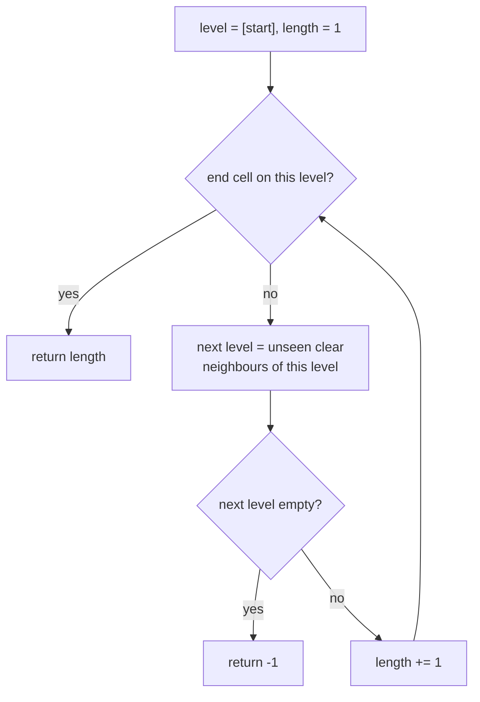

## Understand the problem

Treat the grid as a [graph](#/algo/learn/data-structures/graphs): every clear cell (`0`) is a
node, joined to each of its up to 8 clear neighbours. We want the fewest cells on a path from the
top-left node to the bottom-right one.

Two details change the answer, so pin them down first.

**Diagonal steps count.** In Example 2, going round the outside (right, right, down, down) visits 5
cells, but cutting the corner diagonally visits only 4:

```grid
0 0 0
0 1 0
0 0 0
path: 0,0 0,1 0,2 1,2 2,2
caption: round the outside with straight steps only: 5 cells
---
0 0 0
0 1 0
0 0 0
path: 0,0 0,1 1,2 2,2
caption: with a diagonal step: 4 cells, the answer
```

**The length counts cells, not steps.** A 1 x 1 grid `[[0]]` has a path of length 1.

Edge cases: if the start or the end cell holds a 1, there is no clear path at all: return -1 at
once. And the walls may cut the end off from the start entirely, which is also -1.

## Brute force: depth-first search

A depth-first search from the start finds *a* path, but not necessarily a short one: it follows
one direction as far as it can before trying anything else. On an open 3 x 3 grid, trying "right"
first:

```grid
0 0 0
0 0 0
0 0 0
path: 0,0 0,1 0,2 1,2 2,2
caption: depth-first, right before down: 5 cells
---
0 0 0
0 0 0
0 0 0
path: 0,0 1,1 2,2
caption: the shortest path: 3 cells
```

To get the shortest path out of a depth-first search you must keep exploring after the first
success: try every path (exponential), or revisit a cell whenever a shorter route to it turns up.
The second is correct, but the search keeps finding slightly shorter routes and redoing all the
cells beyond them. On an open 100 x 100 grid it runs for many seconds, against a few milliseconds
for the approach below.

## The key insight: breadth-first search explores in rings

Breadth-first search (BFS) visits cells in order of their distance from the start: first the
start, then every cell one step away, then every cell two steps away. A cell is first reached
from a cell of the level before it, so the level on which a cell is first reached *is* its
shortest path length. The first time BFS reaches the bottom-right cell, the answer is that level.
That is the whole idea of [BFS by levels](#/algo/learn/patterns/bfs-by-levels-and-shortest-paths).

Here are the levels growing on Example 3, with each cell's path length written in (`#` is a
blocked cell):

```grid
1 # _ _ _
2 # _ # _
3 # _ # _
_ _ _ # _
# # # # _
dim: 0,1 1,1 1,3 2,1 2,3 3,3 4,0 4,1 4,2 4,3
highlight: 2,0
caption: lengths 1 to 3: down the left column
---
1 # _ _ _
2 # 6 # _
3 # 5 # _
4 4 5 # _
# # # # _
dim: 0,1 1,1 1,3 2,1 2,3 3,3 4,0 4,1 4,2 4,3
highlight: 1,2
caption: lengths 4 to 6: round the foot of the wall and up the middle
---
1 # 7 7 8
2 # 6 # 8
3 # 5 # 9
4 4 5 # _
# # # # _
dim: 0,1 1,1 1,3 2,1 2,3 3,3 4,0 4,1 4,2 4,3
highlight: 2,4
caption: lengths 7 to 9: over the top and down the right side
---
1 # 7 7 8
2 # 6 # 8
3 # 5 # 9
4 4 5 # 10
# # # # 11
dim: 0,1 1,1 1,3 2,1 2,3 3,3 4,0 4,1 4,2 4,3
highlight: 4,4
path: 0,0 1,0 2,0 3,1 2,2 1,2 0,3 1,4 2,4 3,4 4,4
caption: the bottom-right cell is first reached on level 11: the answer is 11
```

To know which level a cell is on, process the search one level at a time: hold the current level
in a list, and build the next level from the clear, not yet seen neighbours of its cells. On
Example 2:

```array
label: level 1
values: 0,0
---
label: level 2
values: 0,1 1,0
caption: the start's clear neighbours; (1, 1) is blocked
---
label: level 3
values: 0,2 1,2 2,0 2,1
caption: the new neighbours of level 2
---
label: level 4
values: 2,2
highlight: 0
caption: the bottom-right cell is on level 4: return 4
```



## The solution

```python
STEPS = [(-1, -1), (-1, 0), (-1, 1), (0, -1), (0, 1), (1, -1), (1, 0), (1, 1)]


class Solution:
    def shortestPathBinaryMatrix(self, grid: list[list[int]]) -> int:
        n = len(grid)
        if grid[0][0] == 1 or grid[n - 1][n - 1] == 1:
            return -1
        seen = [[False] * n for _ in range(n)]
        seen[0][0] = True
        level = [(0, 0)]
        length = 1
        while level:
            next_level = []
            for r, c in level:
                if r == n - 1 and c == n - 1:
                    return length
                for dr, dc in STEPS:
                    nr, nc = r + dr, c + dc
                    if 0 <= nr < n and 0 <= nc < n and grid[nr][nc] == 0 and not seen[nr][nc]:
                        seen[nr][nc] = True
                        next_level.append((nr, nc))
            level = next_level
            length += 1
        return -1
```

**Mark a cell as seen when it is discovered**, just before it goes into `next_level`, not when it
is processed. Several cells of one level can share a neighbour; marking on discovery means the
first of them claims it and the others skip it. Marking only when a cell is processed lets each
cell be queued once per neighbour, up to 8 times, which is still correct but does far more work.

**Why it is correct.** Every cell added to level k + 1 is a clear neighbour of a level-k cell, so
it has a path of length k + 1. And no cell has a shorter path than its level: by induction, a cell
whose shortest path has length k + 1 is next to a cell whose shortest path has length k, which is
on level k, so the cell joins level k + 1 unless it was already found earlier. Because the seen
grid keeps each cell on the first level that reaches it, the level of the bottom-right cell is
its shortest path length. If the levels run out first, it can't be reached.

A queue of `(cell, length)` pairs works just as well as level lists: a queue hands cells out in
the order they went in, so they come out level by level. Store the length with each cell, or in a
`dist` grid.

## Complexity

- **Time: O(n²).** Each of the n² cells enters a level at most once, and checking its 8
  neighbours is O(1). For n = 100 that is at most 10,000 cells and 80,000 neighbour checks.
- **Space: O(n²)** for the `seen` grid and the levels, which can hold a large fraction of the
  cells (a level is a ring around the start).

## Pitfalls and variations

- **Depth-first search for a shortest path.** It finds a path, not the shortest one.
- **Counting steps instead of cells.** The answer is one more than the number of moves.
- **Four directions instead of eight.** Example 1 has no path at all without the diagonal.
- **Forgetting to check the start and end cells.** If the start is blocked, a search that starts
  there anyway returns a wrong length.
- **Marking the grid itself** (`grid[r][c] = 1` for a visited cell) saves the `seen` grid, but it
  changes the caller's data. Say so if you do it.
- **Return the path itself.** Store each cell's *parent*, the cell it was discovered from, and
  walk back from the end, then reverse the list (the walk back produces it from end to start).
- **Faster in practice.** A bidirectional BFS grows levels from both ends and stops when they
  meet, which explores far fewer cells on open grids. A* search orders cells by length so far plus
  an estimate of the remaining length, here `max(|n-1-r|, |n-1-c|)` (the moves needed with no
  walls), which never overestimates and so keeps the answer exact.
- **Cells with different costs** need Dijkstra's algorithm with a heap instead of plain BFS.
- The same level-by-level loop on a tree is
  [Binary Tree Level Order Traversal](#/algo/problem/a25_binary_tree_level_order_traversal), and
  [Pacific Atlantic Water Flow](#/algo/problem/a21_pacific_atlantic_water_flow) searches a grid
  from many starting cells at once.
