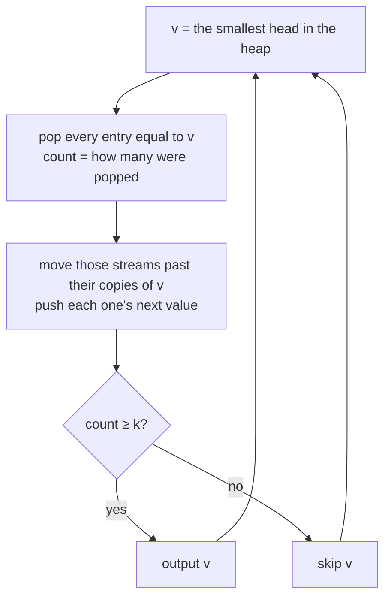

## Understand the problem

A value qualifies when at least `k` *different* streams contain it. Copies inside one stream don't
add up, so it helps to think of each stream as the set of values it contains.

| `streams`, `k` | Result | Why |
|---|---|---|
| `[[5, 6], [4, 5, 20], [20]]`, 1 | `[4, 5, 6, 20]` | `k = 1`: every distinct value, once |
| `[[1, 2, 3, 4], [2, 3, 4, 5], [0, 2, 4, 6]]`, 3 | `[2, 4]` | `k = x`: the values in every stream |
| `[[1, 2], [1, 2]]`, 3 | `[]` | `k` is more than the number of streams |
| `[[4, 4, 4], [1, 2]]`, 2 | `[]` | three 4s, but in one stream |
| `[[], [1, 1, 2], [], [2]]`, 2 | `[2]` | empty streams count for nothing |

The real constraint is memory. The streams may be far too long to store, or never end at all, so
the solution should read each stream once, from the front, and keep only a little state per
stream.

## Brute force: count with sets

```python
from collections import Counter

counts = Counter()
for stream in streams:
    for value in set(stream):  # set(): each stream counts a value once
        counts[value] += 1
return sorted(value for value, c in counts.items() if c >= k)
```

This is correct and even fast, O(N) for `N` values in total plus sorting the output. Its problem
is memory: it holds every distinct value of every stream at once, and it needs each stream to
*end* before `set(stream)` exists. For endless feeds it never answers. It also ignores the one
thing the problem gives us: the streams are sorted.

## The key insight: merge the streams in order

Each stream is sorted, so its front value (its **head**) is its smallest unread value. Take the
smallest head across all streams, `v`:

- No stream can produce `v` later. Every stream's later values are at least its head, and every
  head is at least `v`.
- Every stream that contains `v` has `v` as its head right now. Its earlier values are smaller
  than `v`, and those were all handled before `v` came up.

So values can be finished one at a time, in increasing order: count the streams whose head is
`v`, decide `v`, then move on. This is the k-way merge from
[Merge k Sorted Lists](#/algo/problem/a42_merge_k_sorted_lists), with counting added. A
[min-heap](#/algo/learn/data-structures/heaps) of `(head, stream index)` finds the smallest head
in O(log x), and it only ever holds one entry per stream.

Each round:

- `v` = the smallest head (the top of the heap).
- Pop every entry equal to `v`. The number popped is the number of streams that contain `v`.
- Advance each of those streams past its copies of `v`, and push its next value, if it has one.
- If the count is at least `k`, output `v`.



Here is Example 3, `[[5, 6], [4, 5, 20], [20]]` with `k = 2`. Heap entries are written
`(value,stream)` in the order `heapq` stores them:

```array
label: heap
values: (4,1) (5,0) (20,2)
highlight: 0
caption: the three heads; the smallest is 4
---
label: heap
values: (5,0) (20,2) (5,1)
highlight: 0 2
caption: 4 came from stream 1 only (count 1): skip it. Stream 1's next value, 5, is pushed
---
label: heap
values: (6,0) (20,2) (20,1)
highlight: 0
caption: 5 was the head of streams 0 and 1 (count 2): output 5. Their next values, 6 and 20, are pushed
---
label: heap
values: (20,1) (20,2)
highlight: 0 1
caption: 6 is in stream 0 only: skip it. Stream 0 is used up, so nothing is pushed
```

Last round: 20 is the head of streams 1 and 2, count 2, so output 20. Both streams are used up,
the heap is empty, and the answer is `[5, 20]`.

### Duplicates inside a stream

After popping a stream's `v`, keep reading until its value changes, and push that. The stream has
then contributed exactly one to the count, and it still has exactly one entry in the heap:

```array
label: stream
values: 4 4 4 7
pointers: head=0
caption: pop the 4: this stream counts once for 4
---
values: 4 4 4 7
pointers: head=3
dim: 0..2
caption: skip the other copies of 4, then push 7
```

## The solution

```python
import heapq


class Solution:
    def kCommon(self, streams: list[list[int]], k: int) -> list[int]:
        feeds = [iter(stream) for stream in streams]  # read each one only from the front
        heap = []  # (head, stream index): one entry per stream that still has values
        for i, feed in enumerate(feeds):
            head = next(feed, None)
            if head is not None:
                heap.append((head, i))
        heapq.heapify(heap)

        found = []
        while len(heap) >= k:  # fewer than k live streams: nothing more can qualify
            value = heap[0][0]
            count = 0
            while heap and heap[0][0] == value:
                _, i = heapq.heappop(heap)
                count += 1
                head = next(feeds[i], None)
                while head == value:  # skip this stream's other copies
                    head = next(feeds[i], None)
                if head is not None:
                    heapq.heappush(heap, (head, i))
            if count >= k:
                found.append(value)
        return found
```

The iterators make the streaming explicit: the code never indexes into a stream or looks ahead,
so it would work unchanged on a file or a network feed. `while len(heap) >= k` stops early once
fewer than `k` streams have values left: every value still unread lives in fewer than `k` streams.
It also returns `[]` straight away when `k` is larger than the number of streams.

## Complexity

With `x` streams and `N` values in total:

- **Time: O(N log x).** Every value is read once. Each push and pop is O(log x), because the heap
  never holds more than `x` entries. Building it at the start is O(x).
- **Memory: O(x)** for the heap and one iterator per stream, no matter how long the streams are
  (plus the output itself). The set version needs memory for every distinct value.

| Approach | Time | Memory | Endless streams? |
|---|---|---|---|
| a set per stream, then count | O(N) | O(N) | no: needs whole streams |
| merge with a min-heap | O(N log x) | O(x) | yes |

## Follow-up: endless, real-time streams

The merge already reads each stream only from the front. To run it on live feeds:

- **Emit as you go.** Make the method a generator and `yield` each value when it qualifies,
  instead of returning a list at the end that never comes.
- **Emit early.** A value qualifies as soon as its count reaches `k`, so it can go out before the
  remaining streams have been checked for it.
- **Wait for a slow stream.** If a stream's next value hasn't arrived when you go to push it, the
  merge must stop and wait. Its next value will be at least its last one, but it could equal the
  value now at the top of the heap, and finishing that value early would count it wrong. One slow
  feed therefore stalls all the others. Real systems fix this with a timeout, or by having each
  feed send regular "nothing below `t` from me" messages (stream processors call these
  *watermarks*), which let the merge move on past `t`.
- **Closed streams** simply leave the heap, and once fewer than `k` are open, nothing more can
  qualify.

```array
label: stream 0
values: 0 3 8
pointers: next=3
dim: 0 1 2
caption: stream 0 has no next value yet: everything waits until it sends one, or closes
```

## Pitfalls and variations

- **Counting copies instead of streams.** Pushing a stream's next value without skipping its
  duplicates counts `[4, 4, 4]` as three streams.
- **A stream left out of the heap.** Every non-empty stream must have exactly one entry at all
  times, or a value it contains is undercounted.
- **`None` as the end marker** only works because the values are numbers. If a stream could
  contain `None`, use a sentinel object, or catch `StopIteration`.
- **Pairs of streams:** with `x = 2`, two pointers walking both streams find the common values in
  O(1) memory, with no heap.
- **Too many streams for the heap:** merge them in groups and merge the group results, the way
  external sorting merges sorted runs from disk.
- **Smallest range covering a value from each of k lists** uses the same heap of heads, also
  tracking the largest head.

The [heaps pattern](#/algo/learn/patterns/heaps-and-top-k) covers k-way merges, and
[space complexity](#/algo/learn/complexity/space-complexity) is the reason to prefer the heap here.
