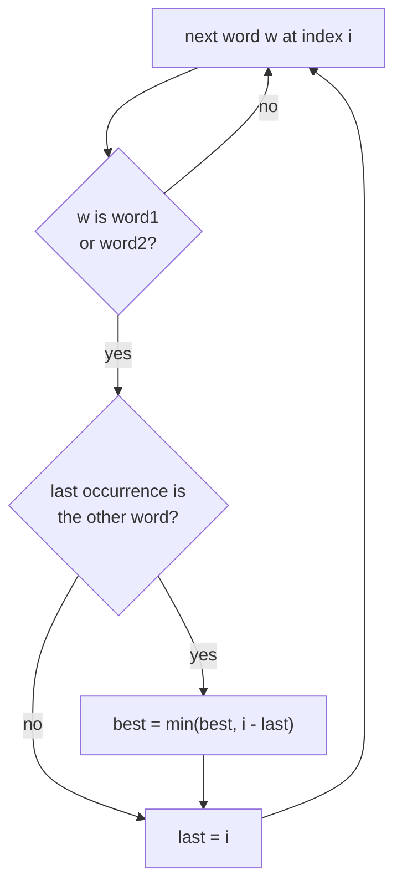

## Understand the problem

The distance is the difference of the two indices, so neighbouring words are 1 apart. Both words
can appear many times, and either can come first:

| `wordsDict` | `word1`, `word2` | Answer | Closest pair |
|---|---|---|---|
| `["the", "quick", "brown", "fox", "quick"]` | `"the"`, `"fox"` | 3 | indices 0 and 3 |
| the same | `"quick"`, `"fox"` | 1 | indices 4 and 3: `word2` first |
| `["a", "b", "c", "d", "c", "a"]` | `"a"`, `"c"` | 1 | indices 4 and 5 |
| `["a", "b"]` | `"a"`, `"b"` | 1 | the only pair |

Compare whole words: `"make"` and `"makes"` are different words.

## Brute force: every pair of positions

Collect the indices of each word and try every pair:

```python
p1 = [i for i, w in enumerate(wordsDict) if w == word1]
p2 = [i for i, w in enumerate(wordsDict) if w == word2]
return min(abs(i - j) for i in p1 for j in p2)
```

If each word fills half the list, that's (n/2)² pairs: **O(n²)**, 100 million for 20,000 words.
(Treating the list as a graph and running a BFS from every `word1` also works, but is far more
machinery than the problem needs.)

## The key insight: only neighbouring occurrences matter

Take a pair, `word1` at `i` and `word2` at `j`, and suppose another copy of either word sits
between them. That copy forms a closer pair with one of the ends:

```array
label: words
values: a x a x b
pointers: i=0 j=4
highlight: 0 4
caption: a at 0 and b at 4: distance 4, but another a lies between them
---
label: words
values: a x a x b
pointers: i=2 j=4
highlight: 2 4
caption: the a at 2 and the b at 4 are closer: distance 2
```

So the closest pair has no occurrence of either word between them: they are *consecutive* in
the sequence of all `word1` and `word2` positions. One pass is enough, keeping a single number
from the past: `last`, the index of the most recent occurrence of either word. This is
[running state in one pass](#/algo/learn/patterns/running-state-in-one-pass): the past matters
only through that one index.

At each occurrence, if `wordsDict[last]` is the *other* word, `i - last` is a candidate. Either
way `last` becomes `i`: a newer copy of a word is at least as close as an older one to anything
still to come. Walking `["a", "b", "c", "d", "c", "a"]` with `"a"` and `"c"`:

```array
label: words
values: a b c d c a
pointers: last=0 i=2
highlight: 0 2
caption: c after a: distance 2 - 0 = 2. Best 2
---
label: words
values: a b c d c a
pointers: last=2 i=4
highlight: 4
caption: c after c: no pair. last moves to 4, closer to what comes next
---
label: words
values: a b c d c a
pointers: last=4 i=5
highlight: 4 5
caption: a after c: distance 5 - 4 = 1. Best 1
```



## The solution

```solution
```

Check `last != -1` **before** reading `wordsDict[last]`. In Python `wordsDict[-1]` doesn't fail:
it quietly reads the *last* word of the list.

An equivalent version keeps the latest index of each word separately:

```python
i1 = i2 = -1
best = len(wordsDict)
for i, word in enumerate(wordsDict):
    if word == word1:
        i1 = i
    elif word == word2:
        i2 = i
    if i1 != -1 and i2 != -1:
        best = min(best, abs(i1 - i2))
```

## Complexity

- **Time: O(n · L)** for n words of up to L letters: one pass, and each word comparison costs up
  to L. With L at most 10, that's O(n).
- **Space: O(1).** Two indices, whatever the length of the list.

## Pitfalls and variations

- **Counting the words *between* the pair** (`i - last - 1`) instead of the index difference.
  Neighbours would then be 0 apart. Settle the definition from an example before coding.
- **Reading `wordsDict[last]` while `last == -1`**: no error in Python, just a wrong word.
- **Keeping the first occurrence instead of the latest.** In `["c", "x", "c", "a"]` the `a` must
  pair with the `c` at 2, not the one at 0.
- **The two words may be equal** (a common follow-up): then the answer is the distance between
  two *different* occurrences. In the single-`last` version, accept every consecutive pair of
  occurrences when `word1 == word2`.
- **Many queries on the same list.** Re-scanning costs O(n) per query. Instead, index the list
  once, O(n): a dict from each word to its sorted positions. A query then walks the two
  position lists with one pointer each, always advancing the smaller value, since pairing it with
  anything later on the other list can only be farther. That's O(m + p) for words with m and p
  occurrences. Positions of `"a"` and `"c"` in the example above:

```grid
rowlabels: a c
0 5
2 4
highlight: 0,0 1,0
caption: |0 - 2| = 2. 0 is smaller, so a's pointer moves
---
rowlabels: a c
0 5
2 4
highlight: 0,1 1,0
caption: |5 - 2| = 3. 2 is smaller, so c's pointer moves
---
rowlabels: a c
0 5
2 4
highlight: 0,1 1,1
caption: |5 - 4| = 1. Then c's list runs out: the answer is 1
```

```python
from collections import defaultdict


class WordDistance:
    def __init__(self, wordsDict: list[str]):
        self.positions = defaultdict(list)  # word -> its indices, increasing
        for i, word in enumerate(wordsDict):
            self.positions[word].append(i)

    def shortest(self, word1: str, word2: str) -> int:
        a, b = self.positions[word1], self.positions[word2]
        i = j = 0
        best = float("inf")
        while i < len(a) and j < len(b):
            best = min(best, abs(a[i] - b[j]))
            if a[i] < b[j]:
                i += 1
            else:
                j += 1
        return best
```

Walking several sorted lists with one pointer each is also the idea behind
[Values in K Sorted Streams](#/algo/problem/a36_k_common_in_sorted_streams), and the same kind of
one-number running state solves
[Best Time to Buy and Sell Stock](#/algo/problem/a03_best_time_to_buy_and_sell_stock).
