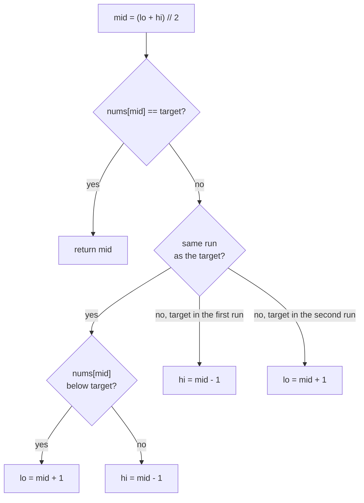

## Understand the problem

The array was sorted, then cut in two and the pieces swapped. What's left is two sorted **runs**:
the larger values first, then the smaller ones.

```array
label: sorted
values: 0 1 2 4 5 6 7
highlight: 3..6
caption: before: the part from index 3 on moves to the front
---
label: rotated
values: 4 5 6 7 0 1 2
highlight: 0..3
caption: after: two sorted runs, 4 5 6 7 then 0 1 2
```

We return the target's index, or `-1`. Cases to say out loud before coding:

- **No rotation** (`k = 0`): `[1, 3, 5, 7]` is one sorted run. The code must not assume a second
  run exists.
- **One element**: `[1]` with target 1 → `0`, with target 0 → `-1`.
- **The target at a run boundary**: the smallest value (the start of the second run), the largest
  (the end of the first run), `nums[0]`, or the last element.
- **The target absent**: between the runs (3 in Example 2), below every value, or above every
  value.

## Brute force: scan

```python
for i, x in enumerate(nums):
    if x == target:
        return i
return -1
```

**O(n) time**, O(1) space. It's correct and ignores that the array is nearly sorted. With at most
5,000 values a scan is fast in practice (the tests can't time the difference), but the problem
asks for O(log n), and that is what the interviewer is checking. O(log n) on an array means
[binary search](#/algo/learn/patterns/binary-search).

## Why plain binary search fails

On a sorted array, binary search keeps a range `[lo, hi]` that must contain the target, checks
the middle element, and throws away the half that can't hold the target:

```array
label: sorted
values: 0 1 2 4 5 6 7
pointers: lo=0 mid=3 hi=6
caption: target 5: nums[mid] = 4 is too small, so the target is right of mid
---
label: sorted
values: 0 1 2 4 5 6 7
pointers: lo=4 mid=5 hi=6
dim: 0..3
caption: nums[mid] = 6 is too big: the target is left of mid
---
label: sorted
values: 0 1 2 4 5 6 7
pointers: lo=4 mid=4 hi=4
dim: 0..3 5..6
highlight: 4
caption: found 5 at index 4
```

"`nums[mid]` is bigger than the target, so go left" relies on everything right of `mid` being
bigger still. After a rotation that's no longer true:

```array
label: nums
values: 4 5 6 7 0 1 2
pointers: lo=0 mid=3 hi=6
caption: target 0: nums[mid] = 7 is bigger, so plain binary search goes left...
---
label: nums
values: 4 5 6 7 0 1 2
pointers: lo=0 hi=2
dim: 3..6
highlight: 4
caption: ...and throws away the half that holds 0. It returns -1
```

## The key insight: which run is each value in?

Every value in the first run is at least `nums[0]`, and every value in the second run is smaller
than `nums[0]`. One comparison with `nums[0]` places any value in its run.

```array
label: nums
values: 4 5 6 7 0 1 2
highlight: 0..3
caption: first run: the values >= nums[0] = 4. Second run: the values < 4
```

The first run is a sorted prefix of the array and the second a sorted suffix. Classify the target
once and `nums[mid]` at every step:

| `target` | `nums[mid]` | The target, if present, is | Move |
|---|---|---|---|
| in the first run | in the second run | left of `mid` | `hi = mid - 1` |
| in the second run | in the first run | right of `mid` | `lo = mid + 1` |
| in the same run | in the same run | where a sorted array says | compare as usual |



Example 1 again, with the run test. `nums[0] = 4` and the target 0 is below it, so the target
belongs to the second run:

```array
label: nums
values: 4 5 6 7 0 1 2
pointers: lo=0 mid=3 hi=6
caption: 7 is in the first run, the target in the second: go right
---
label: nums
values: 4 5 6 7 0 1 2
pointers: lo=4 mid=5 hi=6
dim: 0..3
caption: 1 is in the target's run and 1 > 0: go left
---
label: nums
values: 4 5 6 7 0 1 2
pointers: lo=4 mid=4 hi=4
dim: 0..3 5..6
highlight: 4
caption: nums[4] = 0: return 4
```

The other mixed case moves left. In `[6, 7, 0, 1, 2, 4, 5]` the target 7 is at least
`nums[0] = 6`, so it is in the first run:

```array
label: nums
values: 6 7 0 1 2 4 5
pointers: lo=0 mid=3 hi=6
caption: 1 < 6 is in the second run, the target in the first: go left
---
label: nums
values: 6 7 0 1 2 4 5
pointers: lo=0 mid=1 hi=2
dim: 3..6
highlight: 1
caption: nums[1] = 7: return 1
```

And an absent target. In Example 2 the target 3 is below 4, so it would be in the second run:

```array
label: nums
values: 4 5 6 7 0 1 2
pointers: lo=0 mid=3 hi=6
caption: 7 is in the first run: go right
---
label: nums
values: 4 5 6 7 0 1 2
pointers: lo=4 mid=5 hi=6
dim: 0..3
caption: same run, 1 < 3: go right
---
label: nums
values: 4 5 6 7 0 1 2
pointers: lo=6 mid=6 hi=6
dim: 0..5
caption: same run, 2 < 3: go right
---
label: nums
values: 4 5 6 7 0 1 2
pointers: hi=6 lo=7
dim: 0..6
caption: lo > hi: the range is empty, so 3 isn't in nums. Return -1
```

## The solution

```solution
```

**Why it's correct.** The loop keeps one promise: if the target is in `nums`, its index is in
`[lo, hi]`. Each branch only discards indices that can't hold it. When `mid` and the target are
in different runs, the target's run lies entirely on one side of `mid`. When they're in the same
run, that run is sorted, so the usual comparison is right. The range shrinks by at least one
every step, so the loop ends; if it ends without returning, the target isn't there.

**No rotation needs no special case.** Then every value is at least `nums[0]`, so the whole array
is the first run and `mid` is always in it. A target below `nums[0]` belongs to the (empty)
second run, so every step moves right until the range is empty: `-1`, as it should be.

## Another way: one half is always sorted

The textbook solution looks at the two halves around `mid`. The rotation point can be in at most
one of them, so at least one half is sorted, and for a sorted half a range check says whether the
target can be inside it.

```array
label: nums
values: 4 5 6 7 0 1 2
pointers: lo=0 mid=3 hi=6
highlight: 0..3
caption: nums[lo] = 4 <= nums[mid] = 7: the left half holds 4..7. 0 isn't in it: go right
```

```python
lo, hi = 0, len(nums) - 1
while lo <= hi:
    mid = (lo + hi) // 2
    if nums[mid] == target:
        return mid
    if nums[lo] <= nums[mid]:  # nums[lo..mid] is sorted
        if nums[lo] <= target < nums[mid]:
            hi = mid - 1
        else:
            lo = mid + 1
    else:  # nums[mid..hi] is sorted
        if nums[mid] < target <= nums[hi]:
            lo = mid + 1
        else:
            hi = mid - 1
return -1
```

Both are O(log n). The run test compares against one fixed value, `nums[0]`, which leaves fewer
boundaries to get wrong; the sorted-half version has a `<=` or `<` to choose in five places.

A third approach: first find the rotation point (the first value below `nums[0]`) with one binary
search, then binary-search the run that can hold the target. Two searches, still O(log n). The
first search is the "find the boundary" template of
[Koko Eating Bananas](#/algo/problem/a45_koko_eating_bananas).

## Complexity

- **Time: O(log n).** Each step at least halves `[lo, hi]`, so 5,000 values take at most 13
  steps.
- **Space: O(1).** A few indices.

## Pitfalls and variations

- **`>=`, not `>`, when classifying.** `nums[0]` belongs to the first run. With
  `target > nums[0]`, the target `nums[0]` is put in the second run, and
  `[4, 5, 6, 7, 0, 1, 2]` with target 4 returns -1.
- **Mixing interval styles.** Closed `[lo, hi]` goes with `hi = len(nums) - 1`,
  `while lo <= hi` and `hi = mid - 1`. Half-open `[lo, hi)` goes with `hi = len(nums)`,
  `while lo < hi` and `hi = mid`; that version is also correct. Mixed, they break:
  `while lo < hi` with `hi = len(nums) - 1` never checks the last remaining element (`[5]`,
  target 5 returns -1), and `while lo <= hi` with `hi = mid` loops forever once `lo == hi`.
  [Test](#/algo/learn/approach/test-it) on arrays of length 1 and 2, where off-by-one errors show.
- **`<=` in the sorted-half test.** When `lo == mid`, the left "half" is one element, which is
  sorted. With `nums[lo] < nums[mid]`, `[3, 1]` with target 1 returns -1.
- **Overflow.** `(lo + hi) // 2` is safe in Python. In Java or C++ write `lo + (hi - lo) / 2`.
- **Follow-up: duplicates** (Search in Rotated Sorted Array II). With repeated values,
  `nums[mid] == nums[0]` no longer tells you the run: in both `[1, 1, 1, 0, 1]` and
  `[1, 0, 1, 1, 1]`, `nums[lo]`, `nums[mid]` and `nums[hi]` are all 1, yet the 0 is on different
  sides. When the three are equal, shrink both ends (`lo += 1`, `hi -= 1`). The worst case becomes
  O(n), and no algorithm can do better: an array of 1s with a single 0 hides it anywhere.
- **Follow-up: find the minimum** (the rotation point). Binary-search for the first value below
  `nums[0]`; if there is none, the array isn't rotated and the minimum is `nums[0]`.
- **Return true or false** instead of an index: the same search.

Searching a sorted array in O(log n) is the starting point; see
[sorting and searching](#/algo/learn/data-structures/sorting-and-searching).
