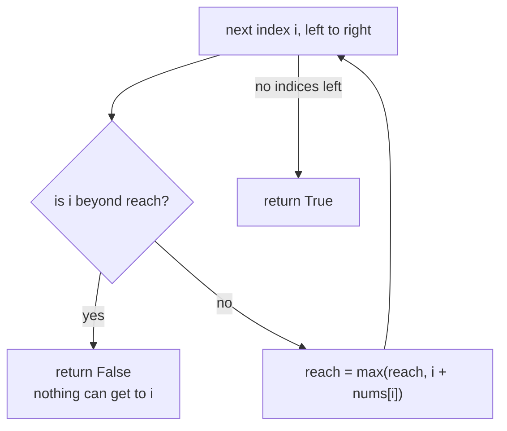

## Understand the problem

`nums[i]` is a *maximum*: from index `i` you can jump 1, 2, ... up to `nums[i]` steps. Two
consequences are worth saying out loud:

- A `0` is a trap. Standing on it you can't move, so the only way past it is to jump *over* it.
- Jumping past the end is as good as landing on it: if a jump could carry you beyond the last
  index, a shorter jump from the same place lands exactly on it.

| `nums` | Answer | Why |
|---|---|---|
| `[1, 1, 1, 1]` | True | one step at a time |
| `[1, 0, 1]` | False | the 0 at index 1 can't be passed |
| `[2, 0, 1]` | True | jump over the 0 |
| `[0]` | True | you start on the last index |
| `[0, 1]` | False | stuck at the start |
| `[1, 1, 0]` | True | a 0 on the last index doesn't matter: you're done when you land there |

## Brute force: try every jump

Ask "can I finish from index `i`?" recursively. You can if `i` is the last index (or past it), or
if one of the jumps from `i` leads to an index you can finish from. Many routes pass through the
same index, so remember each answer: this is
[top-down DP with a memo](#/algo/learn/dynamic-programming/top-down-helper-plus-memo).

```python
def canJump(self, nums: list[int]) -> bool:
    n = len(nums)
    memo: dict[int, bool] = {}

    def can_finish(i: int) -> bool:
        if i >= n - 1:
            return True
        if i not in memo:
            memo[i] = any(can_finish(i + j) for j in range(1, nums[i] + 1))
        return memo[i]

    return can_finish(0)
```

Each index is solved once, but solving it tries up to `nums[i]` jumps, so the worst case is
**O(n²)**. Take `[9998, 9997, ..., 2, 1, 0, 1]`: every index can jump anywhere up to the 0 just
before the end and no further, so every jump fails, about 50 million calls in all. The recursion
also goes `n` levels deep, past Python's default limit of 1,000 frames. Without the memo it's
exponential.

Here is the table the DP fills in for Example 2. Every index except the last is a dead end,
because every route funnels into the 0 at index 3:

```array
label: nums
values: 3 2 1 0 4
---
label: can finish
values: F F F F T
highlight: 4
caption: index 3 can't move; indices 0 to 2 can only reach indices up to 3
```

## A greedy that fails: always take the biggest jump

Committing to the longest jump looks tempting, but it can land on a trap that a shorter jump
would have avoided:

```array
label: biggest
values: 3 0 5 0 0 0
pointers: i=3
highlight: 0 3
caption: jumping 3 lands on a 0: stuck, so this greedy wrongly answers False
---
label: shorter
values: 3 0 5 0 0 0
pointers: i=2
highlight: 0 2
caption: jumping 2 lands on the 5, which reaches index 7, past the end
```

The fix is not to commit to any jump at all, but to track every index you *could* be on.

## The key insight: what you can reach is always a prefix

If you can reach index `j`, you can reach every index before it too. On the route to `j`, some
jump starts at or before `k` and lands after `k`. Jumps can be any length up to the maximum, so a
shorter jump from the same index lands exactly on `k`.

So the reachable indices are always `0, 1, ..., reach`: one unbroken block, described by a
single number. The DP table above never needs to exist. Walk `i` from left to right:

- If `i <= reach`, index `i` is reachable, and from it every index up to `i + nums[i]` is too:
  `reach = max(reach, i + nums[i])`.
- If `i > reach`, no jump from any reachable index gets to `i`. Nothing to the right is reachable
  either, so the answer is False.

```array
label: nums
values: 2 3 1 1 4
pointers: i=0 reach=2
highlight: 0..2
caption: i = 0: reach = 0 + 2 = 2
---
values: 2 3 1 1 4
pointers: i=1 reach=4
highlight: 0..4
caption: i = 1: reach = max(2, 1 + 3) = 4, the last index: True
```

On Example 2, `reach` gets stuck at 3, and `i` overtakes it:

```array
label: nums
values: 3 2 1 0 4
pointers: i=0 reach=3
highlight: 0..3
caption: i = 0: reach = 3
---
values: 3 2 1 0 4
pointers: i=3 reach=3
highlight: 0..3
caption: i = 1, 2, 3 each reach exactly 3: reach stays 3
---
values: 3 2 1 0 4
pointers: reach=3 i=4
highlight: 0..3
dim: 4
caption: i = 4 is past reach: no route gets here, so False
```



## The solution

```solution
```

**Why it's correct.** Before index `i` is processed, `reach` is the furthest index reachable from
indices `0..i-1`, and by the prefix argument every index up to `reach` is reachable. If `i` is
within reach, adding its jumps keeps that true. If it isn't, no reachable index jumps to `i` or
beyond, so the reachable set is exactly `0..reach` and the last index isn't in it. Reaching the
end of the loop means every index, the last one included, was within reach.

This is the [greedy-or-DP](#/algo/learn/dynamic-programming/greedy-or-dp) pattern in its purest
form: when a DP's state collapses to one running best value (here, the furthest reach), the DP
becomes a single greedy pass.

### Two other ways to write it

**Steps left.** Instead of the furthest index, track how many more steps you can take. Each move
right uses one step, and standing on index `i` refills it to `nums[i]` if that's more. Running
out before the end means False. This is the same algorithm, since `steps = reach - i`:

```python
steps = 0
for i, jump in enumerate(nums):
    if steps < 0:
        return False  # we ran out before reaching i
    steps = max(steps, jump) - 1  # refill, then spend one step moving to i + 1
return True
```

**From the end.** Walk right to left keeping `goal`, the leftmost index known to reach the end.
Index `i` can reach the end if it can jump to `goal`; then it becomes the new goal. The answer is
whether the goal gets all the way back to 0.

```array
label: nums
values: 2 3 1 1 4
pointers: goal=4
caption: start: the last index is the goal
---
values: 2 3 1 1 4
pointers: goal=3
caption: 3 + 1 reaches 4, so index 3 is the new goal
---
values: 2 3 1 1 4
pointers: goal=0
highlight: 0
caption: then index 2 reaches 3, index 1 reaches 2, index 0 reaches 1: goal = 0, True
```

## Complexity

- **Time: O(n).** One pass. You can also stop early as soon as `reach >= len(nums) - 1`.
- **Space: O(1).** One integer, instead of the DP's O(n) memo and recursion stack.

## Pitfalls and variations

- **Using `nums[i]` before checking `i > reach`.** An unreachable index must not extend the reach:
  in `[0, 5]`, index 1 is never reachable even though it could jump far.
- **Off-by-one on the goal:** the last index is `len(nums) - 1`, and landing on it is enough. A
  `0` there is fine.
- **Committing to a jump** (the biggest, or the one that lands on the biggest value) instead of
  tracking the reach. Find a small counterexample before trusting a greedy rule.
- **Deep recursion** in the DP version: `n` frames for `n` = 10,000 needs a raised recursion
  limit, or a bottom-up loop.
- **Jump Game II** (the fewest jumps to reach the end) uses the same reach, in levels: the indices
  reachable with `k` jumps form a window, and the next window ends at the furthest reach from
  inside it. That's
  [BFS by levels](#/algo/learn/patterns/bfs-by-levels-and-shortest-paths) without a queue,
  O(n).
- **Jump Game III** (jump exactly `nums[i]` left *or* right, and land on a 0) loses the prefix
  property, so it becomes a plain [graph search](#/algo/learn/patterns/graph-traversal).

The [greedy pattern](#/algo/learn/patterns/greedy) has more problems of this shape.
