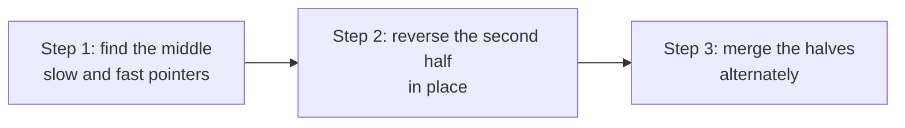

## Understand the problem

Take nodes alternately from the front and the back:

| Input | Output |
|---|---|
| `[1, 2, 3, 4]` | `[1, 4, 2, 3]` |
| `[1, 2, 3, 4, 5]` | `[1, 5, 2, 4, 3]` |
| `[5, 6, 7, 8, 9, 10, 11]` | `[5, 11, 6, 10, 7, 9, 8]` |
| `[1, 2]`, `[1]`, `[]` | unchanged |

The catch is the constraint. On paper you'd jump between the two ends, but a singly linked list
only walks forwards, and we may not use O(n) extra memory.

## Brute force

Two easy approaches, both breaking a rule:

- **Copy the nodes into an array**, then relink them with two indices moving inwards. O(n) time,
  but **O(n) space** for the array.
- **Repeatedly detach the tail**: walk to the second-to-last node, move the last node after the
  current one, step forward twice, repeat. O(1) space, but each walk to the tail is O(n), so
  **O(n²) time**: about 25 million steps for 10,000 nodes.

## The key insight: it's two lists woven together

Look at the output for `[1, 2, 3, 4, 5]`: `1, 5, 2, 4, 3` alternates between the front half
`1, 2, 3` in order and the back half `5, 4` in **reverse**. Reversing the back half is what lets
us walk "from the end" using only `next` pointers. So the problem is three standard
[linked list techniques](#/algo/learn/patterns/linked-list-techniques) in a row.



### Step 1: find the middle

Move `slow` one step and `fast` two steps at a time. When `fast` can't move two more, `slow` is at
the end of the first half.

```linkedlist
values: 1 2 3 4 5
pointers: slow=0 fast=0
caption: start
---
values: 1 2 3 4 5
pointers: slow=1 fast=2
---
values: 1 2 3 4 5
pointers: slow=2 fast=4
highlight: 2
caption: fast can't move two more: slow (3) ends the first half
```

With an even length, `[1, 2, 3, 4]` stops with `slow` on 2: the first half is `1, 2` and the
second `3, 4`. The first half is never shorter than the second.

### Step 2: cut, then reverse the second half

Set `slow.next = None` to split the list in two, then reverse the second half with the usual three
pointers (`prev`, `cur`, and the saved `nxt`).

```linkedlist
label: first
values: 1 2 3
---
label: second
values: 4 5
caption: after the cut
---
label: second
values: 5 4
caption: reversed: 5 → 4 → null
```

Cutting matters: without it, the old `3 → 4` link survives and the merged list ends in a cycle.

### Step 3: merge alternately

Take one node from each list in turn. Save both `next` pointers before relinking, or the rest of
each list is lost.

```linkedlist
label: merged
values: 1 5 2 4 3
highlight: 1 3
caption: 1 → 5 → 2 → 4 → 3; the second-half nodes (highlighted) were spliced in
```

The second half is the same length or one shorter, so the merge stops when it runs out, and the
first half's last node (3) is already in the right place with `next = None`.

## The solution

```solution
```

## Complexity

- **Time: O(n).** Finding the middle walks n/2 steps, reversing touches n/2 nodes and the merge
  touches every node once.
- **Space: O(1).** A handful of pointers; the nodes themselves are reused.

A recursive solution (recursing to the end to reach the tail nodes) looks O(1) but uses O(n) call
stack, so it doesn't meet the constraint. Interviewers often ask that as a follow-up:
[recursion uses space](#/algo/learn/complexity/space-complexity).

## Pitfalls and variations

- **Empty and single-node lists**: `fast.next` on `None` crashes. Return early.
- **Forgetting the cut**: the last node keeps pointing into the first half, which is a cycle.
- **Losing the rest of a list**: always save `next` before overwriting it, in both the reversal and
  the merge.
- **Off-by-one on the middle**: the loop condition `fast.next and fast.next.next` keeps the first
  half the longer one. With `fast and fast.next`, the merge must handle the other case.
- The same three building blocks solve **Palindrome Linked List** (reverse the second half and
  compare) and appear inside many other list problems.
