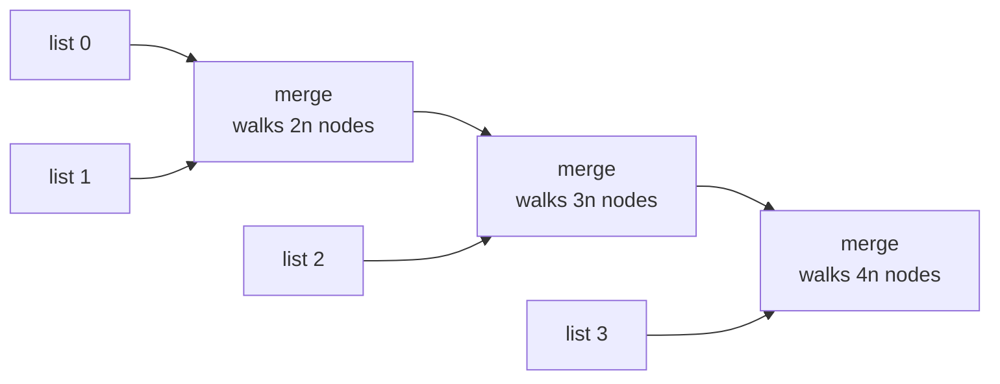
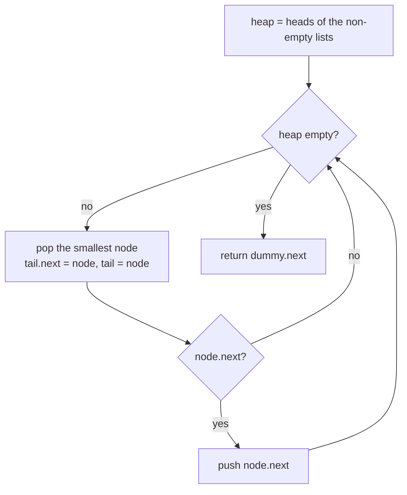
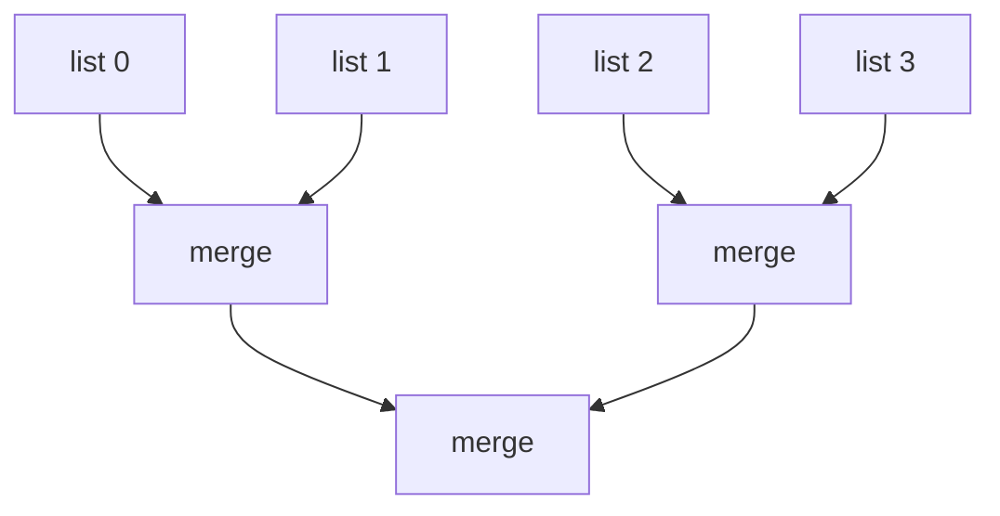

## Understand the problem

Let `N` be the total number of nodes and `k` the number of lists. The output holds all `N`
nodes in sorted order, duplicates included:

```linkedlist
label: lists[0]
values: 1 2 3
---
label: lists[1]
values: 2 3 4
---
label: lists[2]
values: 5 6 7
---
label: merged
values: 1 2 2 3 3 4 5 6 7
highlight: 1 2 3 4
caption: nine nodes: both 2s and both 3s are kept
```

Cases to cover:

| `lists` | Result | Why |
|---|---|---|
| `[]` | `[]` | no lists at all |
| `[[]]`, `[[], [], []]` | `[]` | lists that are all empty |
| `[[], [1], [], [0, 2]]` | `[0, 1, 2]` | empty lists mixed in: their head is `None` |
| `[[1, 1], [1, 1], [1]]` | `[1, 1, 1, 1, 1]` | equal values across lists |
| `[[1, 2], [10, 11], [5, 6]]` | `[1, 2, 5, 6, 10, 11]` | lists that don't interleave at all |

The nodes already exist, so the merge can relink them (change their `next` pointers) instead of
creating new ones.

## Brute force

Three honest first answers:

- **Collect and sort.** Copy every value into an array, sort it, and build a new list:
  O(N log N) time and O(N) extra space. It's simple and fast in practice, but it ignores that the
  lists are already sorted, and it copies every node.
- **Scan the heads.** The next output node is always the smallest of the k current heads. Find it
  by checking all k heads, append it, advance that list, repeat: **O(Nk)**. With 10,000 lists of
  one node each, that's 100 million comparisons.
- **Merge one list at a time** into a growing result, using the two-pointer merge of two sorted
  lists. Each merge walks the whole result so far, so with k lists of n nodes the work is
  `n + 2n + 3n + ... + kn`, about `N·k/2`: **O(Nk)** again.



Each merge re-walks everything merged so far, so the early lists are walked again and again.

## The key insight: a min-heap of the heads

Scanning the heads is the right idea; scanning is the slow part. We need the smallest of k values,
then to replace it with the next node from the same list, over and over. That's exactly what a
[min-heap](#/algo/learn/data-structures/heaps) does in O(log k).

- Put the head of every non-empty list in the heap.
- Pop the smallest node and append it to the output.
- Push that node's `next` (if any): it is now its list's head.
- Repeat until the heap is empty.

The heap holds at most one node per list, so never more than k entries. Here is Example 1, with
heap entries written `(value,list)` in the order `heapq` stores them; the front of the array is
always the smallest:

```array
label: heap
values: (1,0) (1,1) (2,2)
highlight: 0
caption: start: the three heads. Output: empty
---
label: heap
values: (1,1) (2,2) (4,0)
highlight: 0
caption: popped (1,0) and pushed list 0's next node, 4. Output: 1
---
label: heap
values: (2,2) (4,0) (3,1)
highlight: 0
caption: popped (1,1), pushed 3. Output: 1 1
---
label: heap
values: (3,1) (4,0) (6,2)
highlight: 0
caption: popped (2,2), pushed 6. Output: 1 1 2
---
label: heap
values: (4,1) (6,2) (5,0)
highlight: 0
caption: popped (3,1) and then (4,0), pushing 4 and 5. Output: 1 1 2 3 4
---
label: heap
values: (6,2)
highlight: 0
caption: popped (4,1) and (5,0); lists 1 and 0 are used up. Output: 1 1 2 3 4 4 5
```

The final pop of `(6,2)` empties the heap and completes the output.

To build the output, start from a **dummy** node and keep a `tail` pointer: appending is
`tail.next = node; tail = node`, the same O(1) step for the first node as for every other.
Return `dummy.next` at the end.

```linkedlist
values: _ 1 1 2
pointers: dummy=0 tail=3
dim: 0
caption: the empty dummy node is never part of the answer: return dummy.next
```



## The solution

```python
import heapq


class Solution:
    def mergeKLists(self, lists: list[ListNode | None]) -> ListNode | None:
        heap = [(node.val, i, node) for i, node in enumerate(lists) if node]
        heapq.heapify(heap)

        dummy = tail = ListNode()
        while heap:
            _, i, node = heapq.heappop(heap)
            tail.next = node
            tail = node
            if node.next:
                heapq.heappush(heap, (node.next.val, i, node.next))
        return dummy.next
```

Three details make it work:

- **`if node`** skips empty lists, whose head is `None`. Without it, `node.val` crashes.
- **The tie-breaker `i`.** `heapq` compares tuples element by element. When two values are equal
  it moves on to the second element, and comparing two `ListNode`s raises
  `TypeError: '<' not supported between instances of 'ListNode' and 'ListNode'`. Example 1 has
  two 1s, so `(node.val, node)` crashes at once. The list index is unique among the heap's
  entries (each list has at most one node in the heap), so the comparison never reaches the node.
- **Relinking, not copying.** Each popped node is attached to the output as it is. The last node
  popped is the last node of its list, so its `next` is already `None` and the output ends
  cleanly.

Other ways to fix the tie, and their catches:

| Fix | Catch |
|---|---|
| `(val, i, node)` with the list index | none: the simplest |
| `(val, count, node)` with a global counter | also fine; equal values come out in insertion order |
| define `__lt__` on `ListNode` | works, but changes a class you may not own |
| wrap each node in a comparable class | works, but allocates an object per node |
| a random number as the tie-breaker | two equal random numbers still crash: rare is not never |

## Complexity

- **Time: O(N log k).** Building the heap is O(k). Every node is pushed and popped once, and each
  heap operation is O(log k) because the heap never holds more than k entries. Compare O(Nk) for
  scanning the heads: with k = 10,000, log k is about 14.
- **Space: O(k)** for the heap. The output reuses the input's nodes.

## Another way: divide and conquer

Merge the lists in pairs, then merge the results in pairs, and so on, like the merge step of
merge sort. Each round walks every node once and halves the number of lists, so there are
`log k` rounds: **O(N log k)** time, the same as the heap, and only O(1) extra space when the
rounds are written as a loop.



The heap version is the one to know for streams: it only ever needs the current head of each
list, so it works when the lists are files on disk or network feeds.

## Pitfalls and variations

- **Pushing `None`** for an empty list, or **pushing `(val, node)`** without a tie-breaker.
- **`queue.PriorityQueue`** works, but it is built for passing data between threads and takes a
  lock on every call. Use `heapq` in single-threaded code.
- **Returning `dummy`** instead of `dummy.next` puts an extra 0 at the front.
- **Merge k sorted arrays:** the same heap, with entries `(value, array index, position)`.
- **External sorting:** sorting a file too large for memory sorts chunks that fit, writes them
  out, then k-way merges the sorted chunks exactly like this.
- **K-th smallest element across sorted lists, or in a sorted matrix:** pop k times.
- **Values that appear in at least k of the lists:** the same merge, counting equal values as
  they come out. See [Values in K Sorted Streams](#/algo/problem/a36_k_common_in_sorted_streams).

The [heaps pattern](#/algo/learn/patterns/heaps-and-top-k) covers k-way merges alongside top-k
problems, and the dummy node is one of the
[linked list techniques](#/algo/learn/patterns/linked-list-techniques).
