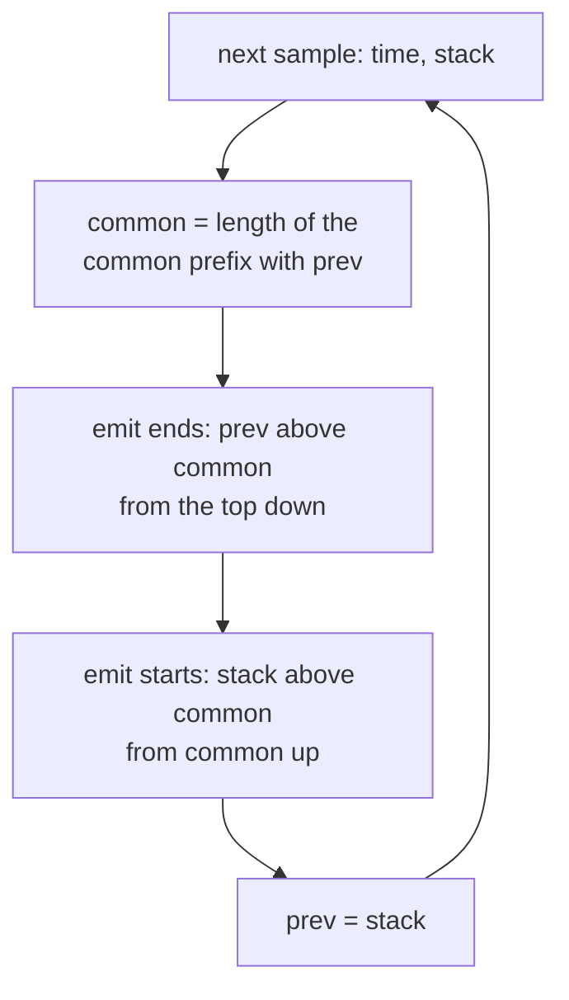

## Understand the problem

Each sample is a snapshot of the call stack. Lay the snapshots side by side, one column per
sample with the outermost call at the bottom, and every call shows up as a horizontal run of
cells:

```grid
collabels: t=1 t=2 t=3 t=4 t=5 t=6
rowlabels: "depth 2" "depth 1" "depth 0"
_ _ read _ _ _
_ parse parse eval eval _
main main main main main _
highlight: 2,0 1,1 0,2 1,3
caption: each call is a run of cells; the first cell (highlighted) is its start
```

Its events, sample by sample:

| Sample | Stack | Events |
|---|---|---|
| 1 | `main` | start main |
| 2 | `main parse` | start parse |
| 3 | `main parse read` | start read |
| 4 | `main eval` | end read, end parse, start eval |
| 5 | `main eval` | none: the stack didn't change |
| 6 | empty | end eval, end main |

Three details decide the order of the output:

- At one timestamp, **ends come before starts**: the old calls return before new ones begin.
- Ends go **innermost first** (a callee returns before its caller), starts **outermost first**
  (a caller is entered before its callee). Nested like brackets: compare
  [Valid Parentheses](#/algo/problem/a27_valid_parentheses).
- An end event carries the timestamp of the first sample *without* the call. And calls still on
  the stack at the last sample get no end event at all, because we never see them return.

## When is it the same call?

The tricky part is deciding whether a frame in one sample is the same call as a frame in the
next. Comparing **names** fails: with recursion, `["f", "f"]` holds two calls named `f`, and a
set of names would merge them (and lose the order we need for the output). Comparing **name and
depth** fails too:

```array
label: t=1
direction: vertical
values: A B C
highlight: 1 2
caption: B calls C ...
---
label: t=2
direction: vertical
values: A D C
highlight: 1 2
caption: ... then D calls a C at the same depth: a new call
```

`C` is at depth 2 in both samples, but between them `B` returned (so the `C` it called returned
too) and `D` called a fresh `C`. A frame is the same call only if **it and every frame below it**
match: its whole path from the outermost call.

## Brute force: compare full paths

Taking that literally, identify every frame by its path, `tuple(stack[:d + 1])`, and compare the
two samples' sets of paths:

```python
events, prev_paths = [], []
for time, stack in samples:
    paths = [tuple(stack[: d + 1]) for d in range(len(stack))]
    seen_now, seen_before = set(paths), set(prev_paths)
    events += [("end", time, p[-1]) for p in reversed(prev_paths) if p not in seen_now]
    events += [("start", time, p[-1]) for p in paths if p not in seen_before]
    prev_paths = paths
```

It is correct, but a stack of depth d has paths of length 1, 2, ..., d: building and hashing them
costs O(d²) per sample. A recursion 7,000 calls deep means about 25 million tuple entries for
every sample, and hundreds of megabytes of memory.

## The key insight: the longest common prefix

Paths are prefixes of the stack, and two prefixes are equal exactly up to the first position
where the stacks differ. So one walk from the bottom finds everything: let `common` be the
length of the **longest common prefix**. Frames below `common` are the same calls; every frame
of the previous stack from `common` up has ended; every frame of the current stack from `common`
up has started.

From sample 3 to sample 4 above:

```array
label: before
direction: vertical
values: main parse read
highlight: 1 2
caption: t=3: common = 1 (main). parse and read end
---
label: after
direction: vertical
values: main eval
highlight: 1
caption: t=4: eval starts
```

Ends are emitted from the top of the previous stack down to `common` (innermost first), then
starts from `common` up to the top of the current stack (outermost first):

```array
label: t=4
values: "end read" "end parse" "start eval"
indices: false
caption: the events of sample 4, in output order
```

Recursion needs no special case: each `f` is a separate frame at its own position.

```grid
collabels: t=1 t=2 t=3 t=4
rowlabels: "depth 2" "depth 1" "depth 0"
_ _ f _
_ f f _
f f f f
highlight: 2,0 1,1 0,2
caption: three calls named f. At t=4 the top two end, innermost first
```

For each sample:



## The solution

```solution
```

Checking it against the edge cases:

- **Identical stacks:** `common` is the whole stack, so both slices are empty.
- **An empty stack** (the program was idle): `common = 0`, so every previous frame ends.
- **The first sample:** `prev` is empty, so every frame starts.
- **The last sample:** nothing runs after the loop, so its frames never get end events, as the
  rules require.

`prev = stack` keeps a reference to the input list rather than a copy. That's fine because
nothing modifies it; copy it (`list(stack)`) if the caller might reuse the list.

## Complexity

Let F be the total number of frames over all samples.

- **Time: O(F).** For each sample, the prefix walk and the two loops touch each frame of the
  previous and the current stack at most once, and every stack is "current" once and "previous"
  once. The output itself has at most 2F events.
- **Space: O(1)** besides the output: a reference to the previous stack, plus two slices that
  are never longer than the events they turn into.

## Pitfalls and variations

- **Sets of names**, or of `(depth, name)` pairs: they merge recursive calls and miss a frame
  whose caller changed. The previous section shows both.
- **Wrong order within a timestamp:** ends before starts, ends innermost first, starts outermost
  first. Iterating the previous stack forwards emits the ends outermost first, which is wrong.
- **Forgetting the empty stack before the first sample**, which would lose the first starts.
- **Closing everything at the end:** these rules say not to. If asked for it as a follow-up,
  emit ends for the last stack, innermost first, at a final timestamp you are given.
- **Follow-ups:** compute each call's duration (pair each end with its start using a stack of
  open calls, as in [Valid Parentheses](#/algo/problem/a27_valid_parentheses)); or aggregate
  time per path to draw a flame graph, keyed by the same paths the brute force built.
