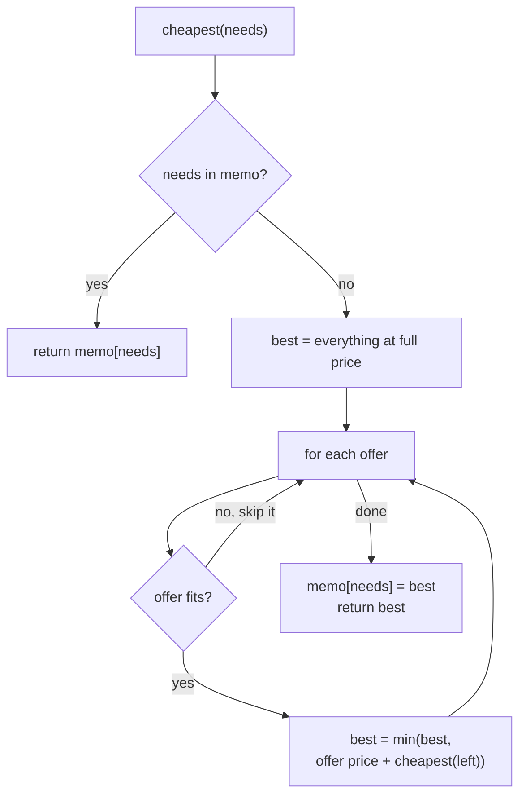
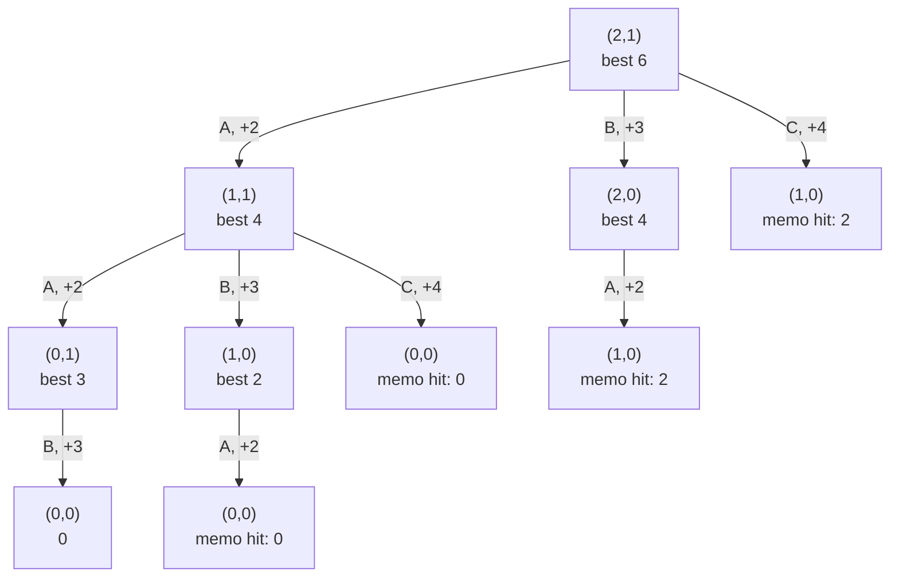

## Understand the problem

We fill an exact order. Each purchase is either one item at full price or a whole offer, offers
can be reused, and nothing may take any item past what we still need. Using an offer subtracts its
items from the needs:

```grid
rowlabels: needs "offer 1" left
3 2
1 2
2 0
highlight: 2,0 2,1
caption: Example 1: offer 1 fits, and leaves two of item 0 to buy
---
rowlabels: needs "offer 0" left
1 1
2 2
-1 -1
highlight: 2,0 2,1
caption: Example 3: the offer would leave -1 of each item, so it can't be used
```

Cases to say out loud:

- **No offers, or none that fit**: everything at full price.
- **An offer dearer than its items at full price**: never worth using.
- **An offer bigger than what's left**, even a free one: not allowed (Example 3).
- **Nothing needed**: the answer is 0.
- **An offer with no items** (all quantities 0): using it changes nothing. It must be skipped, or
  a recursive solution calls itself forever.

## Brute force: try every sequence of offers

Recursion is the natural fit: pick an offer that fits, subtract it, and solve the rest the same
way; or stop and buy the rest at full price.

```python
def cheapest(needs):
    best = sum(q * p for q, p in zip(needs, price))  # the rest at full price
    for offer in special:
        if any(offer[:-1]):  # skip offers with no items
            left = [need - q for need, q in zip(needs, offer)]  # zip stops before the price
            if min(left) >= 0:
                best = min(best, offer[-1] + cheapest(left))
    return best
```

It's correct, but it tries every **order** of the same offers: "A then B" and "B then A" reach the
same remaining needs and solve them twice, and each of those solves its own remainder twice, and
so on. With three offers of one item each and the same need for all three items, the number of
calls explodes:

| needs | calls without a memo | calls with a memo |
|---|---|---|
| `[1, 1, 1]` | 16 | 13 |
| `[2, 2, 2]` | 271 | 55 |
| `[3, 3, 3]` | 5,248 | 145 |
| `[5, 5, 5]` | 2,435,200 | 541 |
| `[10, 10, 10]` | about 1.8 × 10^13 | 3,631 |

At `[10, 10, 10]`, the largest the constraints allow for three items, that's months of
computing.

## The key insight: the remaining needs are the whole state

The cheapest way to finish depends only on what is still needed, not on which offers got us
there. A function whose answer depends only on its arguments can be memoized: compute each result
once and look it up afterwards. This is
[top-down dynamic programming](#/algo/learn/dynamic-programming/top-down-helper-plus-memo), and
the memo key is the smallest thing that determines the answer: the tuple of remaining needs
([choosing the memo key](#/algo/learn/dynamic-programming/choosing-the-memo-key)).

The helper has the usual shape: check the memo, take the default option, try every choice, store
the best, return it.



A small example shows the memo at work. Item 0 costs 3 and item 1 costs 4; offer A is one of
item 0 for 2, B is one of item 1 for 3, C is one of each for 4; we need two of item 0 and one of
item 1. Each node is a state `(item 0 left, item 1 left)` and each edge an offer used; amber
states were already in the memo, so they return at once without exploring further:



The root compares full price (10) with A + 4 = 6, B + 4 = 7 and C + 2 = 6: the answer is 6, for
example A then C. Laid out as a table, the memo is a grid over the remaining needs, and the best
plan is a path through it:

```grid
rowlabels: a=0 a=1 a=2
collabels: b=0 b=1
0 3
2 4
4 6
highlight: 2,1
path: 2,1 1,1 0,0
caption: memo[(a, b)]: the cheapest way to buy a more of item 0 and b more of item 1
```

Filling that grid from the top-left corner instead of recursing from the bottom-right is the
[bottom-up](#/algo/learn/dynamic-programming/bottom-up-tables) version of the same solution.

## The solution

```solution
```

Before recursing it drops two kinds of offer:

- **Offers with no items.** They never change the needs, so trying one would recurse on the same
  state forever (the state isn't in the memo yet, because it's still being computed).
- **Offers that cost at least as much as their items at full price.** Any plan that uses one can
  buy those items one by one instead, for no more money, so they never help. Dropping them is
  optional (the minimum ignores them anyway) but cuts the branching.

**Why it's correct.** Any way of buying exactly `needs` is some offers (repeats allowed) plus
single items. If it uses no offer, the full-price option covers it. If it uses offers, their order
doesn't matter, so one of them can go first; the loop tries that offer and then the cheapest way
to buy what's left, which the recursion finds by the same argument. So the minimum over all
options is the cheapest plan.

## Complexity

With m offers and n kinds of items:

- **States**: each `needs[i]` only goes down, so there are at most
  `(needs[0] + 1) × ... × (needs[n-1] + 1)` distinct states: at most 11^6, about 1.8 million, for
  six items with ten of each. Usually far fewer are reachable by subtracting whole offers.
- **Time: O(m · n · number of states).** Each state is computed once, trying m offers in O(n)
  each; every later visit is an O(n) memo lookup.
- **Space**: the memo holds one entry per state, and the recursion is at most `sum(needs)` (60)
  calls deep, since every offer used removes at least one item.

## Pitfalls and variations

**Greedy fails.** Taking the offer that saves the most first looks tempting. Prices
`[10, 10, 10]`, needs `[2, 2, 2]`, and three offers:

| Offer | Items | Price | Saves |
|---|---|---|---|
| A | `[2, 2, 0]` | 20 | 20 |
| B | `[1, 0, 1]` | 5 | 15 |
| C | `[0, 1, 1]` | 5 | 15 |

Greedy takes A, after which neither B nor C fits, and pays 20 + 2 × 10 = 40. B and C together,
plus one of item 0 and one of item 1 at full price, cost 30. Choices that block each other need
a search, which is why this is DP and not [greedy](#/algo/learn/dynamic-programming/greedy-or-dp).

- **Checking the total instead of every item.** An offer fits only if *each* quantity is at most
  what's left of that item.
- **A list as the memo key** raises `TypeError: unhashable type: 'list'`. Use a tuple.
- **A memo that outlives the call.** The answers depend on `price` and `special`, so a memo kept
  on the class or in a module-level `@cache` gives the next input the previous input's answers.
  Create it inside `shoppingOffers`. For `functools.cache`, decorate a nested function of the
  needs tuple, not the method (its list arguments can't be hashed).
- **Buying more than needed when it's cheaper** isn't allowed here. If it were, an offer could
  overshoot: clamp the needs at 0 instead of rejecting the offer.
- **Bottom-up**: loop over every needs tuple from `(0, ..., 0)` upwards (`itertools.product`)
  and fill the table. Same complexity, but it computes every state, reachable or not.
- **A menu variant**: each menu entry has a price and a *set* of items, extra items are fine,
  and you must cover a set of wanted items. The state is the set of wanted items not yet covered
  (a bitmask, so at most 2^n states). If some wanted item is on no entry, no plan exists: return
  infinity for that state and handle it when adding costs.
- With a single kind of item this is a cost-weighted
  [Coin Change](#/algo/problem/a05_coin_change): the remaining amount is the memo key, as here.
  The same helper-and-memo shape solves [Word Break](#/algo/problem/a19_word_break).

The order-doesn't-matter recursion is a [backtracking](#/algo/learn/patterns/backtracking)
search made fast by the memo; it is a multi-dimensional
[knapsack](#/algo/learn/dynamic-programming/knapsack-and-coin-problems) with the needs as the
capacity.
