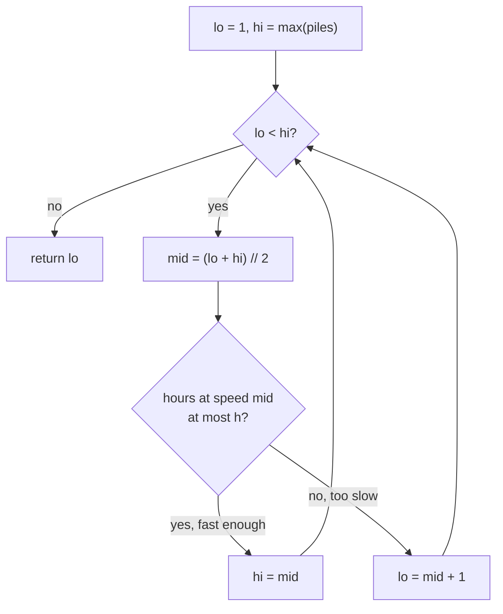

## Understand the problem

At speed `k`, a pile of `p` bananas takes `p / k` hours **rounded up**: Koko can't move on to
another pile within the same hour, so a part-eaten last hour still counts as a whole one.

```array
label: pile of 11
values: 4 4 3
indices: false
caption: at k = 4 the pile of 11 takes 3 hours: 4 + 4 + 3. The last hour isn't full
```

The total over all piles must be at most `h`, and we want the slowest speed that manages it. Here
is Example 1 at every speed from 1 to 11 (the largest pile):

```grid
rowlabels: k hours fits
1 2 3 4 5 6 7 8 9 10 11
19 11 7 6 5 4 4 4 4 4 3
no no no yes yes yes yes yes yes yes yes
highlight: 0,3 1,3 2,3
caption: piles = [3, 5, 11], h = 6: the slowest speed that fits is 4
```

Cases worth saying out loud:

- **`h` equals the number of piles**: one hour per pile, so the answer is `max(piles)`
  (Example 2).
- **`h` at least the total number of bananas**: speed 1 is enough (Example 3).
- **Finishing in exactly `h` hours counts**: in Example 1, speed 4 takes exactly 6 hours.
- **The answer needn't be a pile size**: `[9, 8, 7]` with `h = 6` needs speed 5.

## Brute force: try every speed

No speed above `max(piles)` helps (every pile already takes one hour), and speed `max(piles)`
always fits because there are at most `h` piles. So try the speeds in order and return the first
that fits:

```python
def minEatingSpeed(self, piles: list[int], h: int) -> int:
    for k in range(1, max(piles) + 1):
        if self.hours_needed(piles, k) <= h:
            return k
```

Each check is O(n), and the answer can be as large as `max(piles)`: **O(n · max(piles))** time,
up to 10^4 × 10^9 steps. Starting at a smarter lower bound doesn't rescue it. Koko must average
at least `sum(piles) / h` bananas an hour, but with one pile of a billion among 999 piles of one
banana and `h = 1001`, that bound is about a million while the answer is 500 million. The
constraints already say it: with values up to 10^9, the
[input size](#/algo/learn/complexity/input-size-tells-you-the-target) rules out walking through
the speeds one at a time.

## The key insight: binary search over the speed

Going faster never makes a pile take longer, so the hours needed **never go up** as `k` grows
(they can stay the same: speeds 6 to 10 all take 4 hours above). So the "fits" row is always
no, no, ..., no, yes, yes, ..., yes. Once a speed works, every faster speed works too, and the
answer is the boundary: the first yes.

Finding the boundary of a sorted yes/no sequence is what
[binary search](#/algo/learn/patterns/binary-search) does, so we binary-search the **speeds**,
not the piles. This is called binary search on the answer, and it applies when:

1. the answer is a number in a known range (here `1..max(piles)`),
2. checking one candidate is cheap and gives yes or no ("is `hours_needed(k) <= h`?", O(n)), and
3. the check is monotonic: if `k` works, so does `k + 1`.

Listen for "the minimum speed (capacity, time...) such that...", "the smallest possible largest
..." or "the largest possible smallest ...".

The search on Example 1. `lo` and `hi` bound the answer; the dimmed speeds are ruled out:

```array
label: speed
values: 1 2 3 4 5 6 7 8 9 10 11
indices: false
pointers: lo=0 mid=5 hi=10
caption: 6 takes 4 hours, which fits: the answer is 6 or slower. hi = mid
---
label: speed
values: 1 2 3 4 5 6 7 8 9 10 11
indices: false
pointers: lo=0 mid=2 hi=5
dim: 6..10
caption: 3 takes 7 hours, too slow: the answer is faster. lo = mid + 1
---
label: speed
values: 1 2 3 4 5 6 7 8 9 10 11
indices: false
pointers: lo=3 mid=4 hi=5
dim: 0..2 6..10
caption: 5 takes 5 hours, which fits: hi = mid
---
label: speed
values: 1 2 3 4 5 6 7 8 9 10 11
indices: false
pointers: lo=3 mid=3 hi=4
dim: 0..2 5..10
caption: 4 takes 6 hours, which fits: hi = mid
---
label: speed
values: 1 2 3 4 5 6 7 8 9 10 11
indices: false
pointers: lo=3 hi=3
dim: 0..2 4..10
highlight: 3
caption: lo == hi: the answer is 4
```

On this small example binary search makes four checks, as many as the brute force. Over speeds
up to a billion it makes about 30, where the brute force can make a billion.



## Counting the hours

`hours_needed` adds up the rounded-up division for every pile. In integers, the ceiling of
`p / k` is `(p + k - 1) // k`: adding `k - 1` pushes any remainder over the next multiple of `k`,
and an exact multiple stays where it is. (`-(-p // k)` is the same thing in Python.)

Avoid `math.ceil(p / k)`. `p / k` is a float division: exact enough at these sizes, but it goes
wrong for integers above 2^53, and in Java or C++ `p / k` on integers truncates first, so
`ceil(p / k)` silently rounds down.

## The solution

```python
class Solution:
    def minEatingSpeed(self, piles: list[int], h: int) -> int:
        lo, hi = 1, max(piles)
        while lo < hi:
            mid = (lo + hi) // 2
            if self.hours_needed(piles, mid) <= h:
                hi = mid  # fast enough: the answer is mid or slower
            else:
                lo = mid + 1  # too slow: the answer is faster
        return lo

    def hours_needed(self, piles: list[int], k: int) -> int:
        return sum((p + k - 1) // k for p in piles)
```

**Why it's correct.** The loop keeps the answer inside `[lo, hi]`. It starts there: `hi =
max(piles)` always fits and no speed is below 1. If `mid` fits, the answer is `mid` or smaller,
so `hi = mid` keeps it (we don't skip `mid`, since it may be the answer). If `mid` doesn't fit,
nothing at or below `mid` does, so `lo = mid + 1`. Because `mid` rounds down, `mid < hi` whenever
`lo < hi`, so both branches shrink the range, and the loop ends with `lo == hi`: the answer.

## Complexity

- **Time: O(n log M)**, where n is the number of piles and M = `max(piles)`. The search halves
  `1..M` each step, about log2(10^9) ≈ 30 checks of O(n) each: 3 × 10^5 steps for 10^4 piles,
  against up to 10^13 for the brute force.
- **Space: O(1).** `hours_needed` sums a generator without building a list.

The order of the piles doesn't matter, so there's no need to sort them.

## Pitfalls and variations

**`while lo <= hi` with `hi = mid` loops forever.** Once `lo == hi`, `mid` is that value, it
fits, and `hi = mid` changes nothing. If you prefer `<=`, use the closed-interval form, which
remembers the best speed so far:

```python
lo, hi, best = 1, max(piles), max(piles)
while lo <= hi:
    mid = (lo + hi) // 2
    if self.hours_needed(piles, mid) <= h:
        best, hi = mid, mid - 1
    else:
        lo = mid + 1
return best
```

**Rounding `mid` up with `hi = mid` also loops forever.** With two speeds left, `mid` lands on
`hi`:

```array
label: speed
values: 1 2 3 4 5 6 7 8 9 10 11
indices: false
pointers: lo=3 mid=4 hi=4
dim: 0..2 5..10
caption: mid = (4 + 5 + 1) // 2 = 5 fits, so hi = mid = 5: nothing changed
```

The rule: `hi = mid` needs `mid` rounded down, and `lo = mid` needs it rounded up.
[Test](#/algo/learn/approach/test-it) the loop on a range of two values, where these bugs show.

- **`< h` instead of `<= h`.** Finishing in exactly `h` hours is allowed; Example 1 would return 5.
- **Starting at `lo = 0`.** Then `mid` can be 0 and `hours_needed` divides by zero.
- **Searching the piles instead of the speeds.** The answer is usually not a pile size, and
  sorting the piles doesn't help.
- **Speed-ups that keep the same big O.** Start at `lo = max(1, ceil(sum(piles) / h))`, and stop
  summing once the hours pass `h`.
- **Follow-up: what if `h < len(piles)`?** No speed works; check for it first and return -1.
- **The same template** solves Capacity to Ship Packages Within D Days (the smallest capacity
  that ships everything in D days), Split Array Largest Sum (the smallest possible largest part)
  and Minimum Number of Days to Make m Bouquets. For a "largest value that still works" problem,
  such as the largest minimum distance between balls, search for the last yes instead: round
  `mid` up and set `lo = mid` when it works.

Binary search over indices, with a twist, is in
[Search in Rotated Sorted Array](#/algo/problem/a38_search_in_rotated_sorted_array).
