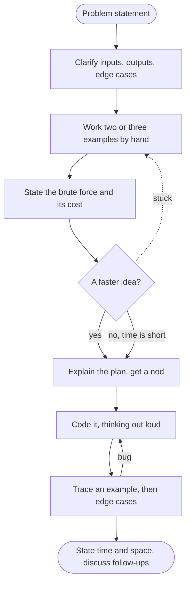
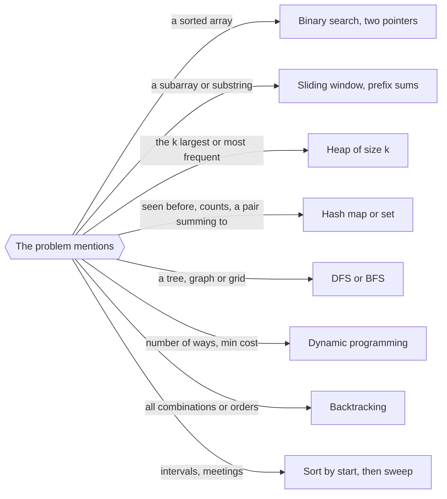
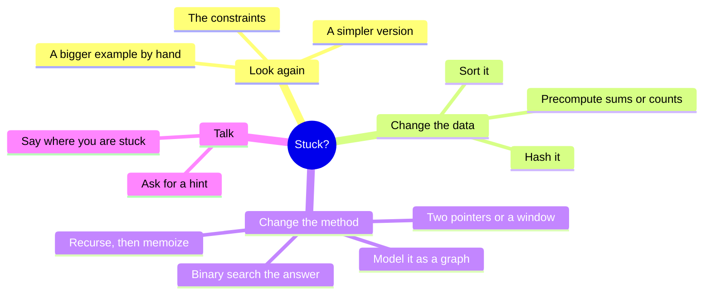

# How to approach a problem

The loop that turns a problem statement into working, tested code in 30 to 45 minutes, and what the interviewer is listening for at each step. One small problem runs through every section, so you can see each step done.

## The interview loop

Interviewers are engineers, and they want you to do well: watching a candidate freeze makes for
a painful hour on both sides. What they need is evidence. After the round they write feedback,
often squeezed between other work, and the easiest candidate to recommend is the one who left a
clear trail: the questions asked, the options compared, a plan, readable code and the tests run.
The problem is only the vehicle. This loop is what gets graded:



Notice the two arrows that go back. When you're stuck, return to examples: working another one by
hand is the most reliable way to find the pattern. When a test fails, fix the code; don't start
over.

| Step | Why | Say something like |
|---|---|---|
| [Clarify](#/algo/learn/approach/clarify-and-work-examples) | Build the right thing before building the thing right | "So I return the indices, not the values. Can the list be empty? Can values repeat?" |
| Work examples | Check your understanding and find the pattern | "With `[2, 7, 11, 15]` and target 9 the answer is `[0, 1]`, because 2 + 7 = 9." |
| [Brute force](#/algo/learn/approach/brute-force-first) | A correct baseline, and the cost to beat | "Checking every pair works: O(n²) time, O(1) space. Let me look for something faster." |
| [Optimize](#/algo/learn/approach/optimize) | Remove the bottleneck | "The inner loop only searches for `target - x`. A hash map finds it in O(1), so one pass is enough." |
| [Code](#/algo/learn/approach/code-it) | Clean code that matches the plan | "I'll write the steps as comments first, then fill each one in." |
| [Test](#/algo/learn/approach/test-it) | Find your own bugs | "Let me trace the first example through the code. Now the empty list." |
| [Complexity](#/algo/learn/approach/talk-about-complexity) | Show you know what it costs | "One pass with O(1) work per element: O(n) time, and O(n) space for the map." |

### What the interviewer is looking for

Most interview rubrics score four things, and every step of the loop is a chance to show one of
them.

| Signal | Earned by | Lost by |
|---|---|---|
| Communication | Restating the problem, thinking out loud, explaining the plan before coding, using hints | Long silences, coding before explaining, arguing with a hint |
| Problem solving | Examples, a brute force, a reasoned route to something faster, comparing options | Jumping to a half-remembered trick you can't justify |
| Coding | Readable, idiomatic code, well-named helpers, few false starts | Fighting the language, one 60-line function, names like `tmp2` |
| Verification | Tracing examples, covering edge cases, catching your own bugs | "I think it works" |

> **Key idea.** Interviewers grade how you reached the answer as well as the answer. A working
> solution explained clearly beats a faster one written in silence, and a bug you find yourself
> counts for you, not against you.

### Time budget

```intervals
Introductions: [0,3]
Clarify and examples: [3,9]
Brute force, optimize: [9,16]
Code: [16,31]
Test and fix: [31,37]
Complexity: [37,40]
Your questions: [40,45]
caption: a 45-minute round, in minutes
```

| Step | 45-minute round | 30-minute round |
|---|---|---|
| Introductions | 3 min | 2 min |
| Clarify and work examples | 6 min | 4 min |
| Brute force, then optimize | 7 min | 5 min |
| Code | 15 min | 12 min |
| Test and fix | 6 min | 4 min |
| Complexity and follow-ups | 3 min | 1 min |
| Your questions | 5 min | 2 min |

> **Rule of thumb.** Start coding by about minute 15 of a 45-minute round (minute 10 of 30). If no
> better idea has turned up by then, code the brute force: you can improve working code, but you
> can't test a plan.

Some rounds have two shorter problems, often a warm-up and a harder follow-up. Halve every step
and keep the first one brisk.

### The running example

Each section below ends by applying its step to one small problem:

> **Example.** Given a list of meetings as `[start, end]` times, return `True` if one person could
> attend all of them.

## Clarify and work examples

The first few minutes, spent understanding the problem, are the most valuable of the interview.
One wrong assumption that you never said out loud can sink an otherwise perfect solution, and the
interviewer can only correct the assumptions they hear.

Start by restating the problem in your own words. Copy it into the editor as a comment and mark
the words that change the solution:

| Words in the problem | Why they matter |
|---|---|
| *sorted* | Binary search and two pointers may apply |
| *distinct*, or *may contain duplicates* | Duplicates break naive counting and some set tricks |
| *subarray* or *substring*, vs *subsequence* | Contiguous (windows, prefix sums) vs any elements kept in order (often DP) |
| *return the indices*, vs *the values*, vs *the count* | Decides what you store; sorting loses the original indices |
| *in place*, *O(1) extra space* | Rules out copies and hash maps |
| *exactly one answer*, *any answer*, *all answers* | Whether you can stop early, and what to return when there's none |
| *at most k*, *at least k* | Often a sliding window or a counting argument |

Then ask about anything the statement leaves open:

| About | Ask |
|---|---|
| The input | How large can it get? Can values be negative, zero or huge? Can it be empty, or `None`? Is it sorted? Are there duplicates? |
| The output | What exactly do I return? Which one, if several answers are valid? What if there is no answer? Does the order matter? |
| The setting | May I modify the input? Is this called once, or many times (worth precomputing)? Does the data fit in memory, or does it stream in? |

> **Interview tip.** Ask about the input size early. It tells you which complexity the interviewer
> expects (see [input size tells you the target](#/algo/learn/complexity/input-size-tells-you-the-target)):
> 10⁵ elements rules out O(n²), and 20 elements invites trying every subset.

Write the answers down as comments at the top of the editor. They become your spec, and the
interviewer's notes.

Then **work examples by hand**, saying each step out loud:

1. Trace the interviewer's example and check that you get their answer.
2. Make your own, big enough to be general: six to eight elements, not sorted, with a duplicate if
   duplicates are allowed. Small or tidy examples hide both patterns and bugs.
3. Add one awkward case: empty input, a single element, all values equal, or no valid answer.

This isn't wasted time. The steps you take by hand are often the algorithm, written out slowly.

> **Example.** Questions for the meetings problem, with the interviewer's answers:
>
> - Does a meeting that ends at 10 clash with one that starts at 10? *No, back-to-back is fine.*
>   So a clash means one meeting **starts before** the other ends: `<`, not `<=`.
> - Are the meetings sorted? *No.* Can the list be empty? *Yes, and then the answer is `True`.*
> - How many meetings? *Up to 10,000.* Is `start < end` always? *Yes, and the times are integers.*

```intervals
clash: [0,30] [5,10] [15,20]
no clash: [2,4] [7,10] [10,12]
caption: [0,30] overlaps both others; [7,10] and [10,12] only touch, which is allowed
```

Practice: [Two Sum](#/algo/problem/a01_two_sum), [Valid Anagram](#/algo/problem/a28_valid_anagram), [Decode Ways](#/algo/problem/a34_decode_ways)

## Brute force first

Once you understand the problem, say the simplest correct solution, even if it's slow. It does
four jobs:

1. It proves you understand the problem.
2. It's a fallback: if nothing better turns up, you can code it and still finish with working code.
3. Its complexity is the number to beat.
4. The work it repeats points straight at the optimization.

State it in a sentence or two, with its time and space, then move on. Code it only if the
interviewer asks, or if five minutes of looking hasn't found anything faster.

> **Pitfall.** Skipping the brute force because it feels too obvious to mention. Saying it takes
> ten seconds, and it's the baseline the interviewer will compare everything else against.

Most brute forces come from a handful of shapes:

| The problem asks for | Brute force | Cost |
|---|---|---|
| A pair with some property | Try every pair | O(n²) |
| A triple | Try every triple | O(n³) |
| The best subarray or substring | Try every start and end | O(n²) ranges, O(n³) if each one is re-scanned |
| The best subset | Try every subset | O(2ⁿ) |
| The best order | Try every permutation | O(n!) |
| The smallest value that works | Try every candidate value | O(range × the cost of one check) |

When there are several ideas, compare them in a small table of pros and cons, out loud or as
comments. It shows judgment, and it leaves the interviewer a clear record. For
[Two Sum](#/algo/problem/a01_two_sum):

| Approach | Time | Space | Notes |
|---|---|---|---|
| Check every pair | O(n²) | O(1) | Simplest; too slow for 10⁵ numbers |
| Sort, then two pointers | O(n log n) | O(n) | Must remember the original indices |
| Hash map of the values seen so far | O(n) | O(n) | One pass; the usual answer |

> **Example.** Two meetings `a` and `b` clash when `a.start < b.end and b.start < a.end`. Checking
> every pair is O(n²) time and O(1) space: for 10,000 meetings that's 50 million checks, several
> seconds of Python. Correct, but slow.

Practice: [Two Sum](#/algo/problem/a01_two_sum), [3Sum](#/algo/problem/a02_three_sum), [Best Time to Buy and Sell Stock](#/algo/problem/a03_best_time_to_buy_and_sell_stock)

## Optimize

The brute force wastes work somewhere. Find where:

1. **Find the bottleneck**: the line that runs most often. It's usually an inner loop that
   searches for something or recomputes something.
2. **Ask what that line needs to know**, and which data structure or precomputation would tell it
   faster.
3. **Look for repeated work**, the same subproblem solved again and again (remember the answers),
   and **unnecessary work**, cases that can't be the answer (sort, prune or skip them).
4. **Know when to stop.** Most problems must read every element, so O(n) is usually the best
   possible. If you're at O(n log n) only because of a sort, ask whether the order is needed.

| The brute force spends its time | Try | Typical gain |
|---|---|---|
| Searching for a value: a complement, a duplicate, an earlier position | A [hash map or set](#/algo/learn/patterns/hashing) | O(n²) to O(n) |
| Checking pairs | Sort, then [two pointers](#/algo/learn/patterns/two-pointers) | O(n²) to O(n log n) |
| Re-scanning every subarray or substring | A [sliding window](#/algo/learn/patterns/sliding-window) or [prefix sums](#/algo/learn/patterns/prefix-sums-and-products) | O(n²) to O(n) |
| Finding the smallest or largest of a changing collection | A [heap](#/algo/learn/patterns/heaps-and-top-k) | O(n) to O(log n) per step |
| Trying every candidate answer in order | [Binary search](#/algo/learn/patterns/binary-search) over the candidates | O(range) checks to O(log range) |
| Solving the same subproblem many times | [Memoization or a DP table](#/algo/learn/dynamic-programming) | Exponential to polynomial |
| Matching nested things: brackets, calls, tags | A [stack](#/algo/learn/patterns/stacks-and-monotonic-stacks) | O(n²) to O(n) |
| Re-walking paths in a grid or graph | [BFS or DFS](#/algo/learn/patterns/graph-traversal) with a visited set | Exponential to O(V + E) |

The problem statement drops hints too. This is the short version of the
[patterns page](#/algo/learn/patterns):



Two general moves cover a lot of ground:

- **Pay once, then save on every query.** Spend O(n) time and memory building a hash map, a sorted
  copy or a prefix-sum array, so that each later question costs O(1) or O(log n).
- **Reduce it to a problem you know.** Sort it first (order enables binary search, two pointers
  and greedy sweeps), split it into simpler cases, or rephrase it as a graph, a tree, or a search
  over possible answers.

Before writing any code, say the plan and its complexity, and check the interviewer is happy with
it: "Sort by start, then compare each meeting with the next: O(n log n). Shall I code that?" If
they were going to steer you somewhere else, this is where they'll do it, before you've spent ten
minutes typing.

> **Example.** The brute force's slow question is "does any *other* meeting clash with this one?".
> Sort by start time, and only neighbours matter: if meeting *i* clashes with a later meeting *j*,
> it also clashes with meeting *i* + 1, because *i* + 1 starts no later than *j*, which starts
> before *i* ends. So: sort, then one pass over neighbours. O(n log n) instead of O(n²).

```intervals
as given: [15,20] [0,30] [5,10]
sorted by start: [0,30] [5,10] [15,20]
caption: once sorted, comparing each meeting with the next one is enough
```

Practice: [Contains Duplicate](#/algo/problem/a07_contains_duplicate), [Longest Consecutive Sequence](#/algo/problem/a11_longest_consecutive_sequence), [Product of Array Except Self](#/algo/problem/a08_product_of_array_except_self)

## Code it

Coding is the step people rush. A few habits make it faster and easier to follow:

1. **Write the signature first** and name the inputs. If you're stuck, this alone often gets you
   moving again.
2. **Write the plan as comments**, one line per step, with the cost of anything expensive. The
   interviewer sees the whole approach before any detail, and can redirect you early.
3. **Fill in each step under its comment.** For a step that's routine but long, write a helper's
   signature and a one-line docstring, and ask whether they want it written out now. Often they
   don't.
4. **Keep talking**: what each part does and why. Don't read out every keystroke.

> **Pitfall.** Coding before the plan is agreed. If the interviewer was about to steer you away
> from that approach, those ten minutes are gone.

For the meetings problem, the plan comes first:

```python
def can_attend_all(meetings: list[list[int]]) -> bool:
    # 1. Sort the meetings by start time: O(n log n)
    # 2. A meeting that starts before the previous one ends is a clash: O(n)
    # 3. No clash found: return True
    ...
```

Then the code goes in under each comment:

```python
def can_attend_all(meetings: list[list[int]]) -> bool:
    # 1. Sort the meetings by start time: O(n log n)
    ordered = sorted(meetings)
    # 2. A meeting that starts before the previous one ends is a clash: O(n)
    for i in range(1, len(ordered)):
        if ordered[i][0] < ordered[i - 1][1]:
            return False
    # 3. No clash found
    return True
```

| Habit | Instead of |
|---|---|
| Names that say what they hold: `seen`, `count_by_char`, `left`, `right` | `a`, `tmp`, `x2` |
| Returning early for edge cases | Deeply nested `if` blocks |
| A small helper for fiddly logic: `in_bounds(r, c)`, `neighbours(node)` | The same bounds check pasted four times |
| The standard library: `enumerate`, `zip`, `Counter`, `defaultdict`, `deque`, `heapq`, `bisect` | Hand-written versions of each |
| Clear code first | Micro-optimizations nobody asked for |

> **Interview tip.** If you blank on a library detail, say what you'd use and carry on: "heapq's
> push, `heappush(heap, item)`, I believe." The idea matters more than the exact spelling, and the
> interviewer will usually just confirm it.

## Test it

"I think it works" isn't testing. Prove it, in this order:

1. **Trace the code, not the idea**, on a small example, line by line, saying each variable's
   value. Bugs live in the gap between what you meant and what you typed.
2. **Run the edge cases** from the checklist below.
3. **Try the awkward example** you made while clarifying, and any new case that might expose a
   weakness in the code you actually wrote.
4. **Fix bugs calmly.** Say what was wrong, fix it, and re-run the trace that caught it. Finding
   your own bug is a good signal, not a bad one.

| Input | Try |
|---|---|
| Any collection | Empty, one element, two elements |
| Numbers | Zero, negatives, duplicates, all equal, very large values |
| Order | Already sorted, reverse sorted, the answer at the very start or the very end |
| Strings | Empty, one character, every character the same, upper and lower case if they matter |
| Linked lists | One node, two nodes, changing the head or the tail |
| Trees | Empty, one node, a skewed tree that is really a linked list |
| Graphs and grids | Disconnected parts, cycles, a single cell, no path at all |
| Answers | No valid answer, several valid answers |

The bugs that turn up most often:

| Bug | Check |
|---|---|
| Off by one | Loop bounds (`range(n)` or `range(n - 1)`?), `<` or `<=`, `mid + 1` or `mid` |
| Infinite loop | Does every iteration move a pointer or shrink the range? |
| Changing a collection while looping over it | Loop over a copy, or collect the changes and apply them after |
| Shared rows | `[[0] * m] * n` is n references to one row; build it with a comprehension |
| Lost references | In a linked list, save `node.next` before you overwrite it |
| Stale state | Counters or visited sets that should be reset between iterations |
| The wrong division | `//` rounds down, `/` gives a float |

> **Example.** Trace `[[7, 10], [2, 4], [10, 12]]`. Sorted, it's `[[2, 4], [7, 10], [10, 12]]`:

| `i` | `ordered[i - 1]` | `ordered[i]` | Clash? |
|---|---|---|---|
| 1 | `[2, 4]` | `[7, 10]` | 7 < 4: no |
| 2 | `[7, 10]` | `[10, 12]` | 10 < 10: no |

No clash, so `True`. Then the edge cases: `[]` never enters the loop and returns `True`;
`[[1, 5]]` returns `True`; `[[1, 5], [1, 5]]` finds 1 < 5 and returns `False`. And the second row
of the trace is the touching case from clarifying: had we written `<=`, it would wrongly return
`False`, which is exactly the bug that example was made to catch.

Practice: [Remove Nth Node From End of List](#/algo/problem/a41_remove_nth_node_from_end_of_list), [Decode Ways](#/algo/problem/a34_decode_ways), [Insert Interval](#/algo/problem/a15_insert_interval)

## Talk about complexity

Say the complexity twice: briefly when you propose each approach, and properly at the end,
written down next to the code.

- **Name your variables.** "n is the number of meetings." Use one letter per independent size:
  n words of length up to k is O(n·k), not O(n²).
- **Time:** cost each step, add the steps that run one after another, multiply the loops that
  nest, and keep the biggest term.
- **Space:** count the extra memory: structures you build, copies and slices, and the depth of any
  recursion. Say whether you're counting the output.
- **Name the case** when it matters: hash map operations are O(1) on *average*; quicksort is
  O(n log n) on average but O(n²) at worst.

The [complexity page](#/algo/learn/complexity) covers
[reading complexity from code](#/algo/learn/complexity/reading-complexity-from-code),
[recursion](#/algo/learn/complexity/recursion) and
[space](#/algo/learn/complexity/space-complexity) in detail.

> **Example.** "Sorting is O(n log n) and the scan is O(n), so O(n log n) overall. `sorted`
> returns a copy, which is O(n) extra space. Sorting in place with `meetings.sort()` saves the
> copy, if I'm allowed to reorder the input."

Then expect a follow-up. Most are one of these:

| Follow-up | What it tests | A typical answer |
|---|---|---|
| "Can you do better?" | Whether you know the limit | "We must read every element, so O(n) is the floor; the sort is what costs O(n log n)." |
| "What if it's called many times?" | Precomputation | Pay once up front (sort, index, prefix sums) and answer each call in O(1) or O(log n) |
| "What if the data doesn't fit in memory?" | Scaling | Stream it, sort it externally, or split it by hash and handle each part separately |
| "What if the input is a stream?" | Online algorithms | Keep running state: a counter, a window, a heap of size k |
| "Can you use O(1) extra space?" | In-place techniques | Two pointers, reusing the input array, keeping only the last row of a DP table |
| "What about duplicates, or negatives?" | Robustness | Recheck which assumptions the solution relies on |

The classic follow-up to the meetings problem is "how many rooms do we need so that every meeting
can happen?". Sort the start and end times and sweep through them, or keep a heap of end times.
[Number of Airplanes in the Sky](#/algo/problem/a18_number_of_airplanes_in_the_sky) is the same
question in disguise.

Practice: [Climbing Stairs](#/algo/problem/a04_climbing_stairs), [Number of Airplanes in the Sky](#/algo/problem/a18_number_of_airplanes_in_the_sky)

## When you're stuck

Everyone gets stuck; what's assessed is what you do next. Keep moving, and keep talking: an
interviewer who knows exactly where you're stuck can give a small hint, while silence gives them
nothing to work with.

> **Interview tip.** It's fine to think in silence for a moment. Say so first: "Let me think about
> this for a minute."



Go down this list until something gives:

1. **Say where you are.** "I have an O(n²) idea. The slow part is finding X, and I'm looking for a
   faster way to find it."
2. **Work a bigger example by hand**, slowly, and watch what you do. Your hands often find the
   algorithm before your head does.
3. **Write out the brute force** and look for the work it repeats.
4. **Ask which data structure answers the slow question.** Membership or counts: a set or a
   `Counter`. The smallest or largest so far: a heap. The most recent unfinished thing: a stack.
   Order: sort, or keep a sorted list with `bisect`.
5. **Sort the input.** Order enables binary search, two pointers, greedy sweeps and grouping equal
   items together.
6. **Try two pointers or a window** on an array or a string.
7. **Recurse.** If you had the answer for the first n - 1 elements, how would you extend it to n?
   If the same subproblems come up repeatedly, memoize them.
8. **Solve a simpler version**: k = 1, no duplicates, sorted input, one row instead of a grid. Then
   generalize.
9. **Work backwards**: from the end of the array, from the target, or binary search on the answer
   when "can it be done with x?" is easy to check.
10. **Rephrase it.** Are there things and connections between them (a graph)? Ranges
    (intervals)? Is it a problem you know in disguise?
11. **Reread the constraints.** They hint at the
    [complexity to aim for](#/algo/learn/complexity/input-size-tells-you-the-target).

> **Interview tip.** Take hints gracefully: repeat the hint in your own words and use it straight
> away. A hint costs you little; ignoring one costs a lot.

And if a round goes badly anyway: interviews are noisy. Strong engineers fail rounds and pass the
next one, and many need several attempts before an offer. Treat each round as practice for the
next, and judge yourself by the effort you put in, not by one 45-minute window.

Practice: [Koko Eating Bananas](#/algo/problem/a45_koko_eating_bananas), [Jump Game](#/algo/problem/a39_jump_game), [Pacific Atlantic Water Flow](#/algo/problem/a21_pacific_atlantic_water_flow)
