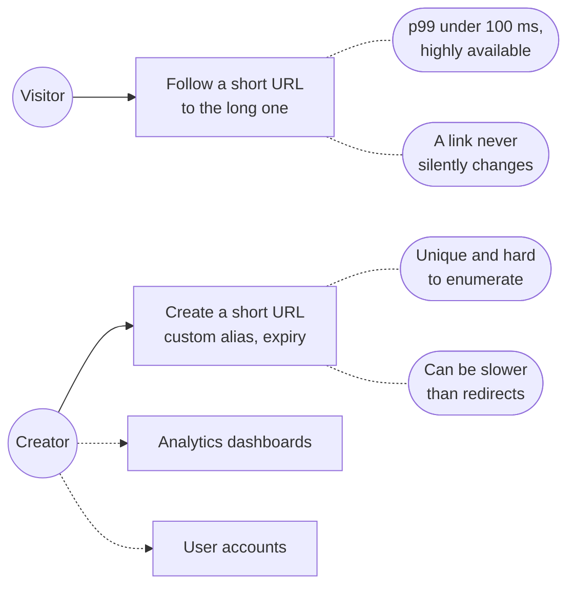
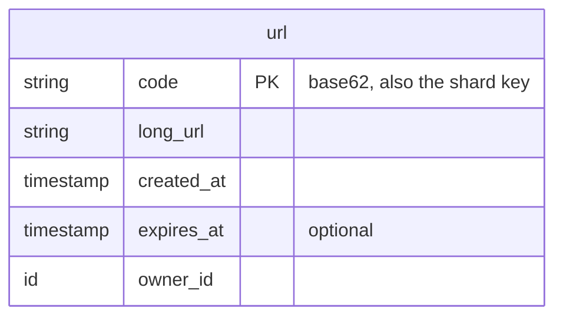
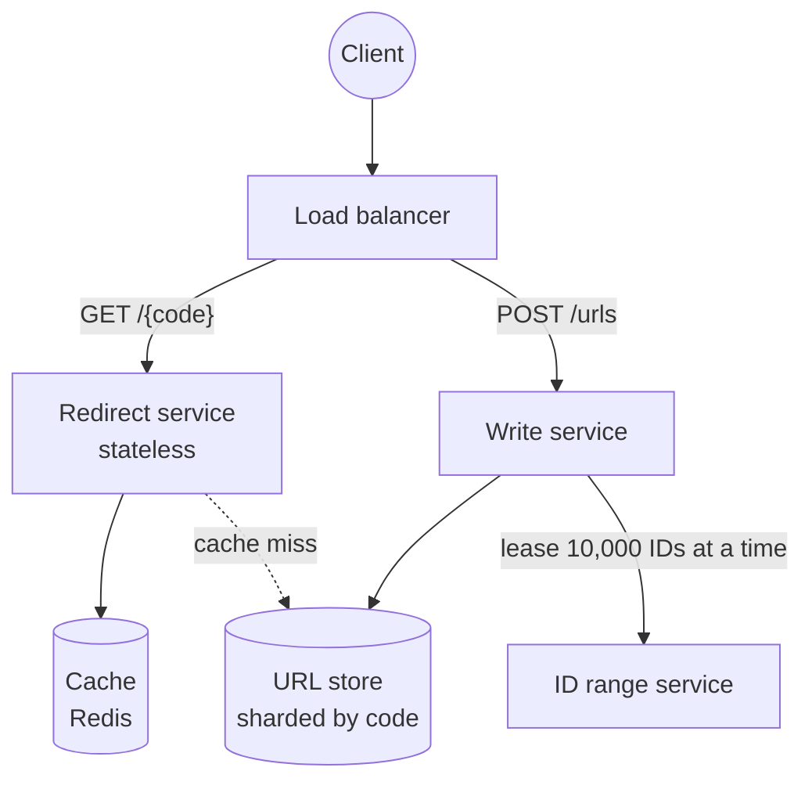
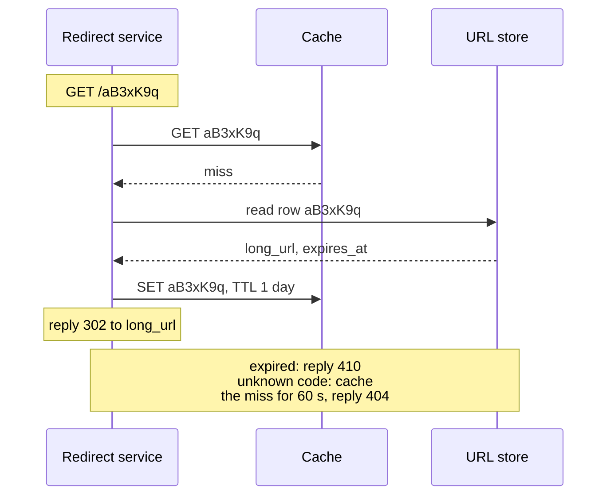
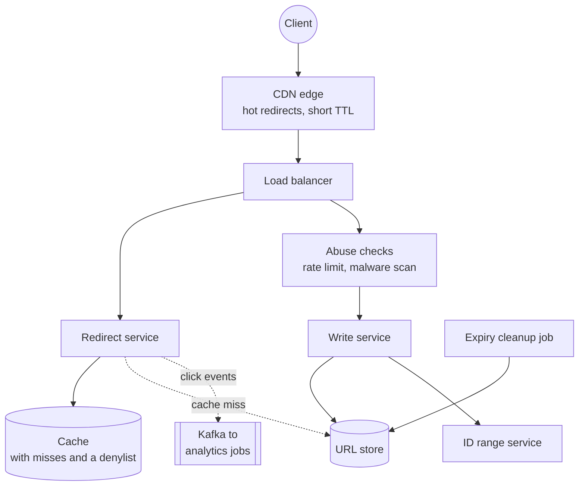

**Requirements.** Functional: create a short URL for a long one (optionally a custom alias and expiry); redirect short to long. Out of scope for v1: analytics dashboards, user accounts (mention as extensions). Non-functional: redirects are very fast (p99 under 100 ms) and highly available; creation can be slightly slower; short codes must be unique and hard to enumerate; links should never silently change.

Amber marks the non-functional requirements, each beside the operation it constrains. Grey is out of scope.



**Estimates.** 100M new URLs per month ≈ 40 writes/s average (say 100/s peak). Read:write of 100:1 gives 4,000 reads/s average, 10,000+/s peak, a tenth of what [one cache node handles (about 100K operations/s)](#/design/learn/building-blocks/estimation-and-benchmarks), so a cache in front of the database takes the reads. Storage: 100M × 12 months × 5 years = 6B links × ~500 bytes ≈ 3 TB (9 TB with three replicas), a few nodes at a few TB each: a small sharded store holds it easily. A 7-character [base62](#/design/learn/building-blocks/short-codes-and-base62) code gives 62⁷ ≈ 3.5 trillion values, plenty for 6B links.

**API.** A public REST API over HTTPS. The management endpoints live under `/v1` so they can [change later without breaking old clients](#/design/learn/networking/versioning); the redirect path stays as short as possible. Creating a link needs an API key or a signed-in user, so creation can be rate-limited and abuse traced to an owner. Redirects are anonymous.

```text
POST   /v1/urls  {long_url, alias?, expires_at?}
  -> 201 {code, short_url, long_url, expires_at}
GET    /{code}
  -> 302, Location: <long_url>
GET    /v1/urls/{code}
  -> 200 {code, long_url, created_at, expires_at}
DELETE /v1/urls/{code}          (owner only)
  -> 204
```

The create response returns the full short URL, so clients never have to assemble it:

```json
{
  "code": "aB3xK9q",
  "short_url": "https://s.example/aB3xK9q",
  "long_url": "https://example.com/blog/2026/a-long-title",
  "expires_at": null
}
```

Errors share one body shape, `{"error": {"code", "message", "request_id"}}`, with the [status code](#/design/learn/networking/errors-and-status-codes) telling the client whether to change the request or try again later:

| Case | Response |
| --- | --- |
| `long_url` isn't an absolute http(s) URL, is over 2 KB, or points at our own domain (a redirect loop) | `400 invalid_url` |
| Destination is on a malware or phishing list | `400 unsafe_url` |
| Custom alias isn't 4–30 base62 characters, or is already taken | `400 invalid_alias`, `409 alias_taken` |
| Over the creation limit | `429` with [`Retry-After`](#/design/learn/networking/rate-limiting-429-and-retry-after) |
| Unknown code | `404` |
| Expired or taken down | `410 Gone`: unlike a 404, it tells browsers and crawlers the link won't come back |

- **No idempotency key needed.** A retried create just makes a second code for the same URL, which costs one row and harms no one (contrast payments, where a retry could charge twice). If duplicates bother you, return the owner's existing code when they shorten the same URL again.
- **The redirect's status code.** [301 (permanent)](#/design/learn/networking/redirects-301-vs-302) lets browsers cache the redirect, cutting load but hiding later clicks from analytics and making edits or takedowns slow to take effect; 302 keeps every click on your servers. Choose 302 if you want analytics or expiry; say that out loud.
- **The redirect's cache headers.** With 302, [`Cache-Control`](#/design/learn/networking/http-caching) fine-tunes it: `s-maxage=60` lets the CDN answer a viral link for up to a minute (deep dive 1), so a takedown takes effect within a minute, while browsers, which ignore `s-maxage`, still ask again on every click.

**Data model.** `url(code PK, long_url, created_at, expires_at, owner_id)`. A key-value or wide-column store (DynamoDB, Cassandra) fits: single-key lookups, no joins, [easy sharding by `code`](#/design/learn/data/choosing-a-partition-key). A relational database also works at this size with a [read replica](#/design/learn/data/read-replicas-and-replication-lag) and cache.



**Generating the code (the core decision).**

| Approach | How | Trade-off |
| --- | --- | --- |
| Counter + base62 | Global counter or ID service gives each server a range (say 10,000 at a time); encode in base62 | No collisions, short; sequential codes are guessable, so scramble the bits or use a keyed permutation if enumeration matters |
| Random 7-char code | Generate randomly, insert with a [unique constraint](#/design/learn/data/unique-constraints), retry on collision | Unguessable, no coordination; collision probability grows as the table fills (still tiny at 6B of 3.5T, about 0.2%) |
| Hash of the long URL | MD5/SHA, take 7 characters | Same URL yields the same code (free dedup), but truncation collides and needs handling |

Recommend the [range-allocation counter](#/design/learn/building-blocks/ticket-servers-and-id-ranges) with bit scrambling, or random codes with a conditional insert. Custom aliases use the same unique constraint and return `409` on conflict.

**High-level design.** Client → load balancer → stateless redirect service → cache (Redis) → database. A separate write service handles creation, taking codes from ID ranges it leases.



The redirect path is `GET code → cache lookup → on miss, database read, fill cache → 302`:



**Deep dives.**

1. **Read scaling.** Traffic is heavily skewed (a few links are viral). A cache with a [99% hit rate](#/design/learn/building-blocks/hit-rate) leaves about 100 database reads/s. Use [cache-aside](#/design/learn/building-blocks/cache-aside) with LRU and a TTL; cache negative results briefly to blunt scans of nonexistent codes ([penetration](#/design/learn/building-blocks/cache-failure-modes)). Popular redirects can also be cached at the [CDN edge](#/design/learn/building-blocks/cdns-and-edge-caching) with a short TTL if you accept slightly delayed takedowns.
2. **Expiry and cleanup.** Check `expires_at` at read time (never serve an expired link); a background job deletes expired rows and recycles nothing (don't reuse codes, or old links could point somewhere new).
3. **Abuse.** [Rate-limit creation](#/design/learn/building-blocks/rate-limiting) per user/IP, scan destinations against malware lists, and keep a way to disable a code instantly (a denylist in the cache).
4. **Analytics (extension).** Emit a click event to a stream (Kafka) from the redirect service, asynchronously, and aggregate offline; never write analytics synchronously on the redirect path.

**The design after the deep dives.** Green marks what they added or changed.



**Failure modes and wrap-up.** Cache down: reads fall back to the database (add [load shedding](#/design/learn/reliability/load-shedding) and a [circuit breaker](#/design/learn/reliability/circuit-breakers)). Database shard down: replicas serve reads; writes for that range [fail over](#/design/learn/reliability/redundancy-and-failover). ID service down: servers hold ranges and keep issuing. Monitor redirect latency p99, error rate, cache hit rate and creation errors. If asked to scale 10x: more cache nodes and shards, and push hot links to the CDN.
