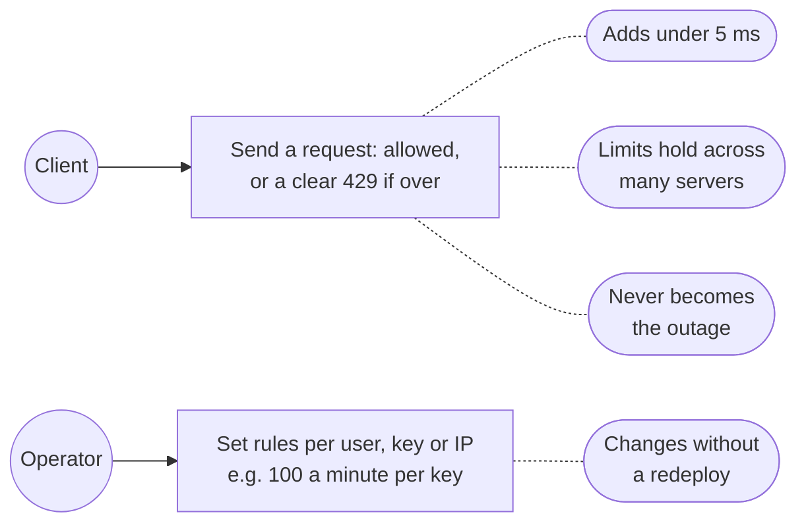
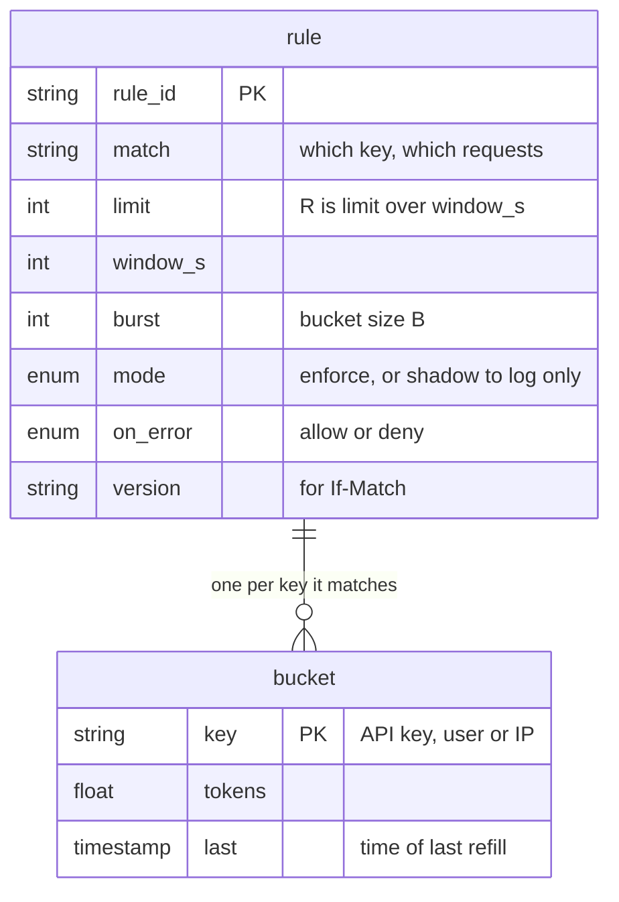
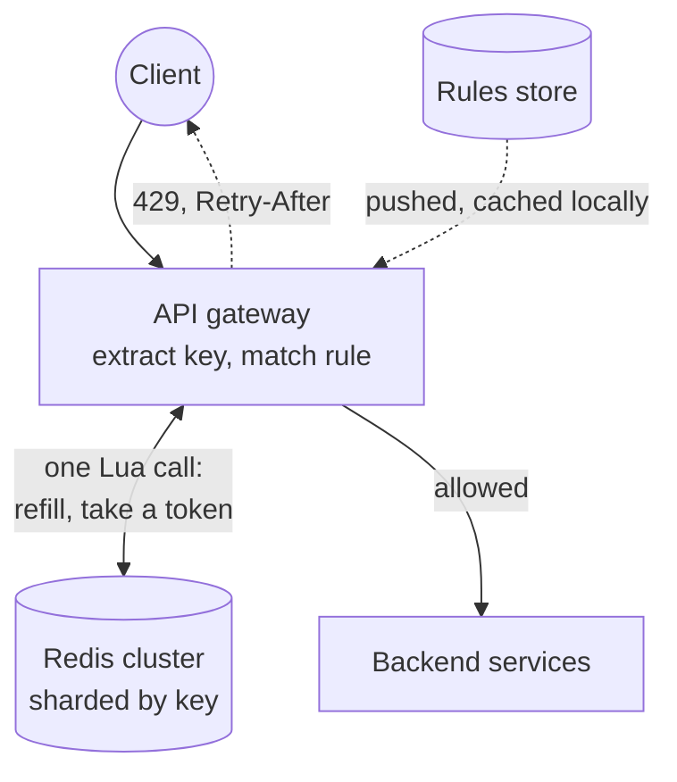
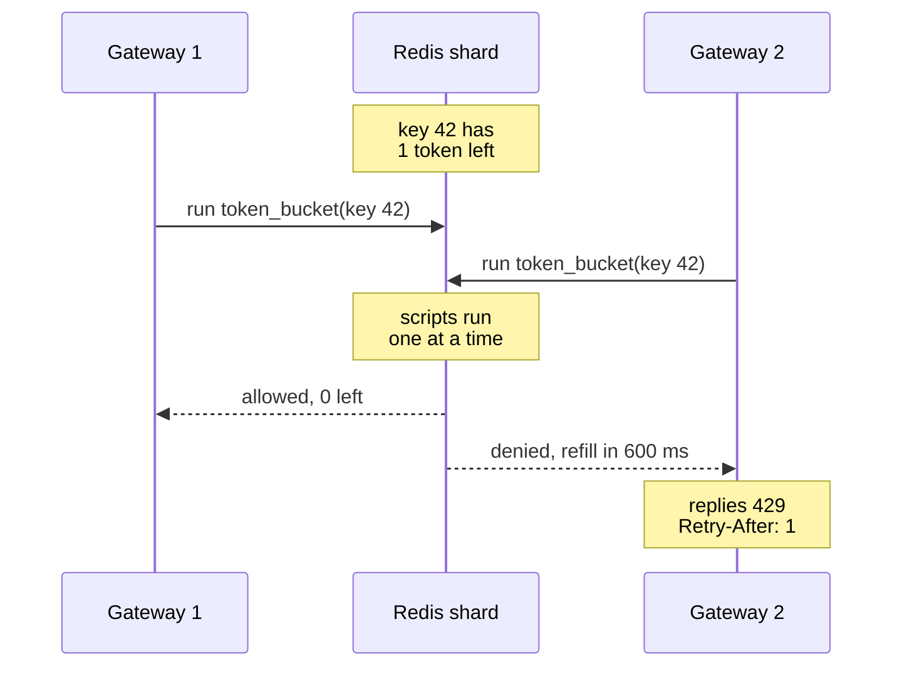
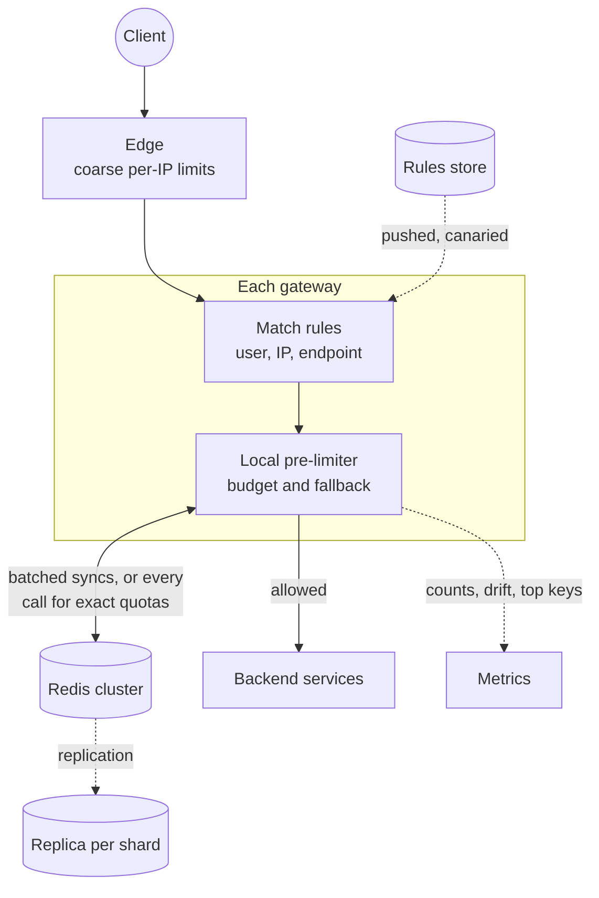

**Requirements.** Functional: limit requests per client (user, API key, IP) by rule, such as 100 requests per minute per key and 10 per second per IP on login; reject excess with a clear response. Non-functional: adds under 5 ms per request; works across many servers; highly available (the limiter must not become the outage); rules changeable without redeploying. Clarify first: is this a library inside services, a shared service, or a gateway feature? Assume a shared component used at the [API gateway](#/design/learn/networking/api-gateway).

Amber marks the non-functional requirements, each beside the operation it constrains.



**Estimates.** 1M requests/s globally at peak, 50M active keys. Per-key state for a [token bucket](#/design/learn/building-blocks/token-bucket) is about 16 bytes (count + timestamp) plus key overhead, say 100 bytes: 50M × 100 B = 5 GB, which fits in one Redis shard's memory. Throughput is the constraint: 1M checks/s needs about 10–20 Redis shards at [roughly 100K ops/s each](#/design/learn/building-blocks/estimation-and-benchmarks).

**API and behavior.** The limiter has three interfaces: the check the gateway runs on every request, the response a rejected client sees, and an admin API for the rules.

**The check** is a library call inside the gateway, not a separate service: a limiter service would add a second network hop to a 5 ms budget, on top of the Redis call.

```text
check(keys=["user:42", "ip:203.0.113.7",
            "route:POST /login"], cost=1)
  -> {allowed, limit, remaining, reset_at,
      retry_after_ms, rule_id}
```

- One call checks every rule that matches the request and rejects if any of them fails (deep dive 4). The returned `limit`, `remaining` and `reset_at` come from the most restrictive rule.
- `cost` lets an expensive endpoint take more than one token: a bulk export might cost 10.

**What a rejected client sees.** The gateway rejects before the request reaches any backend, with [`429 Too Many Requests` and `Retry-After`](#/design/learn/networking/rate-limiting-429-and-retry-after):

```http
HTTP/1.1 429 Too Many Requests
Retry-After: 2
X-RateLimit-Limit: 100
X-RateLimit-Remaining: 0
X-RateLimit-Reset: 1763402430
Content-Type: application/json

{"error": {"code": "rate_limited",
  "message": "The limit is 100 requests per minute.",
  "request_id": "req_8f2c"}}
```

- `Retry-After` is the time until the next token, rounded up to whole seconds, not the length of the window, so the client comes back as soon as it could succeed.
- Allowed responses carry the `X-RateLimit-*` headers too, so well-behaved clients slow down before they hit the limit.
- For security limits such as login attempts, return the same `429` whether or not the account exists, so the limiter can't be used to find valid usernames.

**The rules admin API** is internal, for operators:

```text
GET /v1/rules?cursor=
  -> 200 {items: [Rule], next_cursor}
PUT /v1/rules/{rule_id}   If-Match: "v7"
    {match, limit, window_s, burst, mode, on_error}
  -> 200 Rule, now version "v8"
```

- `match` picks the key and the requests (`api_key` on `/v1/*`, `ip` on `POST /login`). `limit / window_s` is the refill rate R and `burst` is the bucket size B.
- `mode: shadow` logs what the rule would reject without rejecting anything. That is how a new limit is tried on real traffic before it's enforced (deep dive 5). `on_error: allow | deny` sets whether the rule fails open or closed when Redis is unreachable (deep dive 3).
- `PUT` replaces the whole rule, so sending it twice is harmless. `If-Match` carries the version the operator read, so two operators editing at once get `412 Precondition Failed` instead of silently overwriting each other ([optimistic locking](#/design/learn/data/optimistic-locking)).

**Algorithm.** Token bucket: each key has a bucket of capacity B refilling at rate R per second. On each request compute `tokens = min(B, tokens + (now − last) × R)`; if `tokens ≥ 1`, subtract one and allow. It permits short bursts up to B while enforcing the long-term rate, needs two numbers per key, and is the standard answer. Mention [sliding window counter](#/design/learn/building-blocks/sliding-window-counter) as the alternative for strict per-minute quotas.

**Data model.** Two kinds of state. Rules are a small table in a database, pushed to every gateway and cached there. Bucket state is the token bucket's two numbers per key, about 100 bytes each with key overhead, kept in Redis on the shard that owns the key.



**High-level design.**

1. Request hits the API gateway.
2. The gateway extracts the key (API key, user ID, or IP) and loads the matching rule from a locally cached rules table (rules live in a config store, pushed to gateways).
3. The gateway runs an [atomic check-and-decrement](#/design/learn/data/atomic-updates-and-counters) in Redis ([a Lua script](#/design/learn/building-blocks/distributed-rate-limiting-with-redis) performing the token bucket math in one round trip).
4. Allowed requests proceed to the backend; rejected ones get `429` immediately.



Redis is sharded by key ([consistent hashing](#/design/learn/building-blocks/consistent-hashing) or hash slots), so each key lives on one shard and the Lua script makes the read-modify-write atomic, avoiding [the classic race](#/design/learn/data/check-then-act-races) where two gateways both read "one token left."



**Deep dives.**

1. **Latency and [hot keys](#/design/learn/data/hot-keys).** One Redis hop adds about 1 ms. A single abusive key can saturate its shard; mitigate with a small local in-memory pre-limiter on each gateway (cheap rejection of obvious floods) and per-IP limits at the edge before the call even reaches Redis.
2. **Distributed accuracy vs cost.** Exact global counting needs a central store on every request. An approximation keeps a local token budget per gateway and syncs periodically with the central count, which cuts Redis load by 10x or more at the cost of brief overshoot (up to roughly the number of gateways × local burst). State which accuracy the product needs: billing quotas want exact; abuse protection tolerates approximate.
3. **Failure behavior.** If Redis is unreachable, [fail **open**](#/design/learn/building-blocks/fail-open-or-fail-closed) for ordinary API traffic (log and alert, fall back to the local limiter) but fail **closed** for security-critical limits such as login attempts. Replicate shards ([leader + replica](#/design/learn/data/single-leader-replication)) so a failover loses at most a few seconds of counts.
4. **Multiple rule dimensions.** Check several limits per request (per user, per IP, per endpoint) in a single Lua call, rejecting if any fails. Tier plans (free vs paid) are rules keyed by the customer's plan.
5. **Rules management.** Rules stored in a database, cached at gateways with a TTL or pushed via config service; changes are [canaried like code](#/design/learn/reliability/rollout-strategies) (bad limits cause outages).

**The design after the deep dives.** Green marks what they added or changed.



**Wrap-up.** Observability: allowed/rejected counts per rule, Redis latency, local-vs-central drift, top rejected keys. Extensions: concurrency limits (in-flight requests), quotas with durable daily/monthly counters, and adaptive limits that tighten when the backend is stressed ([load shedding](#/design/learn/reliability/load-shedding)).
