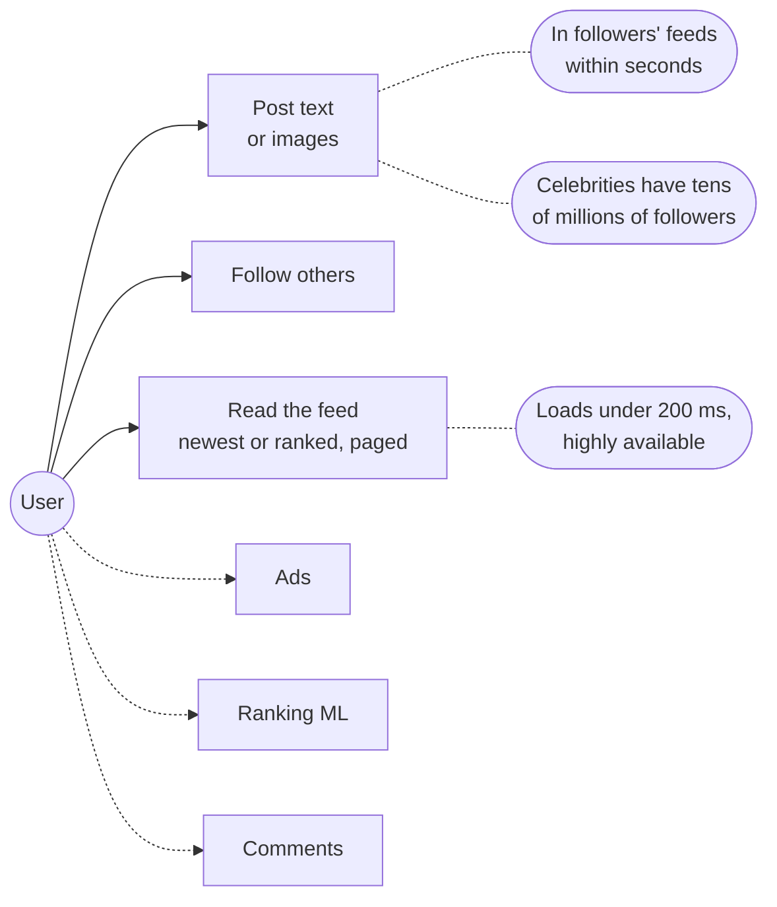
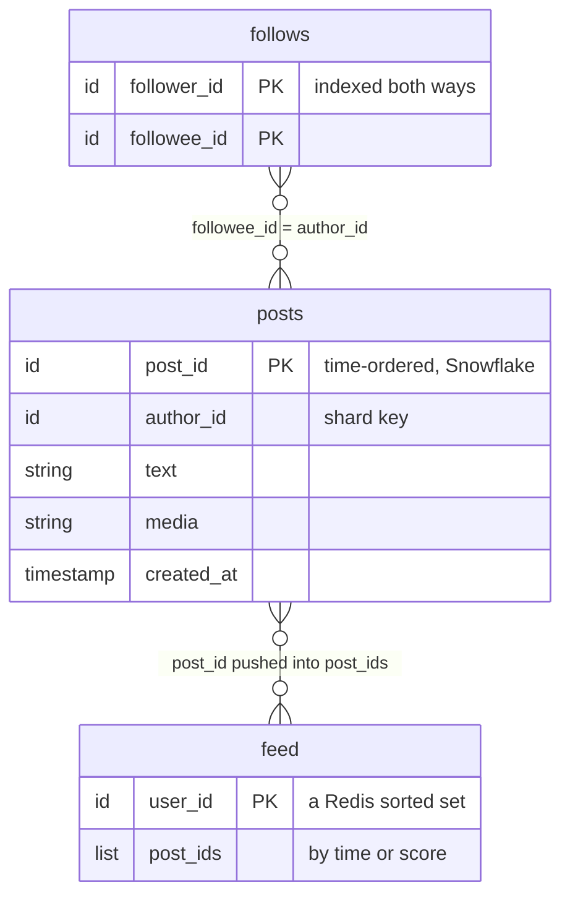
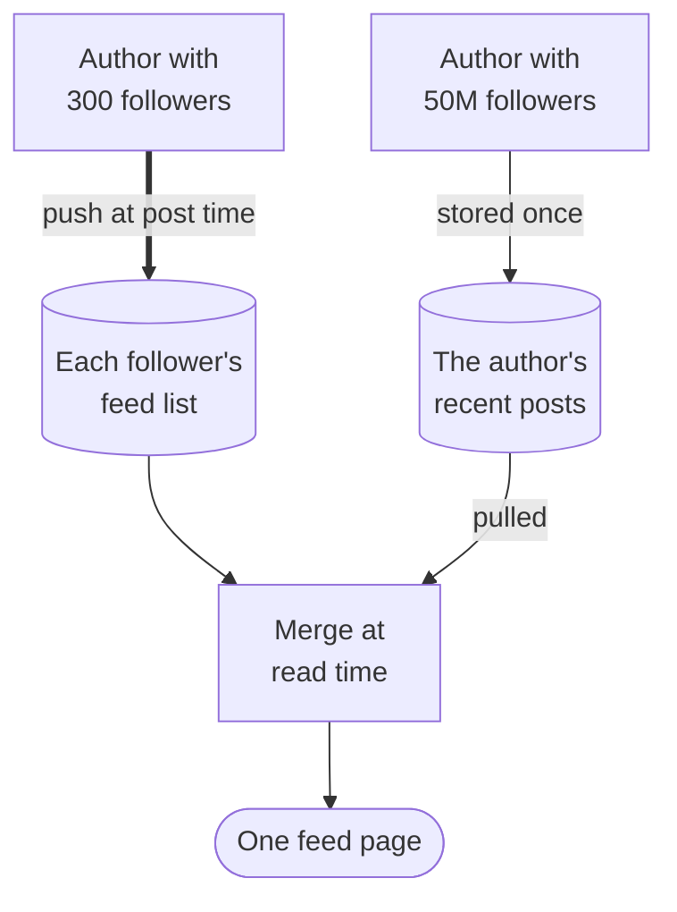
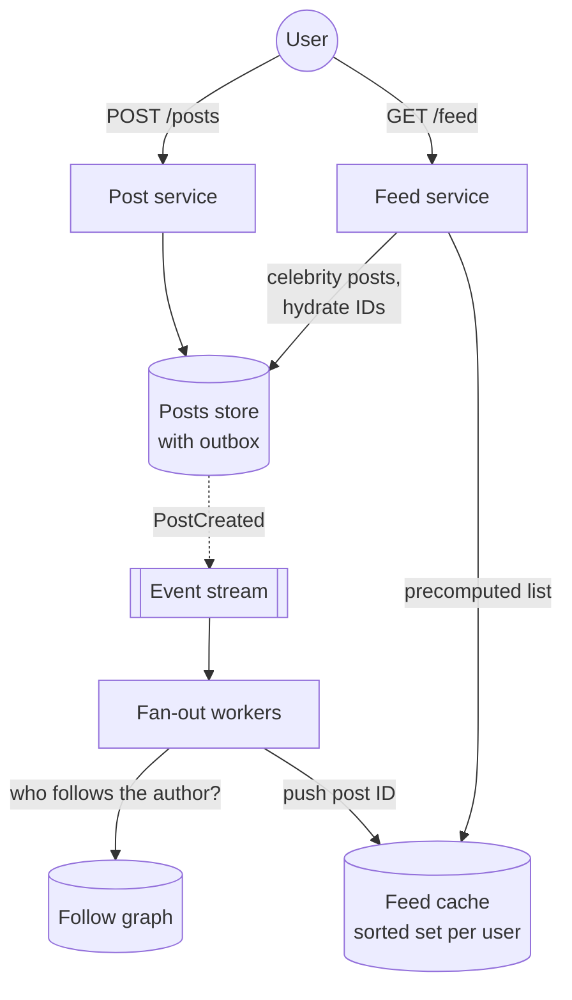
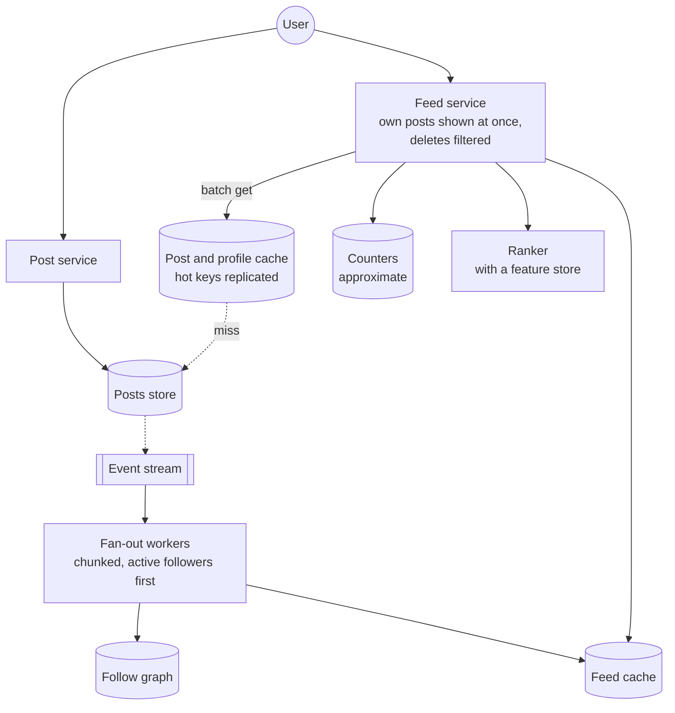

**Requirements.** Functional: users post (text, images); follow others; see a feed of followed users' posts, newest or ranked first, with pagination. Out of scope for v1: ads, deep ranking ML, comments (mention). Non-functional: feed loads under 200 ms; new posts appear within a few seconds (eventual consistency is fine); highly available; handles celebrity accounts with tens of millions of followers.

Amber marks the non-functional requirements, each beside the operation it constrains. Grey is out of scope.



**Estimates.** 300M daily active users, each opens the feed 10 times a day = 3B feed reads/day ≈ 35,000/s average, 100,000+/s peak. Posts: 100M/day ≈ 1,200/s. Average user follows 200 accounts; a few have 50M followers. Read:write is about 30:1, so optimize reads. Fan-out on write costs 1,200 posts/s × 200 followers = 240,000 feed inserts/s, [a few Redis shards at about 100K operations/s each](#/design/learn/building-blocks/estimation-and-benchmarks). Storing a feed of 500 post IDs per user (8 bytes each) = 4 KB × 300M ≈ 1.2 TB raw, a few TB with Redis's per-entry overhead, which is cache-sized across a cluster of tens to a hundred shards.

**API.** REST over HTTPS for the mobile and web apps. Every call carries the user's session token, so "me" comes from the token, never from a parameter a client could change.

```text
POST   /v1/media  {content_type, size}
  -> 201 {media_id, upload_url}
POST   /v1/posts  {text, media_ids}   Idempotency-Key
  -> 201 Post
DELETE /v1/posts/{id}                   -> 204
GET    /v1/feed?cursor=&limit=20
  -> 200 {items: [Post], next_cursor}
GET    /v1/users/{id}/posts?cursor=&limit=20
  -> 200 {items: [Post], next_cursor}
PUT    /v1/me/following/{user_id}       -> 204
DELETE /v1/me/following/{user_id}       -> 204
```

The feed returns posts already [hydrated](#/design/learn/data/normalize-or-denormalize) with their author, media and counts, so one request draws the page instead of one request per post:

```json
{
  "items": [{
    "id": "1790234567890123",
    "author": {
      "id": "u42", "name": "Ana",
      "avatar_url": "https://cdn.example/a/u42.jpg"
    },
    "text": "Sunset over the river",
    "media": [{"type": "image",
               "url": "https://cdn.example/m/9f1c.jpg",
               "width": 1080, "height": 1350}],
    "created_at": "2026-11-18T09:12:00Z",
    "like_count": 1204,
    "liked_by_me": false
  }],
  "next_cursor": "eyJ0IjoxNzkwMjM0NTY3ODkwMTIzfQ"
}
```

- **[Cursor pagination](#/design/learn/networking/pagination-offset-vs-cursor), never offset:** new posts arriving at the top would shift every offset, and the user would see repeats. The cursor is opaque (base64 of the last item's position), so the server can change what's inside it. For a ranked feed it points into the candidate list ranked when the session opened, cached for a few minutes, so scrolling never reshuffles posts already seen.
- **Pull to refresh** asks only for what's newer than the top post on screen: `GET /v1/feed?newer_than=<post_id>`.
- **Media is uploaded first,** straight to object storage with a [pre-signed URL](#/design/learn/building-blocks/presigned-url-uploads); then the post names its `media_ids`. A post naming media that hasn't finished uploading gets `409 media_not_ready`. Empty posts, or text over 5,000 characters, get `400`.
- **Posting is idempotent.** The app makes an `Idempotency-Key` when the user taps Post, so a retry on a flaky network can't publish twice.
- **Follow is a `PUT` on the relationship,** so following twice is harmless and returns `204` both times; `DELETE` unfollows. An unknown user is `404`; someone who blocked you is `403`.
- **Caching.** The feed is personal, so its response is `Cache-Control: private` and never cached by the CDN. Media is the opposite: [file names never change content](#/design/learn/building-blocks/versioned-urls-and-purging), so images are cached for a year. `like_count` is approximate (deep dive 2).

**Data model.** `posts(post_id, author_id, text, media, created_at)` [sharded by `author_id`](#/design/learn/data/choosing-a-partition-key) (or by post ID); `follows(follower_id, followee_id)` with [an index in both directions](#/design/learn/data/secondary-indexes-on-sharded-data) (who do I follow; who follows me); `feed(user_id, [post_id...])` as a per-user list in Redis (a sorted set by time/score). Use [time-ordered IDs (Snowflake)](#/design/learn/building-blocks/snowflake-ids) so post IDs sort chronologically.



**The central decision: [fan-out on write vs fan-out on read](#/design/learn/data/fan-out-on-write-vs-fan-out-on-read).**

|  | Fan-out on write (push) | Fan-out on read (pull) |
| --- | --- | --- |
| On post | Write the post ID into every follower's feed list | Store the post once |
| On read | Read the precomputed list: very fast | Fetch recent posts from everyone you follow and merge |
| Cost | Write amplification: a 50M-follower account means 50M writes per post | Read amplification: 200 queries per feed load |
| Freshness | Delay while the fan-out finishes | Always fresh |
| Storage | Feed lists for every user, including inactive ones | Minimal |

**Hybrid (the answer to give).** Push for normal users (cheap, reads are fast). For celebrities above a threshold (say 100K followers), don't fan out; at read time, merge the user's precomputed feed with recent posts from the few celebrities they follow. Also skip fan-out for inactive users (no login in 30 days): they rebuild the feed on return.



**High-level design.**

1. Post service writes the post to the posts store and publishes a `PostCreated` event ([via outbox](#/design/learn/reliability/the-outbox-pattern), so it's never lost).
2. [Fan-out workers consume the event](#/design/learn/building-blocks/message-queues-and-streams), look up followers (paginated from the follow graph), and push the post ID into each follower's feed cache, in batches, partitioned by follower.
3. Feed service handles `GET /feed`: reads the user's feed list from Redis, merges in celebrity posts, [hydrates post IDs into full posts](#/design/learn/data/normalize-or-denormalize) (batch get from a post cache/store, plus author profile and counts), applies filtering and ranking, and returns a page with a cursor.
4. Media goes to object storage [behind a CDN](#/design/learn/building-blocks/cdns-and-edge-caching) (see the video question).



**Deep dives.**

1. **Hot celebrity fan-out.** Fan-out jobs for large accounts are chunked and processed by many workers; prioritize active followers first. The hybrid model avoids the problem for the largest accounts altogether.
2. **Hydration cost.** A feed page needs 20 posts + authors + like counts. Cache post bodies and profiles aggressively ([cache-aside](#/design/learn/building-blocks/cache-aside), [hot keys replicated](#/design/learn/building-blocks/hot-keys)), fetch with batch gets, and keep counters in a separate fast store with approximate counts.
3. **Ranking.** Simple version: reverse chronological. Better: score = recency × affinity × engagement predicted by a model, computed at read time on a few hundred candidates, with features from a feature store. Say you'd start chronological and add ranking behind a flag, measuring engagement.
4. **Consistency.** A user's own post should appear in their own feed immediately ([read-your-writes](#/design/learn/data/read-replicas-and-replication-lag)): insert it locally on post, don't wait for the fan-out. Deletes and unfollows need cleanup: filter at read time using a tombstone check rather than rewriting millions of lists.
5. **Cache failure.** Feed lists are a derived cache; if lost, rebuild from the follow graph and recent posts (the pull path). [Keep this fallback tested](#/design/learn/reliability/graceful-degradation).

**The design after the deep dives.** Green marks what they added or changed.



**Wrap-up.** Metrics: feed latency p99, [fan-out lag](#/design/learn/building-blocks/backpressure-and-consumer-lag) (post creation to last follower write), cache hit rate, queue depth. Scale levers: shard feed cache by user, add fan-out workers, cap feed length at a few hundred entries and fall back to pull for deeper scroll.
