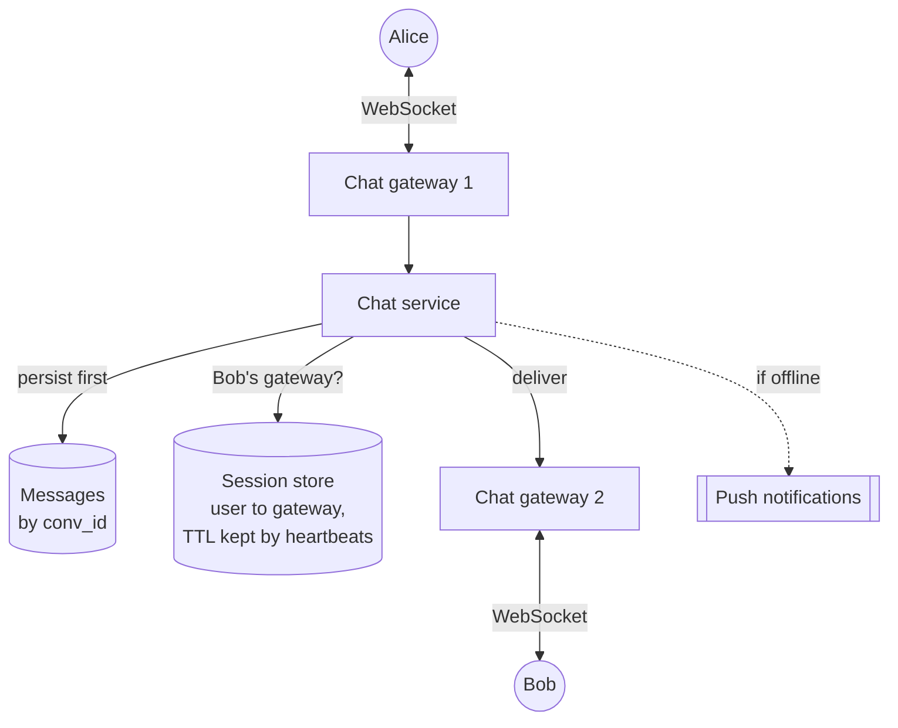
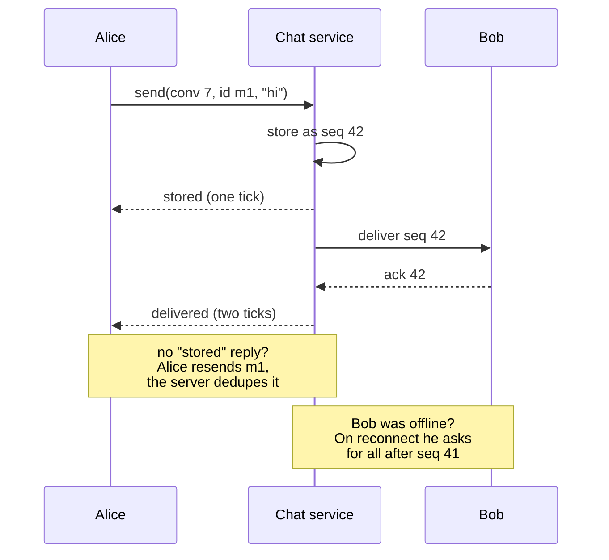
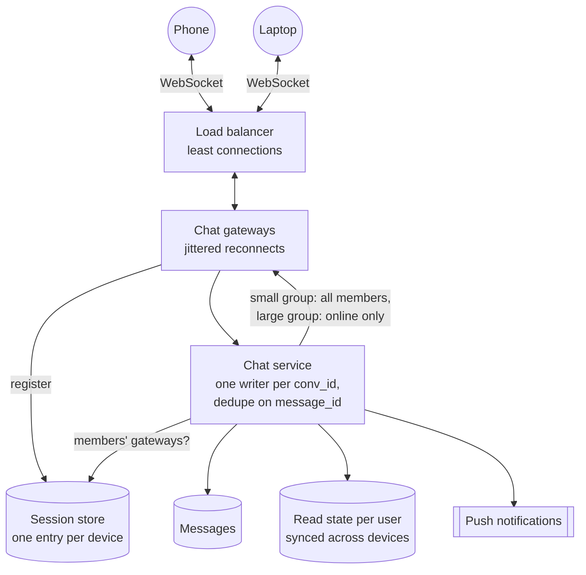

**Requirements.** Functional: one-to-one and group chat (up to, say, 500 members); real-time delivery; message history; delivery and read receipts; offline users receive messages when they return; online presence. Out of scope for v1: voice/video, end-to-end encryption (mention the trade-off with server-side features), large channels. Non-functional: delivery latency under 200 ms when both online; no lost messages; per-conversation ordering; highly available.

**Estimates.** 500M DAU, 40 messages sent per user per day = 20B messages/day ≈ 230,000/s average, 500,000+/s peak. At ~200 bytes per message, 4 TB/day, about 1.5 PB/year, so storage is large and must be partitioned. Concurrent connections: say 100M open sockets; at ~100K connections per gateway server, that's 1,000+ gateway servers.

**API and protocol.** Use a persistent **[WebSocket](#/design/learn/networking/websockets)** per client (bidirectional, low overhead), with HTTPS for non-realtime calls (history, media upload, login). Messages carry a client-generated `message_id` [for idempotency](#/design/learn/reliability/idempotency-keys). Events: `send(conv_id, message_id, body)`, `ack(message_id)`, `deliver`, `read(conv_id, up_to_id)`. Fallback to [long polling](#/design/learn/networking/long-polling) where WebSockets are blocked; push notifications (APNs/FCM) for offline devices.

**Data model.**

- `messages` partitioned by `conversation_id`, clustered by a time-ordered message ID: `(conv_id, message_id, sender_id, body, created_at)`. A [wide-column store](#/design/learn/data/wide-column-tables) (Cassandra/DynamoDB) fits: append-heavy, range-read by conversation, scales horizontally. [Partition key](#/design/learn/data/choosing-a-partition-key) `conv_id` keeps a conversation's messages together; for huge conversations bucket by time (`conv_id, month`).
- `conversations(conv_id, members, ...)` and `user_conversations(user_id, conv_id, last_read_id)` in a relational or key-value store.

**High-level design.**

1. Client opens a WebSocket to a **chat gateway**, which authenticates and registers `user_id → gateway_id` in a **presence/session store** (Redis) with a TTL [refreshed by heartbeats](#/design/learn/networking/heartbeats-presence-and-reconnects).
2. The sender transmits a message to its gateway. The gateway forwards it to the **chat service**, which assigns an ordered ID and persists it (and acks the sender: "stored").
3. The service looks up recipients' gateways in the session store and routes the message to each connected gateway, which pushes it down the socket. For offline recipients, it enqueues a push notification and the message stays in their inbox.
4. Recipients ack; the service updates delivery and read state.
5. When a client reconnects, it requests everything after its last seen message ID (sync by cursor) so nothing is lost.

One message, with the gateways left out:

**Deep dives.**

1. **Ordering.** [Guarantee ordering](#/design/learn/data/ordering-per-key) **per conversation**, not globally. Assign sequence numbers per conversation (a single writer per conversation via partitioning by `conv_id` on the chat service, or a per-conversation counter), and clients display by sequence. Time-ordered IDs alone drift with clock skew.
2. **Delivery guarantees.** [At-least-once](#/design/learn/reliability/delivery-guarantees) with idempotent handling: the client resends unacked messages with the same `message_id`; [the server dedupes on it](#/design/learn/reliability/deduplicating-consumers). [Store before delivering](#/design/learn/reliability/acknowledgements-and-redelivery), so a crash can't lose a message the sender saw acked.
3. **[Group chat fan-out](#/design/learn/data/fan-out-on-write-vs-fan-out-on-read).** For small groups, write one message and fan out delivery to each member's gateway at send time (read-time pull of history from the single stored copy). For large groups, deliver to online members only and let others sync on demand. Per-member inboxes (write per member) cost storage but make unread counts and sync simple; hybrid by group size.
4. **Presence.** Heartbeats every ~5–30 s; presence is "best effort": mark offline after missed heartbeats. Don't broadcast every change to every contact (a fan-out storm); send presence on demand or to active conversations only.
5. **Gateway scaling and failure.** [Gateways are stateful](#/design/learn/networking/scaling-websockets) (hold sockets), so use a load balancer with consistent hashing or [least connections](#/design/learn/building-blocks/load-balancing-algorithms), and spread reconnect storms with [jittered backoff](#/design/learn/reliability/retries-with-backoff-and-jitter) after a gateway dies. The session store is the routing table; if a gateway dies, entries expire and clients reconnect elsewhere.
6. **Multi-device.** Treat each device as a session; a message is delivered to all of a user's devices; read state syncs across them.

**The design after the deep dives.** Green marks what they added or changed.

**Wrap-up.** Metrics: end-to-end delivery latency, connection count and churn, undelivered backlog, reconnect rate. Mention end-to-end encryption: it removes server-side search and moderation and complicates multi-device sync, so it's a product decision.
